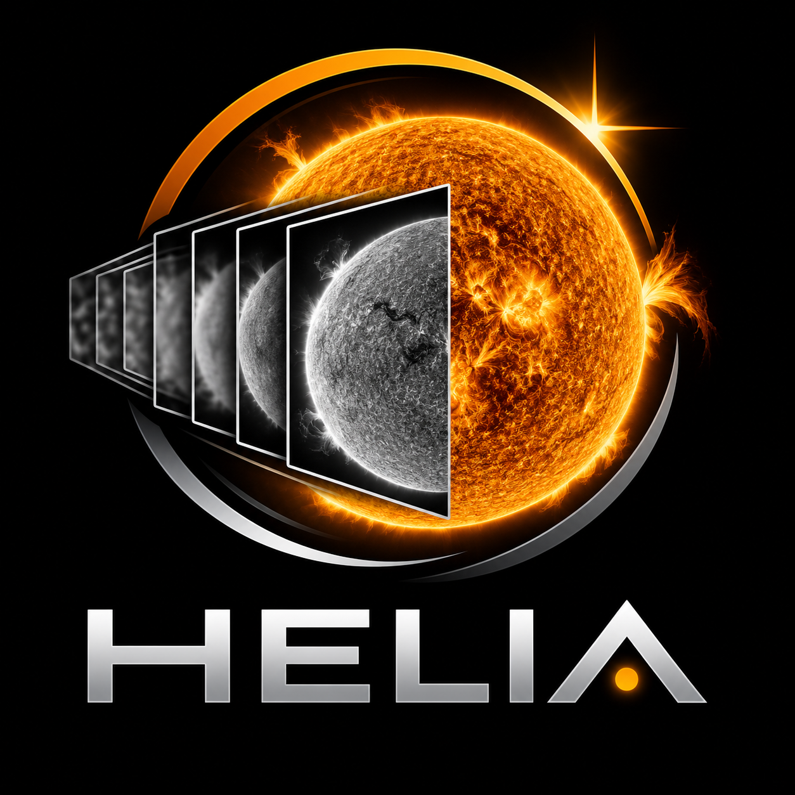

<p align="center">
  
</p>

# Helia

[](https://github.com/qisback/helia/actions/workflows/ci.yml)
[](https://qisback.github.io/helia/)
[](https://github.com/qisback/helia/releases)
[](LICENSE)

<a href="https://ko-fi.com/qisback"></a>

A modern, open-source solar lucky-imaging stacker for every computer.

Helia takes the video you capture of the Sun (SER, AVI, or MP4 and other
compressed video through the optional ffmpeg) and turns thousands
of seeing-blurred frames into one sharp image: it ranks frame quality, aligns
the disc globally and with a multi-point grid, stacks the best frames and
writes 16-bit TIFF, 8-bit PNG or FITS. It recognises the common solar filters from
the file name, picks sensible settings for them, sharpens the stack (wavelets,
unsharp mask or deconvolution, with a limb guard against ringing) and edits it
non-destructively, and can colour the result for sharing (the stack and FITS stay
mono, and FITS is the unsharpened stack unless you ask). It does the job of tools like AutoStakkert!, with
a modern interface, on Linux, Windows and macOS, on x86_64 and ARM.

## Support

Helia is free software. If it saves you time, you can buy me a coffee at [ko-fi.com/qisback](https://ko-fi.com/qisback).

<a href="https://ko-fi.com/qisback"></a>

## Dedication

Helia is dedicated to my daughter, the light of my life. Her middle name is
Helia, because she has an energetic spark. She has not stayed still since the
day she was born, which suits software whose whole job is catching the sharp
moments in something that never stops moving.

## Acceleration

Helia runs its heavy maths on whatever GPU you have, through
[wgpu](https://wgpu.rs):

| Platform | GPU API | Hardware |
|---|---|---|
| Linux | Vulkan, GLES fallback | AMD, NVIDIA, Intel, Raspberry Pi 4/5 |
| Windows | DX12, Vulkan | AMD, NVIDIA, Intel, Qualcomm |
| macOS | Metal | Apple silicon, Intel Macs |

With no usable GPU it falls back to a multi-threaded SIMD CPU path that gives
the same results. Optional machine-learning features (planned) run through
ONNX Runtime on CUDA, ROCm, DirectML, OpenVINO or CoreML, with experimental
Coral Edge TPU support.

## Status

Early development, released as pre-releases (below 1.0.0). The first milestone is
the stacking pipeline; see
the [roadmap](https://qisback.github.io/helia/roadmap/) for the plan.

**Feedback is welcome.** The app has a Feedback button (Ctrl+Shift+F) where you can
draw on a screenshot of the window and send a bug, feature request or question to
the Helia issue tracker, and `helia feedback` does the same from a terminal. Nothing is sent
until you press Send, and Helia has no telemetry. See the book's
[Sending feedback](docs/book/src/user-guide/sending-feedback.md) page.

## Documentation

The Helia book is at **<https://qisback.github.io/helia/>**: a user guide
(installation, quick start, capturing, the desktop app, the command line, the API, how
stacking works, GPU acceleration, sending feedback, troubleshooting), step-by-step
tutorials, reference pages and the roadmap. The source is in [`docs/book`](docs/book)
and the site is built with [Zensical](https://zensical.org/):

```sh
python3 -m venv .venv && .venv/bin/pip install -r docs/requirements.txt
.venv/bin/zensical serve
```

The CLI and API references are generated: run `cargo xtask docs` after changing
either.

## Download

Pre-releases are on the
[releases page](https://github.com/qisback/helia/releases), each with a `SHA256SUMS`
file and a software bill of materials:

| System | Get | Install |
|---|---|---|
| Windows 10 or 11 | `helia-<version>-x86_64-pc-windows-msvc-setup.exe` | run it; per user, no administrator needed. Not code-signed yet, so SmartScreen asks you to choose More info, Run anyway |
| Debian, Ubuntu, Raspberry Pi OS | `helia_<version>_amd64.deb` or `_arm64.deb` | `sudo apt install ./helia_<version>_amd64.deb` |
| Fedora and RPM systems | `helia-<version>-1.x86_64.rpm` or `.aarch64.rpm` | `sudo dnf install ./helia-<version>-1.x86_64.rpm` |
| Any Linux (glibc 2.35+) | `Helia-<version>-x86_64.AppImage` or `-aarch64.AppImage` | `chmod +x` it and run it |
| macOS | `Helia-<version>-macos.dmg` (Apple silicon), or build from source | build from source |

The plain `.tar.gz` and `.zip` archives are still published. Check a download with
`sha256sum -c SHA256SUMS --ignore-missing`. The
[installation page](https://qisback.github.io/helia/user-guide/installation/) has the steps, the
uninstall instructions and the Gatekeeper and SmartScreen notes.

## Building

```sh
cargo build --release
cargo run --release -p helia-cli -- --help
cargo run --release -p helia-gui
```

Needs a current stable Rust (see `rust-version` in `Cargo.toml`). On Windows,
install the Visual Studio C++ Build Tools first.

## Contributing

Helia is not accepting outside contributions yet: pull requests will be closed
until a contributor agreement is in place. Bug reports, questions and ideas are
welcome as issues. See [CONTRIBUTING.md](CONTRIBUTING.md).

## Supporting Helia

Helia is free software. If it helps your imaging, you can
support its development through the links in [FUNDING.yml](.github/FUNDING.yml).

## Copyright and licence

Copyright (C) 2026 Laurence Horrocks-Barlow.

Helia is free software: you can redistribute it and/or modify it under the
terms of the GNU General Public License as published by the Free Software
Foundation, either version 3 of the License, or (at your option) any later
version.

Helia is distributed in the hope that it will be useful, but WITHOUT ANY
WARRANTY; without even the implied warranty of MERCHANTABILITY or FITNESS FOR A
PARTICULAR PURPOSE. See the GNU General Public License for more details. The
licence text is in [LICENSE](LICENSE), unmodified.

Additional terms under section 7 of the GPL (7(b) and 7(c)) apply to Helia and
to every work based on it: the copyright line and the dedication above must be
preserved, and modified versions must be marked as changed and must not be
presented as the original or as made or endorsed by Laurence Horrocks-Barlow.
They are in [ADDITIONAL-TERMS.md](ADDITIONAL-TERMS.md), and are shown by the
About page and by `--version`. Every source file carries an SPDX header
and `REUSE.toml` covers the rest, following the
[REUSE specification](https://reuse.software/spec/); the IBM Plex fonts keep
their own copyright and the SIL Open Font License.

The methods Helia implements are cited in the manual's [References](docs/book/src/reference/references.md),
and other products are named only to say what they are, with no affiliation: see
[Credits, licences and trademarks](docs/book/src/reference/credits-and-trademarks.md). The licence and
provenance audit is in [docs/LEGAL-AUDIT.md](docs/LEGAL-AUDIT.md).

Helia is made by Laurence Horrocks-Barlow. If you are interested in anything else I make, visit [12hobbies.studio](https://12hobbies.studio).
