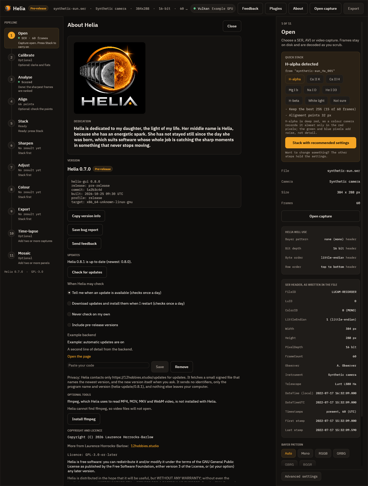

# Automatic updates: design

This page is the design of Helia's update system and the contract the other
pieces build on: the `helia-update` crate, the client in the app, the release
pipeline and the hosting. Valerian and Annora use the same crate unchanged.
The tracking issue is #296.

The code is in `crates/helia-update`. The core checks and fetches; the platform
appliers (`apply/`), the install-kind detection (`install.rs`) and the shared
client flow (`client.rs`) are in the same crate behind injected file, process and
HTTP traits, so they are tested without root, a network or a second process. The
GUI (`crates/helia-gui/src/update_ui.rs`) and `helia update`
(`crates/helia-cli/src/update.rs`) are thin shells over `client.rs`. See
[Per-platform apply strategy](#per-platform-apply-strategy).

## What the user gets

- Helia checks for a newer version when it starts, at most once a day, and when
  you choose **About > Check for updates** or run `helia update check`.
- The default mode is **notify only**: Helia tells you a version is out and where
  to get it. You can switch to **automatic** (download in the background, install
  when you next close the app) or **off**.
- The only thing Helia ever asks the network for is the update information, and
  later the file you agreed to download. See [Privacy](#privacy).

## Threat model

The update channel is the most valuable thing to attack in a desktop program: whoever
controls it runs code on every user's machine. The design assumes the attacker can
read and change network traffic, can replay old files, can compromise the web
server or its storage bucket, but does not hold the signing key. The attacks
considered are the ones the Update Framework (TUF) names
([specification](https://theupdateframework.github.io/specification/latest/);
Samuel, Mathewson, Cappos and Dingledine, "Survivable Key Compromise in Software
Update Systems", CCS 2010):

| Attack | What the attacker does | Defence here |
|---|---|---|
| Arbitrary software | Serves a malicious installer | The manifest is signed (Ed25519, minisign format) and lists each file's sha256 and size. A changed manifest fails the signature, a changed file fails the hash. |
| Rollback | Serves an older, genuinely signed manifest, to push users back to a vulnerable version | Every manifest has a `sequence`. The client remembers the highest it has accepted and refuses a lower one. A lower version number is also refused unless you asked for a rollback. |
| Freeze | Keeps serving the last manifest so users never see a fix | Every manifest has an `expires` date. After it, the client treats the information as untrustworthy and says so rather than "you are up to date". |
| Mix and match | Combines a genuine manifest for one app or channel with another's files | The manifest names its `app` and `channel`; both must equal what the source asks for. Every asset URL must be on an allowed asset host. |
| Endless data | Sends a huge or deeply nested file to exhaust memory | 64 KiB limit on the manifest, nesting depth 8, a 4 KiB limit on the signature, a declared size per asset that the download may not exceed. The parser is fuzzed. |
| Redirect or downgrade of transport | Redirects to another host, or to plain http | https only. Every redirect hop must stay on the list of allowed hosts for that request and be https. |
| Compromised storage | Replaces files in the bucket | Without the key it cannot produce a valid signature, so the client rejects them. This is the case the signature is for. |
| Key compromise | Steals the signing key | Two pinned keys allow rotation without an app update (see below). A stolen key still needs the right sequence and an unexpired date, but it can sign anything: it is the one failure the design cannot absorb. |

What this does not defend against: a compromised build machine (the signed file
is then malicious), and a user whose own clock is wrong (expiry uses the local
clock). The first is the release process's job (CI/CD security rules, the
security audit gate before every release); for the second a wrong clock makes the
client refuse, never accept.

Where this is lighter than full TUF, on purpose: there is one signing role and
two keys, not separate root, targets, snapshot and timestamp roles. Helia has one
publisher and a small manifest; the extra roles protect against compromise of
parts of a large repository. The manifest's `expires` plays the timestamp role.

## Manifest v1

One file per app and channel, with a detached signature beside it:

```text
https://downloads.12hobbies.studio/<app>/<channel>/manifest.json
https://downloads.12hobbies.studio/<app>/<channel>/manifest.json.minisig
```

```json
{
  "schema": 1,
  "app": "helia",
  "channel": "stable",
  "version": "0.8.0",
  "date": "2026-10-24T18:00:00Z",
  "sequence": 42,
  "expires": "2026-12-01T00:00:00Z",
  "min_supported": "0.7.0",
  "notes_url": "https://12hobbies.studio/helia/releases/0.8.0",
  "assets": [
    {"platform": "windows-x86_64", "kind": "nsis", "url": "https://downloads.12hobbies.studio/helia/0.8.0/Helia-0.8.0-setup.exe", "sha256": "<64 lower-case hex>", "size": 123456}
  ]
}
```

| Field | Meaning |
|---|---|
| `schema` | Format number. A client that reads schema 1 and meets 2 says "update the app by hand" and does nothing else. |
| `app`, `channel` | Must equal the source's. Characters `a-z 0-9 . _ -`, 1 to 64. |
| `version` | Semantic version offered. `stable` never carries a pre-release (`-rc.1`); `prerelease` may. |
| `date`, `expires` | UTC, `YYYY-MM-DDTHH:MM:SSZ` only. `expires` must be after `date`. Releases set it about 60 days ahead and the pipeline refreshes the manifest before then. |
| `sequence` | Integer, never decreases. The anti-replay counter. |
| `min_supported` | Optional. Installed versions older than this are flagged "required". |
| `notes_url` | Optional release notes page (https). |
| `assets[]` | `platform` is one of `windows-x86_64`, `linux-x86_64`, `linux-aarch64`, `macos-aarch64`, `macos-x86_64`. `kind` is one of `nsis`, `appimage`, `deb`, `rpm`, `targz`, `zip`, `dmg`. `url` is https on the allowed host. `sha256` is 64 lower-case hex digits, `size` is bytes, between 1 and 4 GiB. |

Rules the parser keeps: unknown fields are ignored, assets with an unknown platform
or kind are skipped (so newer manifests can add platforms for newer clients),
duplicate keys are an error, a known asset with a bad field is an error.

**The signature covers the exact bytes of `manifest.json`.** The client verifies
those bytes before parsing them and never re-serialises. The release tool writes the
file once, signs it, and uploads both files unchanged.

## Signing and keys

Format: [minisign](https://jedisct1.github.io/minisign/). Public keys are 42 bytes
(algorithm, key id, Ed25519 key) and signatures are Ed25519 over the BLAKE2b-512
hash of the file, with a second signature covering a trusted comment. Verification
uses the permissively licensed `minisign-verify` crate (MIT); signing is done with
`ed25519-dalek` (BSD-3-Clause) and `blake2` (MIT or Apache-2.0) in the release tool
only. Legacy unhashed signatures are refused.

**Two pinned keys.** An update source lists one or two public keys; a signature
from either is accepted. The first is the current key. The second is empty until a
rotation.

**Rotating the key** (planned rotation, or after suspected exposure):

1. Generate the new key pair; store the secret key in the secret store.
2. Release app version N whose pinned list is `[old, new]`. Sign it with the old key.
   Users who update to N now trust both.
3. Wait until the oldest version you still support is N or later (use
   `min_supported`), then sign manifests with the new key.
4. Release N+1 with the pinned list `[new]` and retire the old key.

If the old key is stolen, step 2 cannot be trusted for users who have not updated; the
fix is a clearly announced manual download of version N. That is why the key must
be kept off build machines except at the signing step.

**Where the keys live.** The release key pair is generated by the owner's
coordinator and stored in bao at `claude-automation/release-signing/helia`, with the
fields `secret_key`, `public_key` and `key_id`. The public key is pinned in exactly
one file, `crates/helia-update/src/pinned_keys.rs` (`PINNED_KEYS`), which holds the
release key (id 5725F88D0DF42020); `KEYS_ARE_PLACEHOLDER` is `false`.
The release workflow refuses to publish while that flag is `true`.

The signing step needs the secret key and nothing else. The shape for CI/CD (to be
created by the owner or the coordinator, not by this change): a narrow AppRole (or a
just-in-time grant) with read on `claude-automation/release-signing/helia` only,
used by the one release job that signs, which writes `secret_key` to a mode 0600
temporary file, runs `helia-manifest sign`, and deletes the file. Build jobs get no
access. The key is never passed on a command line or printed. Valerian and Annora get
their own paths.

## Channels

| Channel | URL path | Who gets it |
|---|---|---|
| `stable` | `/helia/stable/` | everyone by default; never a pre-release version |
| `prerelease` | `/helia/prerelease/` | users who opt in; may offer `-rc.N` and `-beta.N` |

A pre-release user is offered the final version when it ships (`0.9.0` is newer than
`0.9.0-rc.1` in semantic version precedence). Helia has 0.x versions, which are all
"pre-release" in the app's own wording, but they are on the `stable` channel in the
update system: the channel says how the release is meant to be consumed, the
version number says how mature it is.

## Client state machine

```text
           +-----------+  due or asked   +----------+
           |   Idle    |---------------->| Checking |
           +-----------+                 +----------+
                 ^                         | fetch manifest + .minisig
                 |                         v
   up to date /  |   +-------------- verify (size, signature, app, channel,
   error shown   |   |                expiry, sequence, pre-release rule)
                 |   v
           +-----------+   mode = notify   +-----------+
           | Available |------------------>|  Notice   |  (user decides)
           +-----------+                   +-----------+
                 | mode = automatic, or user chose "download"
                 v
           +-------------+  verify size + sha256   +--------+
           | Downloading |------------------------>| Staged |
           +-------------+  (resumes after a drop)  +--------+
                                                        | apply on exit / user chose "restart now"
                                                        v
                                                   +----------+  first start of the new version
                                                   | Applying |-----> health flag (below)
                                                   +----------+
```

`Checking` is `Updater::check`. It updates `last_check` even on failure, so a down
server is not hit again until the next interval. `Available` carries the verified
`Update`. `Downloading` is `Updater::download`, which resumes from a partial file
with an HTTP `Range` request and starts again from zero if the server ignores
`Range`. `Staged` is recorded in the state file so that "install on restart" survives a
restart.

Errors are shown in plain words (what happened, why, what to do). A check that fails
never blocks start-up: it runs in a background thread with a timeout.

## Per-platform apply strategy

`install::detect` decides the install type from the platform and the running
executable: `uninstall.exe` beside the program (Windows installer, per user unless the
folder is under Program Files), `$APPIMAGE` naming an existing file, a program under
`/usr` (not `/usr/local`) owned by `dpkg -S` or `rpm -qf`, `$FLATPAK_ID`, or an
`X.app/Contents/MacOS` path. `apply::apply` then does, as built:

| Platform and kind | Strategy |
|---|---|
| Windows, NSIS installer (`nsis`), per user | Copy `helia-gui.exe` and `helia.exe` to `<local data>/helia/previous/<version>`, then start a hidden PowerShell helper (script passed as `-EncodedCommand`, so no quoting) that waits for this process to end, runs `<installer> /S /D=<install folder>`, restores the copied programs if the installer exits non-zero, and starts the GUI again (not from the CLI). The GUI starts the helper only when it exits or the user presses **Close Helia and install**, never while it is running. Settings live in the user's profile, outside the install directory, so they are untouched. An all-users install needs administrator rights, so only the installer's path is shown. |
| Linux AppImage (`appimage`) | Re-hash the staged file (size, sha256, ELF header), copy it to `.<name>.new`, flush, `chmod 755`; copy the running file to `.<name>.previous.tmp` and rename it to `<name>.previous`; rename `.<name>.new` over `<name>`. The path always holds a complete file; any failure removes the temporary files and leaves the install as it was. Done at once (the running process keeps its open file), the new version starts next time. |
| Linux deb and rpm installs | Never replace package-manager files. The downloaded, verified file is left in the staging folder and the command is shown: `sudo apt install <file>` or `sudo dnf upgrade <file>`. See [apt and dnf](#apt-and-dnf-repositories). |
| Linux tar.gz (`targz`) and Windows zip (`zip`) | Notify only, with the download link: the app cannot know where the user unpacked it. |
| macOS dmg (`dmg`) | Replace the `.app` bundle from the mounted image, keep the old bundle as backup. Gatekeeper and notarisation limits: an update downloaded by the app carries no quarantine flag, but an unsigned or un-notarised bundle will still be refused on first launch on recent macOS. Until the app is signed and notarised the Mac path is notify only. Mac testing is deferred. |

## Rollback

The applier keeps the previous version (the `.previous` AppImage, the previous
bundle, or for Windows the two programs copied before the installer ran). The crate holds the **start-up health flag** in the state file:

1. Early in `main` the app calls `BootHealth::begin_start(version)`. If the same
   version started before and never reported healthy, a failure counter goes up.
2. After the window is up and the app has run a few seconds, it calls
   `mark_healthy()`, which clears the flag and the counter.
3. If the counter reaches 2 (so the third start of that version),
   `rollback_target()` names the version recorded by `record_applied(from, backup)`.
   The app restores the backup (AppImage and bundle are a rename away) and calls
   `rolled_back()`. The startup after a rollback does not check for that same version
   again until the user asks.

The user can also ask for a rollback explicitly. Only then is a manifest whose
version is older than the installed one honoured (`CheckOptions::allow_downgrade`),
and it must still be signed, unexpired and have a sequence at least as high as any
seen: a rollback is a new release of the older version, never a replayed manifest.

## Schema and migration policy

Implemented so far: the update settings (`update.conf`) and the GUI settings
(`gui.conf`) carry `schema=1`; a file with a higher number is read as far as it is
understood and never rewritten, with a notice. There are no project files in Helia
(captures are read-only inputs; presets are small JSON files read tolerantly), and no
format has changed yet, so the migration step below has nothing to do today. The
policy for when one does:

Settings and project files migrate forward only. Each file carries its format
version. A newer app reads older files and rewrites them in the new format on first
save, keeping a copy of the old file with a `.pre-<version>` suffix. An older app
that meets a newer file refuses to open it and says which version wrote it, rather
than silently dropping fields. So an update never loses data, and a rollback leaves
the newer files alone and untouched (the copy made at migration is the way back).

## Plugins and add-ons

`UpdateSource { app, channel, manifest_url, pinned_keys, manifest_hosts, asset_hosts }`
is all a caller needs, so a plugin or a closed add-on (for example the remote-processing
add-on) uses the same code with its own private manifest URL, host allow-list and
keys. A plugin declares its source in `plugin.toml`; the plugin system (a separate
change) passes it to the crate. Plugin updates are never applied silently: the
default for them is notify only whatever the app's mode is, since a plugin runs with
the app's rights.

The crate depends on nothing Helia-specific: the Helia constants are in one small
module (`helia.rs`).

## Privacy

**In a source build**, and in any build that has no update backend (see
[The update backend](#the-update-backend-extension-point)), checking for an update sends **one request to download the
manifest and one for its signature**, to the update server named in the build
(`12hobbies.studio` by default, Cloudflare R2 later), and later, only if you or your
mode say so, one request (or several with `Range`, to resume) for the installer, from
the download hosts named in the build. Nothing else leaves your machine for updates.

The request headers are exactly: `Host`, `User-Agent: helia-update/<version>`,
`Accept: */*`, and `Range` when resuming a download. There are no cookies, no
`Authorization`, no identifiers of any kind: no machine id, no installed version, no
operating system or language, no counter. A test sends a request to a local server and
fails if any other header appears (`only_the_documented_headers_are_sent`). The server
necessarily sees your IP address, as any web server does; the project keeps no log of
it beyond what the host keeps for operating the service. The check can be turned off
in the settings; in that mode Helia never contacts the host unless you run
`helia update check` yourself.

**With an update backend.** An official installer build plugs a backend into the hook
described below. What such a build adds to the requests above is documented with that
build, outside this repository, and printed on its About page under Privacy. The
rules the public code enforces on any backend are the same: a bearer token is sent
**only to the one host the backend names for it**, never on a manifest or signature
request and never after a redirect to another host; it is not part of `UpdateSource`
(which is `Debug` and `Clone`), it is redacted in `Request`'s and `AssetAccess`'s `Debug`
output, and a redirect to a host outside the allowed list is refused, as always. The
no-cookies and no-identifiers statements above stay true for every build without a
backend.

Tests that hold this: `a_backend_opens_its_host_sends_its_bearer_only_there_and_leaves_a_notice`
(`client_tests.rs`) fails if a bearer reaches any other host or any manifest request,
`a_file_on_an_allowed_host_downloads_without_a_backend` fails if a source build sends a
bearer at all, and the unchanged header test above.

## The update backend (extension point)

Public Helia checks the signed manifest, verifies it, compares versions and tells you when a
newer version exists; it downloads and applies an update from the hosts the build allows. The
ready-made installers are sold at 12hobbies.studio, so a source build cannot fetch them by
itself: it says that an update exists and links to the Helia page. An official installer build
plugs in one extra piece through a small hook, `helia_update::backend::UpdateBackend`, installed
once at start-up with `backend::install`. A source build has no backend and every method below
has a no-op default.

| Method | What it is for | Default |
|---|---|---|
| `extend_source` | adjust the source, for example open one more download host | unchanged |
| `asset_access` | a bearer for the download, its one host, and how a 401 or 403 is explained | none: a plain download |
| `refresh` | read what the backend needs after each check; may leave a notice for the next start | nothing, never fresh |
| `gate` | may this version be downloaded on its own, and what to tell the user | no opinion (below) |
| `status`, `panel`, `panel_action` | a line for `helia update status` and a settings block for the About page, as plain data the GUI draws; a button press is passed back | none |
| `cli` | one extra `helia` command (name, one-line help, a function that parses its own arguments) | none |
| `build_line`, `privacy` | a line for `--version` and the About build record; a sentence for the Privacy paragraph | none |

With no opinion from a backend the client decides by one rule: the file may be fetched only if
its address is on a host the source allows (`asset_hosts`). A signed manifest that lists a file
elsewhere is accepted, because the signature is good, but the file is never requested: the check
reports `note` and `link` (the Helia page) and `auto_download` is false, and `Client::download`
refuses with `Error::Refused`. This is also what a source build does with the official manifest.



Code map: `backend.rs` (the trait and its data types), `client.rs` (`Client::backend`, the gate, the
panel and action calls), `check.rs` (`Updater::with_access`), `download.rs` (the bearer on the asset
request, 401 and 403 through `AssetAccess::refusal`), `traits.rs` (`Request::bearer`,
`Request::bearer_host`), `ureq_http.rs` (the per-hop rule). `helia-cli` adds the backend's command
before it parses the command line, and `helia-gui` draws `Client::backend_panel`.

How a backend is linked in is the one build-time step outside this tree. The binaries call
`store_backend::install()` behind `#[cfg(feature = "store")]`; that feature and its optional
dependency are not declared in this repository, so `cargo build`, `cargo test --all-features` and every
public workflow never have them. The tooling of an official build adds both to a throw-away copy of
the tree and builds that copy. The workspace lint table lists the feature name so rustc knows it is
intended.

## Hosting

An update source has two lists of allowed hosts: **`manifest_hosts`** (where the
manifest and its signature may come from) and **`asset_hosts`** (where the files may
come from). Each request, and every redirect hop of it, must be https and on the list
for that request; a file host cannot serve the manifest and the manifest host cannot
serve files. A manifest whose asset URL is on another host is accepted, because it is signed, but
that file is never requested: see [The update backend](#the-update-backend-extension-point).

Helia's lists are set when the app is built, from environment variables read with
`option_env!` (see `crates/helia-update/src/helia.rs`):

| Variable | Default |
|---|---|
| `HELIA_UPDATE_BASE_URL` | `https://12hobbies.studio/updates` (manifest at `<base>/helia/<channel>/manifest.json`) |
| `HELIA_UPDATE_MANIFEST_HOSTS` | `12hobbies.studio` while the base URL is the default, else the base URL's host |
| `HELIA_UPDATE_ASSET_HOSTS` | `github.com,objects.githubusercontent.com` while the base URL is the default, else the base URL's host |

The default build (Helia 0.8.0) uses the fallback hosting; setting `HELIA_UPDATE_BASE_URL` to the R2 address switches to R2 with no code change.

Three set-ups use the same code:

- **Target:** everything on `downloads.12hobbies.studio` (Cloudflare R2).
- **Fallback, the default for 0.8.0 (R2 follows):** base
  `https://12hobbies.studio/updates`, manifest hosts `12hobbies.studio`, asset hosts
  `github.com,objects.githubusercontent.com` (the files are GitHub release assets,
  which redirect to the second host).
- **End-to-end test:** base `http://127.0.0.1:<port>`, both lists `127.0.0.1`. Plain
  http is allowed only when the base URL starts with `http://127.0.0.1`
  (`helia::allow_loopback_http()`), so a release build can never take http.
  A script serves a signed test manifest and asset from a local HTTP server and runs
  a build configured this way against it; the same script runs on Linux (AppImage
  path) and on Windows (NSIS, silent).

A closed add-on sets its own hosts at build time. Uploading to the bucket is part of
the release pipeline (ci-cd), not this crate.

## Release steps

1. The release workflow builds the assets as for any release.
2. Compute the manifest:

   ```text
   helia-manifest build --app helia --channel stable --version 0.8.0 --sequence 42 \
     --base-url https://downloads.12hobbies.studio/helia/0.8.0/ \
     --notes-url https://12hobbies.studio/helia/releases/0.8.0 --expires-days 60 \
     --min-supported 0.7.0 \
     --asset windows-x86_64:nsis:dist/Helia-0.8.0-setup.exe \
     --asset linux-x86_64:appimage:dist/Helia-0.8.0-x86_64.AppImage \
     --out manifest.json
   ```

   The sequence is the previous one plus one (read it from the live manifest).
3. Sign: `helia-manifest sign --manifest manifest.json --secret-key-file "$KEYFILE"`
   (or `HELIA_UPDATE_SECRET_KEY_FILE`). The key is written to a mode 0600
   temporary file from the secret store for this step and deleted after. The tool
   never prints it. The reference `minisign -S` produces a signature the client
   accepts too.
4. Verify as a client would: `helia-manifest verify --manifest manifest.json --key helia.pub`.
5. Upload the assets first, then `manifest.json`, then `manifest.json.minisig`
   (so a client never sees a manifest whose files are missing).
6. Refresh the manifest (same version, new `date`, `expires`, `sequence`) at least
   every 30 days, so `expires` never lapses on a quiet period.

`helia-manifest` is a binary of the `helia-update` crate (feature `sign`), not an
`xtask` command, because Valerian, Annora and the ci-cd release scripts need it
without a Helia checkout. `helia-manifest keygen-for-tests` makes throwaway keys for
tests and for the placeholder; never use its output for a release.

## apt and dnf repositories

**Recommendation: publish a signed apt and dnf repository on the same R2 bucket
(for example `https://downloads.12hobbies.studio/helia/apt/` and `.../rpm/`) for deb
and rpm users, rather than notify-only and rather than GitHub Pages.** Reasons:

- The deb and rpm users are exactly the ones the self-updater cannot touch. With a
  repository they get updates through `apt upgrade` and `dnf upgrade` with the rest of
  their system, with no code in Helia, and with the distribution's own signature
  checking.
- It is the same host and bucket as everything else: one allow-list, one place to
  monitor, no second hosting service.
- Notify-only for these users means a banner and a manual download every release.

What the repo already produces (`packaging/linux`): `helia_<version>_amd64.deb` and
`arm64.deb` from `build-deb.sh`, and `helia-<version>-1.x86_64.rpm` and
`aarch64.rpm` from `build-rpm.sh`, built from one staged tree and checked by
`verify-packages.sh`. Pre-release versions already sort correctly in the deb
(`0.5.0~rc.1`).

Effort, in steps rather than days (measured only by what exists; the work is in
the pipeline, nothing in the app):

| Step | What | Size |
|---|---|---|
| Repository key | A separate OpenPGP key (apt and rpm use GPG, not minisign); owner decision, stored like the minisign key | an owner decision, then 1 step |
| apt metadata | `apt-ftparchive` (ships with apt) or `reprepro` to make `Packages`, `Release`, `InRelease` for `amd64` and `arm64`, signed | one script, about 60 lines |
| dnf metadata | `createrepo_c` to make `repodata/`, then sign `repomd.xml` | one script, about 40 lines |
| Release workflow | Run both scripts over the new packages plus the previous ones (a repository holds history), upload to R2 after the assets | one job added to `release.yml` |
| Docs | Two lines to add the repo and key to the Installation page | a page edit |
| Test | A container job that adds the repo from a local copy and installs and upgrades | one CI job |

That is one release-pipeline pull request and one docs page, so it belongs to the
release-pipeline issue (#293),
after the first manifest release. The pieces that need an owner decision are the GPG
key and its storage.

## What is tested

`cargo test -p helia-update` (see the crate's `tests`): tampered manifest bytes
(a flipped bit anywhere), bad and missing signature, signature by an unpinned key,
key rotation (either of two keys accepted, a third not), downgrade refused unless
explicit, replayed old sequence refused (also after a restart, from the state file),
expired manifest refused, manifest for another app or channel refused, pre-release on
stable refused, newer schema reported, oversized and deeply nested input refused,
unknown fields and kinds tolerated, plain http refused, an asset on another host listed but never fetched,
redirect to another host refused (in memory and with the real client), a man in the
middle serving a modified manifest under the old signature refused, the exact request
headers, a truncated download detected and resumed with a `Range` request, a server
that ignores `Range`, a sha256 mismatch discarded, more data than declared discarded,
a backend's bearer sent to its one host only, a refused download explained by the backend,
the notice a backend leaves, the signing tool end to end, and a known-answer signature made by the reference
minisign tool. The parser and verifier are also a `cargo-fuzz` target
(`fuzz/fuzz_targets/update_manifest.rs`), run nightly with the other fuzz targets and
by the release security gate, which lists its targets from `fuzz/fuzz_targets`.

## References

- The Update Framework specification: <https://theupdateframework.github.io/specification/latest/>
- Samuel, Mathewson, Cappos and Dingledine, "Survivable Key Compromise in Software
  Update Systems", ACM CCS 2010.
- Minisign: <https://jedisct1.github.io/minisign/>
- Semantic Versioning 2.0.0: <https://semver.org/>
- Howard Hinnant, date algorithms (public domain): <https://howardhinnant.github.io/date_algorithms.html>
