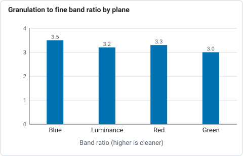
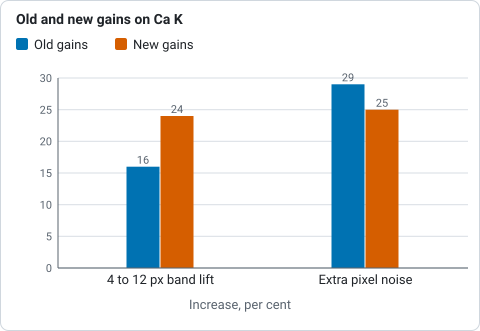

# Calcium K

**Goal:** a violet picture of the Ca II K network and plage from a calcium K
capture.

> **How far this is tested.** Two real captures through a Ca K filter, from the
> same afternoon: a colour camera (`15_36_42.avi`, 1920 x 1080, 2 arcsec per pixel)
> and a mono one (`15_44_48.avi`, soft and over-exposed). They are the same band:
> the limb darkening matches (0.68 of the centre at mu 0.3 in both) and all three
> colour planes darken alike, which broad-band light would not do. The measurements
> are below; nothing here is a grain of the K network, because the captures are
> soft, so look at your own picture.

**You need:** a capture through a Ca II K filter (393.4 nm), with `CaK` in the file
name or folder (`CaK_session/capture.ser` works). Ca K is at the violet edge of
what a sensor sees and the line is faint, so the signal is weak and the noise is
the problem.

## Settings

Press **Ca II K** on the Quick stack card, or use `--preset cak`. The preset
recommends:

* the **blue channel** for a colour camera, because the blue pixels are the ones
  that see 393 nm (a mono camera has only one channel). On the real capture the
  brightest plane (levels 1.43 : 1.16 : 1.00 for blue : red : green; the red dye
  leaks violet, the green does not) had a granulation-band to fine-band ratio of
  3.5, against 3.2 for the luminance, 3.3 for red and 3.0 for green, so blue is
  right. Helia reads red and blue from the filter in the file name; with no hint
  it calls the dimmer of the two blue, which is wrong for Ca K, so put `CaK` in
  the name (or `--bayer bggr`);
* **30 per cent of the frames**, a few more than for H-alpha, to average the noise
  down;
* **gentler sharpening**: wavelet gains 1.70, 2.80, 2.00, 1.40 with higher noise cuts
  (3.0, 1.5, 0.8, 0.2) and a short deconvolution of 8 iterations. Sharpening
  noise only makes a prettier mess.



*Ratio of the granulation band to the fine band for each plane of the colour Ca K capture, measured on the real capture.*

```sh
helia stack cak_001.ser -o cak.tif --preset cak --sharpen wavelet
helia stack cak_001.ser -o cak-negative.png --preset cak --sharpen wavelet --invert
```

The second command inverts before colouring, which makes a negative; it shows
filaments and prominences well, and some people prefer it for calcium. Try both.

Frames kept (6 to 60 per cent) and alignment points (24 to 128 px, 90 arcsec is
44 px here) moved the picture by under 3 per cent; more frames lower the noise
(the ratio of the fibril band to the fine band rose from 8.3 at 6 per cent to 9.5 at
60), so 30 per cent stays. The new gains lift the 4 to 12 px band by 24 per cent
against 16 per cent for the old ones, for 25 against 29 per cent more pixel noise.



*Gain in the 4 to 12 px band and extra pixel noise for the old and the new wavelet gains, measured on the real captures.*

## Tips

* **Exposure and gain:** the line is faint, so light is the constraint. Keep the
  exposure short enough to freeze the seeing and raise the gain until the
  histogram sits at about 50 to 70 per cent of full scale; many frames beat few
  long ones. See
  [Exposure, gain and bit depth](../user-guide/capturing.md#exposure-gain-and-bit-depth).
* **Do not push the wavelets.** If the picture looks processed, lower layer 1 and 2
  gains first.
* **Ca H** (`--preset cah`) takes the same settings and a slightly redder violet, so
  a K and H pair can be told apart.

Related: [Colour presets](../reference/presets-table.md).
