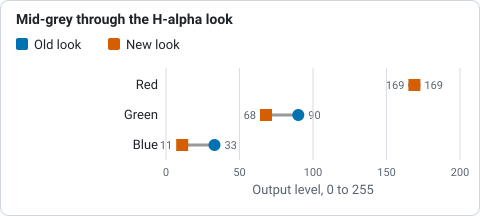
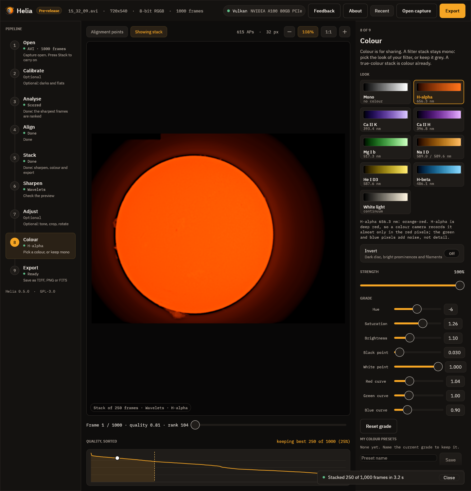
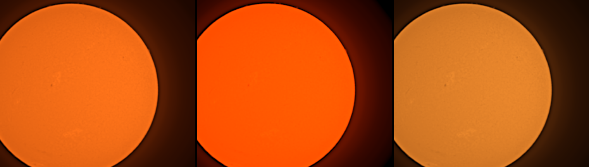

# Colour grading your band

Each band has a look (H-alpha orange-red, calcium violet and so on). The look is a
starting point: here you make it yours. A **grade** adds hue, saturation, brightness
(gamma), a black and a white point and a curve for each of red, green and blue, with
a live preview, and it is saved as a named colour preset. The band look is kept; with
every grade control at its neutral value the picture is exactly the look.

**The capture.** `15_32_09.avi`, H-alpha, full disc, 250 of 1,000 frames kept, with
the [recommended wavelets](sharpening-like-registax.md).

## The new H-alpha look

Several users found the old H-alpha pale and cream, not the red-orange of the line.
The look is now closer to the common H-alpha palette: gains red 1.0, green 0.45, blue
0.10 (before the tone gamma; it was 1.0, 0.85, 0.60), exponents 0.70, 0.90, 1.40. A
mid-grey now maps to RGB 169, 68, 11, where it was 169, 90, 33. The same look is
used in `helia lut` and the colour tables, so a table saved for another program
matches.



*RGB value a mid-grey maps to in the old and the new H-alpha look, as printed on the page.*

## Step by step, in the app

1. Stack the capture and go to **Colour**. **H-alpha** is already chosen. Under
   **Grade** are eight controls, each with a slider and a number box you can type
   into; the preview follows every one.
2. **Hue** (-180 to 180 degrees) turns the colours round the colour wheel. -6 is a
   little more red, +8 a little more yellow-green.
3. **Saturation** (0 to 2): 0 is grey, 1 is the look as it is, 1.25 is stronger.
4. **Brightness** is a gamma on the picture before the look (0.3 to 3); above 1
   brightens the mid-tones.
5. **Black point** and **White point** say which stack values become black and full
   brightness. Raise the black point a little (0.03) to deepen the sky.
6. **Red, green and blue curves** (0.3 to 3) lift or lower the mid-tones of one
   channel. Blue 0.9 warms the picture, blue 1.2 cools it.
7. Name it under **My colour presets**, press **Save**, and press its name to use it
   again. **Reset grade** returns to the look. Presets are small readable JSON files
   in `$HELIA_COLOUR_PRESETS`, else a `colour-presets` folder beside the edit
   presets (`%APPDATA%\helia\colour-presets` on Windows,
   `~/.config/helia/colour-presets` elsewhere).



## What you should see

The look as it is (left), the warm grade of step 7 (hue -6, saturation 1.25, gamma
1.1, black 0.03, red 1.05, blue 0.9; middle) and a cool one (hue 8, saturation 0.85,
gamma 0.95, blue 1.2; right):



## The same on the command line and in the API

```sh
helia stack 15_32_09.avi -o ha.tif --preset ha \
  --grade hue=-6,sat=1.25,gamma=1.1,black=0.03,r=1.05,b=0.9
helia stack 15_32_09.avi -o ha.tif --preset ha --grade "Warm Ha"   # a saved colour preset
```

The API takes the same text as `grade` in the job configuration. The grade is
written into the file's history (`grade hue=-6,...`), and a colour table saved from
the app carries it. A true-colour stack (`--colour true`) has no look to grade, so
`--grade` is refused there.

The keys are `hue` (-180 to 180), `sat` (0 to 2), `gamma` (0.3 to 3), `black` (0 to
0.9), `white` (0.1 to 1, at least 0.05 above black) and `r`, `g`, `b` (0.3 to 3).

## How it works

The grade is part of the colour table, so the CPU and the GPU agree (the parity
tests cover it) and a `.cube` or `.lut` includes it. The mono value is first mapped
through black, white and gamma, then through the band look, then the per-channel
curves; hue rotates the colour about the grey axis and saturation scales its
distance from its luma (Rec. 709 weights).

## Troubleshooting

* **A flat orange disc.** Saturation or the red curve is too high and the red
  channel clipped. Lower them, or raise the white point.
* **Black sky is not black.** Raise the black point a little.
* **The saved table looks different in another program.** A table is the grade at
  the time you saved it; save again after changing it.
* **"grade: ... out of range".** The ranges are listed above.
