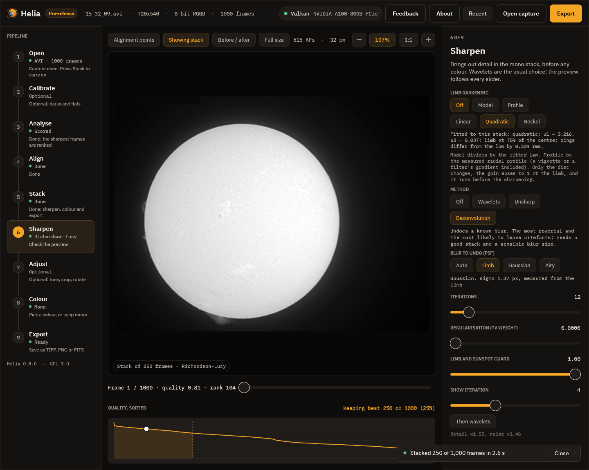
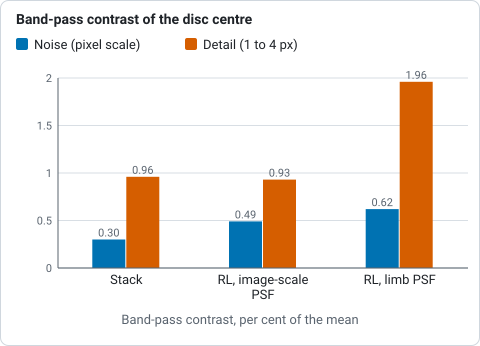
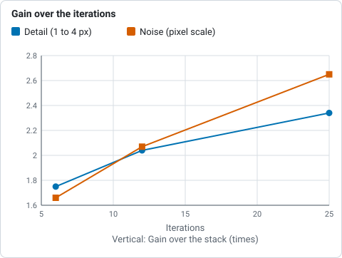
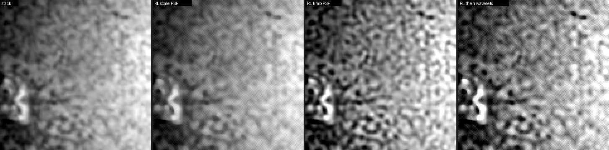
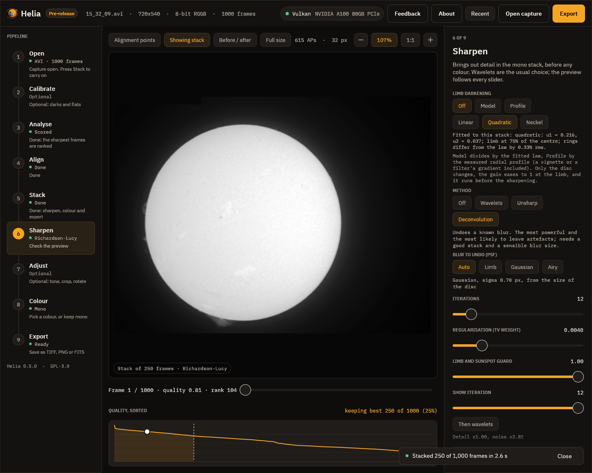

# Deconvolution

Richardson-Lucy deconvolution tries to undo the blur of the telescope, the seeing
and the stack. It is the strongest sharpening Helia has and the one most likely to
mostly amplify noise. This tutorial shows the controls that let you see what it is
doing: the blur it undoes (measured from the limb, or chosen), the iteration
scrub, the regularisation, the before / after split and the warning that says when
the result is mostly noise.

**The capture.** `15_32_09.avi`, H-alpha, full disc, 250 of 1,000 frames kept
(the same stack as [Sharpening like RegiStax](sharpening-like-registax.md)).

## Step by step

1. Stack the capture, go to **Sharpen** and press **Deconvolution**.
2. Under **Blur to undo (PSF)** choose **Limb**. Helia measures the edge of the Sun
   in your stack: the limb is a step from disc to sky, so what the picture makes of
   it is the blur. The line under the chips says what it found, here *Gaussian,
   sigma 1.68 px, measured from the limb*. The image scale alone suggests 0.70 px,
   which is below what this stack really holds. (`helia measure --psf stack.fits`
   prints both.)
3. Set **Iterations** 12 and **Regularisation (TV weight)** 0. Press **Before /
   after** and **1:1**.
4. Drag **Show iteration** from 0 up. 0 is the original; each step is one more
   iteration. Detail arrives in the first few and then slows while the noise keeps
   rising: pick the iteration where the picture stops improving and set
   **Iterations** to it. The export always runs all of them.
5. Read the line under the controls: `Detail x2.04, noise x2.07`. Detail is the 1
   to 4 pixel band after over before, noise the pixel-scale band. Real detail
   keeps the first at least as high as the second. If the noise rises and the
   detail does not, a warning appears in red.
6. Press **Then wavelets** and set the layers under **Wavelets**: deconvolve first,
   then lift what is left and cut the noise it raised (a denoise of 0.3 on layer 1).

## What you should see

Band-pass contrast of the disc centre (per cent of the mean, `helia measure` bands):

| | noise (pixel scale) | detail (1 to 4 px) |
|---|---|---|
| Stack | 0.30 | 0.96 |
| RL, PSF from the image scale (0.70 px), TV 0.004 | 0.49 | 0.93 |
| RL, PSF from the limb (1.68 px), TV 0, 12 iterations | 0.62 | 1.96 |

*Contrast of the disc centre in two bands for the stack and two deconvolutions, from `helia measure`.*

Over the iterations (limb PSF, TV 0) the gains are detail x1.75 and noise x1.66 at
6, x2.04 and x2.07 at 12, x2.34 and x2.65 at 25.

*Detail and noise gains of Richardson-Lucy with the limb PSF at 6, 12 and 25 iterations, from the figures printed under the table above.*

## The warning

A result is flagged when the noise gain is at least 1.4 and more than 1.5 times the
detail gain. The known case is the clipped-red H-alpha: the scale's PSF gives
detail x0.98 and noise x1.64 here, x1.00 and x2.81 on the earlier stack of the same
capture, and on calcium K x1.2 against x4.9. The warning also appears when the
residual (the result blurred by the PSF, minus the picture) is below the noise
level of the picture, which means the iterations are fitting the noise. The same
check runs in `helia stack` and `helia edit` (a `check:` line and a `warning:`) and
in the API (`summary.sharpen_check`).

## Choosing the order

Either order is allowed; we recommend **deconvolve, then wavelets**. Deconvolution
assumes a blur plus noise, and wavelets applied first change both. After it, a
wavelet layer 1 with denoise removes the pixel noise it raised. Measured on four
stacks the two orders lift the 1 to 4 px band within about 10% of each other; on
calcium K and white light wavelets first then deconvolution left 8 to 14 times
more pixel noise than deconvolution first then wavelets with a denoise. On the
command line `--sharpen rl --wavelets registax:l1=100/0.1/0.3,...` runs the
deconvolution first.

## Troubleshooting

* **The red warning.** Fewer iterations, measure the PSF from the limb instead of
  the image scale, or follow with wavelets with denoise. On a faint line (calcium)
  use a regularisation of 0: TV 0.004 made the noise worse on every stack tried
  (calcium K noise x3.8 against x1.0 at TV 0).
* **"No clear limb to measure".** The frame shows too little of the edge: choose
  **Gaussian** and a sigma of 1.5 to 3.
* **Rings round sunspots or at the limb.** Keep the guard at 1.
* **H-alpha limb.** It is a fringe of spicules, not a sharp edge, so the measured
  blur is larger than the telescope's; judge by the iteration scrub.
