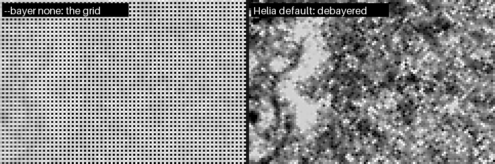

# Fixing a Bayer grid

**Symptom:** the stacked picture is covered by a fine grid or chessboard, with
neighbouring pixels alternating between bright and dark.

**Cause:** a colour camera records one colour per pixel in a repeating 2 x 2
pattern (a Bayer mosaic). The pictures must be demosaiced before they are
stacked. If a file says it is mono although the pixels are a mosaic, a stacker
that trusts the header stacks the mosaic itself.

The picture shows the same 120 x 80 pixel patch of a real capture, magnified, once
read as mono and once as Helia reads it by default:



Behind a narrow-band filter such as H-alpha the grid is stark, because the blue
pixels receive almost no light.

## Helia usually fixes it for you

For a SER file that says mono, Helia measures the four pixel positions of a 2 x 2
cell on the disc in a few frames. If they differ in the way a colour-filter array
would make them, it says so and debayers. Check what it decided:

```sh
helia info bayer-sample.ser
```

```text
Header, as written in the file
  ColorID:           0 (MONO)
  PixelDepth:        8 bit
  FrameCount:        631
  ...

Helia will use
  Bayer pattern:     RGGB           (detection)
  Bit depth:         8 bit          (header)
  Byte order:        not used (8-bit) (header)
  Row order:         top to bottom  (header)

Mosaic check (2x2 pixel positions, share of full scale)
  means:             79.6%  77.6%  77.4%  0.3%
  spread:            135.0% over 5 frame(s)

warning:  The SER header says mono (ColorID 0), but the frames hold a Bayer mosaic that looks like RGGB: ...
```

Read the second list: the Bayer pattern is `RGGB` and its source is `detection`,
so the header was overruled by the pixels. The four numbers are the average
brightness at the four positions of a cell. Here one position is 0.3 per cent while
the others are about 78 per cent: the blue pixel of an H-alpha capture, which sees
almost nothing. In the app the same message is the **Check this** card on the
[Open step](../walkthrough/01-open.md).

If a stack that you made with an older Helia shows the grid, stack it again.

## If it still shows, or the colours are wrong

Tell Helia what you know:

```sh
helia stack capture.ser -o out.tif --bayer rggb    # force a pattern
helia stack capture.ser -o out.tif --bayer none    # it really is mono
```

In the app, use the **Bayer pattern** buttons at the foot of the Open step: Auto,
Mono, RGGB, GRBG, GBRG, BGGR. The list above them then shows `override` as the
source.

* **Red and blue swapped.** The mosaic says which diagonal is green but not which
  of the other two pixels is red. Helia settles it from the layout a SharpCap
  sidecar states, the colour the filter passes, the camera model, and finally by
  taking the dimmer of the two as blue. If you stack a single channel (H-alpha takes
  red) a wrong pick matters, and the result looks like noise: try the other pattern
  of the same family, RGGB or BGGR, GRBG or GBRG.
* **A mosaic too faint to see.** If the four positions are within 2 per cent of each
  other the data is called mono; between 2 and 5 per cent Helia cannot tell and
  uses the sidecar's colour space if there is one. Give `--bayer` yourself.
* **An upside-down picture** is a different problem: `--flip-rows` (or **Bottom to
  top** under *Row order*), and give `--bayer` for the picture after the flip.

More: [Troubleshooting](../user-guide/troubleshooting.md#a-grid-or-chessboard-in-the-stack-a-bayer-mosaic-that-was-not-removed).
