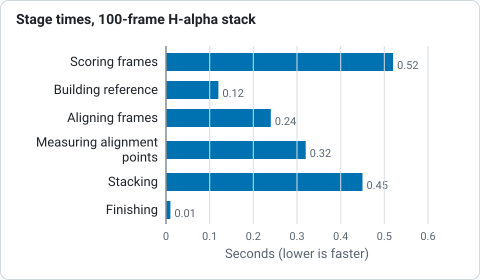
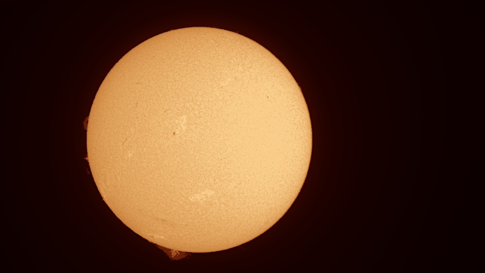
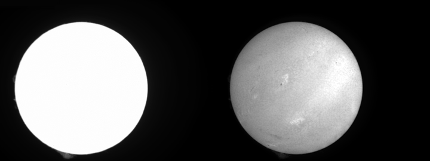
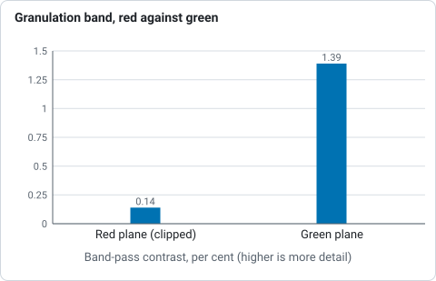
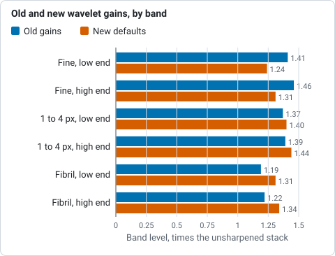
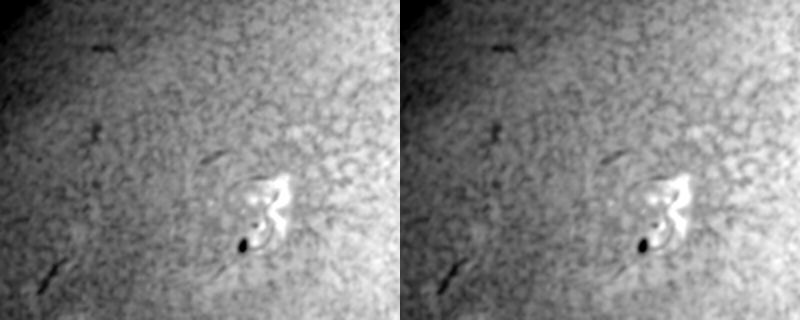

# H-alpha, full disc

**Goal:** a sharp, orange full-disc picture of the chromosphere from an H-alpha
capture, as a 16-bit TIFF.

**You need:** a SER (best) or AVI of the full disc, a few hundred frames or more,
with the filter in the name (for example `2026-10-19_Sun_Ha_001.ser`). See
[Capturing for Helia](../user-guide/capturing.md).

## In the app

1. Open the file (Ctrl+O). Helia reads the filter from the name, so the Quick
   stack card says *H-alpha detected* and offers the red channel and the best 25
   per cent of the frames. If the red plane is clipped (see below) Helia stacks
   the green plane instead and says so. If the name does not say, press **H-alpha**.
2. Press **Stack with recommended settings**.
3. On **Sharpen**, the recommended H-alpha wavelets are already on (gains 1.4,
   3.2, 2.4, 1.6; noise cuts 3.0, 1.0, 0.5). Use **Before / after** to check
   they help, and ease a gain down if the grain looks coarse. To sharpen as in
   RegiStax, see [Sharpening like RegiStax](sharpening-like-registax.md).
4. On **Colour**, H-alpha is already selected. Try **Invert** for prominences.
5. **Export** a **TIFF 16-bit**.

The pictures for each step, from a real capture, are in the
[walkthrough](../walkthrough/index.md).

## On the command line

```sh
helia stack disc-sample.ser -o sun-ha.tif --preset ha --sharpen wavelet
```

This is the real output for a 100-frame, 1920 x 1080, 16-bit SER on a laptop with
a mid-range GPU (the times are that machine's, not a promise):

```text
input:    SER 1920x1080 16-bit, 100 frames
note:     The header flag says big-endian, but the pixel data only makes sense as little-endian; Helia reads it that way.
backend:  GPU (NVIDIA GeForce RTX 3050 Ti Laptop GPU (Vulkan, DiscreteGpu))
settings: H-alpha (chosen); red channel, keep 25%, alignment points 64 px
edit:     1. wavelet sharpen, 6 layers (dyadic from layer 1), default filter, amount/sharpen/denoise 100/0.063/0.30 100/0.148/0.10 100/0.118/0.05 100/0.077/0.00 100/0.000/0.00 100/0.000/0.00
[   0.8s] building reference
[   1.2s] aligning frames
[   1.9s] stacking
[   2.1s] sharpening and editing
[   2.1s] colourising
[   2.1s] writing
frames:  100 total, 25 kept, 50 registered
points:  615 of 2135 alignment points active
align:   phase correlation (limb fit not confident enough, 0.42); confidence mean 1.00, least 1.00 (sampled)
masked:  196 x 20 at (0, 0), flat in the result
disc:    centre (788.4, 553.1), radius 447.2 px
detail:  stack 0.00106 vs best single frame 0.00115 (0.92x)
sharpened: detail 0.00137 after the edits, 0.00106 before (1.29x)
noise:   finest-layer sigma 0.00017 before, 0.00001 after the edits
timing:  scoring frames 0.52s, building reference 0.12s, aligning frames 0.24s, measuring alignment points 0.32s, stacking 0.45s, finishing 0.01s (total 2.18s)
wrote:   sun-ha.tif
```



*Seconds spent in each stage of the 100-frame, 1920 x 1080 H-alpha stack, from the `timing:` line of the real output above.*

Reading it:

* **settings** is what Helia chose and why. `--preset ha` gives the red channel, 25
  per cent of frames and the orange look.
* **masked** is the burned-in timestamp it found and kept alignment off.
* **align** says whole frames were aligned by phase correlation because the limb fit
  was not confident (the disc is not entirely in the frame, or the limb is soft). It
  is a normal outcome; see [Align](../walkthrough/04-align.md).
* **sharpened** is Helia's detail measure, about 1.29 times higher after the
  wavelets, with the finest-layer noise much lower.

The result, reduced in size:



## A clipped red plane

H-alpha lights the red pixels of a colour camera, and an exposure long enough to
show the prominences clips them: on the owner's real captures (ZWO ASI482MC, 2022 and
2026) 92 to 100 per cent of the red pixels of the disc sit at one value, so the red
stack is a flat white disc. The green pixels pass a little of the line, 40 to 60 per
cent of scale, and carry the filaments, plage and fibrils. Helia looks at a few
frames, sees the plateau, and stacks the green plane (`channel:` in the output
names it); name a channel with `--channel` to override. Lowering the exposure or
gain until the red plane is no longer flat gives the best picture.



Measured on `15_37_19.avi` (the granulation band of `helia measure`, which on an
H-alpha disc reads the fine chromospheric mottle): red 0.14 per cent, green 1.39
per cent.



*Granulation-band contrast of the stack from the red and the green plane of `15_37_19.avi`, from `helia measure`.*

## Sharpening, measured

The preset wavelets were re-measured on four real H-alpha captures
(`helia measure`, 240 px disc-centre crop, the green plane). Against the old gains
(1.50, 1.45, 1.25, 1.05) the new ones (1.20, 1.60, 1.50, 1.10) leave the pixel
noise 14 points lower (fine band 1.24 to 1.31 times the unsharpened stack, was 1.41
to 1.46), the 1 to 4 px band the same or up (1.40 to 1.44 times, was 1.37 to 1.39)
and the fibril-scale band 10 points higher (1.31 to 1.34 times, was 1.19 to 1.22).
Layer 1 amplifies the noise most, so it is lifted least. The noise cuts changed
nothing measurable on these captures (cuts of 0 to 3 sigma on any layer moved the
bands by under 2 per cent).



*Band level as a multiple of the unsharpened stack for the old gains and the new defaults, ends of the ranges over four real captures, from `helia measure`.*



Frames kept and alignment point size matter little here: 5 to 60 per cent of the
frames changed the fibril band by under 10 per cent (more frames lower the noise by
up to 14 per cent), and point windows from 35 to 300 arcsec gave fibril contrast
within 5 per cent of each other, so the 25 per cent and 90 arcsec defaults stay.

## Limb and prominences

The limb fit is not thrown by prominences, but they and the red halo bias it a
little: the radius fitted on the red plane (where the prominences glow) is 0.3 to
2.6 px larger than on the green plane (0.1 to 0.6 per cent) on the four real
captures, so the fit is good to under a per cent either way and the limb-darkening
profile is best read from the green plane when red is clipped. Prominences are
outside the disc, so the alignment points stay on the disc unless you ask for
`--prominence-band PX`; 20 or 40 px added 19 to 28 per cent more points and left the
disc contrast unchanged (the disc is what the measure sees), so use it when the
prominences are the subject and check them by eye.

## If it is not right

* **A fine grid:** see [Fixing a Bayer grid](fixing-a-bayer-grid.md).
* **Soft:** keep fewer frames (`--keep 15%`) in good seeing, or look at the
  quality curve in [Analyse](../walkthrough/03-analyse.md).
* **Halos or grain after sharpening:** lower the gains, or see
  [Troubleshooting](../user-guide/troubleshooting.md#sharpening-left-halos-ringing-or-grain).
* **Prominences too faint:** add **Invert**, or a second export with stronger
  levels. Prominences and disc differ greatly in brightness; a single picture
  cannot show both fully (HDR compositing is on the [roadmap](../roadmap.md)).
