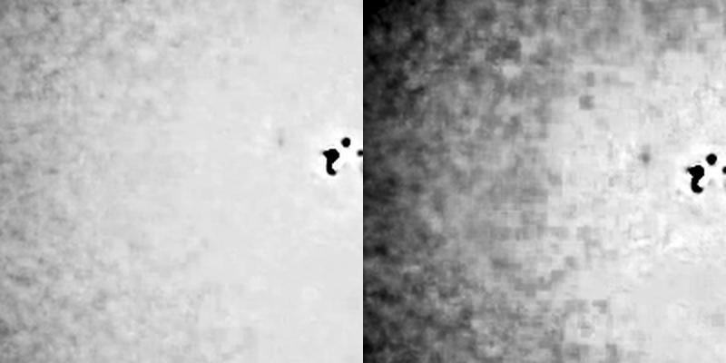

# MP4 from a phone or DSLR

**Goal:** a good first picture of the Sun from a video recorded on a phone held to
an eyepiece, or from a DSLR or mirrorless camera.

> **No output is shown here** because the machine used for this manual has no
> ffmpeg. The commands, options and messages are as documented elsewhere in this
> manual; the messages are listed in
> [Troubleshooting](../user-guide/troubleshooting.md#opening-captures).

## What to expect

An MP4 is compressed, and the compression throws away fine detail first, which is
exactly what stacking needs. Helia can stack it and the picture will be a big step
up from a single frame, but a raw SER or AVI from an astronomy camera keeps more.
See [When an MP4 is fine](../user-guide/capturing.md#when-an-mp4-is-fine). When you
open one, the Open step says so: *lossy 8-bit 4:2:0 video (h264): fine for quick
results, SER/AVI raw captures keep more detail*.

## 1. Install ffmpeg

Helia never bundles ffmpeg; it runs it when it is installed (version 4.4 or newer).

| System | Install |
|---|---|
| Windows | `winget install Gyan.FFmpeg`, then open a new terminal |
| macOS | `brew install ffmpeg` |
| Debian, Ubuntu, Raspberry Pi OS | `sudo apt install ffmpeg` |

Check with `ffmpeg -version`. See [Installation](../user-guide/installation.md#optional-ffmpeg-for-mp4-and-other-video).

## 2. Record well

* **Solar filter first.** Never point a phone or camera at the Sun without a proper
  solar filter over the front of the telescope.
* Lock exposure and focus, so the brightness does not wander. Record a minute or
  more, at the highest frame rate the phone offers, with the Sun fully in frame.
* Keep the phone steady (a clamp), and use a self-timer or remote so you do not
  shake it.
* Put the filter in the file name when you copy it off the phone: `sun_Ha_001.mp4`
  or `sun_white_001.mp4`. A phone names videos `VID_2026...mp4`, which tells Helia
  nothing.

## 3. Open and stack

In the app, open the file as for any other. A notice shows *Converting the video
with ffmpeg* with a percentage while the frames are decoded once to a cache
folder; afterwards scrubbing is as quick as for a SER file. The decoded frames are
uncompressed, so the cache needs room for the whole video; Helia checks first.

On the command line:

```sh
helia info sun_white_001.mp4
helia stack sun_white_001.mp4 -o sun.tif --preset white --sharpen wavelet
```

`helia info` is the quick test that ffmpeg is working. To use a drive with more
room for the decoded frames, add `--cache-dir /big/disk`.

## 4. Choose what to keep

* **Keep the recommended share** of frames to begin with, and compare with a
  smaller and a larger one on the quality curve ([Analyse](../walkthrough/03-analyse.md)).
  With a lossy video the sharpness measure partly ranks how the encoder behaved,
  so the best frames are less clear cut than in a raw capture.
* **Go easy on the sharpening.** Wavelets at the recommended values are fine;
  deconvolution will turn compression blocks into texture.

## Colour video

A phone video is already a colour picture. Helia stacks colour video as
luminance, or as the red, green or blue channel you choose (`--channel`, or the
Channel chips under **Advanced settings**). For a white-light video leave it at
luminance (`lum`) or choose green (`g`). The stack is mono, and the colour of the
finished picture comes from the look you choose; see
[Can it stack colour?](../user-guide/troubleshooting.md#questions).

### A Seestar video of the Sun

The Seestar app tints a solar video orange, and its exposure clips the red: on a
real one (`2025-09-17-161400-Solar.mp4`, 1080 x 1920, H.264) the disc reads red 254
(about half of the lit pixels flat at the limit), green 86 and blue 2. The blue is
empty and the red flat, so the luminance carries a flat component and only green
holds the detail. With no channel named, Helia decodes three early frames, finds
the clipped plane and stacks the green one (`channel:` says so). Measured by the
granulation band of `helia measure`: green 1.53 per cent, luminance 1.18, red 0.76
(blue is noise). The orange is the app's tone map, not the Sun's colour, and
`--colour true` is refused because a video is already demosaiced.



At 2.4 arcsec per pixel a granule (1.5 arcsec) is smaller than a pixel, so this video
shows sunspots and faculae, not granulation, whatever the settings.
