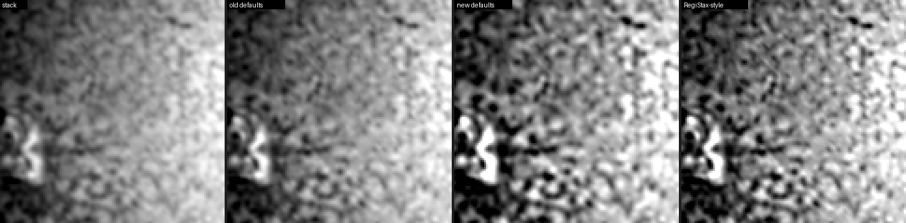
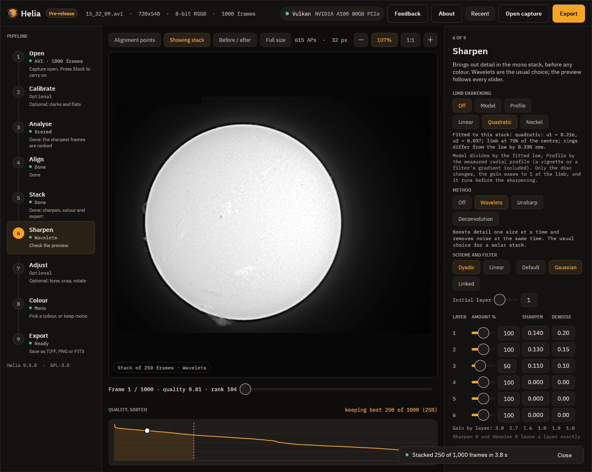
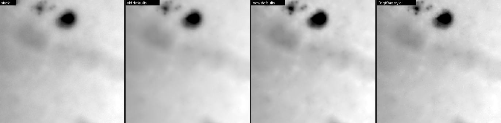

# Sharpening like RegiStax

> RegiStax is a trademark of its owner; Helia is not affiliated with it. See
> [Credits, licences and trademarks](../reference/credits-and-trademarks.md).

This recipe takes a real H-alpha capture, stacks it, and sharpens it with the
wavelet settings a RegiStax 6 tutorial would use, then shows what each choice
does and what to do if the result is soft, grainy or ringed. It uses the
RegiStax-style controls of the Sharpen step; if you are new to Helia's Sharpen
step, read [6. Sharpen](../walkthrough/06-sharpen.md) first, and if you want the
control-by-control mapping, [Coming from RegiStax](../user-guide/coming-from-registax.md).

**The capture.** `15_32_09.avi`: H-alpha, a colour camera, 720 x 540, 1,000
frames, full disc. Helia chose the filter from the file name, kept the best 25%
(250 frames) and stacked the plane that carries the signal (the red plane of this
camera is clipped, so Helia stacks the next one). Any capture of any filter works;
solar H-alpha and Ca K are the ones measured here.

## What you will get

A stack that looks soft becomes visibly crisp, on the same stack:



Over the disc-centre crop (`helia measure`), as the band-pass contrast, in per cent
of the mean:

| | pixel scale (noise) | 1 to 4 px (fibrils, mottling) | 4 to 12 px |
|---|---|---|---|
| Stack | 0.30 | 0.96 | 0.79 |
| Old recommended wavelets (gains 1.5, 1.45, 1.25) | 0.40 | 1.22 | 0.92 |
| New recommended wavelets | 0.62 | 2.17 | 1.62 |
| This recipe (RegiStax-style) | 0.72 | 2.05 | 1.23 |

The old defaults raised the 1 to 4 px band by a quarter, which is why a picture
looked soft. The recipe doubles it, and the noise (pixel-scale band) rises less
than the detail does. Noisier captures behave the same way: on the 2022
`15_20_57.ser` capture (a noisy H-alpha stack) the 1 to 4 px band goes from 2.02
to 4.97 against a noise rise from 1.56 to 4.44, which is why that capture needs
more denoise (see Troubleshooting).

## Step by step, in the app

1. **Open and stack.** Press **Open capture**, choose the file, press **Stack**
   with the defaults. The result takes a few seconds on a GPU.
2. **Go to Sharpen** (step 6). **Wavelets** is already selected, with the
   recommended values of the filter. Press **Before / after** and **1:1** in the
   toolbar so you judge at 100% with the stack on the left.
3. **Scheme and filter.** Choose **Dyadic** and **Gaussian**. Leave **Initial
   layer** at 1 and **Linked** off. (RegiStax tutorials for the Moon and planets
   use these too.)
4. **Layer 2 first.** Set **Amount** 100, **Sharpen** 0.13, **Denoise** 0.15. Layer
   2 holds the fibrils and the mottling, and is where the picture gains most.
5. **Layer 1.** Set **Amount** 100, **Sharpen** 0.14, **Denoise** 0.20. Layer 1
   carries the pixel noise, so give it more denoise than the others. If you see
   grain, raise the denoise before you lower the sharpen.
6. **Layer 3.** Set **Amount** 50, **Sharpen** 0.11, **Denoise** 0.10. This is the
   broader texture; half the amount is plenty.
7. **Leave layers 4 to 6 alone** (Sharpen 0). Raising them adds a halo and a
   washed look on a disc.
8. Look at the **Gain by layer** line: it should read about 3.0, 2.7 and 1.6 for
   layers 1 to 3. That is a firm, not an extreme, boost.
9. **Save the settings.** Type a name under **My presets** (for example "Ha like
   RegiStax") and press **Save**. Press the name to use them again, on any capture.



The same settings on the command line, from the capture or from a stack you
already have:

```sh
helia stack 15_32_09.avi -o ha.tif --preset ha \
  --wavelets registax:l1=100/0.14/0.2,l2=100/0.13/0.15,l3=50/0.11/0.1,filter=gaussian
helia edit stack.fits -o ha.tif --preset ha \
  --wavelets registax:l1=100/0.14/0.2,l2=100/0.13/0.15,l3=50/0.11/0.1,filter=gaussian
```

or in the API, in the job's `config`:
`"wavelets": "registax:l1=100/0.14/0.2,l2=100/0.13/0.15,l3=50/0.11/0.1,filter=gaussian"`.

## How the settings translate

| In RegiStax 6 | In Helia | Gain at the settings |
|---|---|---|
| Dyadic, Gaussian | Dyadic, Gaussian | |
| Layer 2: slider 100%, sharpen 0.130, denoise 0.15 | `l2=100/0.13/0.15` | 2.7 |
| Layer 1: slider 100%, sharpen 0.140, denoise 0.20 | `l1=100/0.14/0.2` | 3.0 |
| Layer 3: slider 50%, sharpen 0.110, denoise 0.10 | `l3=50/0.11/0.1` | 1.6 |

These are the values of the SharpCap guide's Jupiter example (see the
[sources](../user-guide/coming-from-registax.md#what-can-and-cannot-be-matched)),
used here on the Sun.

## Going further: gains of 10x and more

A very soft stack, or a high-resolution capture of a fine feature, sometimes needs
more. The range is there: at an amount of 100%, a sharpen of 0.5 is a gain of 26,
and 1 is a gain of 101, and an amount up to 200 doubles the reach. Do it one layer
at a time, with denoise to match. On this stack the settings
`l1=100/0.6/0.4,l2=100/0.5/0.3,l3=100/0.3/0.15` push the 1 to 4 px band to 20% of
the mean, which is far past what the Sun shows: noise has become detail. The
useful range on a real solar stack is a gain of 2 to 8 on layers 1 to 3; the high
end of the range is for stacks of fine, bright structure, and for experiments.

## Linear scheme

A linear scheme with step 0 keeps every layer at the same size: successive layers
then catch successively larger detail only because each smooths the last.
RegiStax users like it for control over the middle sizes. In Helia choose
**Linear**, **Initial layer** 1 and **Step** 0, and set, for example:

```text
registax:l1=100/0.20/0.15,l2=100/0.15/0.15,l3=100/0.13/0.10,l4=100/0.11/0.10,scheme=linear,initial=1,step=0,filter=gaussian
```

On the same stack that gives 1.00, 2.41 and 1.14 (pixel scale, 1 to 4 px, 4 to 12
px, per cent): a little more of the fine detail than the dyadic recipe and a
little less of the larger sizes (1.14 against 1.23).

## Troubleshooting

* **The picture is still soft.** Press **1:1** and **Before / after** first: at
  fit zoom a sharper picture looks softer than it is. Then raise the sharpen of
  layer 2 by 0.02 at a time. If layer 1 is doing nothing, set **Initial layer** to
  1 (not 2).
* **Grain or a "salt and pepper" look.** The noise of layer 1 is being boosted.
  Raise its **Denoise** (0.25, 0.30) before you lower the **Sharpen**. A noisy
  capture needs a higher denoise: the noisy 2022 capture above has about five
  times the pixel noise of this one.
* **Dark rings or bright halos at the limb or round a sunspot.** The boost is too
  high for the contrast there. Use **Model** limb darkening in the same step (it
  flattens the disc before the layers see it), lower the sharpen of layers 1 and
  2, or use a lower **Amount** for the layer.
* **A flat, washed look.** Layers 4 to 6 are boosted. Set their sharpen back to 0.
* **Sharper in the app than in the file.** The preview while you drag is made
  from a shrunk copy; let go and wait for it to be made again at full size, or
  switch on **Full size**. The file is always from the full-size stack.
* **Sharper in RegiStax for the same numbers.** The numbers carry over approximately
  (see the page on what can and cannot be matched). Raise the sharpen a little, or
  the amount above 100.
* **`error: wavelets: ...`.** The text of `--wavelets` is `registax:` then
  `key=value` items separated by commas: `l1=AMOUNT/SHARPEN/DENOISE`, `scheme`,
  `filter`, `initial`, `step`, `linked`. A layer needs at least the amount and the
  sharpen.

## On a faint line: Ca K

Calcium K is faint and noisy, so it takes a harder noise cut and a gentler boost.
The new Ca K defaults (gains 1.7, 2.8, 2.0, 1.4; noise cuts 3.0, 1.5, 0.8, 0.2)
raise the 1 to 4 px band from 0.088% to 0.104% of the mean (the plain stack to the
sharpened one) where the old defaults lowered it to 0.064%, and keep the pixel
noise at 0.048% against the stack's 0.115%:



Take the same RegiStax-style settings on this capture and the pixel-scale noise
comes back to the level of the stack (0.117% against 0.115%); a faint line wants a harder denoise
than a bright one.

## What was measured

Everything on this page is from `helia measure` on stacks made from the owner's
captures (`15_32_09.avi`, `15_37_19.avi`, `15_44_48.avi`) and the 2022 set
(`15_20_57.ser`), 25% of the frames kept, at the settings shown. The bands are the
band-pass contrast in the disc-centre crop; compare only like with like. The
captures and the numbers are checked in the real-data tests of the repository.
