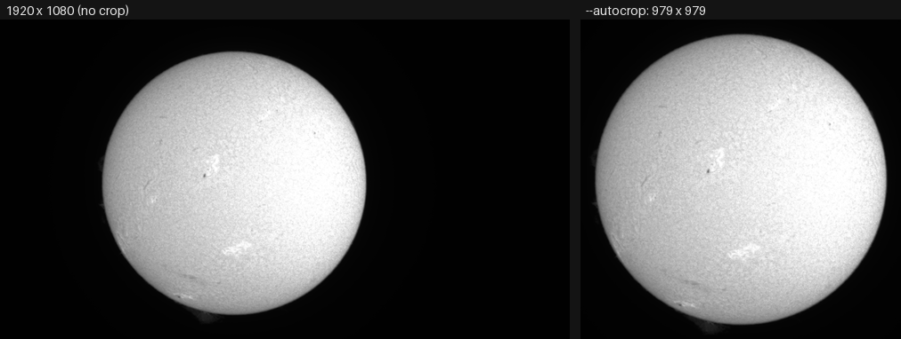
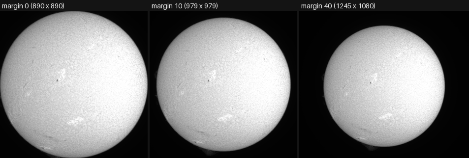
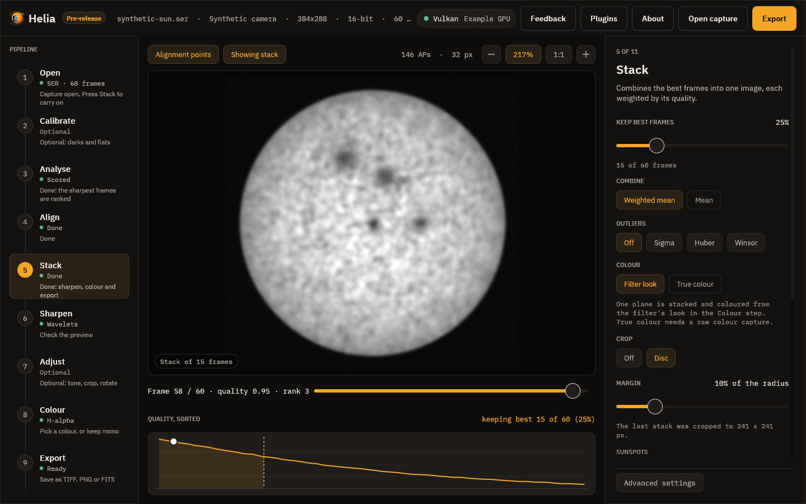

# Tutorial: crop the stack to the disc

**Goal:** a result that is a tidy square around the Sun, with a margin for
prominences, instead of a 1920 x 1080 frame that is mostly black sky, and the
same in every output format (FITS included).

**You need:** a capture with the disc, or most of it, in the frame. The reference
text is [Cropping to the disc](../user-guide/how-stacking-works.md#cropping-to-the-disc);
this is the worked example.

## The capture and why

`15_20_57.ser` from the 2022-07-17 set (ASI482MC, 1920 x 1080, 16-bit, 100 frames,
H-alpha although it was labelled sodium; see
#121). The disc is wholly in
the frame with a little sky all round and a faint prominence at its edge, which is
what you need to see what a margin does. A further capture, `14_42_57.avi`
(a disc larger than the frame), shows what happens when the disc is not so tidy.

## 1. Stack with `--autocrop`

```sh
helia stack 15_20_57.ser -o crop.png --preset ha --colour mono --autocrop
```

The summary gains a `crop:` line (and the `disc:` line beside it is now in the
cropped picture's pixels):

```text
limb:    quadratic: u1 = 0.472, u2 = 0.046; limb at 48% of the centre; rings differ from the law by 0.66% rms
crop:    979x979 from (299, 63), disc plus 10%
disc:    centre (489.5, 489.4), radius 444.6 px
wrote:   crop.png
```

Read it as: the result is 979 x 979 pixels, cut from the stack with its top-left
corner at x = 299, y = 63; the square is the disc plus 10% of the radius all round.
The check is arithmetic: the disc is 2 x 444.6 = 889 pixels across, and
889 x 1.10 = 978.1, which rounds up to 979. The disc now sits at (489.5, 489.3),
the middle of the square.



*Both pictures are written by `helia stack` as above; the figure was set side by
side and reduced for the page.*

## 2. Choose the margin

`--autocrop-margin` is the room left beyond the limb, as a percentage of the radius
(default 10, 0 to 200). The same capture, three margins:



| Margin | Command ends | `crop:` line |
|---|---|---|
| 0 | `--autocrop --autocrop-margin 0` | `890x890 from (344, 107), disc plus 0%` |
| 10 (default) | `--autocrop` | `979x979 from (299, 63), disc plus 10%` |
| 40 | `--autocrop --autocrop-margin 40` | `1245x1080 from (166, 0), disc plus 40%` |

With margin 0 the picture is exactly the disc, and the faint prominences at the
bottom and the left are cut. With 10 they are whole; prominences seldom reach
5% of the radius. With 40 the square would be 1245 pixels high, but the frame is
1080, so the crop keeps the whole of that side: the result is 1245 wide and 1080
high, not square. The square also moves inwards rather than shrinking when the
disc is near an edge, so the crop is always the size you asked for if the frame
allows it.

## 3. FITS and the other formats

The crop applies to every format. A FITS file records it and keeps the limb right:

```sh
helia stack 15_20_57.ser -o crop.fits --preset ha --autocrop
```

The header then has `NAXIS1 = 979`, `NAXIS2 = 979`, the processing step
`PRPROC9 = 'helia-core autocrop'` with `PRPARA9 = 'disc plus 10% margin; 979x979
from (299, 63)'`, and the world coordinate system for the new frame: the disc centre
`CRPIX1 = 490.5`, `CRPIX2 = 489.7` and the scale `CDELT1 = CDELT2 = 2.1229`
arcsec per pixel. The centre is where the disc is in the cropped picture, not in
the capture.

## 4. The same in the app

1. Open the capture and **Stack**.
2. On the **Stack** step find **Crop**. It has two chips, **Off** (the whole frame,
   the default) and **Disc**.
3. Press **Disc**. A slider **Margin** appears, 0 to 50 per cent of the radius,
   10 to start. The note under it says what will happen.
4. Press **Stack N frames**. When it has finished the note says the size the
   picture was cropped to, for example `979 x 979`, or why it was not.
5. **Export**: every format is cropped, FITS included.



*Drawn by the interface test harness on its synthetic demonstration capture; it
shows where the controls and the note are. The real result is above.* (The slider
stops at 50; the command line and the API take up to 200.)

## What to expect and how to tell it worked

* A `crop:` line in the summary, and in the app a note naming the size.
* The picture is a square (or a rectangle when a side would pass the frame) and
  the disc is centred in it.
* Cropping and flattening ([the limb tutorial](limb-darkening.md)) work together:
  the disc is fitted on the stack first, so you may use both.
* The crop does not change a pixel: it is the stack's own pixels, cut out.

## Troubleshooting

Each of these was run on the captures above.

* **`crop:    the disc and margin already fill the frame, so nothing was cropped`.**
  Margin 200 on this capture (`--autocrop-margin 200`): a square of 2670 pixels is
  bigger than the frame. Nothing is wrong; lower the margin, or do not ask
  for a crop.
* **`helia: --autocrop-margin must be between 0 and 200 percent`.** You gave 250.
  The run stops before it reads a frame.
* **I gave `--autocrop-margin 20` and the picture is not cropped.** The margin is
  only used with `--autocrop`; without it the run accepts the value, writes the
  full frame and prints no `crop:` line.
* **The result is not square.** The disc plus margin is bigger than the frame on
  that side. On `14_42_57.avi` (a disc larger than the frame, 63% of the limb
  visible) the result is `crop:    1468x1080 from (278, 0), disc plus 10%`: the
  whole height, and as much width as fits round the fitted disc. The fit is
  of a limb that is partly out of the frame, so treat the centre as an estimate.
* **`crop:    no clear solar disc was found, so the image was not cropped`.** There is
  no disc to fit: a cropped region, a frame of a prominence, or too little contrast.
  The image is left whole. Crop by hand with `--crop x,y,w,h` (or **Crop** in the
  Adjust step) instead. (This message is printed by the code; I had no capture
  that triggers it, so it is quoted.)
* **A prominence is cut at the edge.** The margin was too small (0 above cuts the
  faint ones at the bottom and left). Use 10 or more, or `--prominence-band` and the
  [prominence layer](../user-guide/prominences.md) when you are after prominences.

## See also

* [How stacking works: cropping to the disc](../user-guide/how-stacking-works.md#cropping-to-the-disc).
* [The command line](../user-guide/cli.md#cropping-to-the-disc) and the
  [CLI reference](../reference/cli.md): `--autocrop`, `--autocrop-margin`.
* [API](../user-guide/api.md): `autocrop`, `autocrop_margin`, and `summary.crop`.
* [Flatten the limb darkening](limb-darkening.md).
