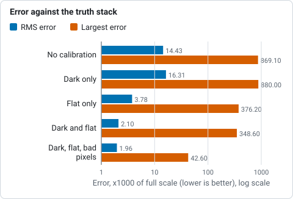
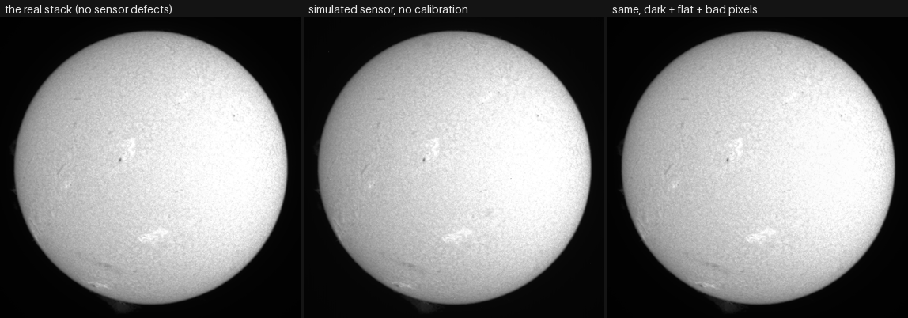

# Tutorial: calibrate with darks, flats and bad pixels

**Goal:** build master dark, flat and bad-pixel files, apply them to a stack, and
check, with numbers, that the picture got closer to the Sun and further from the
camera.

**You need:** a capture and the calibration captures from the same session. The
reasoning, the maths and the limits are in
[Calibration: darks, flats and bad pixels](../user-guide/calibration.md); the app
is in [Calibrate (optional)](../walkthrough/calibrate.md). This page is the worked
example, with every command and the numbers it printed.

> **What the example is, honestly.** The project has no darks or flats for the
> camera that took its captures (the ASI482MC of 2022-07-17). So the main example
> uses a **simulated sensor on real Sun frames**: the first 20 frames of the real
> capture `15_20_57.ser` (ASI482MC, 1920 x 1080, 16-bit, RGGB, H-alpha), put
> through a sensor model I wrote, with matching darks and flats from the same
> model. Because the real, undamaged frames are available, the stack has a known
> truth to compare against. The model is not a real camera, and real dust and
> fringes are harder than the ones here. The one run on real data is the last part,
> the stuck-pixel finder, which needs no darks.

## 1. The sensor model, and the three captures

The model, written in a few lines of NumPy (not part of Helia): a vignette that
leaves 70% in the corners, eight dust shadows of 6 to 15% with widths of 6 to 14
pixels, a column offset pattern (25 grey levels rms) on a base of 800, 40 hot
pixels at +25000 and 10 dead ones. The three captures it gives:

| File | Frames | What it is |
|---|---|---|
| `sim-lights.ser` | 20 | The real Sun frames, multiplied by the gain, plus the offset and the hot pixels |
| `sim-darks.ser` | 30 | The offset pattern, the hot pixels and noise: lens capped, at the Sun's exposure |
| `sim-flats.ser` | 20 | A uniform field through the same gain pattern, to about 43% of full scale, with the same offset |

What to record for real, and how many, is in
[What to record](../user-guide/calibration.md#what-to-record): darks at the Sun's
exposure and gain, flats at the science focus and set-up, and darks at the flats'
exposure (here the same darks, as the model's exposure is the same).

## 2. Build the masters

```sh
helia calibrate --darks sim-darks.ser --flats sim-flats.ser --flat-darks sim-darks.ser \
                --preset ha -o masters
```

```text
[   0.0s] combining 30 frame(s) of 1920x1080 (sigma-clip 3)
wrote:    masters/master-dark.fits  (master dark of 30 frame(s), sigma-clip 3, from sim-darks.ser, fp:0323dda1a2c8b998)
wrote:    masters/master-flat-dark.fits  (master dark of 30 frame(s), sigma-clip 3, from sim-darks.ser, fp:0323dda1a2c8b998)
wrote:    masters/master-flat.fits  (master flat of 20 frame(s), sigma-clip 3, from sim-flats.ser, fp:356c4094a62bce12)
flat:     edge of the field 94% of the centre; rings 0.11% (0 crossings); dust 0.1% of the field
wrote:    masters/bad-pixels.fits  (50 pixel(s) (40 hot, 10 cold), from the dark and flat)
warning:  H-alpha: take the flats at the science focus and tilt, through the etalon, ... no flat restores it
next:     helia stack <capture> -o out.tif --dark masters/master-dark.fits --flat masters/master-flat.fits --bad-pixels masters/bad-pixels.fits
```

Read it:

* **`master dark of 30 frame(s), sigma-clip 3`.** Each pixel is the mean of that
  pixel over the frames after dropping values more than 3 standard deviations out,
  so a cosmic ray in one frame does not reach the master (`--combine median`
  changes that).
* **`fp:0323dda1a2c8b998`.** A fingerprint of the pixels, to tell masters apart in
  a log. Reading the master back checks it (see [Troubleshooting](#troubleshooting)).
* **The flat line.** How the flat was judged: the edge of the field is 94% of the
  centre (a warning under 75%), no rings, dust is 0.1% of the field (a warning over 0.5%). Real etalon
  fringes and dust would show here.
* **`50 pixel(s) (40 hot, 10 cold)`.** The model has 40 hot and 10 dead pixels;
  the dark and the flat found exactly those, none missed and none invented.
* **The `H-alpha:` warning** is advice that `--preset ha` adds whatever the numbers
  say.

## 3. Apply them

```sh
helia stack sim-lights.ser -o cal.fits --preset ha --channel g --keep 100% --align phase \
      --dark masters/master-dark.fits --flat masters/master-flat.fits \
      --bad-pixels masters/bad-pixels.fits
```

```text
calibrate: dark: master dark of 30 frame(s), sigma-clip 3, from sim-darks.ser, fp:0323dda1a2c8b998
calibrate: flat: master flat of 20 frame(s), sigma-clip 3, from sim-flats.ser, fp:356c4094a62bce12
calibrate: bad pixels: 50 pixel(s) (50 hot), from bad-pixels.fits
...
limb:    quadratic: u1 = 0.471, u2 = 0.048; limb at 48% of the centre; rings differ from the law by 0.68% rms
```

(`--channel g --keep 100% --align phase` keep the comparison below like for like.
In a first run without `--channel g` the calibrated stack's limb fit came out
flat, `u1 = -0.002`: a different colour plane had been chosen than for the truth,
so I fixed it.) The
three `calibrate:` lines name each master. The calibration is applied to every frame as it is
read, before it is demosaiced, scored or aligned: dark, then flat, then bad pixels.
The file records the masters (`PRSTEP` cards in FITS; see [What the files
say](../user-guide/calibration.md#what-the-files-say)).

## 4. Check that it worked

The truth is the stack of the 20 real frames, with none of the model's defects.
Every stack below was made with the same options, as FITS, and compared with the
truth over the disc, after the one scale factor that a flat leaves open:

| Stack | RMS error (x1000) | Largest error (x1000) |
|---|---|---|
| no calibration | 14.43 | 869.1 |
| dark only | 16.31 | 880.0 |
| flat only | 3.78 | 376.2 |
| dark and flat | 2.10 | 348.6 |
| dark, flat and bad pixels | **1.96** | **42.6** |



*RMS and largest error of the simulated-sensor stack against the truth, for each calibration, from the table above.*

The limb fit tells the same story: the real stack has `u1 = 0.472, u2 = 0.048`;
the uncalibrated simulated stack `u1 = 0.576, u2 = -0.037` (the vignette read as
limb darkening); the calibrated one `u1 = 0.471, u2 = 0.048`.



*Each picture is written by `helia stack` (grey, green channel), cropped to the
disc and reduced to 380 pixels. In the middle one the disc is darker towards the
edge and faintly blotched where the dust is; the left and the right look alike.*

How to read the table:

* **The flat does most of the work** (14.4 to 3.8): the gain pattern is the large
  error. The dark takes the rest (to 2.1), the bad pixels take the largest errors
  (348.6 down to 42.6): a hot pixel is a large error on very few pixels.
* **A dark on its own was worse than nothing** (16.3 against 14.4). Subtracting
  the offset leaves the gain pattern and makes it a larger share of what is left;
  calibration is for the whole set, and darks without flats are of little use on
  their own. (The project's test on another synthetic sensor, in
  [Does it work?](../user-guide/calibration.md#does-it-work), found a gain of 6.4 dB
  for a dark alone; the sensors differ and I did not investigate further.)
* The limb fit is a quick check you can make on your own data: a vignette reads as
  limb darkening ([limb tutorial](limb-darkening.md)), so a flat that works moves
  `u1` back.

## 5. The same in the app

1. Open the capture. Press **Calibrate** in the rail (the second step).
2. Under **Dark** press **File** and pick `masters/master-dark.fits`, or **Folder**
   and pick a folder of dark captures. The rail shows **Preparing** while Helia
   reads or builds it.
3. Under **Flat** do the same with `master-flat.fits`. If the flat is captures, a
   **Dark for the flat** slot appears.
4. Leave **Bad pixels** empty and the hot pixels of the dark and the dead ones of
   the flat are found for you, or give `bad-pixels.fits`.
5. Read **In force**: the frames each master combines, the exposure, the
   fingerprint, and the warnings (vignetting, rings, dust).
6. Drag the line across the before and after picture to see the dust, the edge and
   the speckle.
7. **Save the masters** writes `master-dark.fits`, `master-flat.fits` and
   `bad-pixels.fits` to a folder, so next time you can pick the files.
8. **Stack** as usual; the stack is scored, aligned and stacked after calibration.


*The interface test harness's synthetic capture (a sun through a strongly vignetted
sensor, dust and sixty hot pixels), to show where the controls are.*

## 6. A real run: stuck pixels from the lights alone

With no darks at all, `--lights` finds pixels that read the same wrong value while
the Sun moves across them. On the real `15_20_57.ser`:

```sh
helia calibrate --lights 15_20_57.ser -o real-masters
```

```text
[   0.0s] looking for stuck pixels in the light frames
wrote:    real-masters/bad-pixels.fits  (552 pixel(s) (447 hot, 105 cold, 552 stuck), from the lights)
next:     helia stack <capture> -o out.tif --bad-pixels real-masters/bad-pixels.fits
```

```sh
helia stack 15_20_57.ser -o real-bp.fits --preset ha --bad-pixels real-masters/bad-pixels.fits
```

```text
calibrate: bad pixels: 552 pixel(s) (552 hot), from bad-pixels.fits
detail:  stack 0.00073 vs best single frame 0.00115 (0.64x)
```

552 pixels is 0.03% of the sensor. The stack's `detail:` figure is identical with and
without the map (0.00073 against 0.00115 for the best single frame): on this
capture, replacing them changes the stack by an amount that does not show in the
summary. The finder reports pixels that stay off, which includes pixel-to-pixel
response outliers as well as hot ones.

## What to expect and how to tell it worked

* `helia calibrate` writes the masters and prints, for the flat, the edge level,
  rings and dust, and the count of bad pixels. The output says what it warned about
  and exits `0` regardless.
* `helia stack` prints one `calibrate:` line per master. A run with no
  `calibrate:` lines was not calibrated.
* On a real capture the effect is subtler than here. Check by the three things the
  step shows: the dust shadows, the fall-off at the edge, the speckle in the sky.
* The limb fit moves toward the Sun's: less apparent darkening where the vignette
  was the cause.

## Troubleshooting

Each of these was run.

* **`helia: the calibration does not fit this capture: invalid input: the master dark
  is 1920x1080 but the frames are 720x540: it must come from the same camera, mode
  and region`.** The master is from another size, mode or mosaic. Rebuild the master
  from calibration captures made the same way as the Sun. (Tried: the 1920 x 1080
  dark on `15_32_09.avi`.)
* **`warning: no dark flat given: the flats keep their offset, which makes the
  correction too strong in the dim parts. Capture darks at the exposure of the
  flats`.** Build the flat with `--flat-darks` (or `--bias`).
* **`cannot prepare the calibration: invalid input: bad-dark.fits does not match the
  fingerprint in its header: the file has been changed or damaged`.** A master was
  edited or damaged (a byte of it was flipped to produce this). Rebuild it.
* **`cannot prepare the calibration: invalid input: masters/master-flat.fits is a
  master flat, not a master dark`.** The files are the wrong way round.
* **`the Sun moved only 16 pixels over the capture: the gain and the scene cannot be
  told apart ... Move it by at least 30 pixels`.** From `helia calibrate --displaced`
  on `Sun_Test.ser`, which was recorded tracking. A flat from the Sun itself needs
  frames made for it: see [A flat from the Sun
  itself](../user-guide/calibration.md#a-flat-from-the-sun-itself-displaced-disc-frames).
* **The picture is worse with the dark than without.** A dark alone leaves the gain
  pattern (the table above). Add the flat, or leave calibration off.
* **Dust shadows or fringes remain.** The flat was taken at another focus or tilt;
  rings and etalon fringes move with focus. Take the flat at the science focus,
  through the filter ([Etalons and Newton
  rings](../user-guide/calibration.md#etalons-and-newton-rings)).

## See also

* [Calibration: darks, flats and bad pixels](../user-guide/calibration.md): what to
  record, how masters are combined, what is done to each frame.
* [The command line](../user-guide/cli.md#helia-calibrate) and the
  [CLI reference](../reference/cli.md): `helia calibrate` and the `--dark`,
  `--flat`, `--bad-pixels` options of `helia stack`.
* [The API](../user-guide/api.md#calibration): the `calibration` object of a job.
* [Calibrate (optional)](../walkthrough/calibrate.md): the app step.
