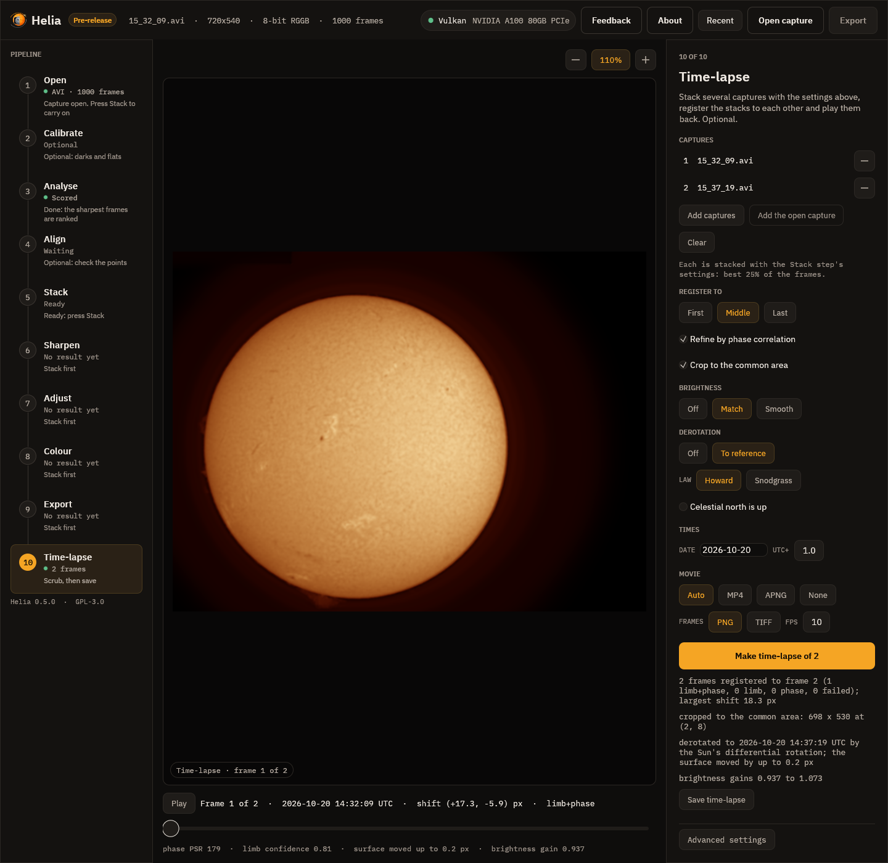
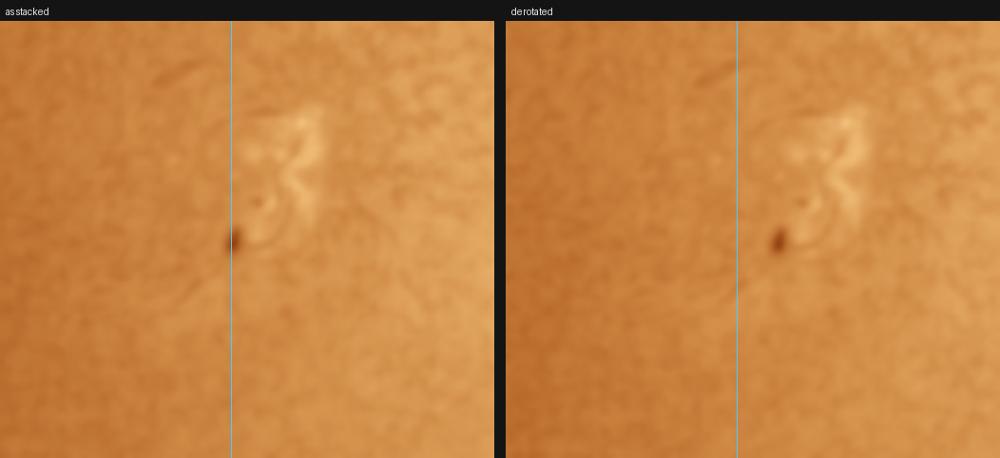

# Tutorial: derotating H-alpha stacks to one time

This walks through the solar derotation on the pair of real H-alpha captures used in
the [time-lapse tutorial](timelapse.md): `15_32_09.avi` and `15_37_19.avi`, 720 by 540
pixels, taken about five minutes apart on 2026-10-20 (the file names are in British
Summer Time, an hour ahead of UTC). The method is described in
[Solar derotation](../user-guide/derotation.md). You need Helia 0.6 or later and the
two stacks from the time-lapse tutorial (`tl/stacks/0001-15_32_09.tif` and
`0002-15_37_19.tif`); the stacks are named so that their times can be read again.

**An honest note first.** Five minutes is too short for the Sun to turn by more than a
fraction of a pixel, so for these two captures the derotation is a small correction. This
tutorial shows it at that size, and then, to show what it does over hours, brings one
stack five hours on. That second picture is the model applied to a real image; it is not a
photograph of the Sun five hours later. We do not yet have a real series spanning hours.
If you have one, with a sunspot group or a filament in view at both ends, please send it.

## 1. Derotate within the time-lapse

On the command line, add `--derotate` to the time-lapse of the other tutorial:

```sh
helia timelapse 15_32_09.avi 15_37_19.avi -o tl --date 2026-10-20 --utc-offset 1 \
    --crop --deflicker match --derotate --reuse-stacks -- --preset ha
```

`--derotate` brings every frame to the time of the reference frame (the second, 14:37:19
UTC). In the app, choose **To reference** under **Derotation** in the Time-lapse step
and press **Make time-lapse** again. You should see one more line than before:

```text
2 frames registered to frame 2 (1 limb+phase, 0 limb, 0 phase, 0 failed); largest shift 18.3 px
derotated to 2026-10-20 14:37:19 UTC by the Sun's differential rotation; the surface moved by up to 0.2 px
    1 14:32:09  shift ( 17.35,  -5.94) px  limb+phase  phase PSR 178
    2 14:37:19  shift (  0.00,   0.00) px  reference
```



and `timelapse.csv` has a `derotated_px` column: 0.185 for the first frame (the surface
was moved by at most that much, at the middle of the disc) and 0 for the reference.

The shift of the first frame is 17.35 pixels in x, where it was 17.17 without the
derotation. The pointing between the two captures is a property of the telescope and
the limb; the surface features have also moved, by 0.185 pixel at the disc centre, and the
phase correlation of the middle of the disc had folded that into its answer. With the
derotation the correlation is asked to find only the pointing: its correction to the limb
fit is 0.35 pixel, where it had been 0.18. The difference, 0.17 pixel, is the motion of the
surface, and the model predicts 0.185. For a time-lapse of a few minutes the effect on the
pictures is slight; it is the order of work, limb, then derotation, then correlation, that
matters as the series gets longer: without it a correlation over hours would follow the
rotation of the middle of the disc and shift the whole disc to suit it.

## 2. Derotate a stack on its own

To bring stacks to a time without registering them, use `helia solar-derotate`. Here the
second stack is brought five hours on, to 19:37:19 UTC:

```sh
helia solar-derotate tl/stacks/0001-15_32_09.tif tl/stacks/0002-15_37_19.tif -o dd \
    --date 2026-10-20 --utc-offset 1 --to 2026-10-20T19:37:19
```

```text
bringing 2 image(s) to 2026-10-20 19:37:19 UTC, Howard rates
  tl/stacks/0001-15_32_09.tif  14:32:09 UTC  +305.2 min  disc (288.5, 289.0) r 222.4 px  moved up to 10.96 px (centre 10.89)  -> dd/0001-15_32_09-derotated.tif
  tl/stacks/0002-15_37_19.tif  14:37:19 UTC  +300.0 min  disc (271.5, 294.6) r 222.0 px  moved up to 10.76 px (centre 10.69)  -> dd/0002-15_37_19-derotated.tif
```

Each line says when the image was taken, how far it was moved in time, the disc that was
fitted to it and how far the surface moved: up to 10.8 pixels, 10.7 at the middle of the disc
(the limb stays put). Open `dd/0002-15_37_19-derotated.tif` next to the stack.



*The pore left of the middle of the disc, 4 times enlarged: as stacked (left) and
derotated five hours on (right). The pore's centroid moves from x = 221.0 to 231.4, 10.4
pixels, in the direction the Sun turns (west, to the right); its y does not change
(282.8 and 283.0). The model's displacement at the disc centre is 10.7 pixels; 50 pixels west of it, where
the foreshortening takes off the cosine of 13 degrees, it is 10.4. The edge of the disc, and the sky, are
as they were.*

The rate used is the Howard one, for spots and bright features. To see how much the law
matters, compare it with the Snodgrass law, or with a rigid rotation that has no
differential part:

```sh
helia solar-derotate tl/stacks/0002-15_37_19.tif -o dd-sn --date 2026-10-20 --utc-offset 1 \
    --to 2026-10-20T19:37:19 --rotation-law snodgrass
helia solar-derotate tl/stacks/0002-15_37_19.tif -o dd-rigid --date 2026-10-20 --utc-offset 1 \
    --to 2026-10-20T19:37:19 --rotation-law 14.33,0,0
```

The Snodgrass equator turns 0.21 degree a day slower, 1.5% less, which is 0.17 pixel in five
hours; the rigid rotation leaves the mid latitudes where the equator would carry them,
which is about a pixel off at 40 degrees over five hours.

## 3. What to check

* **The direction.** Features must move west, toward the right of the picture for solar
  north up. If your pictures are mirror images, or the north is not up, say so with
  `--mirror`, `--north-angle` or `--celestial-north-up`; the distance is right but the direction is not
  otherwise.
* **The times.** The time of an AVI is the one in its name. Check the line the command
  prints: `+305.2 min` should be what you expect between the picture and the target.
* **The limb.** The disc is fitted for each image; a limb cut by the frame, or a
  faint one, stops it ("no clear solar disc").

## What to expect and what can go wrong

| What you see | Why | What to do |
|---|---|---|
| "no time for ..." | The file name has no time and the file no header time | Give `--date` for a name with only a time of day; or a FITS file with `DATE-AVG` |
| "no clear solar disc in ..." | The whole disc is not in the picture, or it is too faint to fit | Derotate the whole-disc stacks; for panels see the mosaic page where available |
| "derotation needs the time of every frame" (time-lapse) | A capture has no time | Give `--date`, or name the files after their start time |
| Features move the wrong way | The picture is mirrored or north is not up | `--mirror`, `--north-angle DEG` or `--celestial-north-up` |
| The surface looks smeared where it meets the limb | The picture is left as it was in the last 2% of the radius, and for what came from behind the east limb | Expected for hours; the features there are not in the picture |
| Over many hours the result looks wrong | Features evolve; a single law is used for the whole disc | Keep the interval short, or use the original stacks |
