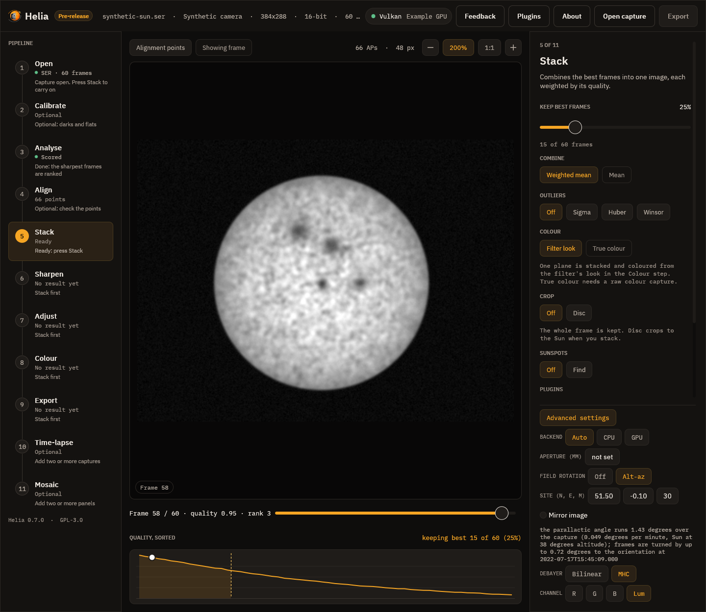
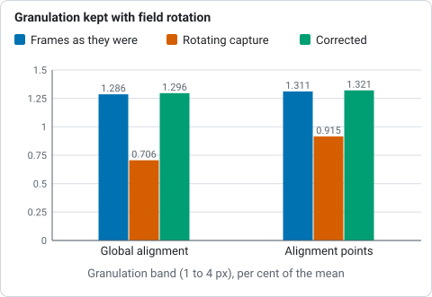

# Tutorial: correcting field rotation on an altazimuth mount

This tutorial corrects a long capture and a time-lapse of the Sun taken on an
altazimuth mount. It uses a real SER capture, `15_20_57.ser` (1920 by 1080, 100 frames
with real timestamps), and shows the effect by giving its frames the timestamps of an
hour-long session, because the capture itself lasts only 9.5 seconds. The method is in
[Field rotation](../user-guide/field-rotation.md). Skip all of this on an equatorial
mount: it has no field rotation.

## 1. Decide whether you need it

The rotation rate is `15 degrees per hour * cos(latitude) * |cos(azimuth)| /
cos(altitude)`. Open the capture in the app, turn on **Advanced settings**, set
**Field rotation** to **Alt-az** and enter the site: the line under the controls says
how far this capture rotates. For `15_20_57.ser` (9.5 s, 51.5 N) it is 0.023 degrees,
0.09 pixels at the limb of a 445 pixel disc: nothing to correct. A capture of ten
minutes near noon turns by about two degrees, 16 pixels at the limb: correct it.

## 2. Correct a long capture

You need timestamps in every frame (SER) and the site: latitude north, longitude east,
height in metres (use your own; the example uses 51.5, -0.1, 30).

```sh
helia stack session.ser -o sun.fits --preset white --field-rotation \
    --site 51.5,-0.1,30
```

In the app: **Advanced settings**, **Field rotation: Alt-az**, the three **Site**
fields, then **Stack** as usual. If your picture is a mirror image (a star diagonal),
tick **Mirror image** or add `--field-rotation-mirror`; if the stack is not as sharp as
it should be, try the other setting.



What to expect: the run prints `rotation:` lines with the angle covered and the shift at
the limb, and the FITS history gets a `FIELD-ROTATION` step. Settings used for the
measurement below: the 100 frames of `15_20_57.ser` stamped one every 36 s (an hour),
site 51.5, -0.1, the Sun at 47 degrees: 6.3 degrees in total, turns of up to 3.2
degrees, 25 pixels at the limb; best half of the frames kept.

| Granulation band (1 to 4 px), % of the mean | Frames as they were | Rotating capture | Corrected |
|---|---|---|---|
| Global alignment | 1.286 | 0.706 | 1.296 |
| Alignment points | 1.311 | 0.915 | 1.321 |



*Granulation band at the disc centre for 100 frames of `15_20_57.ser` given the timestamps of an hour, from the table above (higher is better).*

## 3. Align a time-lapse

Stack each capture to FITS (the file carries `DATE-AVG`), then turn the images to one
orientation:

```sh
helia derotate sun-1100.fits sun-1130.fits sun-1200.fits -o aligned \
    --site 51.5,-0.1,30
```

The table printed shows each image's time, the parallactic angle and the turn applied.
Images come out as `sun-1100-derot.fits` and so on, turned to the middle image. For
TIFF or PNG give the times: `--times 2026-03-20T11:00:00,2026-03-20T11:30:00,...`.
Stack or crop afterwards: the corners the turn uncovers are filled with the edge level.

## What can go wrong

| What you see | Why | What to do |
|---|---|---|
| `needs the time of each frame` | The capture has no timestamps (AVI, video) | Use a SER capture; or for stacked images give `--times` |
| `needs the observing site` | No `--site` and no `HELIA_SITE` | Give the site |
| `cannot be used with --colour true` | A raw mosaic cannot be turned before demosaicing | Stack one colour plane |
| The limb is still smeared | Wrong turn direction, or a clock far off | Toggle the mirror setting; check the computer's clock when you captured |
| Nothing changes | The capture is short, or the mount is equatorial | Nothing to correct |

## Reference: every option

| Setting | CLI | API (`config.field_rotation`, with `site`) | App | Range | Default |
|---|---|---|---|---|---|
| Correct the rotation | `helia stack --field-rotation` | `field_rotation` (an object; `{}` for the defaults) | Advanced settings, Field rotation: Off / Alt-az | on or off | off |
| Reference orientation | `--field-rotation-reference` | `reference` | middle (fixed) | `middle`, `first`, `last` | `middle` |
| Mirror image | `--field-rotation-mirror` | `mirror` | Mirror image | on or off | off |
| Site | `--site LAT,LON,ALT` or `HELIA_SITE` | `site` or the server's `HELIA_SITE` | Site (N, E, M) | latitude -90 to 90, longitude -180 to 180, height -1000 to 10000 m | none |
| Time-lapse | `helia derotate IMAGES -o DIR` with `--site`, `--times`, `--reference` (`middle`, `first`, `last` or an image number), `--mirror`, `--overwrite` | not offered | not offered | | middle |

Results appear in `summary.field_rotation` in the API.
