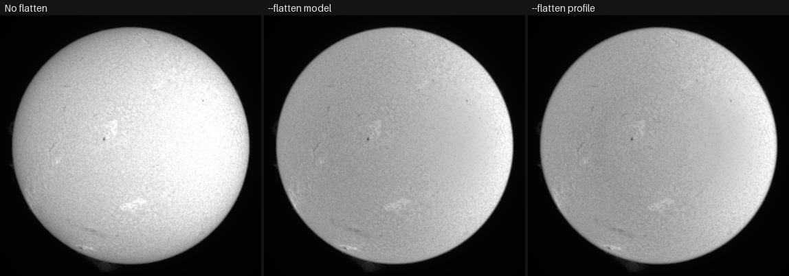

# Tutorial: flatten the limb darkening

**Goal:** remove the fall of brightness from the centre of the disc to the limb, so
that the sharpening sees the same contrast everywhere, and read the numbers that
say how strong the darkening is and how well a law describes it.

**Time:** two minutes of work; each stack here took about 2.5 seconds on a GPU.

**You need:** a capture with the whole disc in the frame. The reference for the
settings is [Limb darkening](../user-guide/sharpening.md#limb-darkening); this page
is the worked example.

## The capture and why

`15_20_57.ser` from the 2022-07-17 set: a ZWO ASI482MC colour camera, 1920 x 1080,
16-bit, 100 frames, the whole disc in the frame. The owner labelled it sodium; the
analysis in #121 found it
is H-alpha (the red plane is clipped, with a prominence and filaments that match
the other H-alpha captures). Helia agrees: it chooses the H-alpha preset from the
data's behaviour and stacks the green plane because the red one is saturated.
The label does not matter for this tutorial. What matters is that it is a real
capture with a clean, full limb, so the fit has a whole circle to work with. The
project has no white-light capture of its own yet, so the numbers below are for
this band, and your own white-light stack will differ.

The captures live on the build server, not in the book. Use any of your own whole
disc captures instead and expect different numbers.

## 1. Stack it as it is

```sh
helia stack 15_20_57.ser -o plain.png --preset ha --colour mono
```

`--colour mono` keeps the PNG grey so that the pictures below show brightness only.
The summary ends with the limb fit, which every run makes whether or not you flatten:

```text
settings: H-alpha (chosen); red channel, keep 25%, alignment points 64 px
channel:  the red plane is clipped (red 98% of its lit pixels sit at the sensor limit, so the disc is flat there); stacking the green plane instead. ...
align:    phase correlation (limb fit not confident enough, 0.67); confidence mean 1.00, least 1.00 (sampled)
limb:    quadratic: u1 = 0.471, u2 = 0.046; limb at 48% of the centre; rings differ from the law by 0.66% rms
disc:    centre (788.3, 552.3), radius 444.6 px
```

Read the `limb:` line like this:

| Part | Meaning |
|---|---|
| `quadratic` | The law fitted (the default). `--limb-law` changes it |
| `u1 = 0.471, u2 = 0.046` | The coefficients of `L(mu) = 1 - u1 (1 - mu) - u2 (1 - mu)^2`. `u1` is the linear part: the larger it is, the stronger the darkening |
| `limb at 48% of the centre` | The law's brightness at the limb itself (`mu` = 0), as a share of the centre: `1 - u1 - u2` = 0.483 here |
| `rings differ from the law by 0.66% rms` | How far the measured brightness of each one-pixel ring strays from the law. Small means the law describes the disc; large means something else is radial in the picture (see [Troubleshooting](#troubleshooting)) |

## 2. Measure the profile on the unsharpened stack

A FITS file is the unsharpened stack, so it is the right thing to measure:

```sh
helia stack 15_20_57.ser -o plain.fits --preset ha
helia measure plain.fits --limb
```

```text
file:        plain.fits
image:       1920 x 1080
disc:        centre (788.5, 552.3), radius 444.6 px, sky 0.0080, centre 0.9085
linear: u = 0.498; limb at 50% of the centre; rings differ from the law by 0.69% rms
quadratic: u1 = 0.471, u2 = 0.046; limb at 48% of the centre; rings differ from the law by 0.66% rms
neckel: a1 = 0.443, a2 = 0.046, a3 = 0.028, a4 = 0.058, a5 = -0.089; limb at 51% of the centre; rings differ from the law by 0.65% rms
mu    measured    linear quadratic   neckel
0.90  0.9547      0.9502   0.9524   0.9560
0.80  0.9066      0.9004   0.9039   0.9071
0.70  0.8496      0.8506   0.8545   0.8556
0.60  0.8023      0.8009   0.8041   0.8034
0.50  0.7613      0.7511   0.7528   0.7518
0.40  0.7039      0.7013   0.7006   0.7014
0.30  0.6503      0.6515   0.6475   0.6525
0.25  0.6142      0.6266   0.6206   0.6287
```

`mu` is the cosine of the angle from the local vertical: 1 at the centre of the
disc, 0 at the limb. `measured` is the azimuthal median of the image at that `mu`
relative to the centre, and each column after it is a law's value there. In this
capture the brightness has fallen to 61% of the centre at `mu` 0.25, which is 97%
of the way out, the last ring that is fitted. All three laws follow the measurement
to within 1.5% of the centre's brightness, and no law has a ring scatter better
than another's by more than 0.04 percentage points.

## 3. Flatten

```sh
helia stack 15_20_57.ser -o flat-model.png   --preset ha --colour mono --flatten model
helia stack 15_20_57.ser -o flat-profile.png --preset ha --colour mono --flatten profile
```



*Made by `helia stack` as above, then cropped to the disc, reduced to 380 pixels
and set side by side. The left picture is the stack as written; nothing else was
done to any of them.*

What you should see: the left disc is bright in the middle and fades towards the
edge; in the other two the disc is an even grey, the mottle and
the filaments are equally visible at the limb as at the centre. The overall level
is lower, which is not a loss: Helia scales the gain so that the 99.9th percentile
of the disc stays where it was, so that dividing out the darkening cannot push
the brighter side past white. Because of that, the patch on the right of the disc
(the etalon's sweet spot, a real feature of this capture and not a radial one)
now stands out more: flattening leaves it, as it should.

To check it worked, measure the flattened result, using `--sharpen-fits` so that
the FITS file receives the edit too (see [Troubleshooting](#troubleshooting)):

```sh
helia stack 15_20_57.ser -o flat-model.fits   --preset ha --flatten model   --sharpen-fits
helia stack 15_20_57.ser -o flat-profile.fits --preset ha --flatten profile --sharpen-fits
helia measure flat-model.fits --limb
helia measure flat-profile.fits --limb
```

| | Linear `u` | Quadratic `u1`, `u2` | Rings off the law (quadratic) | Disc centre level |
|---|---|---|---|---|
| Unflattened | 0.498 | 0.471, 0.046 | 0.66% | 0.9085 |
| `--flatten model` | -0.001 | 0.003, -0.006 | 0.74% | 0.6496 |
| `--flatten profile` | 0.000 | -0.002, 0.004 | 0.34% | 0.6514 |

The coefficients go to zero: the disc has no darkening left. The model removes
only the fitted law (its rings stay about as far off as before, 0.74%); the profile
removes the whole measured radial profile, so any radial gradient the law could
not describe goes too, and the rings end up 0.34% off a flat line. Neither
touches the granulation or fine detail: dividing by a smooth radial function
cannot move contrast that is not radial. (On this capture the project measured
the granulation band of `helia measure` at 2.050% before, 2.052% with the model and
2.049% with the profile.)

## 4. The same in the app

1. **Open** the capture (drop `15_20_57.ser` on the window, or **Open**).
   Helia names the filter it chose on the Open step.
2. **Stack** it: press **Quick stack**, or go to **Stack** and press **Stack N
   frames**.
3. Go to **Sharpen**. At the top is **Limb darkening**. Press **Model** or
   **Profile**; the picture updates at once.
4. Under **Model**, the chips **Linear**, **Quadratic** and **Neckel** choose the
   law. The line under the chips is the fit that was made on your stack: the same
   `limb:` line as the command line, with the coefficients, the limb level and
   how far the rings stray from the law.
5. Press **Before / after** in the toolbar and drag the dividing line to compare
   with the unflattened stack. **Off** puts the disc back as it was.
6. **Export** as TIFF or PNG; the flattening is in the file. A FITS export is the
   unsharpened stack unless you turn on **Edit the FITS too** on the Export step.


*This picture is the app's synthetic demonstration capture, drawn by the interface
test harness, with the fit made on that stack. It shows where the controls are;
the real result is the one above.*

## Flatten an image you already have

`helia edit` takes the same flags on a finished stack, for example the FITS written
above, so you can try the laws without stacking again:

```sh
helia edit plain.fits -o flat.tif --flatten profile
```

```text
edit:     1. flatten the limb darkening by the measured radial profile (azimuthal median), on the disc only
wrote:    flat.tif (1920x1080) in 1.10s
```

(`--limb-law` chooses the law fitted and printed, and the one `--flatten model`
divides by; `--flatten profile` divides by the measured profile whatever the law.)

## Which law to choose

* **`quadratic`** (the default) is right for nearly everything. Two coefficients,
  stable on a whole disc. On this capture it explains the rings as well as the
  five-term law (0.66% against 0.65%).
* **`linear`** has one coefficient, which is easy to compare between captures
  (`u` 0.498 here, 0.539 on `Sun_Test.ser`). It is a little too stiff close to the
  limb: at `mu` 0.25 it is 0.627 where the disc measures 0.614.
* **`neckel`** (Neckel and Labs, five terms) is the form the literature tables use.
  Its terms are nearly collinear and the rings barely determine five numbers, so
  compare the law (the `limb at` figure and the table), not `a1` to `a5`. It
  fits marginally better (0.65% against 0.66%) and is no better for flattening.
* **`--flatten profile`** is the choice when the capture has a radial gradient
  that is not limb darkening (a vignette, an uncorrected flat, an etalon). It
  removes everything that is radial. Use `model` when you want only the physical
  darkening removed and the rest left for a flat to deal with.

How real captures compare with the literature, and the table for every band, are
in [What the real captures say](../user-guide/sharpening.md#what-the-real-captures-say).

## What to expect and how to tell it worked

* The `limb:` line appears on every run. With `--flatten` and a disc that fits,
  nothing else changes in the summary; the picture does.
* `helia measure --limb` on a flattened FITS (made with `--sharpen-fits`) gave
  coefficients within 0.01 of zero and a `limb at` of 99% to 101% for the
  linear and quadratic laws here.
* The last 1.5% of the radius is left alone by design (the gain eases to 1
  there), so the very edge is as it was.
* Everything outside the limb, prominences included, is untouched.

## Troubleshooting

* **`limb:    no clear disc to fit, so --flatten changed nothing`.** The capture has
  no disc Helia can fit: a cropped region, a prominence frame, or too little contrast.
  Flattening needs the whole disc in the frame; there is nothing to fix in the
  settings. (This message is printed by the code; I did not have a capture that
  triggers it, so it is quoted, not pasted.)
* **I flattened and the FITS file is unchanged.** By design: the FITS output is
  the unsharpened stack. The run says `note: FITS is the unsharpened stack; the
  sharpening and edits go to TIFF and PNG (add --sharpen-fits to change that)`.
  Measuring such a FITS file gives the unflattened numbers (verified:
  `u1 = 0.471` again). Add `--sharpen-fits`, or flatten the TIFF or PNG.
* **The rings are far from the law (several per cent) and the fit looks odd.** The
  fit measures the image, so anything radial is read as limb darkening. Seen on
  this set: `14_42_57.avi`, a capture whose frame cuts the limb (63% of it
  visible), gave `quadratic: u1 = 0.823, u2 = -0.584; limb at 76% of the
  centre; rings differ from the law by 1.66% rms`. A `u2` that cancels `u1`
  like that is not physics. Flattening such a disc is harmless but the
  coefficients are not a measurement; frame the whole disc, or calibrate with a
  flat ([Calibration](../user-guide/calibration.md)) if the cause is vignetting.
* **A bright patch on one side after flattening.** Not a bug. It is not radial
  (here, the etalon's sweet spot), so neither source removes it, and with the rest
  of the disc flat it is easier to see. A flat field is the cure, not flattening.
* **The disc looks greyer or darker than before.** The gain is scaled to keep the
  brightest 0.1% of the disc where it was, so the disc cannot clip. Raise the
  level in **Adjust** (Levels or Curve), as you would for any stack.

## See also

* [Limb darkening](../user-guide/sharpening.md#limb-darkening): the laws, the fit
  and the literature.
* [The command line](../user-guide/cli.md#limb-darkening) and the
  [CLI reference](../reference/cli.md): `--limb-law`, `--flatten`, `--sharpen-fits`.
* [Autocrop to the disc](autocrop.md): the next step.
* [Sharpening and adjustments](../user-guide/sharpening.md).
