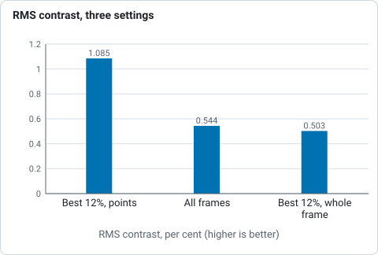
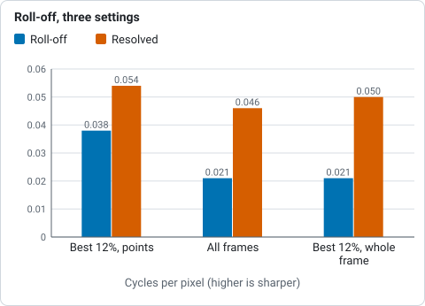
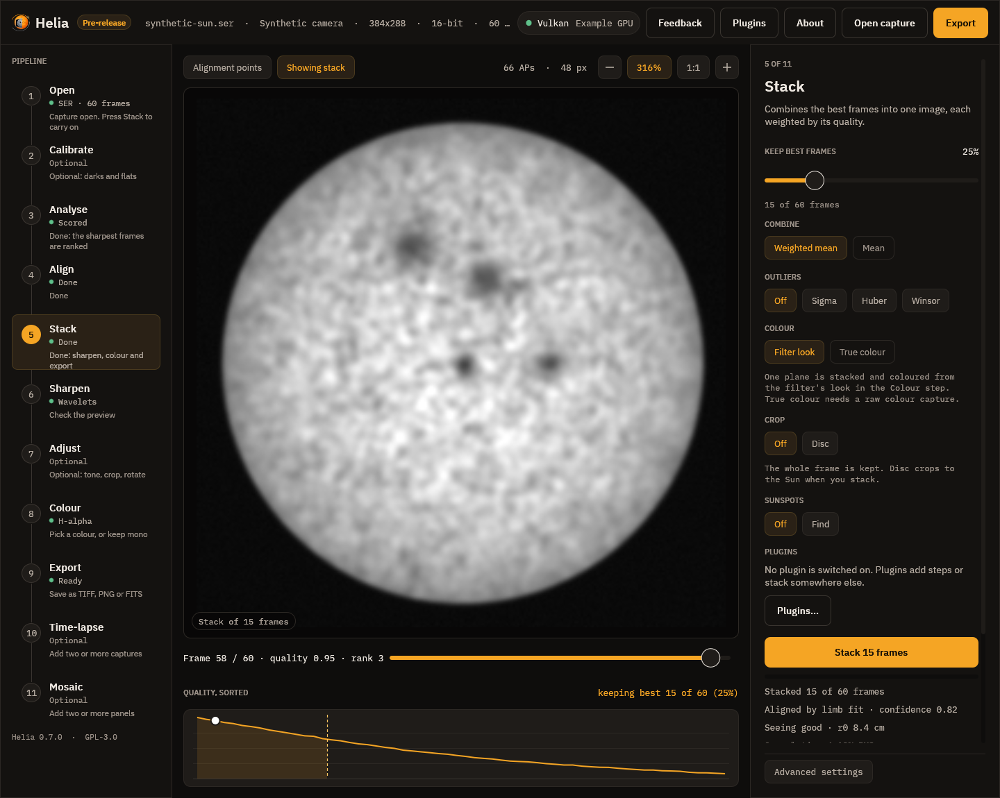

# Tutorial: measure a stack, read the granulation and seeing report

**Goal:** put numbers on a white-light stack (how much contrast, how fine, how
good the seeing was), read each one correctly, and use them to compare two runs
of the same capture.

**You need:** a finished image or a capture. The pages
[The granulation and seeing report](../user-guide/quality-report.md) and
[Seeing estimation](../user-guide/seeing.md) explain the methods and the tests.
This page is a numbered walk-through that uses them; it does not repeat them.

> **Read this first: there is no real granulation here yet.** The project has no
> capture that resolves granulation. The only photospheric capture of the 2022-07-17
> set is `14_42_57.avi` (a colour camera, 1.44 arcsec per pixel; its filter is not
> recorded; sunspots are visible). A granule, about 1.5 arcsec across, is one pixel
> on it, so the cells the report finds are larger structure and noise. That makes
> it a good example of reading the report's warnings, and a poor one of
> granulation. The aperture below, 80 mm, is a guess: the captures do not say what
> telescope was used. Only the comparisons mean anything.

## 1. Stack with the report switched on

The granulation report is made for the white-light and sodium D presets
(chromospheric filters have none). It needs nothing to switch on; `--aperture-mm`
adds the telescope's diffraction cut-off, and `--seeing` adds the seeing report:

```sh
helia stack 14_42_57.avi -o wl.fits --preset white --aperture-mm 80 --seeing
```

A FITS output is the unsharpened stack, which is the one to measure: sharpening
raises contrast and would make the number depend on your sharpening settings.

```text
settings: White light (chosen); luminance channel, keep 12%, alignment points 32 px
frames:  630 total, 76 kept, 152 registered
align:   phase correlation (the frame cuts the limb, 63% of it visible); ...
disc:    centre (1011.8, 637.6), radius 667.8 px
granulation: region:         240 x 240 at (799, 423)
granulation: RMS contrast:   1.085%
granulation: cell size:      pitch 67.88 px (97.51 arcsec), diameter 30.88 px (44.36 arcsec) (12 cells)
granulation: power spectrum: roll-off 0.038 cycles/px (period 26.67 px, 38.31 arcsec), resolved to 0.054 (period 18.46 px, 26.52 arcsec)
granulation: telescope:      diffraction cut-off 1.013 cycles/px lies above the sampling limit (0.5): the pixel scale, not the telescope, limits the detail; resolved 11% of the sampling limit
granulation: noise floor:    2.954e-7
granulation: note:           a granule (1.5 arcsec) spans 1.0 px at this scale; below 3 px the cell size measures larger structure and noise, not granules. ...
seeing:  followed 11 tiles of 64 px through 120 frames spread over the capture
seeing:  motion index:   0.495 px (0.71 arcsec) RMS differential motion per axis between points 64 px (92 arcsec) apart (6 pairs); relative, not r0
seeing:  spectral ratio: D/r0 7.8, r0 1.0 cm at the capture's wavelength, 0.9 cm at 500 nm (21 rings, 11 tiles, tiles differ by 24%)
seeing:  note:           a 64 px tile spans 92 arcsec, more than one isoplanatic patch (a few arcseconds); ...no grade is given
seeing:  note:           the cut-off (1.01 cycles/px) is above the sampling limit, so fine detail is aliased and the r0 is indicative; ...
```

## 2. Read the granulation lines, one at a time

1. **`region: 240 x 240 at (799, 423)`.** The square the report is made on: the
   middle of the disc, 240 pixels on a side (`helia measure --crop` changes it).
   Check that it holds no sunspot, filament or plage: any of them raises the
   contrast. On a disc cut by the frame, as here, look at the crop to be sure it
   is on the disc.
2. **`RMS contrast: 1.085%`.** The standard deviation of the square after
   dividing it by a copy of itself blurred by an eighth of its side (this removes
   limb darkening and vignetting). The number that matters: it falls with seeing
   and defocus, rises with sharpening. Quote it with the bit depth and the
   noise.
3. **`cell size: pitch 67.88 px (97.51 arcsec) ...`.** The mean spacing of the
   bright cells found at the scale where the contrast peaks, and the mean
   diameter of those wholly inside. Meaningful only if a granule covers three
   pixels or more; the last line says it does not here, and 97 arcsec cells are
   not granules.
4. **`power spectrum: roll-off 0.038 cycles/px (period 26.67 px ...), resolved to
   0.054`.** Two landmarks of the azimuthally averaged power: the frequency where
   the power above the noise has fallen to 10% of its peak (seeing and defocus move
   it down), and the highest one still above 1% of the peak (noise limits it). A
   higher roll-off means finer detail survives.
5. **`telescope: diffraction cut-off 1.013 cycles/px ...  resolved 11% of the
   sampling limit`.** `D / lambda` in cycles per pixel (550 nm for white light and
   589.3 nm for sodium) and how much of it the data reaches. The cut-off is above
   0.5, the sampling limit, so the pixels, not the telescope, limit the detail: no
   point buying aperture until the scale is finer.
6. **`noise floor: 2.954e-7`.** The power at the highest frequencies, which is all
   noise.
7. **`note:`** Always read it. It is where the report tells you it does not
   believe its own cell size.

## 3. Read the seeing lines

`--seeing` samples 120 frames spread over the whole capture and measures two
different things:

1. **`motion index: 0.495 px (0.71 arcsec)`.** How much neighbouring alignment
   points move against each other from frame to frame. Relative: use it to
   compare captures through the same optics at the same scale, never as `r0`.
2. **`spectral ratio: D/r0 7.8, r0 1.0 cm ... 0.9 cm at 500 nm`.** The Fried
   parameter, the diameter of a patch of atmosphere over which the wavefront is
   flat to about a radian, and the aperture over it. It needs `--aperture-mm`
   (and `--wavelength-nm` when the filter is not known). With a grade it would
   read excellent (10 cm or more at 500 nm), good (7 to 10), fair (4 to 7), poor
   (2.5 to 4) or bad (under 2.5).
3. **No grade is printed here, and the second note says why.** A 64 pixel tile
   spans 92 arcsec, far more than one isoplanatic patch (a few arcseconds), so
   `r0` is indicative. The method is meant for a scale near 0.1 to 0.3 arcsec per
   pixel; at 1.4 arcsec per pixel, read only the comparison.

## 4. Measure a finished image: `helia measure`

The same report, and three band-pass contrasts, for any TIFF, PNG or FITS file
(colour is averaged to grey):

```sh
helia measure wl.fits
```

```text
crop:        240 x 240 at (799, 423)
fine 0-1 px         0.087%
granulation 1-4 px  0.155%
meso 4-12 px        0.359%
(band-pass standard deviation over mean; compare only like with like)

Granulation report (flattened region, see the user guide)
  region:         240 x 240 at (799, 423)
  RMS contrast:   1.085%
  cell size:      pitch 67.88 px, diameter 30.88 px (12 cells)
  power spectrum: roll-off 0.038 cycles/px (period 26.67 px), resolved to 0.054 (period 18.46 px)
  noise floor:    2.954e-7
```

Without `--scale` there are no arcseconds. Give the scale and the report becomes
physical; the stack's FITS header has it (`CDELT1`, here 1.4365 arcsec per pixel):

```sh
helia measure wl.fits --scale 1.4365 --aperture 80 --wavelength 550
```

```text
  cell size:      pitch 67.88 px (97.51 arcsec), diameter 30.88 px (44.36 arcsec) (12 cells)
  power spectrum: roll-off 0.038 cycles/px (period 26.67 px, 38.31 arcsec), resolved to 0.054 (period 18.46 px, 26.52 arcsec)
  telescope:      diffraction cut-off 1.013 cycles/px lies above the sampling limit (0.5): ...
```

These are the lines the stack printed. The three bands are the older measure:
fine (0 to 1 px) is mostly noise, granulation (1 to 4 px) is cells plus some noise,
meso (4 to 12 px) is larger structure and slow brightness change.

## 5. Use it: compare settings on one capture

The numbers are for comparing. The same capture three ways (`--preset white`,
the FITS output, the report lines of each):

```sh
helia stack 14_42_57.avi -o a.fits --preset white                 # best 12%, alignment points
helia stack 14_42_57.avi -o b.fits --preset white --keep 100%     # every frame
helia stack 14_42_57.avi -o c.fits --preset white --no-multipoint # best 12%, whole-frame only
```

| Stack | Frames kept | RMS contrast | Roll-off (period) | Resolved (period) |
|---|---|---|---|---|
| best 12%, alignment points | 76 | 1.085% | 0.038 (26.7 px) | 0.054 (18.5 px) |
| all frames | 630 | 0.544% | 0.021 (48.0 px) | 0.046 (21.8 px) |
| best 12%, whole frame only | 76 | 0.503% | 0.021 (48.0 px) | 0.050 (20.0 px) |



*RMS contrast of 14_42_57.avi stacked three ways with `--preset white`, from the table above.*



*Roll-off and resolved frequency of 14_42_57.avi stacked three ways with `--preset white`, from the table above.*

Frame selection and alignment points both lift the contrast (twice that of the
other two here), and the roll-off moves to a higher frequency. Seeing and defocus
move the roll-off down, so a night with a higher roll-off at the same settings had
better seeing. Selection alone (the third row) or the points alone (the second) give about
half of what the two together do. The noise floor differs by orders of magnitude
between the runs (2.5e-8, 7.7e-7 and 2.95e-7); I did not interpret it, so
compare the floor only between runs of the same kind.

## 6. In the app

1. **Open** and **Stack** with the **White light** or **Na D** look. When it
   has finished, the lines under the Stack button include
   `Granulation 1.09% RMS`, and, once an aperture is set, either
   `Seeing good · r0 8.4 cm` (the example in the picture below) or, with no
   aperture or no grade, `Seeing index 0.49 px`.
2. Hover either line to see the whole report: it is the text the command line
   prints.
3. To get an absolute `r0`, press **Advanced settings** at the foot of the
   inspector and set **Aperture (mm)** before you stack (the field shows *not set*
   at 0).
4. The app's report has no diffraction cut-off line: that needs the command line
   or the API (`aperture_mm`).



*Drawn by the interface test harness on its synthetic demonstration capture with
fixed example figures; it shows where the lines are, not a measurement.*

## What to expect and how to tell it worked

* `helia stack --preset white` prints the `granulation:` block; `--seeing` adds the
  `seeing:` block. A capture with a chromospheric preset prints neither.
* The same capture and settings give the same numbers: the report uses no random
  numbers.
* On a capture that resolves granulation (about 0.5 arcsec per pixel or finer) the
  note about the granule size disappears and the cell size is a granule spacing
  (about 1.5 arcsec across, a pitch of a few arcsec). Not demonstrated here, for
  lack of such a capture.

## Troubleshooting

* **`note: a granule (1.5 arcsec) spans 1.0 px at this scale; below 3 px the cell
  size measures larger structure and noise, not granules`.** The scale is too
  coarse. The contrast and the spectrum still compare runs of the same capture;
  the cell size does not.
* **No `granulation:` lines.** The filter is chromospheric (H-alpha, Ca K and the
  rest) or not recognised; the report is for `white` and `na`. (`--preset ha --seeing` on
  `15_20_57.ser` printed the `seeing:` lines and no `granulation:` line: run.) Name the preset
  yourself with `--preset white`.
* **`seeing: ... no grade is given`.** Tiles span more than an isoplanatic patch
  because the scale is coarse. Use a finer scale; the motion index still compares.
* **No `r0`, only a motion index.** `--aperture-mm` was not given; the report ends
  `note: give the telescope aperture (--aperture-mm) for r0 and a grade` (run on
  this capture). Add it; with a filter Helia does not know add `--wavelength-nm`.
* **`helia measure` says
  `the following required arguments were not provided: --wavelength <NM> --scale <ARCSEC> --aperture <MM>`.**
  Run as `helia measure wl.fits --aperture 80` (verified): `--aperture` needs
  `--scale` and `--wavelength` as well, so that the cut-off can be worked out.
* **A different contrast between two exports of the same capture.** Sharpened
  against unsharpened. Measure the FITS, or sharpened against sharpened.
* **The contrast is high and the picture is a sunspot.** The 240 pixel square
  holds a spot, a facula or a filament. Use `helia measure --crop` with a smaller
  size (`--crop 120` gave 0.706% here against 1.085% for 240), or crop the image to a
  quiet area first.
* **The app says "Seeing: not measurable here".** (From the code, not reproduced.) Too few tiles locked on the capture
  (a very blocky or very soft one): the capture is the problem.

## See also

* [The granulation and seeing report](../user-guide/quality-report.md) and
  [Seeing estimation](../user-guide/seeing.md): methods, tests and the real
  captures.
* [The command line](../user-guide/cli.md#helia-measure) and the
  [CLI reference](../reference/cli.md): `helia measure`, `--aperture-mm`,
  `--seeing`, `--wavelength-nm`.
* [White-light granulation](../recipes/white-light-granulation.md): the settings
  tuned for granulation.
