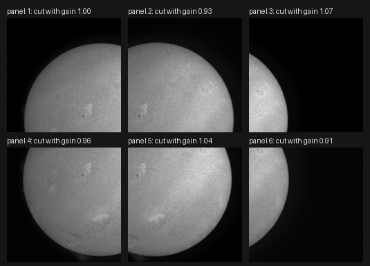
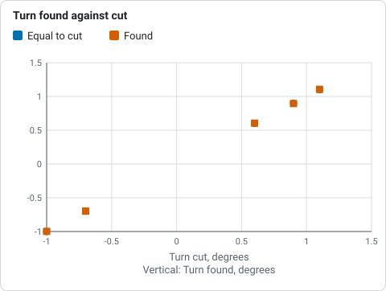
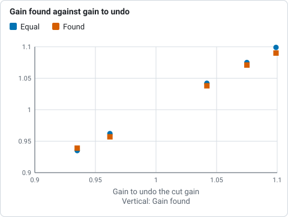
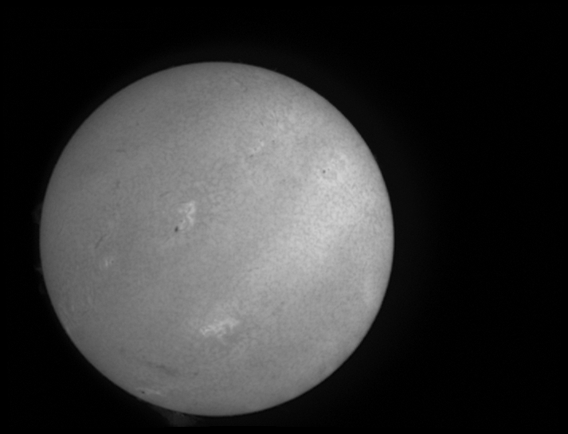
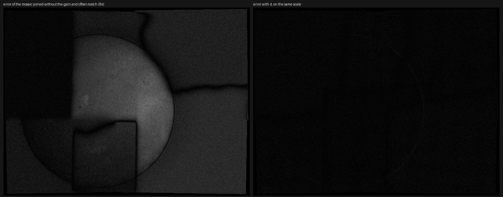
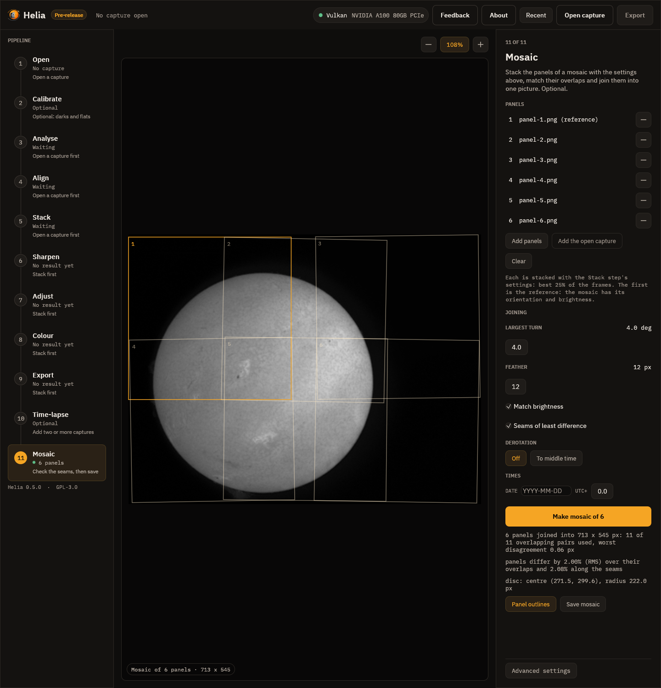

# Tutorial: joining panels into a full-disc mosaic

This walks through the mosaic from start to finished picture. **We have no real mosaic
capture yet**, so the panels here are cut from a real full-disc stack: the H-alpha capture
`15_37_19.avi` of 2026-10-20 (720 by 540 pixels, 1000 frames; the disc is 222 pixels in
radius), stacked with `helia stack 15_37_19.avi -o stack.tif --preset ha`. Cutting panels
from a picture whose answer we know shows what the method does to a real Sun's detail and
noise, and how close it gets; it does not show how it does with the panels of a real
mosaic, which differ in ways we cannot make up (seeing that changes between panels, the
flat-field of each place on the chip, a camera that was turned between panels). If you have
such a set of captures, please send one. The method is described in
[Mosaics](../user-guide/mosaic.md). You need Helia 0.6 or later.

## 1. Cut four panels, and join them

The easiest panels to try are plain crops of a stack. `helia edit` cuts a region
(`--crop X,Y,W,H`); four 400 by 300 panels in two rows overlap by 80 pixels in x and 60 in y:

```sh
helia edit stack.tif --crop 0,0,400,300     -o p1.tif
helia edit stack.tif --crop 320,0,400,300   -o p2.tif
helia edit stack.tif --crop 0,240,400,300   -o p3.tif
helia edit stack.tif --crop 320,240,400,300 -o p4.tif
helia mosaic p1.tif p2.tif p3.tif p4.tif -o m.tif
```

(With real panels you would give the captures, `helia mosaic p1.ser p2.ser ... -o m.tif --
--preset ha`: each is stacked the same way, and the stacks are kept in `m-stacks/`.) What you
should see:

```text
joining 4 panels
4 panels joined into 722 x 542 px: 4 of 4 overlapping pairs used, worst disagreement 0.00 px
panels differ by 0.03% (RMS) over their overlaps and 0.03% along the seams
disc: centre (272.5, 295.6), radius 222.0 px
  panel 1 p1.tif  at (    0.00,     0.00) px  turn +0.000 deg  gain 1.000 offset +0.0000
  panel 2 p2.tif  at (  320.00,    -0.02) px  turn -0.007 deg  gain 1.000 offset -0.0000
  panel 3 p3.tif  at (   -0.00,   240.02) px  turn -0.001 deg  gain 1.000 offset +0.0000
  panel 4 p4.tif  at (  320.02,   240.01) px  turn -0.002 deg  gain 1.000 offset +0.0000
wrote m.tif (m-panels.csv, m-pairs.csv)
```

The panels were cut at (0, 0), (320, 0), (0, 240) and (320, 240), and are found at those
places to 0.02 pixel, with a turn of under 0.01 degree and no change of gain: the answer.
The first panel is the reference. The mosaic is 722 by 542 because the panels were found to be a
hair out of square, which widens the box that holds them. The panels agree to 0.03% over their
overlaps: the same picture, so what is left is the resampling.

## 2. Panels that differ

Real panels are not a perfect cut: they are taken at different times, through different
seeing, with the camera turned a little, and the sky brightness and the gain differ.
Here, the same stack was cut into six 330 by 330 panels (a grid of three by two), each
with a known shift to a tenth of a pixel, a turn of up to 1.1 degrees, a gain of 0.91 to
1.07 with an offset, and noise of 0.004 added:



```sh
helia mosaic panel-1.png panel-2.png panel-3.png panel-4.png panel-5.png panel-6.png \
    -o joined.tif
```

```text
joining 6 panels
6 panels joined into 713 x 545 px: 11 of 11 overlapping pairs used, worst disagreement 0.06 px
panels differ by 2.00% (RMS) over their overlaps and 2.08% along the seams
disc: centre (271.5, 299.6), radius 222.0 px
  panel 1 panel-1.png  at (    0.00,     0.00) px  turn +0.000 deg  gain 1.000 offset +0.0000
  panel 2 panel-2.png  at (  190.72,     3.41) px  turn +1.106 deg  gain 1.071 offset -0.0108
  panel 3 panel-3.png  at (  380.22,    -2.58) px  turn -0.698 deg  gain 0.939 offset +0.0098
  panel 4 panel-4.png  at (    4.30,   205.61) px  turn -0.998 deg  gain 1.038 offset -0.0088
  panel 5 panel-5.png  at (  193.41,   204.11) px  turn +0.605 deg  gain 0.957 offset +0.0097
  panel 6 panel-6.png  at (  377.93,   206.80) px  turn +0.895 deg  gain 1.090 offset -0.0173
```

Compare the table with what the panels were cut with:

| Panel | Cut at (x, y) | Found at | Cut turn | Found turn | Cut gain | Gain to undo it (found) |
|---|---|---|---|---|---|---|
| 2 | (190.70, 3.40) | (190.72, 3.41) | 1.1 | 1.106 | 0.93 | 1.075 (1.071) |
| 3 | (380.20, -2.60) | (380.22, -2.58) | -0.7 | -0.698 | 1.07 | 0.935 (0.939) |
| 4 | (4.30, 205.60) | (4.30, 205.61) | -1.0 | -0.998 | 0.96 | 1.042 (1.038) |
| 5 | (193.40, 204.10) | (193.41, 204.11) | 0.6 | 0.605 | 1.04 | 0.962 (0.957) |
| 6 | (377.90, 206.80) | (377.93, 206.80) | 0.9 | 0.895 | 0.91 | 1.099 (1.090) |



*Turn found for each panel against the turn it was cut with, from the table above; the line of equality is cut against cut.*



*Gain found for each panel against the gain that would undo the one it was cut with (printed in the table above); the line is equality.*

(These numbers are from 8-bit PNG panels; the test that cuts them in memory finds the
placements to 0.03 pixel and 0.006 degree.) The "gain to undo it" is `1/gain`: a panel cut
dimmer is scaled up. The panels are matched to the first, so the mosaic is in panel 1's
brightness.

The panel table `joined-pairs.csv` says how each pair matched:

```text
panel_a,panel_b,ncc,overlap_px,residual_px,used
1,2,0.9820,45176,0.020,true
1,4,0.9834,40284,0.007,true
1,5,0.9803,16916,0.043,true
...
```

Every correlation is above 0.97, every residual under 0.07 pixel and every pair is used. A
set that did not look like this would show it here first: a pair with a low `ncc`, a
large `residual_px`, or `used` false.



*The six panels joined. The outer edge is the bounding box of the turned panels, black where no panel
reached.*

How well did it do? The panels were cut from a stack we still have, so the mosaic can be
compared with it. This is the error of the mosaic against the stack, brightened eightfold,
on the left joined **without** the brightness match and on the right with it, on the same
scale:



Without the match the panels show as steps of brightness, with a curving boundary where
each seam follows the smallest difference; with it nothing is left but the noise. The
numbers: against the stack, inside the disc, the RMS error is 0.0036 of full scale with the
match (the noise of each panel was 0.004) and 0.023 without; without noise it is 0.00036,
0.1% of the mean level, and the panels differ along the seams by 0.13% of the level. Blending by
the distance from each panel's edge instead of seams (`--no-seams`) gives the same RMS, 0.0036: the
panels cut from one picture agree wherever they are cut. Seams matter when panels differ in
their content (see below), which these cannot show.

## 3. In the app

Go to the last step, **Mosaic**. Press **Add panels** and choose the panels (captures, or
stacked images such as these). The first is the reference. Leave **Largest turn** at 4
degrees, **Match brightness** and **Seams of least difference** on, and press **Make
mosaic of 6**.



*The Mosaic step. The amber outline is the reference, panel 1; the others are drawn at the
shift and turn that were found. The summary under the button is the same as the command line's.*

**Panel outlines** draws and removes the outlines; **Save mosaic** writes the picture and, beside
it, `NAME-panels.csv` and `NAME-pairs.csv`. In the app, the stacks use the Stack step's
settings, so choose the filter and the colour plane in the other steps first (for a capture).

## 4. Panels taken at different times

The Sun turns: at the equator by 0.55 degree an hour, so on a disc 222 pixels in radius the
surface has moved by 2 pixels in an hour. Panels of a mosaic are usually taken minutes
apart (and then the surface has moved by a fraction of a pixel and nothing needs doing), but for
a mosaic taken over an hour or two a seam would run across features that have moved. Add
`--derotate` to bring every panel to one time (by default the middle one) before joining:

```sh
helia mosaic p1.avi p2.avi p3.avi p4.avi -o m.tif --date 2026-10-20 --utc-offset 1 \
    --derotate -- --preset ha
```

It needs a time for every panel (the file names, SER timestamps or `--date`; see
[Time-lapse](../user-guide/timelapse.md#where-the-times-come-from)) and enough of the limb in
the mosaic to fit the disc. The disc is fitted to a first joining; each panel is derotated with
it; the pairs are matched again and the mosaic is built. Our real panels have no times, so
this is not shown on them. On a synthetic rotating Sun, two panels four hours apart join with an
RMS error against the Sun of 0.0011 with the derotation and 0.018 without. See
[Solar derotation](../user-guide/derotation.md).

## What to expect and what can go wrong

| What you see | Why | What to do |
|---|---|---|
| "no two panels overlap enough to be matched" | The panels share no strip with detail in it | Take panels that overlap by at least a fifth, with some of the disc's detail or limb in the overlap; lower `--min-correlation` for panels with little detail |
| "panel(s) 3 do not overlap the rest enough to be placed" | A panel matched none of the others | Check that it is one of the same Sun and scale; put it first in the list, or drop it |
| "matched ... px away from where the rest put them and were not used" | A false match, or a panel that moved between captures | Look at `pairs.csv`; use better stacks of those panels; raise `--max-rotation` if the camera turned more |
| A panel is in the wrong place | The overlap had no detail and the match was a chance | Lower `--max-rotation` to 0 if the camera did not turn; check `ncc` in `pairs.csv`: below 0.7 is doubtful |
| Steps of brightness in the mosaic | `--no-gain-match`, clipped panels, or vignetting | Leave the match on; avoid saturated panels; flat-field the captures ([Calibration](../user-guide/calibration.md)) |
| A visible seam | The panels differ along it: seeing, a change on the Sun, or the flat-field | Raise `--feather`; derotate if the panels are hours apart; look for the same feature in the overlap |
| Black edges | The panels were turned, and the bounding box holds black where none reached | Crop the result (`helia edit --crop`) |
| "derotation needs the whole disc, or enough of its limb" | The panels do not show the limb enough to fit it | Add the panel with the limb, or do not derotate |
