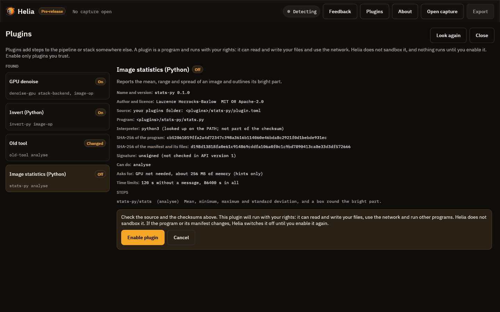

# Tutorial: using plugins

**Goal:** add a processing step to Helia from a plugin, switch it on safely, run it on a real capture
from the command line, read what it reports, and see what Helia does when the plugin changes or
misbehaves.

**You need:** a Helia build and Python 3 for the two example plugins. The plugins are in the
`examples/plugins` folder of the Helia source (`invert-py` and `stats-py`); they are written in plain
Python with nothing to install. Everything below was run on the build at the head of the plugin pull
requests, on `15_20_57.ser` (an ASI482MC H-alpha capture of the 2022-07-17 set, 100 frames of 1920 by
1080, renamed `disc.ser`), with an empty settings folder
(`HELIA_CONFIG_DIR` pointing at a new folder, so your own settings are untouched).

## What a plugin is

A plugin is a separate program that Helia starts when a step needs it and stops afterwards. Helia sends it
a picture (as a file in a private folder) and gets a picture or some numbers back. A plugin can:

* stack the capture somewhere else (`stack-backend`), for example on a faster computer;
* change every frame before stacking (`frame-op`), for example a per-frame denoise;
* change the stack (`image-op`), for example a denoise, deconvolution or super-resolution step;
* measure the result and report numbers and shapes without changing it (`analyse`).

**A plugin runs with your rights.** It can read and write your files, use the network and start other
programs, exactly like any program you download. Helia does not sandbox it. That is why nothing runs until
you have looked at it and said yes, and why Helia switches a plugin off the moment its program changes.
Enable only plugins you trust.

## 1. See what Helia finds

Plugins live in a folder per plugin, each with a `plugin.toml`. Helia looks in its plugins folder (see the
[reference](../reference/plugins.md#where-things-live)) and in any folder you name with `--plugin`. Naming
the two examples:

```console
$ helia --plugin examples/plugins/invert-py --plugin examples/plugins/stats-py plugins list
NAME             VERSION  STATUS     CAPABILITIES               SOURCE
invert-py        0.1.0    off        image-op                   examples/plugins/invert-py/plugin.toml (--plugin)
stats-py         0.1.0    off        analyse                    examples/plugins/stats-py/plugin.toml (--plugin)

Only plugins marked `on` can run. Enable one with `helia plugins enable NAME`.
```

Both are `off`. Finding a plugin only lists it: Helia has read and checked the manifest, but has not run
anything.

## 2. Look before you enable

```console
$ helia --plugin examples/plugins/invert-py plugins info invert-py
name:         invert-py
title:        Invert (Python)
version:      0.1.0
about:        Inverts the brightness of an image, written in plain Python with no SDK.
author:       Laurence Horrocks-Barlow
licence:      MIT OR Apache-2.0
manifest:     examples/plugins/invert-py/plugin.toml
program:      examples/plugins/invert-py/invert.py
interpreter:  python3 (looked up on the PATH; not part of the checksum)
sha256:       e43a305f7ffa342b4d28320c95068b9823ccb65fc4de0e69919d79b0acb8ab09  (program)
              206285aa68b326ba21e44c15ff375c2a485e96ae32e72125e5d19bcdb3ac736f  (manifest and its files)
signature:    unsigned (checking signatures is not in API version 1)
capabilities: image-op
resources:    GPU not needed, about 256 MB of memory (hints only)
limits:       120 s without a message, 86400 s in all
step:         invert-py/invert [image-op] Replaces each value v by (max + min) - v.
status:       off
```

What to read:

* **program** is what will run, and **interpreter** is what runs it. The interpreter is a program from your
  `PATH`, so its checksum is not recorded; the program file's is.
* **sha256** is the fingerprint of what you are about to approve. If the author publishes one, compare it.
* **resources** are hints. They do not limit the plugin; they tell you what it expects.
* **signature: unsigned** is the truth for every plugin in this version: signatures are not checked yet.

## 3. Enable it

```console
$ helia --plugin examples/plugins/invert-py plugins enable invert-py
You are about to enable this plugin:

(the same details as above)

A plugin is a program. It runs with your rights: it can read and write your files, use the
network and run other programs. Helia does not sandbox it. Enable only plugins you trust, and
compare the checksum above with the one its author publishes. If the program or its manifest
changes later, Helia switches it off until you enable it again.

Enable this plugin? [y/N] y
invert-py is on. Approved program checksum e43a305f7ffa342b4d28320c95068b9823ccb65fc4de0e69919d79b0acb8ab09.
```

The answer is recorded, with the two checksums and the time, in `plugins.toml` in your settings folder.
In a script with no terminal Helia cannot ask, and refuses; add `--yes` to approve without the question
(the checksum is still recorded). Do the same for `stats-py`.

## 4. Run a step on a real capture

First, the stack without a plugin, to compare with:

```console
$ helia stack capture/disc.ser -o out/stack.tif --colour mono --keep 25%
```

Now the same, with the invert step:

```console
$ helia --plugin examples/plugins/invert-py stack capture/disc.ser -o out/inverted.tif \
    --colour mono --keep 25% --plugin-step invert-py/invert
plugin:   invert-py/invert (image-op, after Helia's edits)
...
plugin:   invert-py/invert: Inverting
wrote:   out/inverted.tif
```

`--plugin-step PLUGIN/STEP` adds a step; repeat it to chain several. The plugin was checked before the
capture was even opened, so a mistake (a plugin that is off, a step name that does not exist, a value out of
range) stops the run immediately instead of after minutes of stacking.


The two pictures hold the same detail with the brightness inverted: each value `v` became `max + min - v`,
done by a short Python program that reads the picture from a file Helia wrote and writes the answer to a file
Helia named. The file's history (in the TIFF description) names the plugin step that ran, so the result is
traceable.

In plain Python the step visits every one of the 2.1 million samples, so it costs more than one of Helia's own
edits; a plugin written in a compiled language, or one that hands the work to a GPU, is far quicker.

### Before or after Helia's edits

An `image-op` step runs **after** Helia's own sharpening and edits by default, so it sees the picture you
would have saved. Write `pre:` in front to run it **before** them, on the raw stack:

```console
--plugin-step pre:invert-py/invert
```

Put a denoise or deconvolution plugin before your own sharpening, and a plugin that only tidies the result
after it. A step that changes the picture's size (super-resolution) should be the last one, because the
sizes in `--crop` are in the original pixels.

## 5. Measure with an analyse step

`stats-py` does not change the picture. It reports the mean, range and spread, and outlines the part brighter
than a share of the maximum. That share is a **parameter** of the step, given after a colon:

```console
$ helia --plugin examples/plugins/stats-py stack capture/disc.ser -o out/stats.tif --keep 25% \
    --plugin-step stats-py/stats:threshold=0.8
plugin:   stats-py/stats (analyse)
...
plugin:   stats-py/stats: max = 1.0028845071792605
plugin:   stats-py/stats: mean = 0.2441705385875274
plugin:   stats-py/stats: min = 0.0010468891123309731
plugin:   stats-py/stats: std = 0.3703480363437649
plugin:   stats-py/stats: The bright part is 728 by 744 pixels.
wrote:    out/stats.analysis.json
```

Everything an `analyse` step returns is in `out/stats.analysis.json`: the numbers (`metrics`), the shapes
to draw (`overlays`, here a rectangle of 728 by 744 pixels at (496, 172) and a circle at its centre) and the
`notes`. The GUI draws the shapes on the picture; on the command line you get the file. Coordinates are
pixels of the final image, origin top-left.

The parameter has a range in the plugin's manifest, and Helia holds the plugin to it:

```console
$ helia stack ... --plugin-step stats-py/stats:threshold=7
helia: The parameters of stats-py/stats are not right. Bright part threshold: must be at most 1 What to do: Correct them and try again.
```

Parameters can be written as `key=value` pairs (`threshold=0.8`, several separated by commas) or as a JSON
object, `stats-py/stats:{"threshold":0.8}`.

## In the desktop app

Everything above is in the desktop app too. Start it with `helia-gui --plugin examples/plugins/invert-py
--plugin examples/plugins/stats-py` (or put the folders in your plugins folder) and press **Plugins** in the top
bar.


The list on the left shows each plugin and a badge: **On**, **Off**, **Changed** or **Damaged**. Choose one
that is off and Helia shows everything it knows about it before it lets you say yes:



Read the **Source** and **Program** lines, compare **SHA-256 of the program** with the one the author
publishes, and note **Asks for** (a GPU, how much memory; these are hints, not limits). The **Enable plugin**
button is the only thing that switches it on; **Cancel** leaves it off. A plugin that is on has **Disable**,
**Test** and **Forget**. **Test** starts the plugin, runs its own check and shows what it said and its log:
the first thing to try when a plugin that talks to a server does not work. If the plugin has settings (a
server address, a token, a port), the form below is drawn from its settings schema: numbers with a range are
sliders, a token is hidden, and **Save settings** refuses a value outside its range and says which one.

A plugin whose program or manifest changed since you approved it shows **Changed** and is off. Select it and
press **Review and enable again...**; if you did not change it yourself, treat that as a warning.

Close the page with **Close** or Esc, open a capture and go to the Stack step. The **Plugins** card:


* **Stack on** appears when a plugin that can stack is on. **This computer** is Helia's own pipeline.
* **Add a plugin step** lists every step of every plugin that is on, with where it runs: *on every frame*,
  *on the stack* or *measures the stack*. A step with parameters shows its form (here a strength and a
  threshold, each a slider with the range the plugin states).
* **Remove** takes a step out. The steps run in the order shown.
* After a run, **Plugin results** lists what an analysis step reported (numbers and notes), and **Draw the
  shapes on the stack** shows the rectangles, circles, lines and points it asked for, in the pixels of the
  stack.

In the desktop app an image step runs on the stack right after stacking, before the sharpening and edits of
the later steps. To run a step after the edits, use the command line. A true-colour stack cannot go through an
image step (they work on one-channel pictures); Helia says so when you press **Stack**. While a plugin works
its own progress text ("Uploading 40%") replaces the stage name under the Stack button, and **Cancel** asks it
to stop.

## 6. Edit an existing image

`helia edit` takes the same `--plugin-step`, for an image you already have (mono pictures only):

```console
$ helia --plugin examples/plugins/invert-py edit out/stack.tif -o out/edited.tif --plugin-step invert-py/invert
```

A `frame-op` step is refused there, because an edited picture has no frames.

## 7. What Helia does when something is wrong

**The plugin is off.** The run stops before any work, and says what to type:

```console
$ helia stack capture/disc.ser -o out/off.tif --plugin-step invert-py/invert
helia: The plugin invert-py is not turned on. Plugins only run after you approve them. What to do: Open the Plugins page and enable it, or run `helia plugins enable invert-py`.
```

**The program changed.** Edit `invert.py` (add a comment is enough) and look again:

```console
$ helia --plugin examples/plugins/invert-py plugins list
NAME             VERSION  STATUS     CAPABILITIES               SOURCE
invert-py        0.1.0    changed    image-op                   examples/plugins/invert-py/plugin.toml (--plugin)

$ helia --plugin examples/plugins/invert-py stack capture/disc.ser -o out/changed.tif --plugin-step invert-py/invert
helia: The plugin invert-py has changed since you approved it. Its program no longer matches the checksum you approved. What to do: If you updated it on purpose, review it and enable it again with `helia plugins enable invert-py`.
```

Helia hashes the program and the manifest every time it starts the plugin. If you updated it on purpose,
read the change, then run `helia plugins enable` again. If you did not, something has altered a program you
trusted, which is exactly what the check is for.

**The plugin crashes, hangs or sends rubbish.** Helia reports it in the same three parts (what happened, why,
what to do), keeps your capture untouched and carries on with a clear message. `helia plugins test NAME`
starts the plugin, runs its own check and prints its log, which is the first place to look.

## 8. Settings and secrets

A plugin that needs a server address or a token declares a settings form. Set values on the command line;
they are checked against the form (a number out of range is refused), and a secret can be read from
standard input so it never appears in your shell history:

```console
$ helia plugins set myplugin server=https://gpu.example port=7871
$ echo "$TOKEN" | helia plugins set myplugin token=-
$ helia plugins info myplugin
...
settings now: {"port":7871,"server":"https://gpu.example","token":"(hidden)"}
```

Settings, including any token, are kept in `plugins.toml`, readable by you only on Linux and macOS.

## 9. Switch off, forget

```console
$ helia plugins disable invert-py    # off, settings kept
$ helia plugins forget invert-py     # off, approval and settings removed
```

## Troubleshooting

| You see | Why | What to do |
|---|---|---|
| `no plugin called X` | Helia did not find a folder with `plugin.toml` of that name. | `helia plugins list`; check the folder is in the plugins folder or named with `--plugin`. |
| `cannot be used: ...` in the list | The manifest is wrong. The message names the field. | Fix `plugin.toml` (see the [reference](../reference/plugins.md)). |
| `interpreter` not found | `python3` is not on the `PATH` (on Windows it is often `python`). | Change `interpreter` in the manifest, then enable again. |
| `changed` after an update | The program or manifest is not what you approved. | Review it, enable again. |
| `The plugin X stopped answering` | No message for `timeout_s` seconds. | Run `helia plugins test X`; raise `timeout_s` in the manifest for a slow step. |
| Result is the wrong size | The plugin returned a picture that does not fit (`frame-op` must keep the size). | Report it to the plugin's author. |

Where next: [Writing a plugin](writing-plugins.md) builds `invert-py` from nothing, then does the same in
Rust; the [reference](../reference/plugins.md) lists every field and flag.
