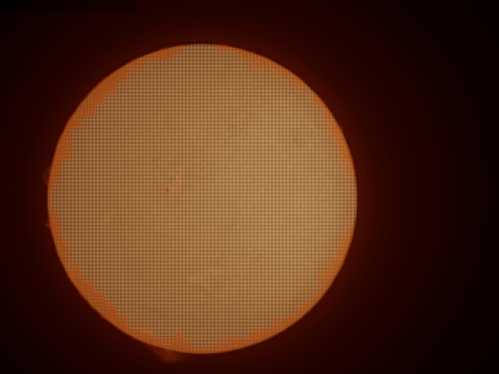
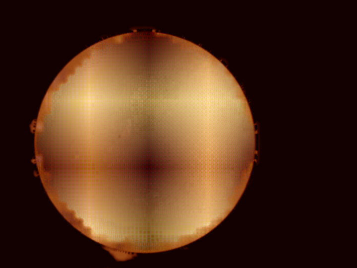

# Tutorial: bringing out prominences in H-alpha

A worked example on a real H-alpha capture: `15_32_09.avi` (720 by 540, mono, 1000
frames, the disc 223 pixels in radius). It shows how to make the prominences above the
limb readable without burning out the disc, and how to adjust the result the way a
prominence processor such as IMPPG lets you. The method and measurements are in
[Prominences and the disc together](../user-guide/prominences.md).

## 1. Stack, sharpen and colour as usual

```sh
helia stack 15_32_09.avi -o ha-plain.tif --preset ha --sharpen wavelet --colour auto
```



The disc is fine, but the prominences on the left limb and at the bottom are a faint
smudge inside a halo of scattered light.

## 2. Turn on the prominence layer

In the app this is the **Adjust** step, and the **Prominence layer** is the first
section. Switch it on and the preview shows the composite. On the command line:

```sh
helia stack 15_32_09.avi -o ha-prom.tif --preset ha --sharpen wavelet \
    --prominence --colour auto
```



With the defaults the brightest 1% of the ring just outside the limb goes from 0.33 to
0.69 of the disc's brightness, the glow in that ring from 0.087 to 0, and the disc
inside 0.9 of the radius is bit-identical.

## 3. Adjust it

Work through the sliders in this order (all have the live preview; defaults in
brackets):

1. **Level** (0.75): how bright the brightest prominence should be next to the disc.
   Raise it for a bolder picture.
2. **Strength** (1) and **Stretch** (6): how hard the faint parts are lifted. Strength
   scales the signal before the stretch; Stretch bends the curve (0 is linear). Faint
   wisps appear as Stretch rises, until the noise does.
3. **Gate** (3 sigma): how much noise is cut away. Raise it if the sky speckles,
   lower it to let the faintest structure through.
4. **Join offset** (0) and **Feather** (0.012 of the radius): where the disc meets the
   layer and how soft the join is. If a thin dark or bright ring shows at the limb,
   widen the feather or move the join out by a few thousandths of a radius.
5. **Layer gamma** (1) and **Disc gamma** (1): a separate tone for the layer and for
   the disc, like the separate adjustment of disc and prominences in IMPPG. Raise the
   layer gamma to darken faint haze; raise the disc gamma to bring out filaments on a
   bright disc. With both at 1 nothing but the layer changes.
6. **Reach** (1.4 radii): how far out the layer goes before it fades to black. Lower it
   when the frame is cut off close to the limb.

Levels and the tone curve below the layer apply to the whole picture afterwards.

## 4. Export a colour table

To colour the same stack in another program: **Colour** step, **Colour table**, or
`helia lut ha -o ha.cube`.

## What to expect and what can go wrong

| What you see | Why | What to do |
|---|---|---|
| Dark arcs next to the limb | The glow is much stronger on one side | Raise Gate a little; widen Feather |
| Speckle all round the disc | Stretch too high for the noise | Lower Stretch or Strength, raise Gate |
| No prominences appear | The capture has none, or they are below the noise | Check the sharpened stack; stack more frames |
| The layer looks flat near a frame edge | The ring is cut by the frame | Lower Reach |
| The picture is unchanged | The limb fit failed (no clear disc) | Frame the whole disc |

On the second capture of that day (`15_37_19.avi`) the same settings take the brightest
1% of the ring from 0.25 to 0.71 of the disc.


*Brightness of the brightest 1% of the ring just outside the limb with the default settings, from the text for the two H-alpha captures (higher shows the prominences better).*
