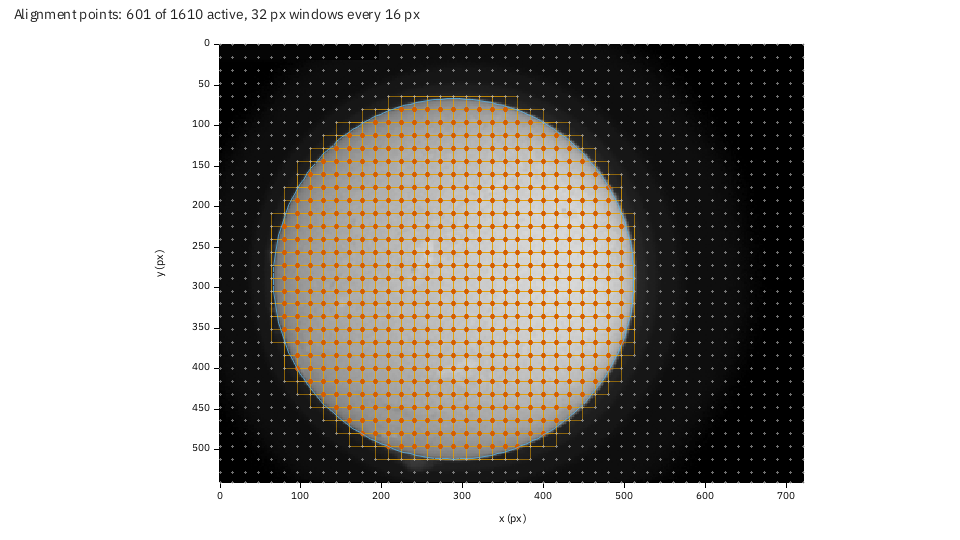
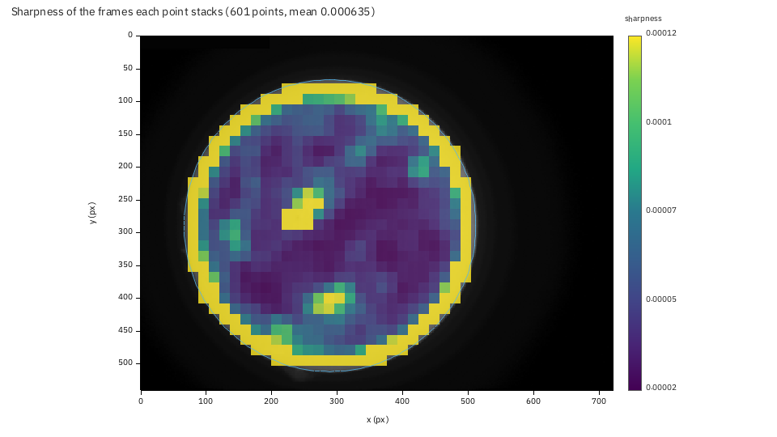
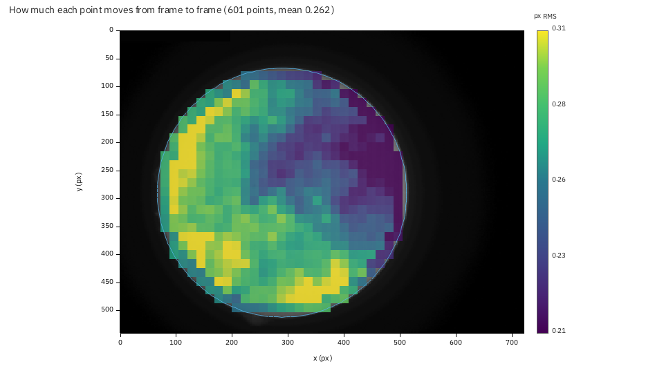
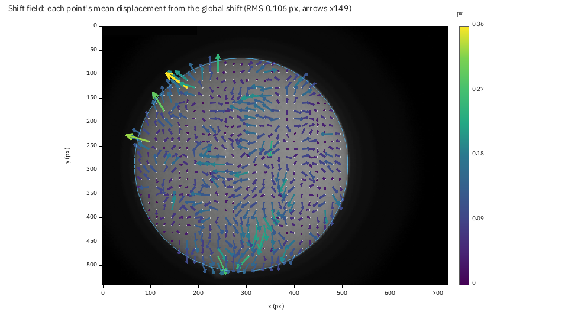
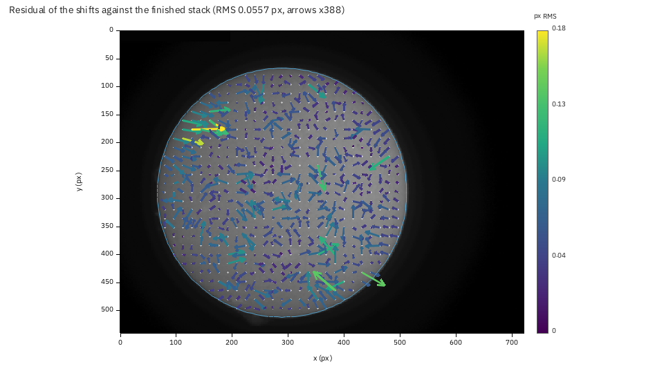

# Tutorial: reading the alignment point plots

**Goal:** check where Helia put its alignment points, which of them found good
frames, how much each one has to move to follow the seeing, and whether the finished
stack agrees with every frame it was made from.

**You need:** a Helia that has `helia stack --report` (see the CHANGELOG) and a
full-disc capture. The pictures are from a real one: `15_32_09.avi`, 1000 frames of
H-alpha at 720 by 540 pixels (the owner's 2022-07-17 session). The first half of
[Tutorial: reading the frame quality graph](reading-the-frame-quality-graph.md) covers
the report itself; the method of multi-point alignment is in
[How stacking works](../user-guide/how-stacking-works.md).

## 1. Stack with the residual pass on

```sh
helia stack 15_32_09.avi -o ha.fits --preset ha --keep 20% --ap-residual --report ha-report
```

`--report` writes the alignment point figures whenever multipoint is on (it is by
default). `--ap-residual` is the one extra: it measures every point once more against
the finished stack, which is one more registration pass (0.3 s here) and what the last
figure needs. Without it the report still has four of the five figures and says so:
`report:  not drawn: ap-residual: the residual was not measured (add --ap-residual ...)`.

```text
frames:  1000 total, 200 kept, 400 registered
points:  601 of 1610 alignment points active
refine:  1 pass, 0 shifts replaced by the smoothing of 240356 measured; residual against the stack 0.056 px RMS
```

New files in the report directory: `ap-grid.png`, `ap-quality.png`, `ap-shift.png`,
`ap-field.png`, `ap-residual.png`, the per-point table `ap-table.csv`, `ap-data.json`
and `ap-reference.png` (the reference frame, which the plots are drawn over).

## 2. The grid



The reference frame (the median of the best five frames) with every point that was
measured: the orange squares are its 32 pixel windows, the red dots their centres. A
window starts every 16 pixels, so windows overlap by half. The pale dots outside the
disc are windows that were skipped as featureless: **601 of 1610** points are active.
The thin circle is the fitted disc.

What to check:

1. **The points cover the detail you care about.** Here they fill the disc evenly; a
   gap over a filament or a sunspot would mean its contrast was below `min_contrast`.
2. **Nothing sits on the sky or on burned-in text.** The camera's time stamp at the top
   left of this capture (a 196 by 20 pixel block) is masked, and no point is on it.
3. **The window size suits the scale.** A window should hold two or three granules or
   fibrils. If you can see only smooth disc inside a square, try a bigger window
   (`--ap-size 48`) or `--ap-auto`.

## 3. Which points found sharp frames



Each point stacks its own best 200 frames, so each has its own quality: the mean
sharpness (the ranking metric, on the point's window) of the frames it kept. Bright
cells are where the picture was sharpest.

1. **The limb saturates the scale** (the yellow ring): an edge is sharp by any
   gradient measure. The colour range is taken from the points well inside the disc,
   so that the interior stays readable, and the limb is clamped at the top.
2. **Inside, structure shows**: two compact patches of high sharpness, near (260, 275)
   and (310, 415), stand out from the dark interior. In an H-alpha disc the sharpest
   detail is a dark filament or a bright plage edge, and these are the places to compare
   with the picture. A uniform interior is the healthy look of a quiet white-light disc;
   blotches that match nothing in the picture would mean the points are choosing frames
   by noise.

The same numbers are in `ap-table.csv` (`quality_kept`, and `quality_mean` over every
frame the point was measured in).

## 4. How much each point moves



The whole frame's shift is taken out first (that is the global alignment's job), then
each point's displacement is compared frame by frame: the colour is the scatter of that
displacement in pixels RMS. This is the distortion the seeing adds across the disc, and
the reason multi-point alignment exists.

1. **The values are small and fairly even**: 0.16 to 0.34 px, median 0.27 px. At the
   scale of this capture (4.3 arcsec per pixel) that is about 1.2 arcsec of local
   wobble.
2. **The left limb and the bottom of the disc move most** (0.30 against 0.24 px on the
   right): the air there was less steady (or a thermal gradient lay
   along that side of the beam). A smooth pattern like this one is the seeing's, not
   noise; it is worth knowing when you choose which part of the disc to judge a stack by.
3. **If every cell is below about 0.1 px**, the global alignment already follows the
   seeing, and multipoint is buying little: `--no-multipoint` would be nearly as good
   and faster.

## 5. The shift field



Each arrow is a point's *mean* displacement from the global shift over the frames:
what is the same in every frame. Arrows are scaled so that the 90th percentile arrow is
one and a half grid steps long (the factor is in the title, x49 here: the arrows are
short; the RMS is 0.11 px).

* A **smooth, systematic** field (all arrows turning the same way round the disc, or
  growing with distance from the centre) means the image is distorted the same way in
  every frame: field curvature, a tilted sensor, or a mount that turns the field.
* A **random** field of short arrows, as here, means the displacement is the seeing's
  and averages out. The few long arrows (the yellow one near (170, 130)) are points
  on a feature the reference does not hold well.

## 6. The residual against the stack



After stacking, the points are measured again against the *finished stack* (which has
far less noise than the reference) and compared with the shifts that were used. The
arrows are the mean difference, the colour the RMS: **0.056 px** overall here, the
number the text report prints as `residual against the stack`.

1. **Small and random** is the result you want: the stack agrees with every frame it was
   made from, to a twentieth of a pixel.
2. **Coherent arrows** (a whole region leaning the same way) would mean the reference
   biased the shifts; the cure is two passes (`--ap-passes 2`), which measures the points
   against a stack instead of the reference.
3. **A few long arrows** (the yellow ones at the left, around (130, 180)) are points
   where the measurement is poorly constrained. `--ap-smooth on` replaces a shift that
   disagrees with its neighbours by their median.

Run the same capture with `--ap-passes 2 --ap-smooth on --ap-residual` and compare the
two residual figures: that is the experiment this plot exists for.

## 7. In the app and through the API

In the app, tick **Residual pass** in the Science section of the Stack step *before*
stacking (it adds the pass), then **Show plots**: the alignment point figures are among
the chips. Through the API, add `"report": true` and `"ap_residual": true` to the job's
`config`; the files are `ap-grid.png`, `ap-quality.png`, `ap-shift.png`, `ap-field.png`,
`ap-residual.png` and their data. To redraw one at another size:

```sh
helia plot ap-shift ha-report -o ap-shift-big.png --size 1600x1200
```

The plot takes its picture and numbers from the report directory, so it works on a
different computer from the one that stacked.

## When it goes wrong

* **`ap-grid: no alignment point was measured`.** Multipoint is off (`--no-multipoint`)
  or the disc has no detail (a capture of sky). The report has no alignment point
  figures, and says so.
* **`the reference picture ap-reference.png is missing from the report`.** You copied
  `ap-data.json` without `ap-reference.png`; the plots need both.
* **The quality plot is one flat colour.** All points have much the same sharpness
  (a featureless disc); the range is then the 2nd to 98th percentile of a narrow
  spread. Read `ap-table.csv` instead.
