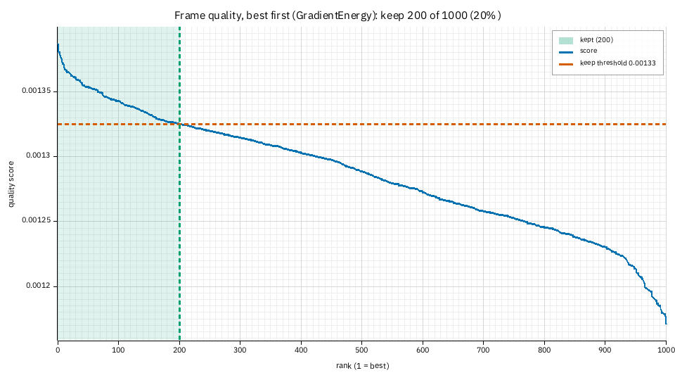
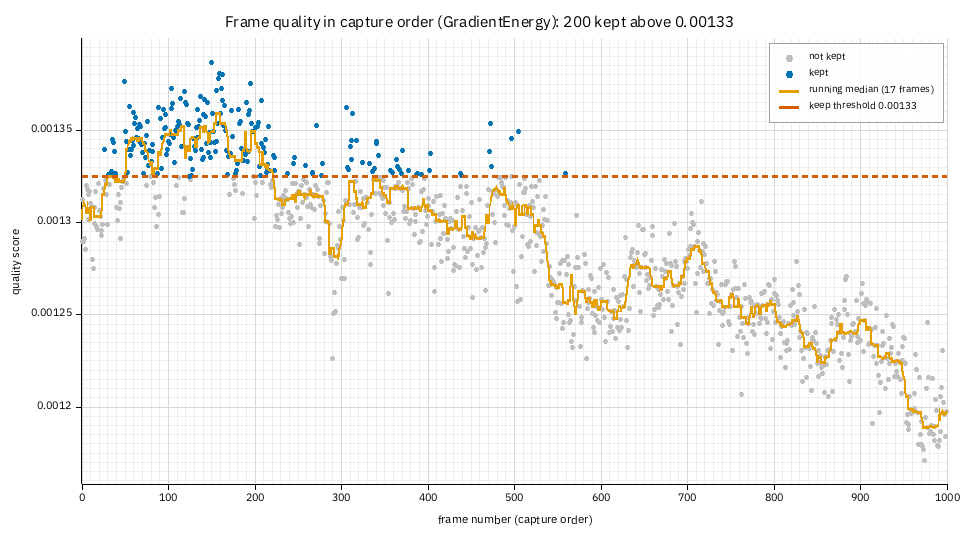
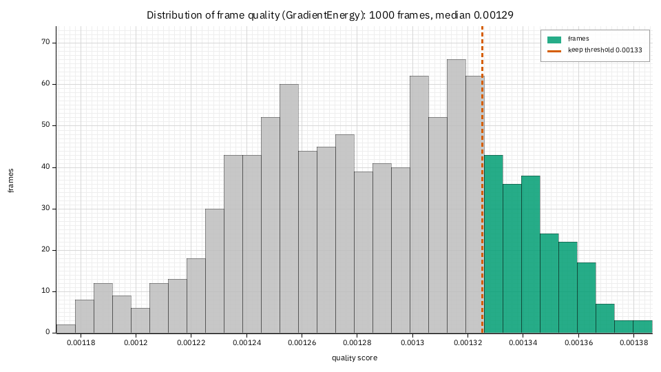
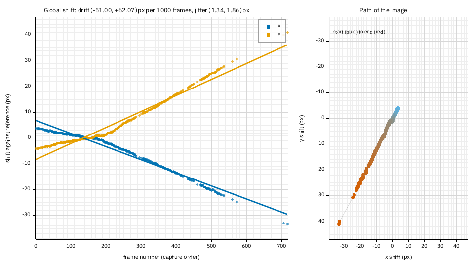
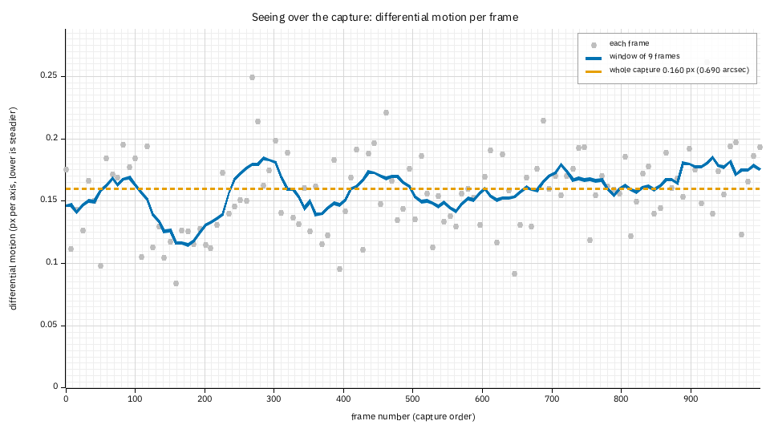
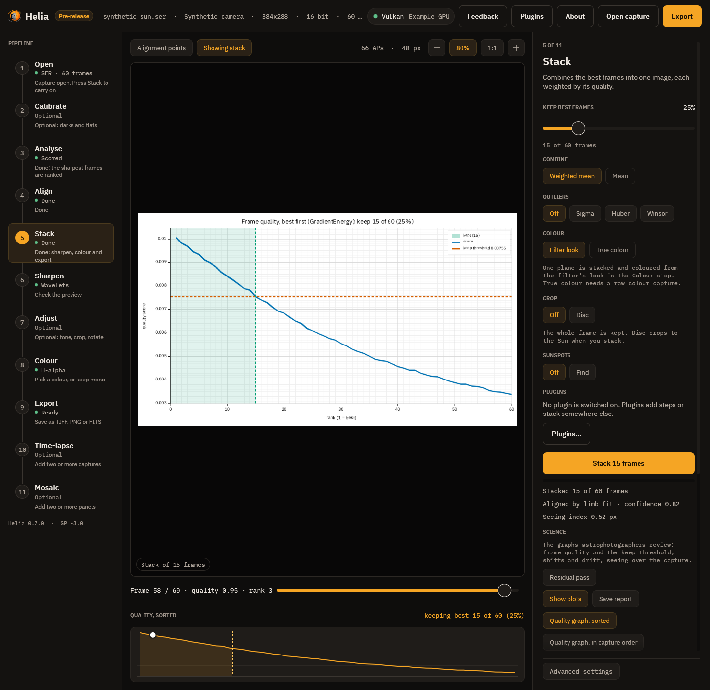

# Tutorial: reading the frame quality graph

**Goal:** stack a capture with the science report switched on, then read the
frame quality graphs, the shift and drift plot and the seeing plot the way you
would read AutoStakkert's, and use them to decide how many frames to keep.

**You need:** a Helia that has `helia stack --report` (see the CHANGELOG) and one capture. The pictures below are from a
real one: `15_32_09.avi`, 1000 frames of H-alpha at 720 by 540 pixels (the owner's
2022-07-17 session, an undriven mount). The page
[Science outputs](../user-guide/science-outputs.md) lists every file and option;
this page is the walk-through.

## 1. Stack with the report switched on

```sh
helia stack 15_32_09.avi -o ha.fits --preset ha --keep 20% --report ha-report
```

`--report DIR` makes the directory and fills it as the last step of the stack. It
turns the seeing probe on too (about 120 more frames are read, a second or two on
this capture). `--keep 20%` is a deliberate choice for this example: the default is
25%, and the graphs below show why 20% is a fair cut for this capture.

```text
frames:  1000 total, 200 kept, 400 registered
...
seeing:  followed 16 tiles of 64 px through 120 frames spread over the capture
seeing:  motion index:   0.160 px (0.69 arcsec) RMS differential motion per axis ...
wrote:   ha.fits
report:  10 files in ha-report (open ha-report/report.html)
```

The directory holds `report.html` (everything on one page, figures inline), five
PNG figures, and the numbers behind them: `frame-quality.csv`, `frame-quality.json`
and `seeing-time.csv`. A FITS output also gives `fits-header.txt`, a copy of the
stack's header cards, so the page says exactly what went into the file.

## 2. The sorted quality graph

Open `quality-sorted.png`, or the first figure of `report.html`.



Every frame's score, best on the left. The score is the ranking metric (here the
gradient energy of the green plane: the default `--metric gradient`), so the units
do not matter; only the shape does.

1. **The green band** is the frames that were stacked, and its right edge, with the
   dashed red line, is the **keep threshold**: the score of the worst frame kept.
   Here it is 0.001325.
2. **The shape of the curve** tells you how much to keep. This one falls steeply over
   the first 100 frames, then slowly, then drops sharply in the last 5%. A steep
   start means a few moments of good seeing stand out from the rest; the knee near
   rank 200 is a natural place to cut, and 20% sits just after it. A curve that is
   straight from the first frame to the last means no frame is much better than
   another, and keeping more frames costs little.
3. **The sharp drop on the right** is blurred frames (a gust, a cloud edge, a bump).
   They are never kept at any sensible threshold.

## 3. The same scores in capture order



Now the x axis is time. Blue points were kept, grey were not, and the orange line is
a running median of the scores, so you can see the trend.

1. **The kept frames come in clusters.** Nearly all of them are in frames 50 to 250:
   that is when the seeing and focus were best. A kept frame far from a cluster
   (here around frame 560) is a good moment, not an accident.
2. **The slow fall to the right** is the focus or the air getting worse over the
   session: the median falls from 0.00135 to 0.00119. If you capture again, refocus
   after the first few minutes. It also says what a longer capture buys: the extra
   frames are mostly in the grey part.
3. **Red crosses** (none on this capture) mark scores an artefact had raised, such
   as a satellite trail or a hot-pixel line. Helia puts them back to their
   neighbours' level before ranking (`robust_ranking`); the cross is the value the
   metric measured. If you see a row of them, look at those frames: something in
   the optical path is changing the picture.

## 4. The histogram



The same 1000 scores, counted. The green bars are the part the threshold lets
through. Read it for the **shape**:

* one narrow hump, no tail: steady conditions, nothing to choose between frames;
* a hump with a long tail to the right (this capture): the occasional lucky frame,
  and the threshold cuts into the tail, which is the point of lucky imaging;
* two humps: something changed part-way (focus, exposure, cloud). Look at the capture
  order graph to find when.

## 5. Global shift and drift



The left panel is each registered frame's shift against the reference, x in blue and
y in orange, with the straight-line drift. The right panel is the same shifts as a
path, from the start (blue) to the end (red). Only the *candidate* frames are
registered (two times the frames kept, 400 here), which is why the points stop at
frame 720: the rest were not among the best 40%.

1. **The drift** in the title is the straight-line fit: here (-51.0, +62.1) pixels per
   1000 frames. This is an undriven mount, and the Sun crossed 40 pixels of the field
   during the capture. A driven mount shows a flat line.
2. **The jitter** (1.34, 1.86 px) is the RMS scatter about the line. It is mostly the
   seeing's image motion (tip and tilt), and it is the number the global alignment
   has to take out. The curve here is not quite straight; the fit is a line on
   purpose, so the departure from it is visible.
3. **If the path leaves the frame**, or the drift is more than a few percent of the
   field over the capture, re-centre the target during the capture or use
   `--exclude` so a frame edge does not confuse the alignment.

## 6. Seeing over the capture



Each grey point is the differential motion between neighbouring tiles of the disc in
one of the 120 frames sampled across the capture, in pixels per axis; **lower is
steadier**. The blue line averages nine of those samples, and the dashed line is
the whole-capture index that the text report prints (0.160 px, 0.69 arcsec here).

It is a *relative* index, not r0: it needs the same optics to compare. What this
plot adds to the number is *when*: the steadiest stretch is around frames 110 to
210 (the line falls to 0.115 px), exactly where the quality graph put its cluster of
kept frames. Two independent measures agreeing is the check that the keep threshold
is choosing seeing and not noise.

Give the aperture (`--aperture-mm`) and the title gains the Fried parameter and the
grade: for example `r0 7.5 cm at 500 nm, good`. The r0 is one figure for the whole capture, as the
spectral method needs many frames; the plot's line is the motion index.

## 7. Redraw or adapt a figure

Each figure is drawn from its JSON, so you can make another without stacking again:

```sh
helia plot quality-sorted ha-report -o sorted-wide.png --size 1600x700
helia plot all ha-report -o figures/
```

`helia plot KIND capture.ser -- --keep 10%` stacks a capture first and draws one
figure from it. For your own styling, read the CSV in Python:

```python
import pandas as pd
import matplotlib.pyplot as plt

q = pd.read_csv("ha-report/frame-quality.csv")
kept = q[q.kept == 1]
plt.scatter(q.frame, q.score, s=3, c="lightgrey")
plt.scatter(kept.frame, kept.score, s=3)
plt.xlabel("frame"); plt.ylabel("quality score"); plt.show()
```

## 8. In the app

After a stack, the Stack step has a **Science** section under the result lines.
**Show plots** puts the graphs in the viewer in place of the stack; the chips choose
which one, and the caption says how to read it. **Save report** writes the whole
report (PNG, CSV, JSON, `report.html`) into a folder you choose.



(The picture is a synthetic capture so that it can be regenerated by the tests; the
graphs above are the real ones.)

## 9. Through the API

Add `"report": true` to the job's `config`; the finished job's `summary.report.files`
lists the files, and `GET /api/v1/jobs/{id}/report` returns the page and
`GET /api/v1/jobs/{id}/report/quality-sorted.png` a figure.

## When it goes wrong

* **No `seeing-time.png`, and a line `not drawn: seeing-time: the seeing was not
  measured`.** The probe needs a disc with enough detail for two or more tiles of 64
  pixels. A capture of a small disc, or sky, has none. The other figures are not
  affected.
* **`shift-drift.png` is missing.** Fewer than two frames were registered: a capture
  of one or two frames, or `--keep` so small that two candidates do not exist.
* **The sorted curve is a straight line.** The metric cannot tell the frames apart on
  this capture. Try `--metric laplacian` or `fourier` (see
  [Choosing a quality metric](../user-guide/choosing-a-quality-metric.md)) and compare.
