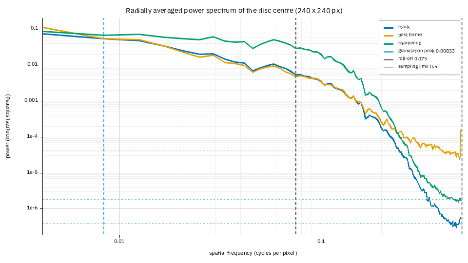
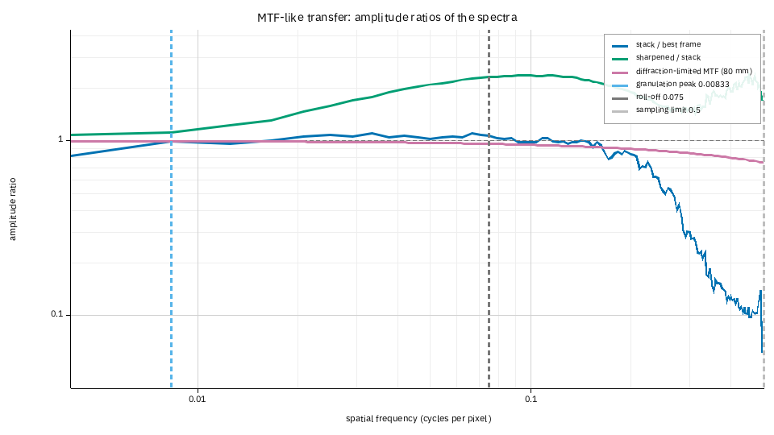
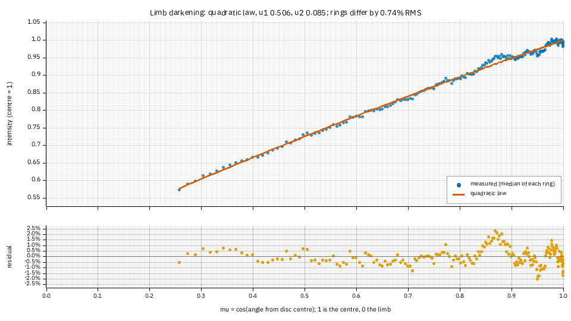
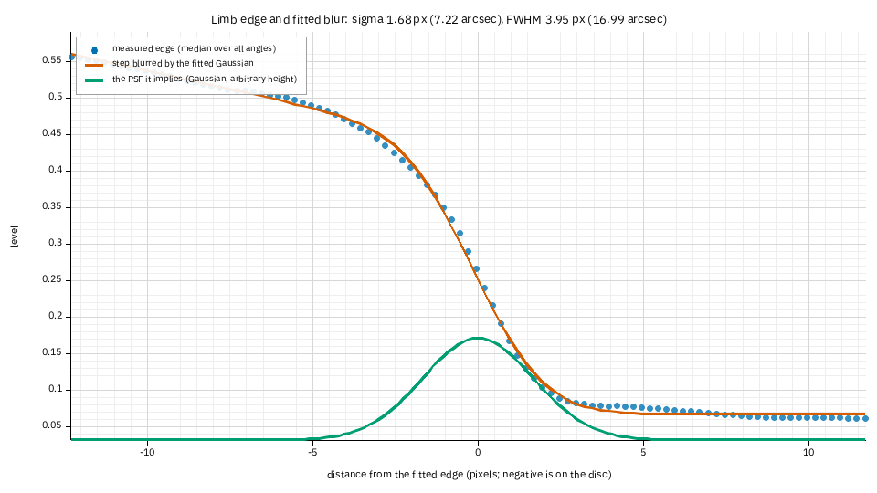
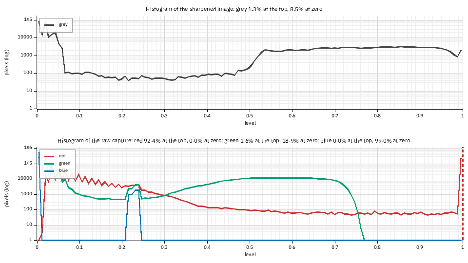
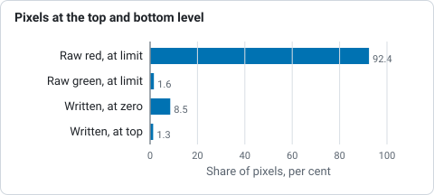
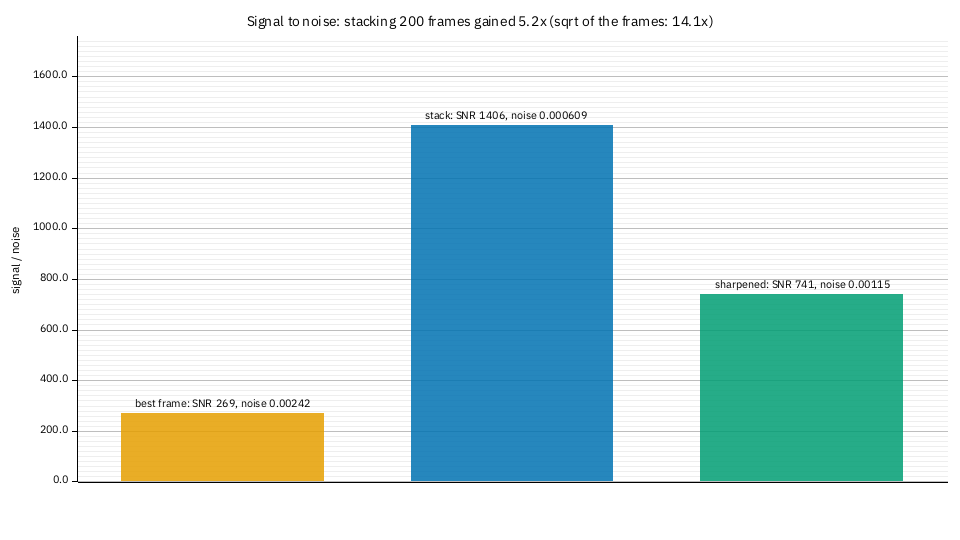

# Tutorial: reading the image science plots

**Goal:** read the power spectrum and the transfer curve of a stack (against its best
frame and its sharpened image), the limb-darkening profile, the measured blur of the
limb, the histograms with their clipping, and the noise, and use them to decide whether
a stack is limited by seeing, by the pixels, by noise or by clipping.

**You need:** a Helia that has `helia stack --report` (see the CHANGELOG) and a
full-disc capture. The pictures are from a real one: `15_32_09.avi`, 1000 frames of
H-alpha at 720 by 540 pixels, stacked with the best 20% and sharpened with the
wavelets. The telescope is not recorded in the capture, so the 80 mm aperture below is a
guess; only the shapes and the comparisons mean anything, as in
[Measure a stack](measure-and-seeing.md). Methods are in
[The granulation and seeing report](../user-guide/quality-report.md) and
[Flatten the limb darkening](limb-darkening.md); the files and options are in
[Science outputs](../user-guide/science-outputs.md).

## 1. Stack with a report, a sharpening and the aperture

```sh
helia stack 15_32_09.avi -o ha.tif --preset ha --keep 20% --sharpen wavelets \
    --aperture-mm 80 --report ha-report
```

The aperture is optional: it adds the telescope's diffraction cut-off to the spectrum
plots and `r0` to the seeing plot. `--sharpen` makes the *sharpened* curve (a TIFF or PNG
output that was edited; a FITS output is the unsharpened stack unless `--sharpen-fits`).
The report reads the best single frame and six raw frames of the capture besides the
stack, a few hundredths of a second.

New files: `power-spectrum.png`, `mtf.png`, `limb-profile.png`, `limb-psf.png`,
`histogram.png`, `noise-snr.png`, their tables (`spectrum.csv`, `limb-profile.csv`,
`limb-psf.csv`, `histogram.csv`, `noise.csv`) and `image-science.json`.

## 2. The power spectrum



The power of the 240 by 240 pixel square at the disc centre, at each spatial frequency
(cycles per pixel; 0.1 is a period of 10 pixels, 43 arcsec here). Each image is divided
by its own blur first, so the curves are in units of contrast and can be compared.
Detail is on the left; each curve flattens into its **noise floor** (the dashed
horizontal lines, one per image) on the right.

1. **Best frame (orange) and stack (blue) agree up to about 0.15 cycles/px.** Stacking
   did not add detail at the scales this capture holds; what it did is lower the floor.
2. **The floors**: 4.1e-5 for the best frame, **4.0e-7 for the stack**, a hundred times
   lower. That is the whole gain of stacking 200 frames, and it is why the stack can be
   sharpened: the detail can be lifted by a factor before the noise comes up with it.
3. **The sharpened image (green)** is the stack lifted by the wavelet gains: up to a
   factor of about five in power between 0.03 and 0.2 cycles/px, and its floor (1.8e-6)
   is higher than the stack's because the same gains lifted the noise.
4. **Where each curve meets its floor** is how fine the image resolves: 0.158 cycles/px
   (a 6.3 pixel period, 27 arcsec) for the best frame, 0.163 for the stack, 0.196 (5.1
   pixels, 22 arcsec) for the sharpened image (`resolved up to` in the report's table).
5. **The vertical lines.** Blue: the granulation peak, which for a white-light capture
   is the size of the granules (here it is just the lowest bin, because H-alpha shows no
   granulation: ignore it). Grey: where the stack's power has fallen to 10% of its peak
   (0.075 cycles/px). Light grey: the sampling limit, 0.5 cycles/px, the finest the pixels
   can hold. A red line would mark the telescope's diffraction cut-off; with 80 mm at
   656 nm and 4.3 arcsec per pixel it is at 2.55 cycles/px, off the plot: **the pixels, not
   the telescope, limit this capture**, as in the measure tutorial.

## 3. The MTF-like transfer curve



The ratio of the amplitudes (the square roots of the power) of two spectra at each
frequency, which is what a modulation transfer function is for a pair of images of the
same scene.

* **Stack over best frame (blue).** Near 1 up to 0.15 cycles/px (the same detail), then
  falling: beyond that the best frame is only noise, so the stack, which has less, is
  lower. Above 1 in the signal band would mean the stack recovered detail the best frame
  lacks (alignment points undoing the seeing; it does on the synthetic captures the
  report was developed on, by up to three times).
* **Sharpened over stack (green).** What the sharpening did: the boost of the wavelet
  layers, up to 2.5 times in amplitude at 0.1 cycles/px, falling off where the noise
  starts. It should look like the gains you chose: if it rises where only noise lives,
  the sharpening is lifting noise.
* **The purple curve** is the diffraction-limited MTF of a circular aperture for the
  aperture you gave (flat here because the cut-off is so far out). No real image should
  pass it; an image that does is oversharpened.
* **Beyond the noise floor every ratio is noise**, as the ragged right-hand end shows.

## 4. The limb-darkening profile



The median intensity of each ring of the disc (blue dots) against the fitted law (the
`quadratic` law, u1 0.506 and u2 0.085), against mu, the cosine of the angle from the
disc centre: 1 at the centre, 0 at the limb. The lower panel is the residual.

1. **The rings differ from the law by 0.74% RMS**, the number the text report gives as
   `limb:`. Residuals of a fraction of a per cent with no pattern are a good fit.
2. **The bump near mu 0.87** (+2%) and **the ripple near the limb** are the real
   centre-to-limb curve. In H-alpha the line forms higher in the atmosphere than the white
   light the laws were made for, so the curve is not a limb-darkening law and the
   quadratic cannot follow every wiggle; each ring is a median, so a single plage patch
   could not make the bump. For white light the residual is usually flat.
3. **A curve in the residual** (a smile or a frown over the whole range) would mean a
   different law fits better: try `--limb-law neckel`.

## 5. The measured blur of the limb



The median over every angle of the picture across the edge of the Sun (blue), a sharp
step blurred by the fitted Gaussian (red), and the Gaussian itself (green, arbitrary
height): the **point spread function** of the stack if the limb were a perfect edge.

1. **The numbers**: sigma 1.68 px (7.2 arcsec) and FWHM 3.95 px (17 arcsec), with the
   pixel's own width taken out. This is what `helia stack --rl-psf limb` deconvolves
   with.
2. **The misfit** is 1.4% of the step from disc to sky. Under about 3% the edge is clean
   and the blur is the telescope's, the seeing's and the stack's. **In H-alpha the limb
   is a fringe of spicules**, so this width is larger than the optics': it is a sensible
   size for the deconvolution to undo, but not the telescope's resolution.
3. **Above 10% misfit** (a limb that is not an edge, or too little of it in the frame)
   there is no PSF and the report says why instead of drawing one.

## 6. The histograms and clipping



The count of pixels at each level, on a logarithmic scale. The top panel is the image
as it will be written; the bottom one is the raw capture (six frames, one curve per
colour plane of the mosaic). The line above each says what share sits on the top
level and at zero.

1. **The raw red plane is clipped: 92.4% of its lit pixels are at the sensor's limit**
   (the red spike at level 1, with the dashed line). This is the same finding as the
   channel note (`the red plane is clipped ...; stacking the green plane instead`), seen
   as a picture: a plane that is flat at the top has no detail in the bright parts.
2. **The green plane is not clipped** (1.6%, nothing like a plateau), and the blue plane
   holds no signal (all its pixels are within a few levels of black, so it is not
   reported as clipped).
3. **The written image** has 8.5% of its pixels at zero (the sky, which the sharpening
   leaves black) and 1.3% at the top. A plateau of more than a few per cent at the top of
   the output means the white point is clipping the disc: lower `--white` or the gain.



*Share of pixels at a limit in the raw red and green planes and in the written image, from the histogram panels.*

## 7. Noise and signal to noise



The signal (the median level) over the noise (the spread of the high-pass response,
Immerkaer 1996) of the disc-centre square, for the best frame, the stack and the
sharpened image: **269, 1406 and 741**.

1. **Stacking 200 frames raised it 5.2 times**; the square root of the number of frames
   predicts 14. The gap is expected: the estimate reads only the finest-grained noise
   and the stack's is correlated over a few pixels (the frames were resampled), so it is
   under-read, and the kept frames are the best of one session, not independent
   exposures. Use the number as a comparison between images of one capture, not as the
   camera's read noise.
2. **Sharpening cost half of it** (741 against 1406): it amplifies the noise along with
   the detail. That is the price of the green curve in the spectrum; if you want it
   back, use a smaller wavelet gain at the finest layers or `--denoise`.

## 8. In the app and through the API

In the app, **Show plots** in the Science section of the Stack step has the power
spectrum, the transfer curve, the limb plots, the histograms and the noise among its
chips, drawn from the stack and the best frame; the sharpened image is not in it (the
edits are applied in the later steps), so the curves there are the stack and the best
frame. **Save report** writes everything. Through the API, `"report": true` serves the
same files; the sharpened curves are there when the job has edits and an output format
they apply to. Redraw one at any size:

```sh
helia plot power-spectrum ha-report -o spectrum-wide.png --size 1600x700
```

## When it goes wrong

* **`mtf: the transfer curve compares the stack with the best frame or the sharpened
  image, and neither is available`.** The report could not read the best frame (a source
  that cannot be read twice) and nothing was sharpened.
* **`limb-psf: the limb is not a clean edge here, or too little of it is in the frame`.**
  The same reasons as `helia measure --psf`; see [Measure a stack](measure-and-seeing.md).
* **`limb-profile: no limb-darkening fit`.** No clear disc: a crop that cuts the limb, or
  a capture of something else.
* **The spectra are empty.** The disc-centre square is flat (an image with no detail in
  it); nothing is drawn, and the other plots are not affected.
