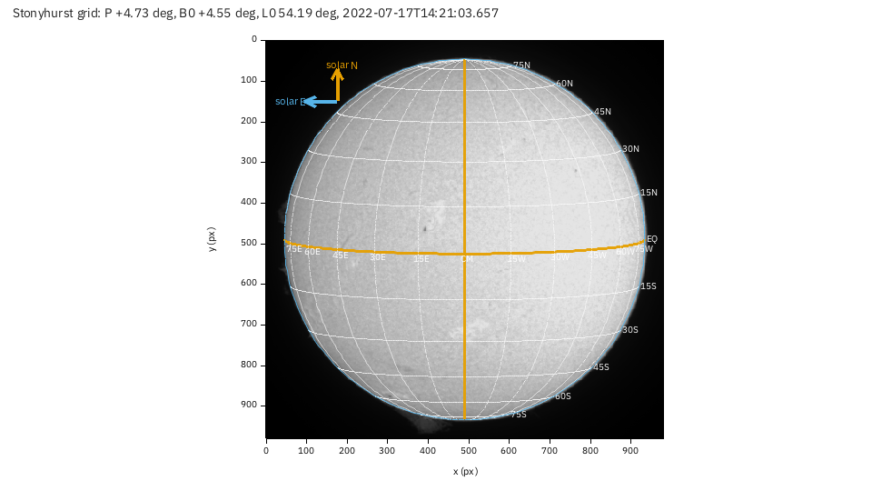
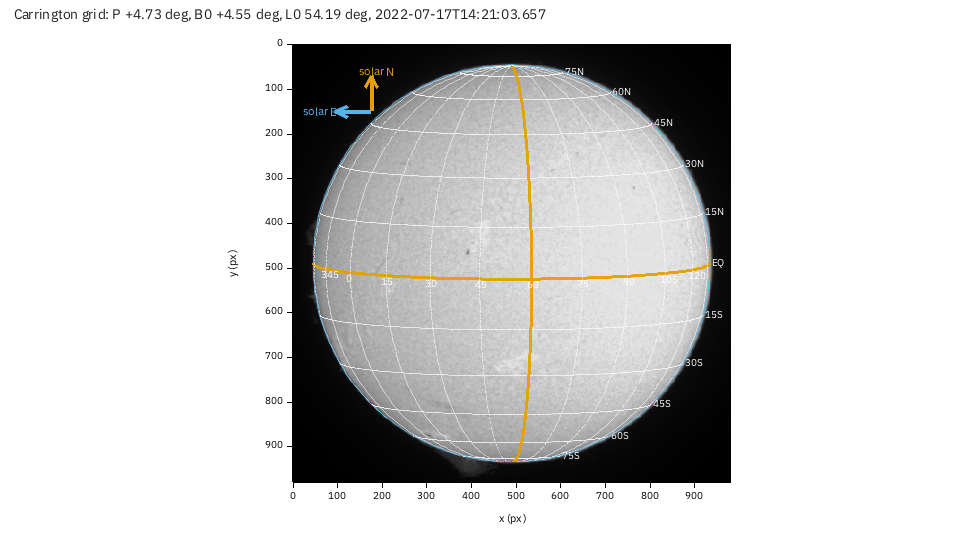
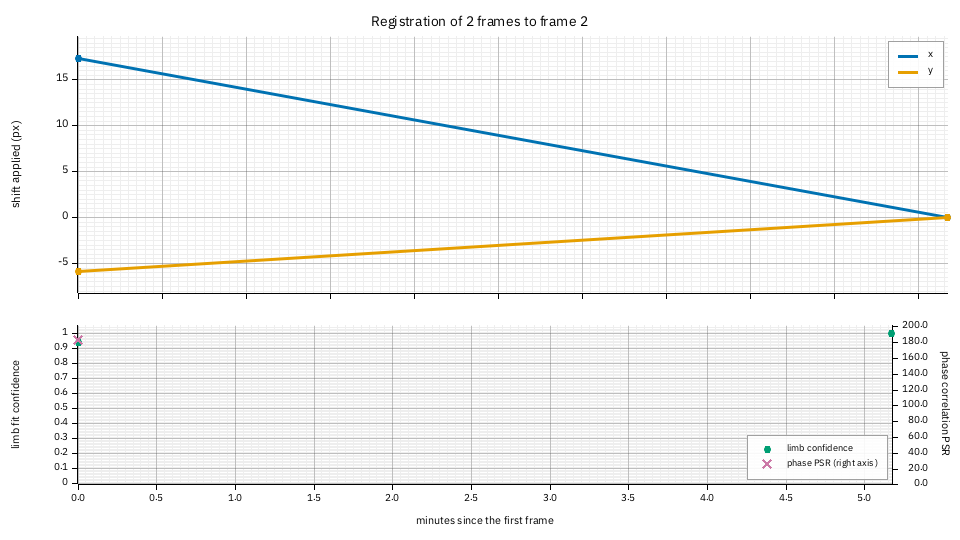
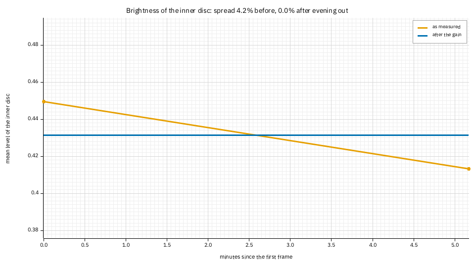
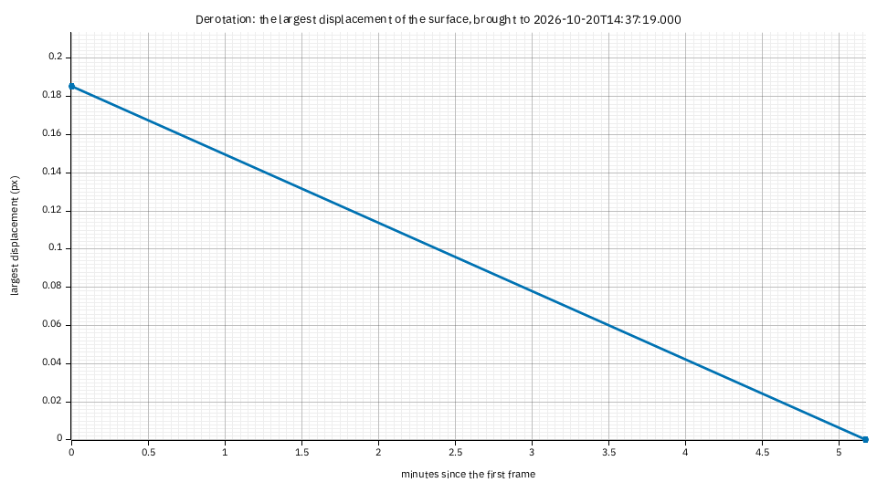

# Tutorial: reading the solar plots

**Goal:** lay the Stonyhurst and Carrington heliographic grids over a stack, find the
position of a feature on the Sun from them, see where the sunspot table of the same report
comes from, and read the diagnostics of a time-lapse (registration, brightness,
derotation).

**You need:** a Helia that has `helia stack --report` (see the CHANGELOG), and for the grid
a capture whose time is known: a SER (its camera time stamps are used), or any other
capture with `--date`. The grid pictures are from a real SER, `15_20_57.ser` (H-alpha,
1920 by 1080, 100 frames, 2022-07-17); the time-lapse pictures are from the real pair of
the [time-lapse tutorial](timelapse.md). The positions are computed as in
[Sunspots, groups and the Wolf number](../user-guide/sunspots.md) and
[Solar derotation](../user-guide/derotation.md).

## 1. Stack with the report on

```sh
helia stack 15_20_57.ser -o ha.fits --preset ha --keep 20% --autocrop --report ha-report
```

The report notes the time it used. For a capture with no time of its own (an AVI, a
video) give it: `--date 2022-07-17T13:42:57` is the UTC time, `YYYY-MM-DDThh:mm:ss`. A
file named by the camera program's local clock needs the offset taken off: this owner's
files are in British Summer Time, so `15_32_09` is 14:32:09 UTC. Without any time the
report says so and leaves the grids out:

```text
report:  not drawn: grid-stonyhurst: the time of the capture is unknown, so P, B0 and L0 cannot be found (a SER with timestamps, or a FITS with DATE-OBS, gives it)
```

New files: `grid-stonyhurst.png`, `grid-carrington.png`, `heliographic-grid.csv`,
`solar.json` and `solar-reference.png` (the stack the grids are drawn on).

## 2. P, B0 and L0

The title of each figure gives the three angles for the middle of the capture, here
2022-07-17 14:21:03.657 UTC (the SER's own time stamps), from the series of Meeus,
*Astronomical Algorithms*, chapter 29 (good to about 0.01 degree):

* **P = +4.73 degrees**: the position angle of the Sun's rotation axis, east of celestial
  north. The pole is tilted that far from the celestial north direction.
* **B0 = +4.55 degrees**: the heliographic latitude of the middle of the disc, which is
  how far the north pole is tipped towards us. At +4.55 the north pole is just visible
  and the south pole hidden, and the equator curves slightly below the middle.
* **L0 = 54.19 degrees**: the Carrington longitude of the middle of the disc.

## 3. The Stonyhurst grid



Parallels and meridians every 15 degrees, measured from the **central meridian** (CM, the
orange vertical line): `15W`, `30W` to the west of it and `15E` to the east, `15N` and
`30S` for latitude. The orange horizontal line is the equator (`EQ`).

1. **Find a feature.** The small dark feature just above and left of the centre, near
   pixel (468, 252), lies between the `30N` and `45N` parallels and a little east of the
   central meridian: the same arithmetic as the grid's gives 37 degrees north and 4 degrees
   east of the central meridian. Read positions from the lines, or compute them in Python
   from `solar.json` (the disc geometry and the three angles).
2. **Solar north and east** are the arrows in the corner. North is along the axis; **east
   is to the left of the picture when north is up**, as on the sky. Here the arrows are
   plain: the picture's orientation was not given, so solar north is assumed to be up.
   If your image has celestial north up (an equatorial mount that does not flip), add
   `--celestial-north-up`: the grid is then turned by P, 4.73 degrees. If it is rotated by
   other means (a diagonal, a camera turned), `--north-angle DEG` turns it; if it is a mirror
   image (a diagonal without a flip), `--mirror`. These are the same options as
   [counting sunspots](sunspots.md); a wrong orientation turns the whole grid, so check it
   against a feature you know, such as a prominence on the limb.
3. **The grid ends at the limb**: only the visible hemisphere is drawn, and the labels
   of meridians within 14 degrees of the limb are left out because they crowd.

## 4. The Carrington grid



The same grid labelled in **Carrington longitude**, a system fixed to the rotating Sun
(it turns once in 27.2753 days, the Carrington rotation). The meridians are the multiples
of 15 degrees: `15`, `30`, `45`, `60`, ... The orange one is the multiple nearest the
middle of the disc: 60 here, which is 5.8 degrees more than L0, so it lies 5.8 degrees west
of the central meridian (Carrington longitude grows towards the west).

1. **A spot keeps its Carrington longitude** from one day to the next, while the disc
   turns about 13.2 degrees a day under the central meridian, so L0 falls by that much a
   day. A group at longitude 40 reaches the central meridian when L0 has fallen to 40, in
   `(54.19 - 40) / 13.2` = 1.1 days; one at longitude 75 crossed it 1.6 days ago and is
   now in the west.
2. **Compare captures.** Two stacks of the same region taken days apart show it at
   different places on the Stonyhurst grid and at the same place on the Carrington one.
3. **`helia sunspots`** gives each spot's `lat`, `CMD` (longitude from the central
   meridian) and Carrington `lon`, the same numbers you read here.

## 5. The sunspot overlay and table

With `--sunspots` (a white-light capture with the whole disc in view) the report also
carries what `helia stack --sunspots` writes beside the output, integrated: `sunspots.png`
(the flattened disc with each spot's penumbra and umbra outlined and the groups numbered),
`sunspots.csv` and `sunspots.json` (one row per spot), and a table of the groups with their
latitude, longitude from the central meridian, Carrington longitude and corrected area in
millionths of the hemisphere. The grids use the same time and orientation as the detection.
A real overlay, from the 2025-09-17 white-light capture of the sunspots tutorial:


(This report was not made from the 2022 white-light capture: it is the only photospheric
capture in the set, and it is dusty and cut by the frame, so the detection finds dust. The
[sunspots tutorial](sunspots.md) explains the numbers.)

## 6. Time-lapse diagnostics

`helia timelapse` takes `--report DIR` too. The pair of the time-lapse tutorial, stacked and
registered with the brightness evened out and the Sun derotated to the later frame:

```sh
helia timelapse 15_32_09.avi 15_37_19.avi -o tl --date 2026-10-20 --utc-offset 1 \
    --deflicker match --derotate --movie none --report tl-report -- --preset ha
```

Two frames is the smallest series, so each curve is a line between two points; with a
long series they are the curves you watch. The three figures:



**Registration.** Top: the shift each frame needed to land on the reference (the second
frame): frame 1 had drifted (17.3, -5.9) pixels, the telescope's drift in five minutes.
A slope across many frames is drift; a jump is a pointing change; a red point is a frame
that could not be registered. Bottom: the confidence of each frame's limb fit (green, 0 to
1) and the peak-to-sidelobe ratio of the phase correlation that refined the centre
(purple, right axis; 183 here: a sharp lock). A frame with both low is the one to look at.



**Brightness.** The mean level of the inner disc as measured (orange) and after the gain
that `--deflicker match` applied (blue): the two frames differ by 4.2% (the standard
deviation over the mean) and 0% after. A series whose brightness falls steadily is the Sun
sinking in the sky or a thickening haze; steps are cloud or a camera gain change.



**Derotation.** How far the Sun's differential rotation (Howard, here) moved the surface
to bring each frame to the common time: the largest displacement over the disc. Five
minutes is 0.18 pixels at this scale, so the plot says that **for a pair this close,
derotation is not worth doing**; it grows linearly with the time from the target, and over
hours (about 13 degrees of longitude a day at the equator) it is several pixels, which is
when it matters. The numbers are in `timelapse-frames.csv` (`derotated_px`).

## 7. In the app, through the API, redrawing

In the app, the grids and (with the **Find** chip of Sunspots) the sunspot table are in the
**Science** section of the Stack step, drawn from the capture's time stamps (a capture with
none has no grids); the time-lapse step has **Save diagnostics** next to **Save
time-lapse**. Through the API, `"report": true` and, for a capture with no time of its own,
`"date": "2022-07-17T13:42:57"` in a job's `config` serve the grids; `"report": true` in a
`POST /timelapse` writes the diagnostics into `OUTPUT/report/` and returns `report`, the page's
path. Redraw one at any size:

```sh
helia plot grid-stonyhurst ha-report -o grid-big.png --size 1600x1200
helia plot timelapse-registration tl-report
```

## When it goes wrong

* **`grid-stonyhurst: the time of the capture is unknown`.** Give `--date` (UTC), or use a
  SER with time stamps, or a FITS with `DATE-OBS`.
* **The grid is rotated against the Sun.** The orientation was not given: see
  `--celestial-north-up`, `--north-angle` and `--mirror` above.
* **`grid-*: no solar data`.** There is no fitted disc in the stack (a crop that cuts
  the limb, or a capture of something else).
* **`timelapse-derotation: no derotation ran`.** Add `--derotate` (it needs the time of
  every frame; `--date` and `--utc-offset` give it for AVIs).
