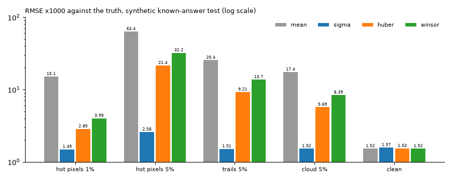
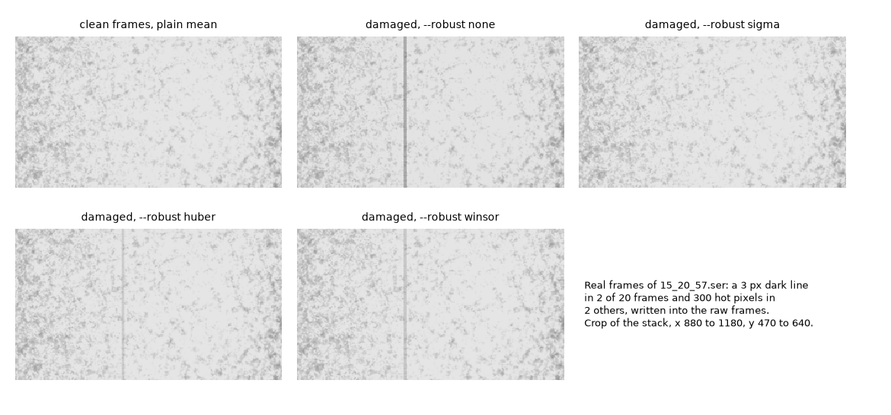
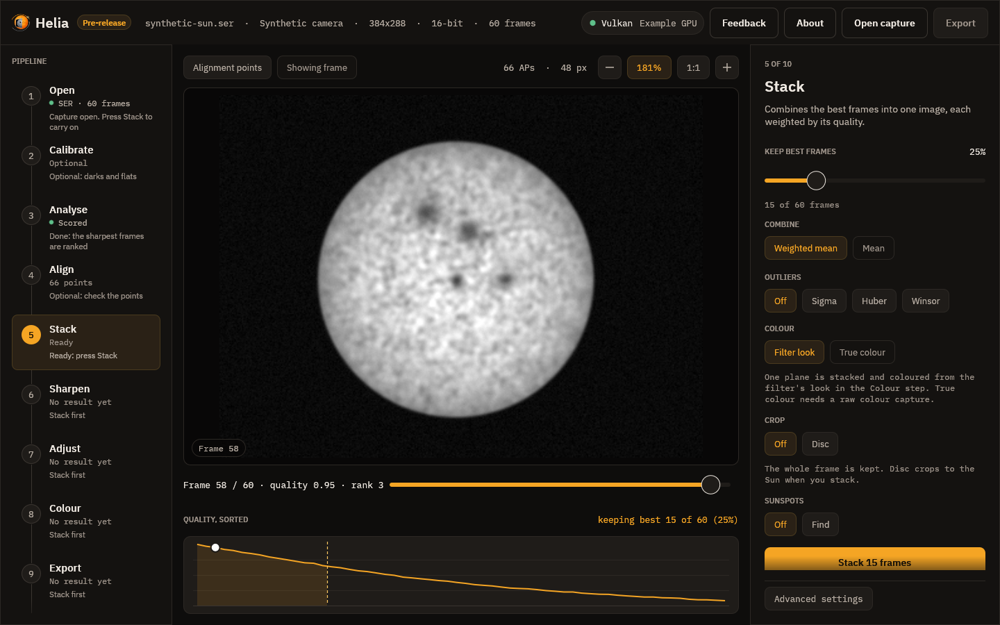

# Tutorial: robust stacking against satellites, hot pixels and clouds

**Goal:** decide whether a capture needs an outlier guard, switch on the right
one, see it remove a real artefact from a real capture, and know what it does
not do.

**You need:** any capture; for the worked example, `15_20_57.ser` (ASI482MC,
1920 x 1080, 16-bit, H-alpha, 2022-07-17) or a capture of your own. The method
and the measurements are in
[How stacking works, section 5](../user-guide/how-stacking-works.md#5-stacking);
this page is the worked example.

> **What is real on this page.** Everything in sections 3 and 4 and in the
> troubleshooting list was run on `15_20_57.ser` with the current build: the
> damage is written into the real frames, the stacks are real, the numbers are
> measured. The chart in section 2 is the project's synthetic known-answer test
> (real captures have no damage with a known answer), re-run on the same build.

## 1. What the guards do

The default stack is a quality-weighted mean of the best frames. It is the right
answer for seeing-selected lucky imaging, where the spread between frames is
partly signal. A mean has one weakness: a sample that does not belong at all (a
satellite or plane trail, a cosmic ray, a bird, a cloud dimming a few frames, a
hot pixel that the alignment moves from frame to frame) pulls the mean by its
full size divided by the number of frames.

`--robust` adds a first pass that collects, at each pixel, the sum and the sum of
squares of the samples, and a second pass that judges each sample against the
mean and spread of the **other** samples at that pixel:

| `--robust` | A sample more than K standard deviations from the mean of the others is | Default K (`--robust-k`) |
|---|---|---|
| `none` | kept: the weighted mean (the default) | |
| `sigma` | dropped | 2.5 |
| `huber` | given less weight the further out it is (K sigma divided by its distance) | 1.345 |
| `winsor` | clamped to K sigma from the mean | 2 |

K is a positive number of standard deviations. `--sigma-clip K` is the older
spelling of `--robust sigma --robust-k K`, and cannot be combined with `--robust`.
At a pixel with fewer than three samples nothing is changed; from six samples up
the sample being judged is left out of the spread it is judged against, so a
spike cannot hide inside the spread it causes. The capture is read twice
instead of once.

Two details matter, and both were found by the real-frame test below. The mean
and spread that judge a sample **ignore the frame quality weights**: the weights
say how much a surviving sample counts in the result, not how much it is
believed. (A frame with a satellite in it often scores *better*, because the
trail's edge is sharp detail, and a spread weighted by those scores hides the
trail inside it.) And with alignment points, the whole-frame image that fills
between the points is stacked under the same rule as the points themselves.

## 2. Which to choose

The synthetic test (200 frames of a 48 x 48 scene, noise 0.02, default K;
`cargo test -p helia-core --all-features --test robust_stack -- --nocapture`)
measures the error against the truth, times 1000 (re-run for this page on the
build with the fix):



*Drawn from the table in [How stacking works](../user-guide/how-stacking-works.md#5-stacking),
which has every damage type and share.*

* **`sigma`** removes gross outliers best: it is the choice for a hot pixel or a
  trail. At 5% hot pixels its error is 2.58, against 21.45 for `huber` and 32.20
  for `winsor`.
* **`winsor`** is the gentlest on real, asymmetric spread (it moved the result
  0.43 from the weighted mean, against 0.98 for sigma and 1.32 for Huber, times
  1000, when one sample in five was pulled down by 0.05). Use it when you want a
  safeguard and not a cleaning.
* **`huber`** sits between them on outliers and moves the result most on real
  spread; raise K (`--robust-k 2`) if that matters.
* **None** of them is a cure for bad alignment.

A good first try for a capture with a known artefact: `--robust sigma`. For a
capture with none, leave it off.

## 3. Worked example: a line and hot pixels in real frames

To see a guard work on a real capture, damage it in a way you know the answer to.
The script below copies the first 20 frames of `15_20_57.ser` and writes into the
**raw frames**, in sensor coordinates, before Helia ever aligns them: a 3 px wide
dark line down columns 1000 to 1002 (20000 of 65535 subtracted) in frames 4 and
13, and 300 hot pixels (+30000) in frames 8 and 16. That is how a satellite
trail or a cosmic ray arrives: fixed in one frame, at a different place on the
Sun once the frames are aligned.

```python
# damage.py  SRC.ser DST.ser clean|damage     (Python 3, no packages needed)
# Written for this capture: its pixel data is little-endian whatever the header says.
import random, struct, sys
src, dst, mode = sys.argv[1:4]
n = 20
f = open(src, "rb")
hdr = bytearray(f.read(178))
_, colour, _, w, h, depth, _ = struct.unpack_from("<7i", hdr, 14)
struct.pack_into("<i", hdr, 14 + 24, n)            # the new frame count
out = open(dst, "wb"); out.write(hdr)
rnd = random.Random(1)
for i in range(n):
    b = bytearray(f.read(w * h * 2))
    if mode == "damage" and i in (3, 12):         # dark line, columns 1000-1002
        for y in range(h):
            for x in range(1000, 1003):
                o = (y * w + x) * 2
                v = struct.unpack_from("<H", b, o)[0]
                struct.pack_into("<H", b, o, max(0, v - 20000))
    if mode == "damage" and i in (7, 15):         # 300 hot pixels
        for _ in range(300):
            x, y = rnd.randrange(w), rnd.randrange(h)
            o = (y * w + x) * 2
            v = struct.unpack_from("<H", b, o)[0]
            struct.pack_into("<H", b, o, min(65535, v + 30000))
    out.write(b)
```

Stack the clean copy once and the damaged copy with each setting:

```sh
python damage.py 15_20_57.ser clean.ser clean
python damage.py 15_20_57.ser dmg.ser damage
helia stack clean.ser -o clean.fits --preset ha --keep 100% --align phase
for r in none sigma huber winsor; do
  helia stack dmg.ser -o dmg-$r.fits --preset ha --keep 100% --align phase --robust $r
done
```

With a guard on, the summary ends with a note about what it can and cannot
remove (see section 4):

```text
note:     robust stacking removes what differs between frames (a satellite, a cosmic ray, a hot pixel the alignment moves); a defect fixed on the sensor sits on the same pixel in every frame and is not an outlier, use --dark or --bad-pixels for it
```

The picture is the proof. A crop of each stack around the line:



*Stacks of `15_20_57.ser` (20 frames, green plane, `--preset ha --keep 100%
--align phase`). The vertical line is the damage in two frames of twenty.
Top row: the clean frames, the damaged frames with no guard, with `sigma`.
Bottom row: `huber`, `winsor`. The hot pixels are far smaller than the line and
do not show at this size; the table measures them.*

The same thing as numbers: the stack of the damaged frames minus the stack of
the clean ones, averaged down the disc rows 300 to 800, at the worst column of
the line (full scale is 1):

| | Alignment points | `--no-multipoint` |
|---|---|---|
| `none` | -0.112 | -0.094 |
| `sigma` | 0.000 | 0.000 |
| `huber` | -0.048 | -0.038 |
| `winsor` | -0.057 | -0.048 |

`sigma` takes the line out completely. `huber` and `winsor` pull it back by
about half and no more: they down-weight an outlier, they do not remove it, and
here the damaged frames also carry high quality weights. That is the reason the
chart puts `sigma` first for gross outliers.

## 4. What robust stacking does not remove

The guards remove a sample that differs from the same place in the other frames.
A defect **fixed on the sensor** (a hot pixel, a dust spot, a dead column) is in
the same sensor pixel of every frame. The alignment moves each frame by its
drift, which on a steady mount is a fraction of a pixel: over these 20 frames it
was 0.45 px in x and 0.39 px in y. So at the stack pixel the defect is present
in all 20 frames and is not an outlier. Measured: writing the same 300 hot
pixels into every frame and stacking with `--robust sigma` left exactly the same
error as stacking with no guard (0.000340 mean absolute difference over the
region, both).

For those, use calibration: a dark frame or a bad-pixel map, applied before the
frames are demosaiced and aligned. See
[Calibrate: darks, flats and bad pixels](calibrate.md) and
[Calibration](../user-guide/calibration.md). In short: robust stacking is for
what moves or comes and goes; calibration is for what stays on the sensor.

## 5. What it costs on a clean real capture

`15_20_57.ser` (100 frames) with nothing to remove measures the cost: stacking
all 100 frames with each guard against the plain weighted mean of the same run
(`--keep 100% --preset ha`, FITS output), over the disc:

```sh
helia stack 15_20_57.ser -o clean-none.fits  --preset ha --keep 100%
helia stack 15_20_57.ser -o clean-sigma.fits --preset ha --keep 100% --robust sigma
helia stack 15_20_57.ser -o clean-huber.fits --preset ha --keep 100% --robust huber
helia stack 15_20_57.ser -o clean-winsor.fits --preset ha --keep 100% --robust winsor
```

| Guard | RMS difference from the mean (x1000, mean level 0.809) | Largest difference (x1000) | Time of the stacking step |
|---|---|---|---|
| `sigma` | 0.45 | 8.09 | 0.89 s |
| `huber` | 0.46 | 6.00 | 0.82 s |
| `winsor` | 0.18 | 2.98 | 0.98 s |
| none | | | 0.46 s |

On a capture with nothing to remove, the three guards change the picture by
about half a thousandth of full scale (on a mean level of 0.809) and cost
about half a second more on a GPU (A100, Vulkan). The capture is read twice, so
the cost grows with the file.

## 6. On the command line

```sh
helia stack sun.ser -o sun.tif --robust sigma
helia stack sun.ser -o sun.tif --robust huber --robust-k 2
helia stack sun.ser -o sun.tif --sigma-clip 2.5       # same as --robust sigma --robust-k 2.5
```

## 7. In the app

1. **Open** the capture and go to **Stack**.
2. Find **Outliers**. The chips are **Off** (the default), **Sigma**, **Huber** and
   **Winsor**. The app uses the default K of each (2.5, 1.345 and 2 standard
   deviations); the slider for K is not in the app, so for another K use the
   command line or the API (`robust_k`).
3. Press **Stack N frames**. The run is slower, because the frames are read twice.



*Drawn by the interface test harness on its synthetic demonstration capture; it
shows where the chips are.*

## 8. In the API

`"robust": "sigma"` and `"robust_k": 2.5` in the job's `config`; see
[The API](../user-guide/api.md) and the [API reference](../reference/api.md).

## What to expect and how to tell it worked

* No sign in the summary beyond the longer stage time and the note; the proof is
  the picture. A trail or a hot pixel that was in the plain stack is gone, and
  nothing else moved.
* A change over the whole image (the level or the contrast) means the guard was
  doing more than removing outliers: on clean data the change should stay at the
  level in the table in section 5.
* Compare with and without on the same capture, in the **Before / after** view,
  zoomed to 100 per cent.

## Troubleshooting

* **`error: the following required arguments were not provided: --robust
  <ROBUST>`.** You gave `--robust-k` alone. K only means something with a guard.
  Add `--robust sigma` (or `huber`, `winsor`).
* **`error: the argument '--sigma-clip <K>' cannot be used with '--robust
  <ROBUST>'`.** Use one spelling: `--robust sigma --robust-k K`.
* **`helia: --robust-k must be a positive number of standard deviations`.** You
  gave 0 or a negative number.
* **It is slow.** The capture is read twice. On `15_20_57.ser` the stacking step
  went from 0.46 s to 0.9 s on a GPU; a long capture on a slow disc will show it
  more. Use `--robust` only when the capture has something to remove.
* **A hot pixel, dust spot or dead column is still there.** It is fixed on the
  sensor, so it is not an outlier (section 4). Use a dark frame or a bad-pixel
  map.
* **A trail is still there.** The guards judge each pixel from its frames
  *after* alignment, so a trail is rejected only if it is far enough from the
  others. `sigma` removes the most; `huber` and `winsor` pull a gross outlier
  only part of the way back (section 3). A faint trail, or a trail in many of
  the kept frames (the 5% rows of the chart), leaks through the soft forms, and
  `sigma` too when many of the frames carry it. If nothing
  helps, drop the affected frames by keeping fewer (`--keep` lower).
* **The artefact moved the whole stack a little.** A frame with an artefact
  scores *higher* (the trail adds sharp edges), so it could rank first and join
  the reference. Helia now guards against this twice: a score that jumps well
  above the frames either side of it is put back to their level before ranking
  (the command-line summary then has a `ranking:` line naming those frames), and
  the reference is the per-pixel median of the best five frames, so an artefact
  in one or two of them does not reach it. On `15_20_57.ser` with a line in two
  frames and hot pixels in two others, ranked on the whole frame, the stack moved
  0.14 px before and 0.011 to 0.013 px now. What remains is damage too small to
  change the score (a few hot pixels raise it by 3 to 4%, less than the seeing
  varies): the median reference covers it. If you still see a shift, compare
  against a clean stack with the same frames excluded, or mask the artefact
  (`--exclude`) for the ranking. See
  [How stacking works: ranking the frames](../user-guide/how-stacking-works.md#1-ranking-the-frames).
* **The picture got softer or the contrast changed.** The guard is working on
  signal, not outliers: the spread between frames is partly real. Switch to
  `winsor`, raise `--robust-k`, or turn it off.
* **A pattern remains in one place after the guard.** A bad alignment point
  shifts its patch and a guard repairs only part of it (an error of 1.86 for the
  mean against 1.69 to 1.75, times 1000, in the synthetic test). Fix the
  alignment ([Align](../walkthrough/04-align.md)).

## See also

* [How stacking works: stacking](../user-guide/how-stacking-works.md#5-stacking).
* [Calibrate: darks, flats and bad pixels](calibrate.md): the answer for defects
  fixed on the sensor.
* [The command line](../user-guide/cli.md#stacking) and the
  [CLI reference](../reference/cli.md): `--robust`, `--robust-k`, `--sigma-clip`.
* [Using the desktop app](../user-guide/gui.md): the Outliers chips.
