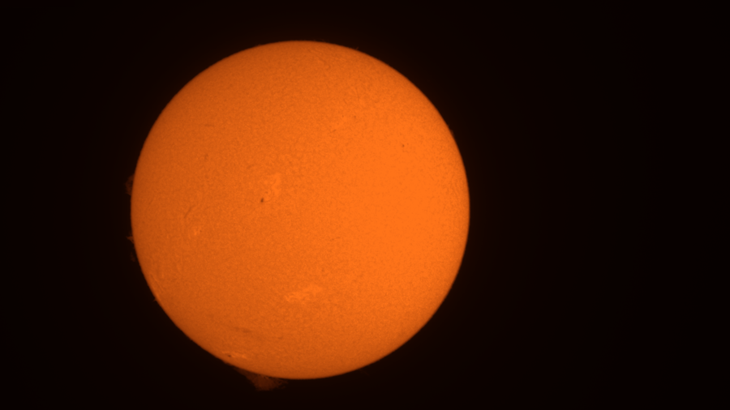
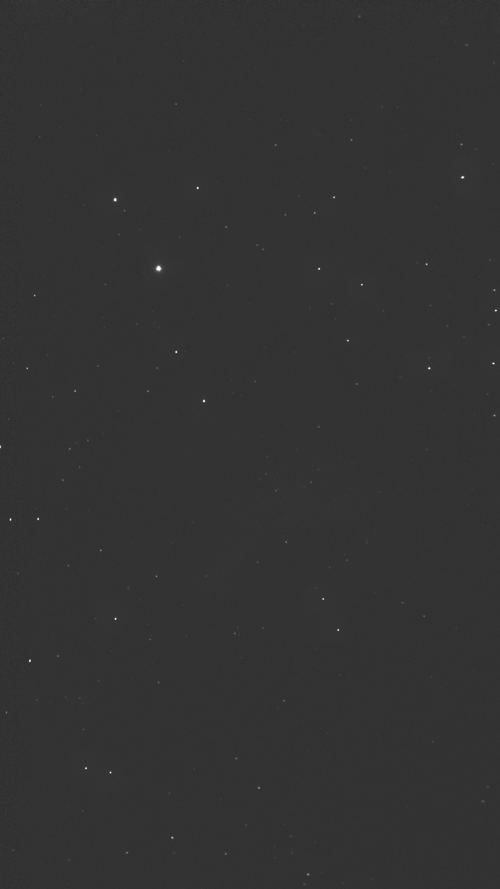
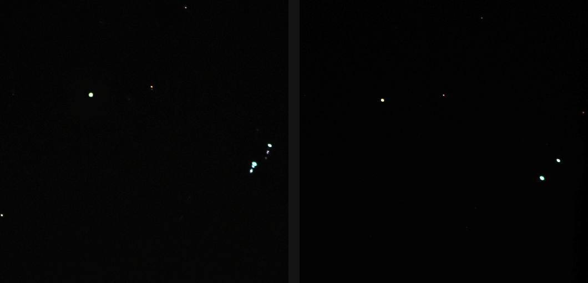

# Tutorial: stack FITS frames (Seestar subs, cubes and sequences)

**Goal:** stack a capture that is saved as FITS: a folder of one-frame files such
as the Seestar's `Light_*.fit` subs, a pattern of such files, or one FITS file
holding a cube of frames. Check that Helia read them as you expect, and fix the
usual problems.

**You need:** FITS frames of one size from one camera setup. The worked example
uses the first 60 frames of the real capture `15_20_57.ser` (ZWO ASI482MC,
1920 x 1080, 16-bit, raw RGGB, H-alpha, 2022-07-17) written out as FITS, so the
result can be compared with the SER it came from, and 60 real Seestar S50 subs.
Where a capture goes in the app and what the stack options mean is in
[Capturing for Helia](../user-guide/capturing.md) and
[How stacking works](../user-guide/how-stacking-works.md); this page is about
the FITS input.

> **What is real on this page.** The commands, the console output and the
> numbers were run on a release build on 2026-10-24. The FITS subs and the cube
> are the real SER frames written by Helia's own FITS writer (16-bit, `BZERO =
> 32768`), with `DATE-OBS` times made up for the test; the Seestar subs are the
> camera's own files (a deep-sky target, used here only to show the reading).
> Everything is kept in `C:\temp\helia-outputs\2026-10-22-issue-266\` on the
> author's machine.

## 1. What Helia accepts

Give `helia stack` (and `helia info`) any of these as the capture:

| You give | Helia reads |
|---|---|
| A folder | Every `.fit`, `.fits` and `.fts` file in it (not its sub-folders), one frame per file |
| A pattern in quotes, `'Light_*.fit'` | The files in that folder whose names match (`*` any run, `?` one character, case ignored) |
| One FITS file with a cube (`NAXIS = 3`) | One frame per plane |
| One FITS file with several image extensions | Every image unit is a frame |

Quote a pattern so your shell does not expand it first; on Windows, where the
shell never does, Helia expands it itself.

A file with three planes and `CTYPE3 = 'RGB'` (the way Helia writes a true-colour
stack) is one colour frame, not three, and is averaged to one plane. Compressed
FITS (`.fz`), integer types other than 8 and 16 bit, and 4-D images are not read.

## 2. Look before you stack

```sh
helia info subs
```

```text
file:               subs
format:             FITS

Header, as written in the file
  Files:             60
  Frames:            60
  NAXIS1 (width):    1920 px
  NAXIS2 (height):   1080 px
  BITPIX:            16
  BZERO:             32768
  BSCALE:            1
  BAYERPAT:          GBRG
  ROWORDER:          absent
  Rows read:         no ROWORDER card, so bottom-up as the FITS standard says
  Frame order:       by DATE-OBS
  First frame time:  2022-07-17T14:20:10.000
  Last frame time:   2022-07-17T14:20:13.688

Helia will use
  Bayer pattern:     RGGB           (header)
  Row order:         bottom to top  (header)
```

The top block is the header as written, taken from the first frame; the bottom is
what Helia will use. Three things to check:

* **Frames** is the count you expect, and **Frame order** says how they are
  ordered. Frames go in `DATE-OBS` order when every file has one (the first of
  `DATE-AVG`, `DATE-OBS` and `DATE-BEG` found), else in file-name order with
  numbers compared as numbers (`sub_2` before `sub_10`).
* **BAYERPAT** is the mosaic *as stored*, the first stored row first. Here it is
  `GBRG`, yet Helia will use `RGGB`. Section 6 explains why.
* **Row order**: FITS stores the bottom row first, so Helia flips the rows
  unless the header says `ROWORDER = TOP-DOWN`, or the file comes from a Seestar
  S50, which stores its rows top-down without saying so. **Rows read** says which
  rule was used. Section 6 has the details and `--row-order` to override it.

For the Seestar subs, `helia info seestar-subs` shows `BAYERPAT: GRBG`, 1080 x
1920, `Rows read: Seestar S50 header, stored top row first`, and Helia will use
`GRBG` and read the rows as stored.

## 3. Stack a folder

```sh
helia stack subs -o subs.tif --preset ha
```

```text
input:    FITS 1920x1080 16-bit, 60 frames in 60 files
backend:  CPU (24 threads)
settings: H-alpha (chosen); red channel, keep 25%, alignment points 64 px
frames:  60 total, 15 kept, 30 registered
points:  610 of 2135 alignment points active
...
disc:    centre (788.8, 552.5), radius 444.6 px
timing:  scoring frames 0.78s, ... stacking 0.26s, finishing 0.04s (total 3.64s)
wrote:   subs.tif
```



Everything after the `input:` line is the same pipeline as for a SER or AVI: the
settings line, frame scoring, alignment, the keep share, sharpening and colour.
The options are the ones in the [CLI reference](../reference/cli.md); the
Bayer overrides `--bayer` and `--channel` work as for a SER.

The same 60 frames as one cube, and as a pattern:

```sh
helia stack cube.fits -o cube.tif --preset ha
helia stack 'subs/Light_*.fit' -o pattern.tif --preset ha
```

## 4. Does it match the SER?

The three captures hold the same numbers, so they must stack the same. Measured on
this build (CPU backend):

| Capture | Frames kept | Difference from the SER stack |
|---|---|---|
| SER (`first.ser`) | 15 of 60 | (reference) |
| 60 FITS files | the same 15 | at most 9.6e-6 of full scale, mean 3.8e-8 |
| One FITS cube | the same 15 | at most 9.6e-6 of full scale, mean 3.8e-8 |

The difference is the rounding of the 16-bit conversion, a hundredth of one grey
level of a 16-bit picture. The test that measured it is
`crates/helia-core/tests/fits_real.rs`; it runs when `HELIA_REAL_DATA` points at
the captures. The three runs took 3.0 s (SER), 3.6 s (files) and 3.6 s (cube) of
stacking on 24 threads of a busy shared machine; reading many small files costs a
little more than reading one, and does not grow with the number of frames in
memory (see section 7).

## 5. A Seestar folder

```sh
helia stack seestar-subs -o seestar.tif
```

```text
input:    FITS 1080x1920 16-bit, 60 frames in 60 files
note:     Seestar S50 frames are stored top row first and carry no ROWORDER card, so the rows are read as stored. Use --row-order bottom-up to flip them.
settings: filter not recognised; luminance channel, keep 25%, alignment points 64 px
frames:  60 total, 15 kept, 30 registered
align:   phase correlation (no solar disc found); confidence mean 1.00, least 1.00
wrote:   seestar.tif
```



Helia is built for the Sun, so there is no disc to find here and it aligns on the
whole frame; this is a check that the Seestar's files are read, not a
recommendation for deep-sky stacking. For a Seestar solar run saved as FITS subs
the steps are the same, with `--preset white` or the filter you used. Any
`SITELAT` or `SITELONG` in the subs is **not** copied into what Helia writes.

### Subs from an altazimuth mount: the field turns

A Seestar keeps its camera level while the sky turns, so over half an hour the star
field rotates in the frame. Stacked as plain shifts, every star but those at the
centre becomes an arc. Real example: 49 subs of NGC 7009
(`Light_NGC 7009_20.0s_IRCUT_*.fit`, 20 s each, 29 minutes).

```sh
helia stack ngc7009 -o ngc7009.tif
```

```text
input:    FITS 1080x1920 16-bit, 49 frames in 49 files
frames:  49 total, 12 kept, 24 registered
detail:  stack 0.22368 vs best single frame 0.21454 (1.04x)
rotation: the parallactic angle runs 7.51 degrees over the capture (0.264 degrees per minute, target at 42 degrees altitude); frames are turned by up to 3.85 degrees to the orientation at 2025-09-21T19:45:01.109
rotation: the stars line up best with the picture as it is (lock 295.8 as it is, 130.8 mirrored), so the frames are turned that way
```

Nothing was asked for: the header names the target (`RA`, `DEC`), the site (`SITELAT`,
`SITELONG`), the mount (`EQMODE = 0`) and the time of each sub, so Helia turns every sub
to the middle one before it aligns them. The second `rotation:` line is how it found
which way the picture turns: it tries both senses on the first and last sub and keeps
the one whose stars line up. Because Helia now reads a Seestar's rows as stored, the
picture is the right way up and the sense is "as it is"; with `--row-order bottom-up`
(the old reading, an upside-down picture) the same command finds "mirrored" with the
two locks swapped. Without the correction at all the same command printed
`detail: stack 0.11005 vs best single frame 0.21345 (0.52x)`.



*Left: shifts only. Right: with the field rotation corrected. The median peak-to-flux of
the 48 brightest stars, which is higher the more point-like they are, goes from 0.065 to
0.104. Measured on the CPU backend of a loaded shared machine; the run takes 6.7 s
instead of 2.0 s, because turned frames are not decoded in parallel.*

Settings: none. To stop it, add `--no-field-rotation`; to give the site yourself,
`--site LAT,LON,ALT`. The 60 subs of IC 5070 turn by only 0.41 degrees, too little for the
stars to say which way, so they are left as they are and the line says so (the stack is
unchanged). If your subs lack `EQMODE`, or the lines say the stars did not show the sense,
add `--field-rotation`, and `--field-rotation-mirror` if the picture is a mirror image.
It works with `--colour true`. The method is in
[Field rotation](../user-guide/field-rotation.md#subs-of-a-star-field).

If a stack is still less sharp than its best single frame (under 0.75), `helia stack`
prints a `warning:` line that names the usual causes and what to do.

## 6. How Helia reads the header

* **Scaling.** The stored value is turned into `BZERO + BSCALE * stored`, then
  divided by 255 or 65535 (8 and 16-bit), the same scale a SER of the same depth
  gets. A 32-bit float image is used as it stands. This follows the FITS
  standard: Pence, Chiappetti, Page, Shaw and Stobie (2010), *Definition of the
  Flexible Image Transport System (FITS), version 3.0*, Astronomy and
  Astrophysics 524, A42,
  [doi:10.1051/0004-6361/201015362](https://doi.org/10.1051/0004-6361/201015362).
* **Row order.** The standard puts the first stored row at the bottom of the
  picture. `ROWORDER = TOP-DOWN` or `BOTTOM-UP` (a convention of capture programs,
  not of the standard; the Siril manual's FITS page describes it) says which way
  the rows run. `--row-order auto`, the default, decides in this order: a
  `ROWORDER` card; else a Seestar S50 header (`INSTRUME` or `TELESCOP` contains
  `S50`), which is read top-down; else bottom-up, as the standard says. The
  Seestar rule rests on measurement, not on a manual: for 39 raw subs, one per
  target folder of a Seestar S50 library, the stored row order agreed better with
  the preview JPG the Seestar saves beside each sub than the flipped one did (39
  of 39; for example a correlation of 0.98 as stored against -0.55 flipped on a C 39
  sub), and the one Seestar stacked FITS file checked behaves the same. `--row-order
  top-down` or `bottom-up` overrides all of that, for example for a file another
  program rewrote. `--flip-v` is a different thing: an edit of the finished
  picture, applied after the read, so `--row-order bottom-up --flip-v` gives the
  same picture as the default on a Seestar sub. The GUI's Open step has the same
  choice (Auto, Top-down, Bottom-up) and the API takes `row_order`.
* **Mosaic.** `BAYERPAT` is also a capture-program convention. Helia takes it to
  name the 2x2 pattern *as stored*. Flipping the rows of a mosaic of even height
  swaps its two row types, so the stored `GBRG` above reads as `RGGB` once the
  rows are flipped (and a Seestar's `GRBG` would read as `BGGR` under
  `--row-order bottom-up`). For an odd height, or rows read top-down (a
  `ROWORDER = TOP-DOWN` card, or a Seestar), the pattern is used as written. This was
  checked on real Seestar subs: in the stored data the two greens of `GRBG` sit on
  the diagonal, as the mean levels of the four pixel positions show.
  If a file's pattern is simply wrong, name the right one with `--bayer`; a
  pattern you name describes the picture *after* the flip, as for a SER.
* **Time.** Each single-frame file's time is stored for ordering, for
  `--field-rotation`, the report and the `DATE-OBS` of the output. A cube has one
  header, so its planes carry no individual times.
* **What is not copied.** Helia writes its own header. The observing site
  (`SITELAT`, `SITELONG` and the like) is never copied from the frames into the
  output.

## 7. Memory and speed

Only the headers are read when the capture is opened: a Seestar library of
11,000 subs opens by reading 11,000 headers. A frame is read, converted and
released when it is needed, so memory is a few frames, not the whole sequence.
Each frame costs one file open and one read; keep the subs on a local disk, not a
slow network share, for a long run.

## Troubleshooting

* **`no FITS frames (.fit, .fits or .fts) in the folder ...`**: the folder holds
  no such files (sub-folders are not searched), or the extension is different.
  Rename, or give a pattern.
* **`no files match ...`**: the pattern matched nothing. Quote it, and check the
  folder part of the path.
* **`the frames are not all the same size: ...`**: one file differs, and the
  message names it. A dark or a stacked result in the same folder is the usual
  culprit; move it out.
* **`the frames disagree on their Bayer pattern or ROWORDER`**: the files come
  from different setups. Stack each setup on its own.
* **`... is not a FITS file Helia can read (...)`**: the message names the file
  and the reason (cut short, not FITS, a type Helia does not read). A download
  that stopped early is the usual cause.
* **Coloured grid or a green cast on a colour sensor**: the pattern is wrong.
  Check `helia info`, then try each of `--bayer rggb|grbg|gbrg|bggr` on a few
  frames.
* **The picture is upside down (or, for a Seestar, you want the old bottom-up
  reading)**: Seestar S50 frames are read top-down automatically. Another camera
  that stores its rows top-down without a `ROWORDER` card is read bottom-up, as
  the standard says; add `--row-order top-down` (and `--row-order bottom-up` for
  the opposite case). Use `--flip-v` only to turn the finished picture over.
* **Frames are in the wrong order**: only some files have `DATE-OBS`, so the file
  name decides. Rename so the names sort, or add the times.
* **Stars are short arcs, and `detail:` is below 1x**: the field rotated during the
  capture. See "Subs from an altazimuth mount" above: check the `rotation:` lines, and
  give `--field-rotation` if there are none.
* **Only one frame**: a single FITS image cannot be stacked. Helia says so in a
  warning.
