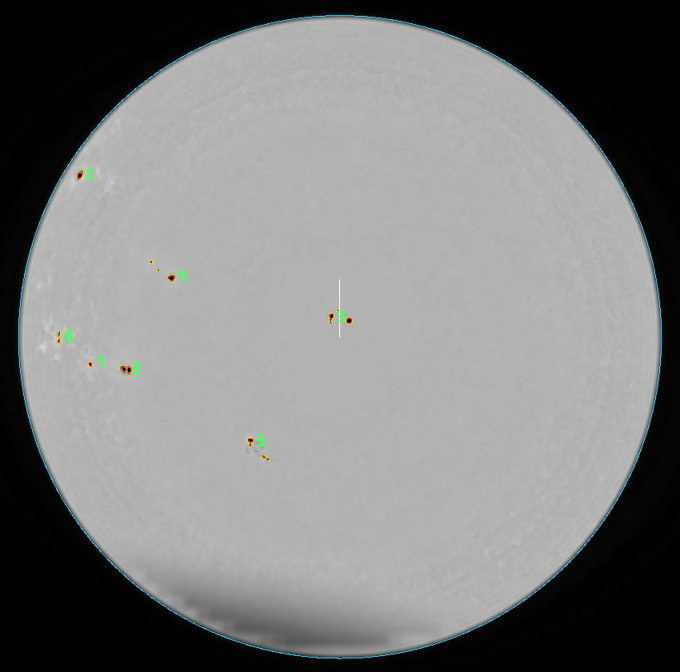
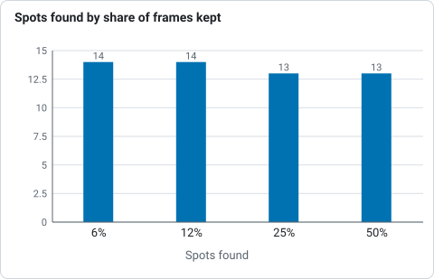
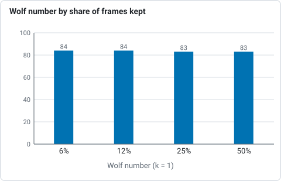

# Tutorial: counting sunspots on a white-light stack

This walks through a real capture from start to finished table: a white-light video
of the Sun taken on 2025-09-17 (`2025-09-17-161400-Solar.mp4`, a phone through a
solar filter, 1080 by 1920 pixels, the disc 402 pixels in radius). You need Helia 0.5
or later and one white-light capture with the whole disc in the frame. The method is
described in [Sunspots, groups and the Wolf number](../user-guide/sunspots.md).

## 1. Stack the capture

In the app, open the file, choose the **White light** filter in the Open step, keep the
defaults (the best 25%), and press **Stack**. On the command line:

```sh
helia stack 2025-09-17-161400-Solar.mp4 -o solar.tif --preset white --channel g
```

White light stacks the green channel: it is the sharpest and the least affected by
atmospheric dispersion. Do not sharpen yet: the detection works on the flattened disc,
and sharpening adds ringing at the limb and around spots. (A FITS output also carries
the capture time.)

## 2. Find the spots

On the command line, with the capture time (UTC) so that the Sun's tilt is known:

```sh
helia sunspots solar.tif --date 2025-09-17T16:14:00 \
    --csv spots.csv --json spots.json --overlay spots.png
```

In the app, set **Sunspots** to **Find** in the Stack step before pressing Stack (the
time comes from the capture if it has timestamps; without one there is no Carrington
longitude), then use **Show overlay** and **Save table and overlay**. Leave the
observer factor k at 1 for the raw count.

What you should see:

```text
disc:        centre (554.5, 980.8), radius 401.7 px
7 groups, 14 spots; Wolf number 84.0 (k = 1)
area 1218 millionths of the hemisphere corrected (795 as seen), umbra 380
P 24.49, B0 7.16, L0 247.82 degrees
```



*The overlay of this capture, cropped to the disc. Penumbrae are outlined yellow,
umbrae red, the limb cyan and each group is numbered in green; the white line is
solar north.*

Check the overlay against the picture before you trust the numbers: every outlined
region should be a spot you can see, and every visible spot should be outlined.

## 3. Read the table

`spots.csv` has a row per spot: `area_msh` is its corrected area in millionths of the
visible hemisphere, `projected_msh` the area as seen, `lat_deg` and `lon_deg` its
heliographic position (Carrington longitude, from the time you gave). The spot at
central meridian distance -73.8 degrees is seen at 98 MSH but is 326 MSH on the Sun:
that is the foreshortening correction at work. A spot near the middle of the disc
(`mu` near 1) has the two areas equal. The full column list is in the user guide.

## 4. If the north is not up

By default solar north is taken to be at the top of the image. If your camera is
elsewhere, latitude and longitude will be wrong (counts and areas are not): add
`--north-angle DEG` (counter-clockwise from the top), or `--celestial-north-up` for an
equatorial mount with the image north up, or `--mirror` for a mirror image. The app
offers only **Celestial north is up**; use the command line for other angles.

## What to expect and what can go wrong

| What you see | Why | What to do |
|---|---|---|
| Hundreds of tiny "spots" over the whole disc | Not white light (H-alpha and calcium have dark filaments and plage), or a very noisy stack | Use a white-light stack; raise `--sunspot-min-area` |
| A big false group along one side of the disc | A cloud, vignette or uneven flat: dark regions over 6000 MSH are dropped with a note, smaller ones are not | Re-stack on a clear frame range, or lower `--sunspot-penumbra` |
| A visible pore is missing | Pores under 4 pixels or 2 MSH are not counted | Lower `--sunspot-min-area` |
| Two groups that are really one | The groups are further apart than 3 degrees | Raise `--sunspot-group-gap` |
| "no clear solar disc" | The whole disc is not in frame, or the contrast is too low | Frame the whole disc |
| Wolf number differs from the official one | k is 1 and groups are drawn by distance, not Zurich class | Calibrate k against the published series for your instrument |

The result is stable across the stack: keeping 6, 12, 25 or 50% of the frames of this
capture gave 7 groups and 14, 14, 13 and 13 spots (Wolf 84, 84, 83, 83).



*Spots found in the 2025-09-17 phone video (7 groups each time) when 6, 12, 25 and 50% of the frames are stacked, from the text.*



*Wolf number (k = 1) for the same four stacks, from the text.*
