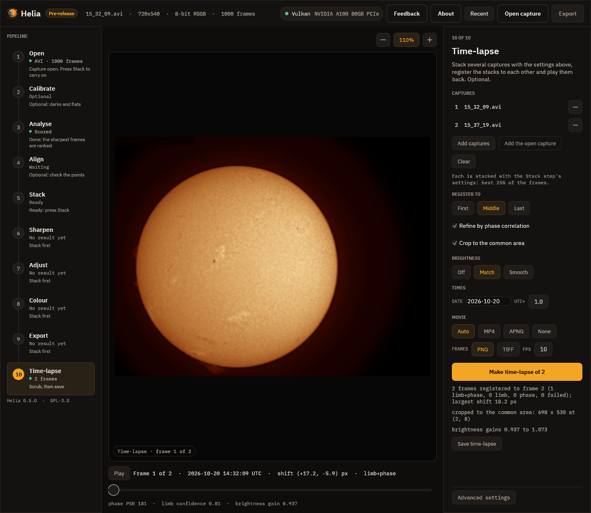
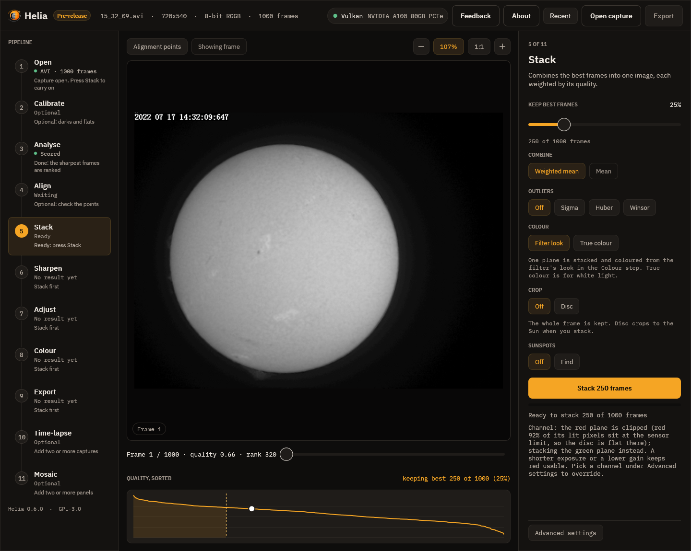
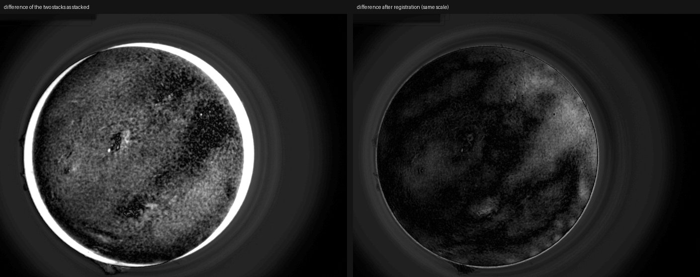
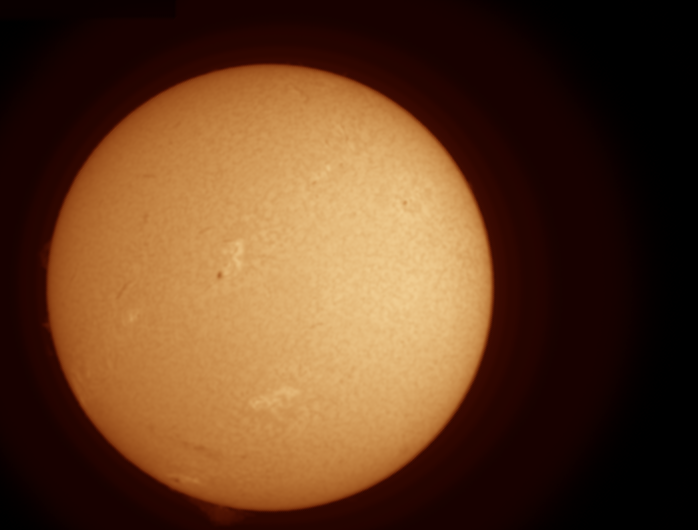

# Tutorial: a time-lapse of two H-alpha captures

This walks through a real pair of captures from start to finished movie: two H-alpha
videos of the whole disc taken about five minutes apart, `15_32_09.avi` and
`15_37_19.avi` (720 by 540 pixels, 8-bit, 1000 frames each). Two frames is the smallest time-lapse there is, but it shows every
part of the method; with more captures you add them to the list. You need Helia 0.6 or
later and, for an MP4, `ffmpeg`. The method is described in
[Time-lapse](../user-guide/timelapse.md).

## 1. What the two captures look like

Stacked one by one (`helia stack 15_32_09.avi -o a.png --preset ha --colour auto`) the
two discs are 17 pixels apart across and 6 down: the telescope drifted between the
captures. The second is also about 13% dimmer over the disc. In an animation made from the
plain stacks the Sun would jump and flicker.

An AVI has no timestamps, so Helia reads the time from the file name: `15_32_09` is
15:32:09. The clock of the capture program was British Summer Time, an hour ahead of
UTC, and the date is not in the name, so the command line says both: `--date 2026-10-20
--utc-offset 1`. That makes the frames 14:32:09 and 14:37:19 UTC, 5 minutes and 10
seconds apart.

## 2. Make the time-lapse

On the command line, with the stack settings after `--` (the filter, as for any stack
of these captures):

```sh
helia timelapse 15_32_09.avi 15_37_19.avi -o tl \
    --date 2026-10-20 --utc-offset 1 --crop --deflicker match \
    --movie auto --fps 2 -- --preset ha
```

`-o tl` is a directory. `--crop` cuts every frame to the area both cover,
`--deflicker match` brings the two to the same brightness and `--fps 2` makes the
movie two frames a second. Everything after `--` is what you would give `helia stack`;
here the filter is the only thing, as in the [prominence tutorial](prominences.md).

What you should see (the two stacks take a few seconds each on a GPU workstation):

```text
[1/2] stacking 15_32_09.avi
[2/2] stacking 15_37_19.avi
registering 2 frames
2 frames registered to frame 2 (1 limb+phase, 0 limb, 0 phase, 0 failed); largest shift 18.2 px
cropped to the common area: 698 x 530 at (2, 8)
brightness gains 0.937 to 1.073
    1 14:32:09  shift ( 17.17,  -5.94) px  limb+phase  phase PSR 180
    2 14:37:19  shift (  0.00,   0.00) px  reference
wrote 2 frames to tl (tl/timelapse.csv)
wrote tl/timelapse.mp4 (mp4)
```

With two frames the middle frame, the default reference, is the second, so the first is
the one that moves. In the app, open the first capture, choose **H-alpha** in the Open
step, then go to the last step, **Time-lapse**, press **Add captures** and choose both
files (or **Add the open capture** and then add the second). Type the date and the
UTC offset in **Times**, tick **Crop to the common area**, choose **Match** under
**Brightness**, and press **Make time-lapse of 2**.



*The Time-lapse step on these captures. The line under the picture says frame 1 was
moved by (+17.2, -5.9) pixels, by the limb fit and the phase correlation together, and
that the correlation's peak was 181 times the level of its surroundings. The
registered disc does not move when you scrub to frame 2.*

The stacks in the app use the Stack step's settings, and the app, like `helia stack`,
moves off a clipped colour plane by itself. These H-alpha captures clip in red (92 to
100% of the lit pixels sit at the sensor limit), so when you open one the Stack step says
"Channel: the red plane is clipped ... stacking the green plane instead" and the Channel
chip under **Advanced settings** shows **G**. You do not have to do anything; choose a
channel yourself on that chip only to stack another plane (a plane you pick is never
changed).



## 3. Read what it did

The table `tl/timelapse.csv` has the numbers behind each line:

```text
frame,file,source,time_utc,shift_x_px,shift_y_px,method,limb_x,limb_y,limb_radius,limb_confidence,phase_dx,phase_dy,phase_psr,level,gain,derotated_px
1,frame-0001.png,0001-15_32_09.tif,2026-10-20T14:32:09.000,17.175,-5.935,limb+phase,288.473,289.039,222.359,0.789,0.179,-0.401,180.276,0.64471,0.9365,
2,frame-0002.png,0002-15_37_19.tif,2026-10-20T14:37:19.000,0.000,0.000,reference,271.477,294.573,221.957,1.000,,,,0.56287,1.0727,
```

* The limb fits put the disc centres at (288.47, 289.04) and (271.48, 294.57): the limb
  alone says the first frame is (17.00, -5.53) pixels from the second.
* The phase correlation of the middle of the disc then adds (0.18, -0.40) pixels, with
  a peak-to-sidelobe ratio of 180 (a solid lock is above 8; Helia uses it above 6). It
  follows the granulation and filaments, so it corrects what an edge the seeing has
  moved cannot say. The shift applied is the sum, (17.17, -5.94).
* The radius differs by 0.4 pixel between the two (222.36 and 221.96): the disc's size
  as the limb fit sees it varies a little with seeing and focus. Helia moves the
  picture but does not rescale it.
* `level` is the mean brightness of the inner disc: 0.645 and 0.563. `gain` brings both
  to their median, 0.604, by 0.937 and 1.073.

To see whether the registration worked, subtract the two frames. Before registration
the two stacks differ by a bright crescent where the limbs do not coincide, and the
spots, filaments and plage are doubled. After it the difference is a faint, smooth
pattern: what really changed in five minutes, and the brightness differences that
a single gain cannot take out.



*Left: the difference of the two stacks as stacked. Right: the difference of frames 1
and 2 after registration, on the same scale. Inside 0.9 of the radius the mean absolute
difference falls from 0.064 to 0.026 and the RMS from 0.071 to 0.036 of full scale.*

The animated PNG that Helia writes when there is no ffmpeg is the same movie. This is
the one from these two frames at two frames a second; in a browser it should show a
disc that stays put while the grain and the filaments shift.



## 4. The files

`tl/` now holds:

```text
frame-0001.png  frame-0002.png   the registered, cropped frames (698 x 530)
timelapse.mp4                    H.264, 2 frames a second (timelapse.png instead without ffmpeg)
timelapse.csv                    the table above
stacks/0001-15_32_09.tif  stacks/0002-15_37_19.tif   the stacks, as stacked
```

The MP4 was checked here with ffmpeg 7.0.2: H.264, `yuv420p`, 698 by 530, 2 frames a
second, one second long.

To try other registration settings without stacking again, add `--reuse-stacks` (the
stacks in `tl/stacks` are used as they are):

```sh
helia timelapse 15_32_09.avi 15_37_19.avi -o tl --date 2026-10-20 --utc-offset 1 \
    --reuse-stacks --no-refine --reference first --format tiff --movie none
```

`--no-refine` registers by the limb alone, `--reference first` keeps the first frame
where it is (so the second moves, and more of the frame is cropped), `--format tiff`
writes 16-bit TIFF frames and `--movie none` no movie.

To add more frames, list more captures. They are sorted by their times, so the shell's
alphabetical order is fine for SharpCap names. Captures that are already stacked images
can be listed too.

## What to expect and what can go wrong

| What you see | Why | What to do |
|---|---|---|
| "no time for ..." | The file name has no time and the file no timestamps | Give `--date` for a name with only a time; or name the files after their start time; the order given is then kept |
| The frames are in the wrong order | Times came from names in different clocks, or `--no-sort` was given | Check `time_utc` in the table; fix `--utc-offset` or the names |
| A frame is marked `failed` | The disc is cut by the frame or too faint, and the whole-frame correlation found nothing | Look at that stack; re-stack it with a clear frame range, or remove the capture |
| A frame is `limb`, not `limb+phase` | The correlation was weak or asked for more than `--max-refine` pixels | Usually fine; check the table's `phase_psr`; raise `--max-refine` if the seeing moves the limb a lot |
| The movie flickers | The brightness differs between captures | Use `--deflicker match`, or `smooth` for a long series with a slow trend |
| Black edges on the frames | A frame was moved and had nothing behind it | Add `--crop` |
| "frames differ in size" | The stacks have different crops | Stack all captures with the same crop (or none) |
| "no MP4 (ffmpeg was not found ...); wrote an animated PNG" | ffmpeg is not installed | Install it ([Installation](../user-guide/installation.md)), or use the PNG |
| The stacks look flat and white (app) | You chose the clipped colour plane on the Channel chip, which the app never overrides | Choose the next plane (Green for H-alpha), or open the capture again to let the app choose |

For a time-lapse over hours, the Sun's surface features also turn with the Sun's
rotation, about 13 degrees a day; over these five minutes that is 0.05 degree, about a fifth
of a pixel at the limb of a disc 222 pixels in radius, so nothing was done about it here.
