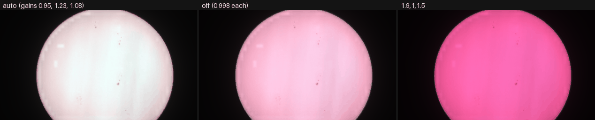
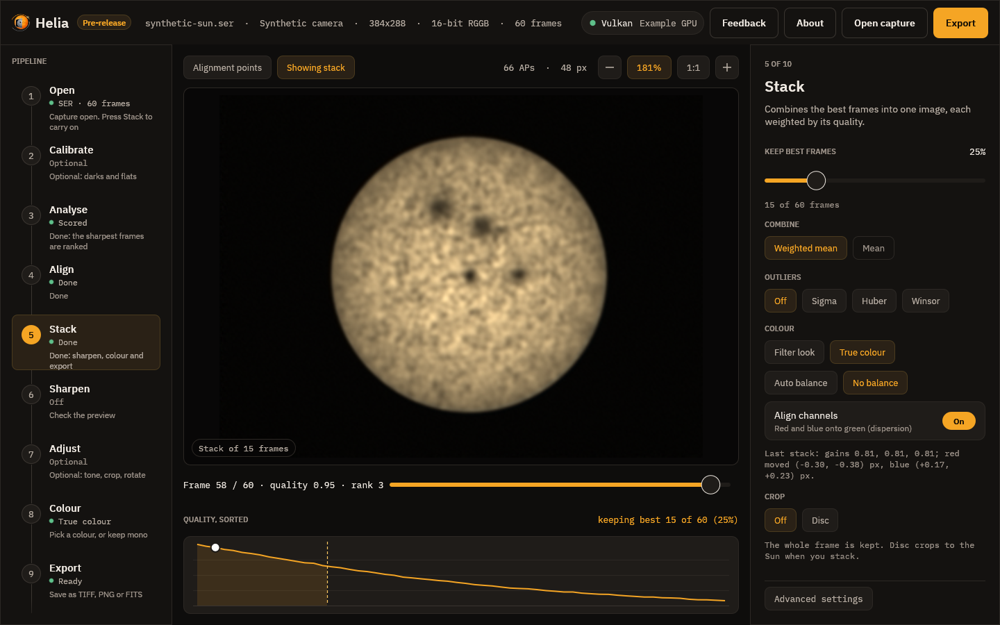
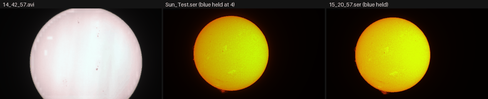

# Tutorial: true colour from a raw colour camera

**Goal:** a colour picture of the Sun as the camera saw it, made by stacking the
red, green and blue planes of a raw colour capture on one alignment, with the
channels registered to each other and the white balance set.

**You need:** a capture from a colour camera that is a raw Bayer mosaic (a SER with
a Bayer ColorID, or an AVI with a SharpCap sidecar that says so), taken in
broad-band light: white light with a solar filter. True colour is not for narrow
band filters, and the [last part of this page](#when-a-channel-is-nearly-empty)
shows why. The reference text is [True colour](../user-guide/colourising.md#true-colour);
this is the worked example.

## The capture and why

The project has no white-light capture of its own yet, so two kinds of real
capture are used, and the page says which is which.

* `14_42_57.avi` from the 2022-07-17 set: a ZWO ASI482MC, 1920 x 1080, 8-bit, 630
  frames, exposure 0.64 ms, gain 0, with the SharpCap sidecar
  `14_42_57.CameraSettings.txt` (it says `Colour Space=RAW8`). It is the one broad
  band capture of the set (the filter is not recorded; the analysis in
  #121 calls it "broad
  band, label unknown", and sunspots are visible in it). The disc is cut by the
  frame (64% of the limb is in view) and the red plane is partly clipped, so it is
  not a good white-light image, but all three planes carry the disc, which is what
  true colour needs.
* `Sun_Test.ser` and `15_20_57.ser`, same camera, which are H-alpha (they were
  labelled sodium). Their blue pixels are empty. They are here only to show what
  Helia does when a channel is nearly empty.

## 1. Look at the capture first

```sh
helia info 14_42_57.avi
```

```text
Header, as written in the file
  FourCC:            DIB
  Format:            Gray8
  Width:             1920 px
  Height:            1080 px
  Sidecar camera:    ZWO ASI482MC
  Colour Space:      RAW8
  Debayer Preview:   On

Helia will use
  Bayer pattern:     RGGB           (sidecar)
  Row order:         top to bottom  (header)
```

`Bayer pattern: RGGB (sidecar)` is what true colour needs. A capture that shows
`none` here is refused (see [Troubleshooting](#troubleshooting)).

## 2. Stack

```sh
helia stack 14_42_57.avi -o colour.png --colour true
```

```text
settings: filter not recognised; luminance channel, keep 25%, alignment points 64 px
frames:  630 total, 158 kept, 316 registered
colour:  true colour, gains red 0.950, green 1.226, blue 1.076
         Channel alignment: red moved (+0.08, +0.03) px onto green (confidence 1.00)
         Channel alignment: blue moved (-0.12, -0.06) px onto green (confidence 1.00)
align:   phase correlation (the frame cuts the limb, 64% of it visible); confidence mean 1.00, least 1.00 (sampled)
wrote:   colour.png
```

The run took 6.6 s on a GPU. Read the `colour:` block:

| Line | Meaning |
|---|---|
| `gains red 0.950, green 1.226, blue 1.076` | The white balance, with the common scale folded in. With the default `--white-balance auto` the means of red and blue over the middle of the disc (inside 80% of the radius) were brought to the green's, and then all three were scaled together so that the 99.99th percentile of the brightest channel of each pixel is 1: nothing clips |
| `red moved (+0.08, +0.03) px onto green` | The shift, in x and y, found by phase correlation of the stacked red plane against the green one and applied. This is atmospheric dispersion (red and blue sit a little either side of green when the Sun is low). A shift under 0.05 px is treated as noise and not applied; over 6 px, or with a confidence under 0.3, it is not believed |
| `confidence 1.00` | How sharp the correlation peak was, 0 to 1 |

All the colour work is done on one alignment: the frames are scored and aligned on
the luminance, once, and the three planes are stacked with those shifts, so the
three planes see the same sky. It costs three stacks, which is why this is slower
than a single-plane run.

## 3. Choose the white balance

`--white-balance` takes `auto` (the default), `off` or three gains `R,G,B`. The same
capture, the same alignment, three balances:

```sh
helia stack 14_42_57.avi -o colour.png --colour true
helia stack 14_42_57.avi -o off.png    --colour true --white-balance off
helia stack 14_42_57.avi -o manual.png --colour true --white-balance 1.9,1,1.5
```



*Each picture is written by `helia stack` as above, then reduced to 420 pixels and
set side by side. The disc is cut by the frame: that is the capture.*

| Option | Gains printed | What you see |
|---|---|---|
| `auto` | 0.950, 1.226, 1.076 | The centre of the disc is neutral: white to a very light cyan-grey |
| `off` | 0.998, 0.998, 0.998 | The sensor's own balance: a raw sensor weighs the colours differently from the eye, so the disc is pink |
| `1.9,1,1.5` | 0.998, 0.525, 0.788 | Your own gains, applied by hand (and then scaled together): strongly magenta, because this capture does not want them |

Use `auto` unless you know the gains your own sensor and filter need. The
manual gains are for repeating a balance between captures from the same setup.
The gains are always the three numbers in the `colour:` line, so they can be
written down and reused. (`off` shows 0.998 for all three because they are no
longer a balance, only the common scale.)

## 4. Channel alignment

`--no-channel-align` skips the registration of red and blue to green:

```sh
helia stack 14_42_57.avi -o noalign.png --colour true --no-channel-align
```

The gains are the same (0.950, 1.226, 1.076) and the `Channel alignment:` lines
are absent. On this capture the shifts were under 0.15 px, so you will not see a
difference; it matters when the Sun is low and the dispersion is a pixel or
more, which shows as a red fringe on one side of the limb and a blue one on the
other. Leave it on unless the shift Helia found was wrong (see
[Troubleshooting](#troubleshooting)).

## 5. The same in the app

1. **Open** `14_42_57.avi`. The Open step shows the Bayer pattern and where it came
   from.
2. Go to **Stack**. Under **Colour** press **True colour**. (The chip is greyed
   out for a capture that is not a Bayer mosaic; hover it to see why.)
3. Choose **Auto balance** or **No balance**. **Align channels** (on by default)
   registers red and blue to green.
4. Press **Stack N frames**. When it has finished the note under the chips gives
   the gains and the channel shifts: the same lines as the `colour:` block.
5. **Sharpen**, **Adjust** and **Export** as usual. The edits run on each channel;
   the Colour step is not used (there is no filter look to choose). **Export** as
   TIFF or PNG for an RGB picture, or FITS for a three-plane cube.



*Drawn by the interface test harness on its synthetic demonstration capture, to
show the chips and the note. The real result is above.* True colour and the
other Colour choice are not remembered between sessions: each capture starts
from its own recommendation.

## What a FITS file holds

```sh
helia stack 14_42_57.avi -o colour.fits --colour true
```

writes a three-plane cube (`NAXIS = 3`, `NAXIS3 = 3`, `CTYPE3 = 'RGB'`, and a
`COMMENT plane 1 is red, plane 2 green and plane 3 blue`). The history cards
record the choices:

```text
HISTORY True colour: red, green and blue stacked on one alignment; white balance
HISTORY  automatic (the disc centre is made neutral); gains 0.950, 1.226, 1.076
HISTORY Channel alignment: red moved (+0.08, +0.03) px onto green (confidence 1.00)
```

See [Output formats](../reference/output-formats.md).

## When a channel is nearly empty

The same command on an H-alpha capture, where the blue pixels see almost nothing:

```sh
helia stack Sun_Test.ser -o ha-colour.png --colour true
```

```text
colour:  true colour, gains red 0.984, green 1.045, blue 4.179
         Warning: the blue plane holds far less than the green, so its gain was held at 4; is a narrow-band filter in use? True colour is for white light
         Channel alignment: red moved (+1.36, -0.04) px onto green (confidence 1.00)
         Channel alignment: blue moved (+0.05, -0.00) px onto green (confidence 1.00)
```



*Left: `14_42_57.avi`. Middle and right: `Sun_Test.ser` and `15_20_57.ser`, both
H-alpha. The yellow-orange is the red and green planes; the blue plane is held
and carries almost nothing.*

What Helia did: the gain that auto would have used for blue (15 to 23 on these
captures) would only have multiplied noise, so it was held at 4 (4.179 and 3.993
here include the common scale) and the warning was printed. The picture is a
yellow-orange disc, which is the red and green planes, not the colour of
anything. The red shift of 1.36 px is also not dispersion: through a narrow filter
the red and green pixels see different things, so the planes disagree. The
conclusion is the warning's: use a filter look instead (`--preset ha`, the
[Colourising](../user-guide/colourising.md) page). The nearly-empty-channel case
is reproduced here on real H-alpha captures; the project has no real sodium capture
(the ones labelled sodium turned out to be H-alpha).

## What to expect and how to tell it worked

* A `colour:` block with three gains and two channel-alignment lines (or none with
  `--no-channel-align`).
* In white light with a good exposure, the gains are within a factor of two of
  each other and no warning appears. Here the three gains are 0.95, 1.23 and
  1.08.
* The centre of the disc is neutral grey or white with `auto`. A colour cast over
  the whole disc means the balance is off, or the red or green is clipped: check
  `helia info` and the sensor's gain.
* A FITS output has three planes; the TIFF is RGB 16-bit, the PNG RGB 8-bit.

## Troubleshooting

Run on the captures above unless it says otherwise.

* **`helia: --colour true needs a raw colour capture (a Bayer mosaic); this capture
  is mono or already demosaiced. Use --colour mono, or a preset for a filter`.**
  The capture is mono (a mono camera, or the Bayer data are gone). Verified with a
  mono capture of the 2026-10-20 set (`15_44_48.avi`). Check `helia info`: if the
  header says mono but the camera is a colour one, `--bayer rggb` (or the pattern
  of your camera) forces the mosaic. An MP4 or other already demosaiced video is, by
  the code, refused the same way (not run: the build server has no ffmpeg).
* **`helia: --channel, --invert and --colour-strength do not apply to --colour
  true: it stacks all three channels and has no colour look`.** Remove those
  options; the look and the single channel are for filter stacks.
* **`Warning: the blue plane holds far less than the green, so its gain was held
  at 4`.** A narrow-band filter, or a sensor that is not seeing blue. Use a filter
  look (`--preset`) for narrow band, or for white light check the filter and the
  exposure. It is held at 4 on purpose: a larger gain only boosts noise.
* **The red and blue are shifted by a pixel or more and the picture has a
  fringe.** If the shift came with a high confidence and the Sun is low, it is
  dispersion and the alignment is correct. If the capture is narrow band (red
  moved +1.36 px above), the planes are disagreeing; use `--no-channel-align` and
  a filter look instead.
* **The disc is pink or cyan, not neutral.** Try `--white-balance auto`; a manual
  balance that was right for another night is wrong for this one (the `1.9,1,1.5`
  picture above). If auto is also off, the red or the green is clipped: lower the
  sensor gain or the exposure and capture again.
* **A Bayer notice you did not expect (`The SER header says mono...`).** Helia
  found a mosaic in a SER that says it is mono, as it did for `Sun_Test.ser`
  (pixel positions averaging 79.6%, 77.6%, 77.4% and 0.3% of full scale). It
  debayers as RGGB and says so. If red and blue come out swapped, choose the other
  pattern with `--bayer bggr`: the dimmer of the two is taken to be blue, which
  is a guess.

## See also

* [True colour](../user-guide/colourising.md#true-colour): the method, the
  real-capture table and what is tested.
* [The command line](../user-guide/cli.md#colour-cameras) and the
  [CLI reference](../reference/cli.md): `--colour`, `--white-balance`,
  `--no-channel-align`.
* [The API](../user-guide/api.md): `colour`, `white_balance`, `align_channels`.
* [Fixing a Bayer grid](../recipes/fixing-a-bayer-grid.md).
