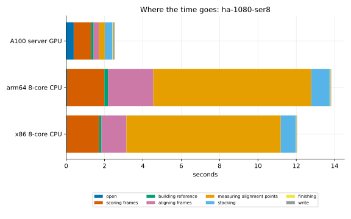
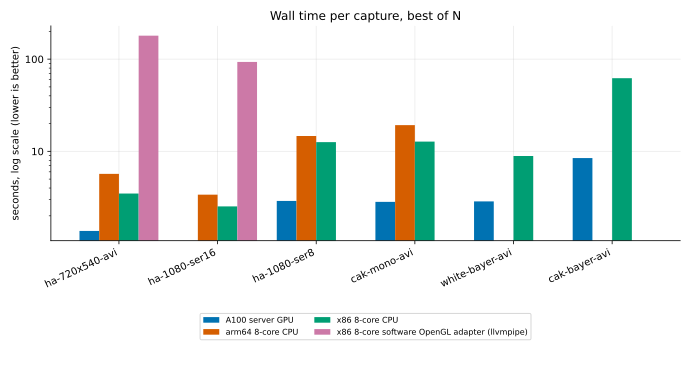
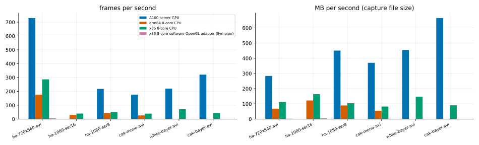
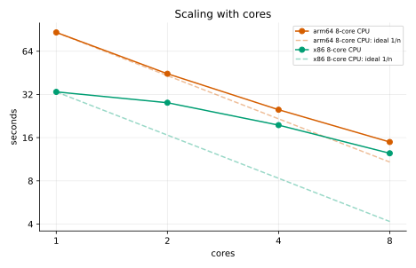
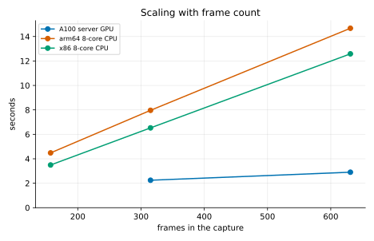
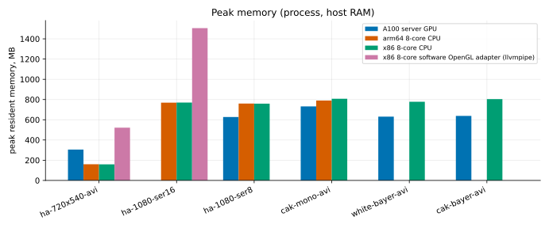

# Performance and benchmarks

This page shows how fast `helia stack` is, where the time goes, how it changes with
the hardware, the number of frames and the number of cores, and how much memory it
needs. Everything here was produced by one script that you can run yourself on your
own machine (see [Reproduce these numbers](#reproduce-these-numbers)), and every graph
has its data table beside it. The older [Performance guide](performance.md) explains
what the settings do to the time; this page is the measurements.

**What counts as a number on this page.** Each figure is the best of several runs of
the same command, on a machine that was otherwise idle while it ran. The script
measures how much CPU the rest of the machine used during each run, and a run that
shared the machine with more than half a core of other work is left out, not
averaged in. The tables under [How it was measured](#how-it-was-measured) say which
machines, which build and how many runs.

## Headline numbers

The figures below are best-of-N seconds for `helia stack`, with the largest differences first.

* **The GPU is 2.5 to 7 times faster than the same machine's processor on real captures.** The 631-frame 1080p SER
  takes 2.9 s on an A100 and 12.6 s on the 8-vCPU x86 server (4.3 times); the 2713-frame 5.6 GB capture takes 8.5 s
  and 62.2 s (7.3 times); the small 1000-frame 720x540 capture, where the time is mostly fixed costs, 1.4 s and 3.5 s.
* **Without a GPU, about 25 to 70 frames per second** on 1080p captures. The x86 server is 17 to 50 per cent
  faster than the Arm server (12.6 s and 14.7 s on the 631-frame SER, 12.8 s and 19.3 s on the 498-frame mono AVI).
* **The alignment points are the CPU's cost and the GPU's gain.** On the 631-frame SER the alignment point stage
  is 8.2 s of the Arm server's 14.7 s and 0.3 s of the A100's 2.9 s.
* **Memory:** 160 to 810 MB of process memory on the CPU path; the GPU path needs 300 to 730 MB of process memory
  and 1 to 6.4 GB of video memory (the frame store of the performance guide).
* **Cores:** 5.8 times faster on 8 Arm cores than on one; only 2.7 times on the x86 server's 8 threads, which are 4
  cores with 2 threads each, so the last four threads add little.

The Performance guide's CPU column was measured on a shared 24-core server and is on the pessimistic side; the
figures on this page come from quiet machines.

### Apple silicon

These come from a separate run, not from the script on this page, so they are not in the graphs: Apple M1
(Scaleway Mac mini), release build, best of 3, `helia stack`. "CPU" is `--backend cpu`, "all-Metal" is
`--backend gpu` on the M1's GPU, and "auto" is what Helia chooses on its own.

| Capture | CPU | all-Metal | auto |
|---|---|---|---|
| 720x540 AVI, 1000 frames | 3.7 s | 4.5 s | 2.7 s |
| 1080p 16-bit SER, 100 frames | 2.2 s | 3.1 s | 1.8 s |
| 1080p AVI, 630 frames | 8.8 s | 9.3 s | 5.9 s |
| Sun_Test.ser | 11.3 s | 13.6 s | 8.7 s |

### Not measured yet

The A100 row has no 100-frame 16-bit SER figure: every run of it overlapped other work on the shared server and was
left out. The software adapter was measured on x86 only, through Mesa's OpenGL llvmpipe (see the machines
below), and only on the two small captures, because it takes minutes on the others.

## How it was measured

<!-- bench:method:begin -->
| Machine | CPU | Cores | RAM GB | GPU | Build | Commit | Date | Best of | Load |
|---|---|---|---|---|---|---|---|---|---|
| A100 server | AMD EPYC 7543 32-Core Processor (24 threads available) | 24 | 62.8 | 0, NVIDIA A100 80GB PCIe, 550.163.01; 1, NVIDIA A100 80GB PCIe, 550.163.01; 2, NVIDIA A100 80GB PCIe, 550.163.01 | helia 0.6.0 | f318da8 | - | 4 | 75 runs, 55 left out as loaded |
| arm64 8-core | Neoverse-N1 (8 cores, 1 thread each) | 8 | 15.2 | - | helia 0.6.0 | f318da8 | - | 3 | 33 runs, 3 left out as loaded |
| x86 8-core | AMD EPYC-Milan Processor | 8 | 30.6 | - | helia 0.6.0 | f318da8 | - | 2 | 46 runs, 7 left out as loaded |
<!-- bench:method:end -->

**The machines.**

* **x86**: a Hetzner CCX33 virtual server, AMD EPYC-Milan, 8 vCPUs that are 4 cores with 2 threads each, 30 GB of
  memory, Debian 12, Rust 1.99.1. Its CI runners were stopped for the timing runs, and the script waited for
  the machine to be quiet; the table above records how many runs were left out.
* **arm64**: a Hetzner CAX31 virtual server, Ampere Altra (Neoverse-N1), 8 cores, 15 GB of memory, Debian 12,
  Rust 1.99.1. It was shared with a CI runner, so the script waited for quiet windows and left out any run
  that shared the machine with more than half a core of other work.
* **A100 server**: a shared server with an AMD EPYC 7543 and three NVIDIA A100 80 GB cards; GPU timings use card 2
  (`HELIA_GPU_DEVICE=2`) and ran only while the one-minute load average was under 8. Because the host is shared,
  a run counts only if other work used less than 4 cores of its 24 while it ran; the table above says how many were
  left out.


* **End to end** is the wall-clock time of `helia stack --timings --preset PRESET
  --backend cpu|gpu -o out.tif capture`, from starting the process to its exit,
  including opening the capture and writing the TIFF.
* **Stages** are the wall-clock seconds `--timings` prints for each stage. Scoring
  includes decoding the frames, because the frames are read as they are scored; the
  busy-time table `--timings` also prints (not repeated here) splits decode from
  scoring. Sharpening is part of "finishing".
* **Throughput** is the frames in the capture divided by the end-to-end time, and the
  size of the capture file (in units of 10^6 bytes) divided by the same time.
* **Memory** is the process's peak resident set (the kernel's `ru_maxrss`); for a GPU
  run the video memory is the most `nvidia-smi` showed in use above the level before
  the run, sampled twenty times a second, so it can miss a shorter peak.
* **CPU** runs use `--backend cpu`. **GPU** runs use `--backend gpu` on the first real
  adapter, or the one named by `HELIA_GPU_DEVICE`. **Software adapter** runs use `--backend gpu` with only Mesa's llvmpipe visible, which runs the GPU code on the processor. It exists to test the GPU path where there is no GPU, not to be fast. On the x86 server the adapter that was used was llvmpipe through OpenGL (the Vulkan driver file was not found by the script, which has since been fixed to look for it); a Vulkan lavapipe row is shown where there is one.
* The captures were read from the operating system's cache after a first pass, as in
  the Performance guide. A cold file adds the time your disk takes to read it.

## Where the time goes



<!-- bench:stages:begin -->
Capture: `ha-1080-ser8`.

| Run (s) | open | scoring frames | building reference | aligning frames | measuring alignment points | stacking | finishing | write | total |
|---|---|---|---|---|---|---|---|---|---|
| A100 server GPU | 0.39 | 0.90 | 0.14 | 0.27 | 0.31 | 0.40 | 0.04 | 0.07 | 2.90 |
| arm64 8-core CPU | 0.04 | 1.95 | 0.19 | 2.36 | 8.24 | 0.96 | 0.05 | 0.03 | 14.68 |
| x86 8-core CPU | 0.03 | 1.69 | 0.12 | 1.30 | 8.05 | 0.79 | 0.03 | 0.03 | 12.58 |
<!-- bench:stages:end -->

## CPU, GPU and platform



<!-- bench:platforms:begin -->
| Capture (s) | A100 server GPU | arm64 8-core CPU | x86 8-core CPU | x86 8-core software OpenGL adapter (llvmpipe) |
|---|---|---|---|---|
| ha-720x540-avi | 1.37 | 5.70 | 3.49 | 179.89 |
| ha-1080-ser16 | - | 3.39 | 2.53 | 93.29 |
| ha-1080-ser8 | 2.90 | 14.68 | 12.58 | - |
| cak-mono-avi | 2.83 | 19.25 | 12.76 | - |
| white-bayer-avi | 2.87 | - | 8.90 | - |
| cak-bayer-avi | 8.46 | - | 62.21 | - |
<!-- bench:platforms:end -->

## Throughput



<!-- bench:throughput:begin -->
| Capture (frames/s / MB/s) | A100 server GPU | arm64 8-core CPU | x86 8-core CPU | x86 8-core software OpenGL adapter (llvmpipe) |
|---|---|---|---|---|
| ha-720x540-avi | 729 / 284 | 175 / 68 | 287 / 112 | 6 / 2 |
| ha-1080-ser16 | - | 29 / 122 | 40 / 164 | 1 / 4 |
| ha-1080-ser8 | 217 / 451 | 43 / 89 | 50 / 104 | - |
| cak-mono-avi | 176 / 370 | 26 / 54 | 39 / 82 | - |
| white-bayer-avi | 220 / 456 | - | 71 / 147 | - |
| cak-bayer-avi | 321 / 665 | - | 44 / 90 | - |
<!-- bench:throughput:end -->

## Scaling with cores



<!-- bench:cores:begin -->
| Cores: seconds (speed-up over 1 core) | arm64 8-core CPU | x86 8-core CPU |
|---|---|---|
| 1 | 86.53 (1.0x) | 33.33 (1.0x) |
| 2 | 44.59 (1.9x) | 28.01 (1.2x) |
| 4 | 25.04 (3.5x) | 19.55 (1.7x) |
| 8 | 14.91 (5.8x) | 12.45 (2.7x) |
<!-- bench:cores:end -->

## Scaling with the number of frames



<!-- bench:frames:begin -->
| Frames (s) | A100 server GPU | arm64 8-core CPU | x86 8-core CPU |
|---|---|---|---|
| 157 | - | 4.48 | 3.49 |
| 315 | 2.25 | 7.96 | 6.53 |
| 631 | 2.90 | 14.68 | 12.58 |
<!-- bench:frames:end -->

## Memory



<!-- bench:memory:begin -->
| Capture (MB) | A100 server GPU | arm64 8-core CPU | x86 8-core CPU | x86 8-core software OpenGL adapter (llvmpipe) |
|---|---|---|---|---|
| ha-720x540-avi | 305 + 1024 VRAM | 160 | 159 | 522 |
| ha-1080-ser16 | - | 769 | 770 | 1506 |
| ha-1080-ser8 | 627 + 2297 VRAM | 760 | 759 | - |
| cak-mono-avi | 732 + 2357 VRAM | 790 | 808 | - |
| white-bayer-avi | 631 + 2293 VRAM | - | 778 | - |
| cak-bayer-avi | 638 + 6396 VRAM | - | 804 | - |
<!-- bench:memory:end -->

## Reproduce these numbers

You need a built `helia`, a folder of captures, Python 3 and, for the graphs,
matplotlib. The harness is in `tools/bench`; it does not change anything outside the
folder you give it and `/tmp`.

```sh
cargo build --release -p helia-cli
python3 -m venv bench-venv && bench-venv/bin/pip install matplotlib

# 1. time the stacks; one JSON file per machine
python3 tools/bench/bench.py --bin target/release/helia --data /path/to/captures \
  --out results/mybox.json --label mybox --modes cpu --reps 3 \
  --threads 1,2,4,8 --scaling

# 2. draw the graphs and fill in the tables of this page
bench-venv/bin/python tools/bench/plot.py results/*.json \
  --out docs/book/src/images/perf --page docs/book/src/user-guide/benchmarks.md
```

* `--modes` takes `cpu`, `gpu` and `sw` (the software adapter), comma separated.
  `--gpu-index N` names the GPU to use and to watch for video memory.
* The script waits for the machine to be quiet before each run and, for a GPU run, until
  the load average is under 8; `--force` skips the second wait. Do not time on a
  machine that is busy with something else: the figures will be wrong in a way no
  repeat can fix.
* The script looks for these files in `--data` and skips what is missing:
  `15_32_09.avi`, `15_20_57.ser`, `Sun_Test.ser`, `15_44_48.avi`, `14_42_57.avi`
  and `15_36_42.avi` (the captures listed in the Performance guide). Use your own
  by adding rows to `CASES` at the top of `bench.py`.
* Send results from your machine through the issue tracker with the JSON file; it
  records the CPU, core count, build and load, and nothing about you or your files.

Graphs and tables are regenerated from the JSON, so a result can be checked or
redrawn without running anything again.
