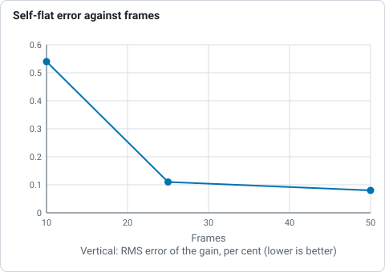
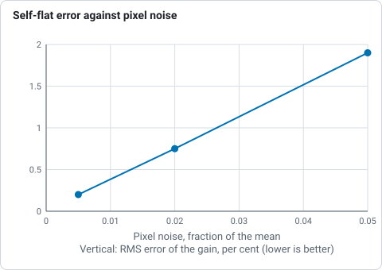
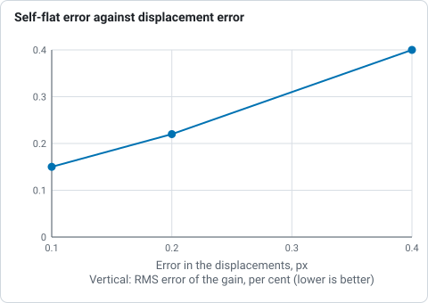
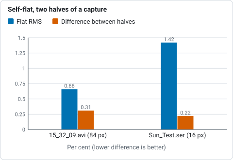
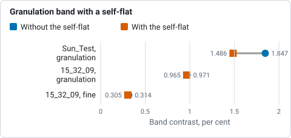
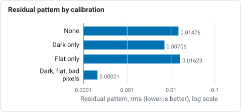
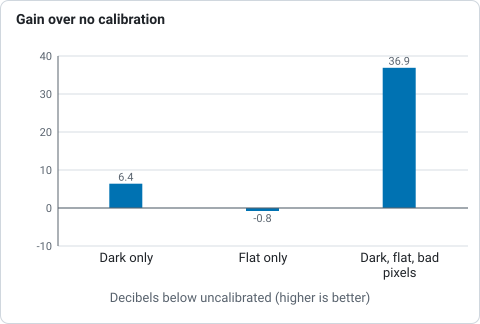

# Calibration: darks, flats and bad pixels

Calibration takes out of every frame what belongs to the camera and the optics in
front of it and not to the Sun. It is optional, and it is the one step in Helia that
needs frames you record separately.

For a worked example with real commands and numbers, see the
[calibration tutorial](../tutorials/calibrate.md).

## Why it matters more for the Sun

Dust on the sensor window, the fringes of an etalon, a vignette and a camera's own
fixed pattern are all fixed to the sensor. The Sun is not: seeing moves it over the
sensor, and Helia's alignment moves every patch of every frame to line it up. A
pattern that stays put while the picture moves is, to the alignment, not part of the
picture; it comes out of the stack as faint detail that was never there, and a
sharpening step then makes it crisper, not fainter. Calibrating first, before the
frames are scored, aligned or stacked, takes it out while it is still a fixed
pattern that can be measured.

## What to record

| What | How | How many |
|---|---|---|
| **Darks** | Lens capped (or the telescope covered), the **same exposure and gain** as the Sun, the same temperature if you can | 50 to 100 |
| **Flats** | An evenly lit field at the **same focus, gain and set-up** as the Sun: the clear sky or a screen through the filter, moved a little during the capture so any structure averages out. Aim for about half of full scale | 20 to 50 |
| **Darks for the flats** | Lens capped, at the **exposure of the flats**. The flats' exposure is almost always different from the Sun's | 20 to 50 |
| **Bias** (optional) | The shortest exposure the camera allows, lens capped. Only needed to scale a dark to another exposure | 50 |

Record them in the same session, in the same file format as the Sun (SER, AVI or
FITS stills), at the same size and region of interest: a master made at another
size, mode or mosaic is refused. A flat for a different focus is worse than no flat
for the reason given under [Etalons and Newton rings](#etalons-and-newton-rings).

## Building masters

```sh
helia calibrate --darks darks.ser --flats flats.ser --flat-darks flat-darks.ser \
                --preset ha -o masters/
```

Each input is a SER, AVI or video file, a FITS still, or a folder of them; give
several paths to combine several. It writes `master-dark.fits`, `master-flat.fits`
(and `master-bias.fits`, `master-flat-dark.fits`) and `bad-pixels.fits` to the folder
and prints the line to use them. The options are in
[The command line](cli.md#helia-calibrate).

* **Masters are single planes, as stored.** For a raw colour camera they are the
  mosaic, before any demosaicing, so a master made from one capture applies to any
  other of the same camera and mode.
* **Combining.** Each pixel of the master is the sigma-clipped mean of that pixel in
  every frame (values more than three standard deviations out are dropped, and the
  rest averaged), or the median with `--combine median`. A cosmic ray or a satellite
  in one frame does not reach the master. Frames are used up to a memory limit of
  3 GiB (many hundreds of 2 megapixel frames); `--max-frames` sets it by hand.
* **The flat.** The dark for the flats is subtracted from each flat frame, the frame
  is scaled to a mean of one in each colour of the mosaic (so a lamp or sky that
  drifts while you record is not a pattern), the frames are combined, and the result
  is normalised to a mean of one **within each colour**. Per colour, so that the
  colour balance of the sensor is not changed by the flat: it corrects the shape of
  the field, not the white balance. A flat from another program (a FITS or TIFF with
  no Helia header) is normalised the same way when it is read.
* **Written with a record.** Each master's FITS header holds how many frames made
  it, how they were combined, the exposure and the input's name, and a fingerprint
  of its pixels (FNV-1a 64, to tell masters apart in a log; not a cryptographic
  hash). Reading a master back checks the fingerprint, so a file that was edited or
  damaged is refused.

## Using them

```sh
helia stack sun.ser -o sun.tif --dark masters/master-dark.fits \
            --flat masters/master-flat.fits --bad-pixels masters/bad-pixels.fits
```

`--dark` and `--flat` also take the captures themselves (a file or a folder), which
Helia combines on the spot; build the masters once with `helia calibrate` if you will
stack the session more than once. In the desktop app it is the
[Calibrate step](gui.md#2-calibrate), and in the API the `calibration` object of a
job ([The API](api.md#calibration)).

### What is done to each frame

In this order, on the stored pixels of each frame as it is read, before it is
demosaiced, scored or aligned:

1. **Dark.** `raw - dark`.
2. **Flat.** `/ flat`, where the flat is at least 0.05. Pixels under that read as
   dead and are replaced as bad pixels, not divided by (a gain of more than 20 would
   only amplify noise).
3. **Clamp** at zero.
4. **Bad pixels** are replaced by the median of the good pixels around them of the
   same colour: the eight at distance one, or at distance two in a raw colour
   mosaic, widened to a second and a third ring when fewer than four are good.

Because it is done in the one place that serves frames, the CPU, the GPU's decode
kernel and every stage after it see exactly the same numbers. The calibration itself
runs on the CPU as each frame is read; the calibrated frame then goes to the device
as 32-bit floats (twice the bytes of a 16-bit frame), and everything from the
decode onwards runs where it did before. The parity tests compare the decoded
frames, and a whole calibrated stack, on both backends.

### Scaling the dark

A dark taken at another exposure can be scaled: `--scale-dark` multiplies the dark by
the ratio of the exposures (the Sun's comes from the SharpCap file beside the capture).
With a master bias (`--bias`) only the part above the bias is scaled; without one the
whole dark is, which also scales the offset, and Helia says so. If either exposure
is unknown the dark is used as it is, and Helia says that too. For the short
exposures of solar work the dark current is negligible and a dark at about the right
exposure and gain is simply used.

### Bad pixels

Hot and cold pixels are found three ways, and merged:

* **In the dark**: a pixel more than 6 robust standard deviations (`--hot-sigma`)
  above the median of its same-colour neighbours is hot, and one that far below is
  cold. A deviation under 0.012 of full scale never counts, so a dark that is nearly
  noise-free does not condemn pixels that differ by one grey level.
* **In the flat**: a pixel that reads under half of its neighbours is cold or dead.
  Dust is not: a shadow covers many pixels together.
* **In the light frames** (`helia calibrate --lights capture.ser`): a pixel whose mean
  over the capture stands out from its neighbours by more than 6 local deviations and
  more than 6 standard errors of the mean, lies outside the range of its neighbours
  (so a pixel on the slope of the limb is never one), and fluctuates no more than its
  neighbours do. The Sun moves over the sensor and a bad pixel does not. Burned-in
  text is as stuck as a bad pixel and is left out. This is for cameras you have no
  darks for; it finds pixels that stay off, which includes outliers of the
  pixel-to-pixel response as well as hot ones.

With a dark or a flat and no map, `helia stack` finds the first two itself
(`--no-cosmetic` stops it). Your own list is a text file with an `x y` pair per line,
counted from 0 at the top left, `#` starting a comment.

## A flat from the Sun itself: displaced-disc frames

A diffuser or sky flat cannot reproduce everything the Sun's own light does to
the sensor: the fringes of an etalon depend on the solar spectrum and the focus
of the moment. If you can move the Sun over the sensor, Helia can solve the flat
from the Sun frames themselves
(#52; Kuhn, Lin and Loranz
1991). The sensor's gain stays where it is while the Sun moves, so the two can be
told apart from the data alone.

```sh
helia calibrate --displaced sun-moved.ser --darks darks.ser -o masters/
helia stack capture.ser -o stack.tif --dark masters/master-dark.fits \
            --flat masters/master-flat.fits
# or in one go, from the frames themselves:
helia stack capture.ser -o stack.tif --dark darks.ser --displaced sun-moved.ser
```

**What to capture.** The ordinary Sun capture, but with the mount off tracking,
or nudged between frames, so the disc lands in different places on the sensor:
at least six frames, 30 pixels or more between the two furthest (Helia refuses
less), a tenth of the field is better, and 20 to 60 frames in all. The limb must
show in each frame (a disc cut off by the edge of the field is fine). Switch the
timestamp overlay off, and take darks at the same exposure. Keep the Sun and the
seeing steady; the Sun is taken to be the same in every frame.

**How it works.** Frame `k` is the gain `g` times the Sun `O` moved by `s_k`:
`frame_k(x) = g(x) O(x - s_k)`. The displacements come from the limb fit of each
frame. Two steps alternate, 30 times: the Sun given the gain (move each frame
back, divide by the gain, average with weights `g^2`), and the gain given the Sun
(the least-squares ratio over the frames, using only where the Sun is bright and
down-weighting what does not fit). A colour mosaic is solved one colour plane at a
time, and a colour the filter leaves empty (the blue pixels behind a sodium
filter, or behind an H-alpha one) is left at 1.

**What cannot be recovered.** A smooth change of the gain across the field cannot
be told from a smooth part of the Sun (limb darkening, a gradient across the disc):
moving by `s` changes a smooth mode of wavelength `L` by only `s / L` of itself. So
by default the solution is **high-passed**: divided by its own Gaussian blur, with a
width of a quarter of the span of the displacements (6 to 120 pixels), which keeps
the dust, the fringes and the column pattern and drops the vignetting. The
vignetting comes from an ordinary flat (or is left alone: it is mild next to dust).
`--displaced-keep-smooth` (`helia calibrate`) keeps every scale, which is only right
when the Sun was moved by much more than anything smooth in it. The printed
`selfcal:` line gives the span and the wavelength above which the gain is not
recovered well (eight times the span).

### How well it works

On synthetic frames (a disc with limb darkening and granulation in a 520 x 420
field, a gain with 25% vignetting, 14 dust rings of 4 to 12% and a column pattern,
noise of 0.2% of the mean, the Sun moved up to 90 pixels in each direction),
`cargo test -p helia-core selfflat`. The error is the RMS of the recovered gain
over the true gain, after matching their means, over the middle of the field:

| Test | Result |
|---|---|
| 10, 25 and 50 frames, displacements from the limb | 0.54%, 0.11% and 0.08% |
| The same 25 frames with the true displacements | 0.11% against 0.11% from the limb |
| Displacement of each frame found from the limb | within 0.04 px of the truth |
| Pixel noise of 0.005, 0.02 and 0.05 on a disc of 0.5 to 1 (25 frames) | 0.20%, 0.75%, 1.9% |
| Error in the displacements, 0.1, 0.2, 0.4 px | 0.15%, 0.22%, 0.40% |
| The Sun changing during the capture (a smooth random field of 2% and 6%) | 0.64% and 1.9% |
| The Sun moved 35 px against 139 px | 1.2% against 0.23% |
| Moved under 30 px | refused |
| A colour mosaic | 0.36% |
| The dark taken off, or not (offset of 15% of the mean) | 0.44% against 0.56% |
| The default high-pass (52 px), against the high-passed truth | 0.86%, the smooth part 0.18% |



*RMS error of the flat recovered from the Sun's own drift (displacements from the limb), by number of frames, from the validation table above.*



*RMS error of the recovered flat with 25 frames on a disc of 0.5 to 1, by pixel noise, from the validation table above.*



*RMS error of the recovered flat when the displacements are wrong by 0.1, 0.2 and 0.4 px, from the validation table above.*

Every row is under 1% except where the test says what degrades it, and the
default takes out the smooth part, which the data cannot determine.

### On the real captures

The project's captures were recorded tracking, so the Sun drifts by 3 to 13
pixels in three of them and 84 pixels in the fourth (`15_32_09.avi`); none was
made to be displaced, and the set does not hold the displaced frames of the
issue. What can be checked is whether the solution is real structure, by solving
from the even frames and the odd frames of 120 spread over the capture
(`cargo run --release -p helia-core --example selfflat_split -- capture`):

| Capture | Span | Flat RMS | Difference between halves | Correlation |
|---|---|---|---|---|
| `15_32_09.avi` | 84 px | 0.66% | 0.31% | 0.90 |
| `Sun_Test.ser` | 16 px | 1.42% | 0.22% | 0.99 |



*Flat RMS and the difference between flats solved from the even and the odd frames of two real captures, from the table above.*

Both halves agree, so there is structure fixed to the sensor in both. Whether it is
the sensor or the Sun is the question the span answers, and the answer is the
other result: stacking `Sun_Test.ser` with the flat solved from its own drift (a
span of 16 px, now refused) lowered the granulation band of `helia measure` from
1.847% to 1.486%: the solution had taken the granulation with it. With the 84 px
of `15_32_09.avi` the same stack changed it by 0.6% (0.971% to 0.965%), the fine
band by 3% (0.314% to 0.305%). So on captures of this kind a flat from the capture's
own drift does not help, which is why a span under 30 px is refused. It needs
frames made for it.



*Band of `helia measure` before and after stacking with the flat solved from the capture's own drift, from the text below the table.*

## Etalons and Newton rings

A flat divides out what is fixed to the sensor and the optics. Two things that look
fixed are not:

* **Newton rings and etalon fringes** move with focus, tilt and temperature. A flat
  taken at another focus does not match the lights: it leaves the rings in, or adds
  a second set. Take the flat at the science focus and tilt, through the filter, and
  look at the result.
* **The etalon's sweet spot.** A Fabry-Perot etalon passes a slightly different
  wavelength across the field unless the beam is nearly parallel, so the line moves
  off the filter's centre towards the edge. The disc is dimmer and has less contrast
  there, and no flat puts the line back. A flat corrects the brightness, not the
  shift. Keep the area you care about near the centre.

`helia calibrate` reads the flat for these and warns, with numbers: the edge of the
field as a share of the centre (a warning under 75%), rings in the radial profile
(half their peak-to-peak size over 0.4% and at least three crossings of the trend),
and the share of the field more than 5% below its surroundings (dust, a warning over
0.5%). `--preset ha` adds the H-alpha advice whatever the numbers say. The same
warnings appear in the app's Calibrate step and in `summary.calibration` of an API
job. They are heuristics on a flat, not a measurement of your etalon.

## What the files say

The masters applied are recorded in the output:

| File | Where |
|---|---|
| FITS | `PRSTEPn` cards `DARK-SUBTRACTION`, `FLAT-FIELDING` and `BAD-PIXEL-CORRECTION` (before `FRAME-SELECTION`), and `HISTORY` lines |
| TIFF | the `ImageDescription` tag |
| PNG | the `Description` text chunk |

Each line names the master: `Calibration: flat-fielded (master flat of 40 frame(s),
sigma-clip 3, exposure 12.0000 ms, from flats.ser, fp:8e47efb3405e3915)`. The
`PRSTEP` names are Helia's own; see [Output formats](../reference/output-formats.md).

## Does it work?

The tests answer on a synthetic sensor with a known truth, and the real captures
answer what they can.

**Synthetic.** A synthetic sun is recorded 40 times through a sensor with a
vignette that leaves 70% at the corners, six dust shadows up to 15% deep, a
per-pixel gain spread of 1%, a fixed offset pattern of 0.4% plus 0.2% per column,
twelve hot pixels and six dead ones. The darks and flats of the same sensor are
made into masters, and the stack is compared with the stack of the same frames
recorded by a perfect sensor (the residual is the root-mean-square difference, after
the one scale factor a flat leaves, since it normalises to a mean of one and not to
the response of the sensor):

| Calibration | Residual pattern (rms) | Below uncalibrated |
|---|---|---|
| none | 0.01476 | |
| dark only | 0.00706 | 6.4 dB |
| flat only | 0.01623 | -0.8 dB |
| dark, flat and bad pixels | 0.00021 | **36.9 dB** |



*RMS of the stack against the stack from a perfect sensor, for each calibration, from the table above.*



*Residual below the uncalibrated stack, in decibels, from the table above; flat only is worse than none.*

The test requires 20 dB. The pieces behave: a master of 40 darks has an error of
0.0016 against 0.0098 for one frame; the master flat is within 0.003 of the true
response; all 18 hot and dead pixels are found with none missed and none invented; in
light frames alone, with no darks, all the stuck pixels on the disc are found with none
invented. Richardson-Lucy sharpening of the stacks (a Gaussian of 1.5 pixels, 20
iterations) takes the uncalibrated residual from 0.01476 to 0.01566 (6% worse) and the
calibrated one from 0.00021 to 0.00029, still 34 dB under the uncalibrated one.

**Real captures.** There are no darks or flats for the ASI482MC that took the
2022-07-17 captures in the project's test data, and the calibration captures that
exist (an ASI071MC, 2456 x 2462, already stacked) are for another camera, so
none of what follows is a measurement of a real dark or flat. What could be tried:

* The sharpening page reports that Richardson-Lucy raises the finest-layer noise of
  `14_42_57.avi` (1920 x 1080, 8-bit, 630 frames, RGGB) six-fold and puts it down to a
  fixed pattern. Repeated here: 0.00031 to 0.00200 (6.5x). Substituting what the
  capture can tell about the sensor, a dark of per-column offsets read from the
  sky beside the disc (0.47% rms), changes it to 0.00026 to 0.00197, and adding a
  column flat estimated from the disc to 0.00049 to 0.00222. Choosing one colour
  plane (`--channel r`, `g`, `b`) gives 0.00027 to 0.00198, 0.00026 to 0.00121 and
  0.00036 to 0.00257. So these stand-ins do not fix it.
* Looking at where the amplified energy is explains why. Of the high-passed energy
  inside the disc, 2.2% is above 0.3 cycles per pixel in the stack and 69.5% after
  Richardson-Lucy. The checkerboard of the Bayer grid is 0% before and 2.3% after;
  the band of vertical stripes is 4.2% before and 1.4% after (a smaller share of a
  larger total); the rms of the column profile of the high-pass, the vertical stripes
  themselves, goes from 0.388% to 0.409% of the disc level, 5% more. The sensor does
  have vertical stripes in this capture, but they are not what Richardson-Lucy
  amplifies: the six-fold rise is broadband noise at the finest scale, which no
  dark or flat removes. A stronger reading would need an independent measure of the
  noise (two stacks of disjoint halves of the capture), which was not made.
* `helia calibrate --lights` found no stuck pixels in `14_42_57.avi`, 552 in
  `15_20_57.ser`, 706 in `Sun_Test.ser` and 3 in `15_32_09.avi`. Replacing them
  changed none of the stacks or the sharpening figures by a visible amount.
* The columns of the sky beside the disc do differ (0.47% rms, 2.3% peak to peak of
  full scale), which is the fixed pattern a real dark would have caught, and the
  flats a real capture would give are what could not be tried.

Run on the project's build server (24 cores, an NVIDIA A100), at the change that added
this page.

## What it does not do

* **No column-noise removal and no flat from the Sun itself.** A flat from the
  displaced disc (Kuhn, Lin and Loranz), which would plug in here, is
  #52.
* **A colour SER (three planes per pixel)** is calibrated as the mean of its planes,
  as it is read for stacking; masters must be made from the same kind of capture.
  FITS stills with three planes (a debayered RGB image) are not read.
* **One flat, one dark.** There is no library that picks the master for the
  temperature or the date; you name the files.
* **GPU.** The calibration arithmetic itself runs on the CPU as frames are read. A GPU
  kernel for it is possible and has not been written; what it would save, against the
  decode, has not been measured.
