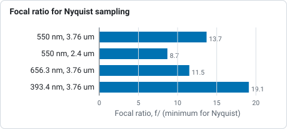

# Capturing for Helia

Stacking can only recover what the capture contains. This page says what to
record so that Helia has the most to work with. The reasoning, and the sources
for it, are in the [imaging methods research](../developer/research/imaging-methods.md);
that document marks each claim as checked against a source or as background
knowledge, and so does this page where it matters.

## The short version

* Save as **SER**, 16-bit if your camera offers it. An MP4 from a camera or
  phone works for quick results, but it has been compressed and loses detail
  (see below).
* Use a **short exposure**, a few milliseconds or less, so each frame freezes
  the seeing.
* Record **many frames**, at **50 frames per second or more**, by cropping the
  sensor to a region of interest.
* Set the gain so the histogram peaks at roughly half to two thirds of full
  scale, and never clip.
* Sample the image properly: roughly f/13 for a 3.76 micron pixel in white
  light (table below).
* Keep the files: darks and flats are not applied yet, but you will want them.

## SER, AVI or MP4

| | SER | AVI (uncompressed) | MP4, MOV, MKV, WebM (compressed) |
|---|---|---|---|
| Made for astronomy | Yes | No | No |
| Raw sensor data (Bayer) | Yes, with a pattern code | Only 8-bit, and the pattern is not stored in the file | No: already converted to colour and compressed |
| Bit depth | 8 or 16 | 8 or 16 (`Y16`) in the formats Helia reads | Usually 8-bit, 4:2:0 colour |
| Per-frame timestamps | Optional | No | Not used |
| Compression | None | None | Lossy (H.264, H.265, MJPEG and similar) |
| Needs | Nothing | Nothing | The optional `ffmpeg` program |

**Prefer SER.** It is simple, uncompressed and carries the colour layout.

Helia also reads uncompressed AVI, including the large OpenDML files (over
1 GB) that SharpCap writes. It reads `BI_RGB`, `Y800`/`GREY`, `Y16` and 24-bit
BGR video. A compressed AVI (for example MJPG) is handed to `ffmpeg`, like an
MP4, described next.
For a raw colour camera recorded to AVI, SharpCap also writes a
`CameraSettings.txt` next to the video, and Helia reads it to learn the Bayer
pattern. See [Troubleshooting](troubleshooting.md) if the colours or the
channel look wrong.

### FITS frames

A camera that saves each exposure as its own FITS file (the Seestar's
`Light_*.fit`, many astronomy cameras' sequence mode) can be stacked directly:
give `helia stack` the folder, or a pattern in quotes. A FITS cube (one file, one
frame per plane) works the same way. The frames keep their raw Bayer mosaic when
the header has `BAYERPAT`. The step-by-step is in
[Stack FITS frames](../tutorials/stack-fits-frames.md).

### When an MP4 is fine

Helia reads MP4, MOV, M4V, MKV and WebM files, and compressed AVI, through
`ffmpeg` when it is installed (see [Installation](installation.md#optional-ffmpeg-for-mp4-and-other-video)).
Helia itself stays free of video codecs; it runs `ffmpeg` as a separate program.

Raw SER or AVI captures keep more detail, for reasons that matter to stacking:

* The codec throws away fine, low-contrast detail first, and granulation is
  exactly that. What was thrown away cannot be stacked back.
* H.264 and H.265 compress in blocks and across frames, which adds blocking and
  smears detail from one frame into the next. The sharpness measure then
  partly ranks how the encoder behaved, not how the air behaved.
* Typical video is 8-bit with colour detail halved in each direction (4:2:0),
  and a camera that records MP4 has already demosaiced and sharpened the
  picture.

An MP4 is fine for a quick look at a day's seeing, for a camera or phone with no
other output, or for an archive you have no raw copy of. Helia then says so:
`helia info`, the Open step of the desktop app and the API's inspect response all
carry a note such as "lossy 8-bit 4:2:0 video (h264): fine for quick results,
SER/AVI raw captures keep more detail". If you can choose, record SER.

Two practical points. Frames are decoded once, by `ffmpeg`, into an
uncompressed file in a cache directory, and removed afterwards, so you need
free space for the whole video as raw frames: a 4K clip of 7,500 frames is about
60 GB. Helia checks the space before it starts and says what is missing. And
colour video is stacked as luminance, or as the red, green or blue channel you
choose with `--channel` (the desktop app has the same chips).

### Why a SER header can be wrong

A SER header is 178 bytes the recording program fills in once, from what it
believes about the camera. It is not checked against the pixels, and programs
differ in what they believe. Known ways it goes wrong:

* **Colour mode.** SharpCap has written raw Bayer data from a colour camera
  (a ZWO ASI482MC, for example) with `ColorID` 0, which means mono. Nothing in
  the file then says the frames are a mosaic. Helia checks the pixels of a SER
  file that says mono; see
  [Troubleshooting](troubleshooting.md#a-grid-or-chessboard-in-the-stack-a-bayer-mosaic-that-was-not-removed).
  The same camera and program do not always do it: of two SER files from one
  ASI482MC session in Helia's test captures, the 16-bit one says `BAYER_RGGB`
  and the 8-bit one says `MONO`. Check with `helia info` after the first capture
  of a session rather than assuming.
* **Byte order.** The flag for the byte order of 16-bit pixels has been written
  inverted by some programs. Helia checks it against the data.
* **Bit depth.** A program can write the depth of its sensor (12 bit) or its
  mode where the data is stored as 16.
* **Dates.** The `DateTime` fields are often zero, and the per-frame timestamps
  at the end of the file are optional.

Run `helia info` on the first capture of a session: it prints every header field
as written next to the values Helia will use, and says where each came from. If
the header is wrong in a way Helia does not catch, `--bayer`, `--bit-depth`,
`--endian` and `--flip-rows` on the command line (and the same choices in the
app's Open step and in the API) override it; the choice is recorded in the
output file.

## Exposure, gain and bit depth

* **Exposure.** Keep it short enough to freeze the seeing, which is a few
  milliseconds in the research notes (that figure is background knowledge, not
  a measured value). In white light this is easy. In H-alpha through a
  narrowband filter you are short of light, and the trade between exposure and
  noise becomes the main constraint.
* **Gain.** Raise it until the histogram sits at about 50 to 70 per cent of full
  scale, without clipping. Many frames at higher gain beat fewer frames with
  longer exposures: stacking averages the read noise down, and frame selection
  throws away the frames that moved during a long exposure.
* **Bit depth.** Use 16-bit if you can. Granulation contrast is only a few per
  cent in white light, and 8-bit steps are about 0.4 per cent each, which is a
  real limit on a single frame (stacking dithers it). Helia reads 8 and 16-bit
  data and works in 32-bit floating point. 12 or 16-bit helps most where the
  detail is faintest, and granulation is: `helia measure` shows how much of it a
  stack holds.

## Region of interest and frame rate

The atmosphere keeps changing while you record, and the sharp moments are
brief. A study of 160 Hz solar sequences
at the GREGOR telescope (Denker and others, 2018) concluded that rates above
about 50 frames per second are needed to catch a good share of the best
moments. On USB cameras the frame rate rises almost in proportion as the
region of interest shrinks, so cropping to the part of the Sun you care about
is the usual way to reach 100 to 300 frames per second.

How many frames? Helia keeps the best 25 per cent by default (12 per cent for white light and sodium D, where granulation needs only the sharpest frames), so a capture of a
few thousand frames leaves hundreds in the stack. Longer captures help, but the
Sun changes: granulation evolves over minutes, and for long captures or mosaics
the field rotation and the Sun's own rotation matter (derotation is on the
[Roadmap](../roadmap.md)).

## Sampling: focal ratio and pixel size

To record all the detail your telescope can deliver, the pixel pitch `p` should
be no larger than `wavelength x f-ratio / 2`, which means a focal ratio of at
least `2 x p / wavelength`. Worked values:

| Wavelength | Pixel size | Focal ratio for Nyquist sampling |
|---|---|---|
| 550 nm (white light) | 3.76 microns | f/13.7 |
| 550 nm (white light) | 2.4 microns | f/8.7 |
| 656.3 nm (H-alpha) | 3.76 microns | f/11.5 |
| 393.4 nm (calcium K) | 3.76 microns | f/19.1 |

*Focal ratio at which the pixel is half the diffraction scale (2 x pixel / wavelength), from the worked values above; a calculation, not a measurement.*

Seeing blurs the image below the diffraction limit, so in poor seeing a little
under-sampling costs little. In good seeing, slightly over-sampling (up to
about one and a half times Nyquist) helps the sub-pixel alignment and later
sharpening. Helia does not compute your sampling for you yet, and sizes its
alignment points in pixels, so if you change your focal ratio you may want to
change `--ap-size` too (see [How stacking works](how-stacking-works.md)).

## Darks and flats

Helia applies dark and flat frames, and a map of bad pixels, before it analyses
anything: see [Calibration](calibration.md). Record them in the same session as
the Sun, because they are cheap and you cannot take them afterwards:

* **Flats** matter a great deal for solar work. Dust on the sensor window
  stays put while the image moves, so a missing flat leaves a fixed pattern
  that stacking can make look sharper, and after local alignment it can be
  mistaken for granulation. Take flats at the **same focus** as your science
  data. In an etalon-based H-alpha system the interference fringes move with
  focus, so a flat at another focus will not match them.
* **Darks** matter little for bright white-light frames, but in H-alpha, where
  the signal is low, they remove hot pixels and fixed-pattern noise. Record 50
  to 100 with the lens capped, at the exposure and gain you used on the Sun.
* **Darks for the flats** at the exposure of the flats, if that differs from
  the Sun's (it usually does): 20 to 50 frames.

The research notes also point out that an etalon passes a slightly different
wavelength across the field unless the beam is nearly telecentric, so a disc
brightness gradient is normal for such systems. A flat corrects the brightness
across the field, not the shift of the pass-band, so Helia warns when a flat
shows strong vignetting; see [the sweet spot](calibration.md#etalons-and-newton-rings).

## Naming and keeping files

For SharpCap AVI captures keep the `CameraSettings.txt` file next to the video
with the name SharpCap gave it (`capture.avi` goes with
`capture.CameraSettings.txt`). Helia finds it by that name.
