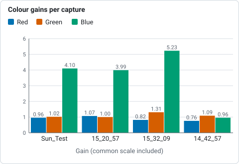

# Colourising

A solar capture through a narrow filter is a picture of one colour of light, so
the stack is monochrome. The orange of H-alpha, the violet of calcium and the
yellow of sodium are choices made when a picture is shared, not something the
camera measured. Helia gives each common solar line a recommended look, and
applies it only when you ask for colour.

**Colour is presentation, not measurement.** For a filter capture the stack stays
mono. A FITS file is never coloured by a look and its pixels are never touched.
(White light with a colour camera is the exception: see
[True colour](#true-colour).) Colour goes to a 16-bit RGB
TIFF and an 8-bit PNG, and every file Helia writes records which look was used
(see [What the files say](#what-the-files-say)). If you need numbers, use the
FITS file; if you want to share a picture, use the colour one.

## True colour

The looks below are for narrow-band captures, where the camera records one colour
of light and the colours are a convention. White light taken with a colour camera
is different: the Sun really is several colours at once, and the camera records
all of them in its Bayer mosaic. `--colour true` (API `colour: "true"`, the **True
colour** chip in the Stack step) stacks that.

* **One alignment.** The frames are scored, aligned globally and measured at the
  alignment points on the luminance (the mean of the three planes), once. The
  red, green and blue planes are then stacked with those same shifts, alignment
  point field and frame weights, so the three planes see the same sky. It costs
  three stacks (and three reads of the capture) rather than one.
* **Channel alignment.** The air disperses colours, so at a low Sun red and blue
  sit a fraction of a pixel to either side of green. Each of the stacked red and
  blue planes is registered to the green by phase correlation and moved by what
  that finds (`--no-channel-align` skips it). A shift under 0.05 px is noise and
  one over 6 px or with a poor lock (confidence under 0.3) is not believed; the
  history and `summary.true_colour.channels` say what was applied. The shift is
  measured on the planes as demosaiced: the Malvar-He-Cutler method borrows
  green's edges into red and blue, so it hides about a quarter of a displacement
  (on the synthetic test, 0.45 of 0.6 px), and the planes then agree with each
  other, which is what the picture needs.
* **White balance** (`--white-balance`). `auto`, the default, makes the middle of
  the disc (inside 80% of the radius) neutral: gains for red and blue that bring
  their means to the green's. `off` keeps the sensor's own balance, and
  `1.9,1,1.5` gives the three gains. A raw sensor does not weigh the colours as
  the eye does, so `off` is rarely what you want for a picture. A channel that
  holds far less than the green (blue behind a sodium filter) is held at a gain
  of 4 with a warning, rather than amplified into noise: true colour is for white
  light.
* **Scale.** All three channels share one scale, chosen so that the 99.99th
  percentile of the brightest channel of each pixel is 1. Nothing clips, and the
  balance of the colours is the white balance, not the scale.
* **Edits.** Sharpening, levels and the other edits run on each channel, as they
  do for any colour image, so a limb-darkening flatten also corrects the colour
  of the limb, which darkens differently in each channel. Areas that were
  flattened in every frame (burned-in text, exclusions) are made grey, so the
  balance does not tint them.
* **Files.** An RGB TIFF or PNG, or a FITS cube of three planes; see
  [Output formats](../reference/output-formats.md#fits-cube). A look (`--preset`
  colours, `--invert`, `--colour-strength`) and `--channel` do not apply, and
  asking for them is an error. The luminance is what the alignment, the limb fit,
  the crop and the summary use.

It needs a raw colour capture (a Bayer mosaic): a mono capture, or one that is
already demosaiced, has no colours to stack and is refused before any work is
done.

### What the real captures say

The four captures of 2022-07-17 are all ASI482MC (RGGB). Three of them (labelled
sodium until 2026-10-20) are H-alpha: the blue pixels are empty and the red is
clipped, so this is not what a sodium capture would look like. `helia stack --colour true --preset white
--keep 12%` on them (the gains include the common scale):

| Capture | Gains (red, green, blue) | Channel alignment |
|---|---|---|
| `Sun_Test.ser` (H-alpha) | 0.96, 1.02, 4.10 (blue held at the cap) | red +0.89, +0.00 px; blue not moved |
| `15_20_57.ser` (H-alpha) | 1.07, 1.00, 3.99 (blue held) | red +1.18, -0.09 px; blue +0.06, -0.01 px |
| `15_32_09.avi` (H-alpha) | 0.82, 1.31, 5.23 (blue held) | red +1.83, -0.25 px; blue +0.40, 0.00 px |
| `14_42_57.avi` (broad band, label unknown, red and blue partly clipped) | 0.76, 1.09, 0.96 | red +0.11, +0.10 px; blue -0.17, -0.14 px |



*Red, green and blue gains of `helia stack --colour true --preset white --keep 12%` on the four 2022-07-17 captures, from the table above.*

The H-alpha captures show why the cap exists (an uncapped blue gain of 15 to 23
would be all noise) and that true colour is not for them: their red and green
planes show different things through an H-alpha filter, so the red shift of a pixel
or two is the planes disagreeing, not dispersion. `14_42_57.avi` is the one
broad-band capture; its planes agree to under a fifth of a pixel, and the CPU and
the GPU (an A100) give the same gains and the same shifts to three decimals
(5.4 s and 4.0 s for 630 frames). There is no good white-light capture in the test
set, so the colour of a real white-light disc has not been checked. What is
checked, with known answers, is a synthetic colour disc: the balance, the
dispersion (and that planes of the same scene are found not to move), the crop
and the files; and the device against the CPU, with and without alignment points,
to 4e-7 in the samples.

## The presets

Each preset is a filter, with a recommended way to process its captures and a
look. The table is generated from the code that colours the pictures, so it is
always what Helia does. The ramp runs from black to white through the colours of
the look; the swatch after it is what a mid-grey becomes.

--8<-- "docs/book/src/reference/presets-table.md"

The processing recommendations apply to raw colour cameras and to the share of
frames kept:

* **Bayer channel.** A colour sensor records each wavelength mostly in one kind
  of pixel, so stacking that plane alone (`--channel r` for H-alpha) avoids the
  noise of the other two. A mono camera has no channels and ignores this.
* **Frames kept.** Faint lines (calcium, magnesium, H-beta) are noise limited, so
  30 per cent of the frames are kept instead of 25 to average more of it away.
* **Alignment point size** is not a property of the filter. Helia chooses it from
  the image size, about a sixteenth of the short side rounded to a multiple of
  8 and kept between 32 and 96 pixels.

Every recommendation is only a default. `--keep`, `--channel` and `--ap-size`
(and the same controls in the app and the API) override it.

## Grading the look

The look can be adjusted with a **grade**: hue, saturation, brightness (gamma), black and
white points and a curve for each channel, saved as named colour presets. See
[Colour grading your band](../recipes/colour-grading.md) for the tutorial, the ranges and
the `--grade` flag. The H-alpha look is now closer to the common red-orange palette
(gains 1.0, 0.45, 0.10).

## How the colours are made

Colourising is the classic amateur method: levels and gamma on the grey value,
then a gain and an exponent for each of red, green and blue. For a mono value
`v` from 0 to 1, a preset with tone exponent `g`, gains `k` and exponents `e`
gives, for each channel,

```text
t   = v ^ g                      (after inversion: v becomes 1 - v)
rgb = mix(t, min(1, k * t ^ e), strength)
```

Each exponent is positive, so every channel rises steadily from black to its
gain: a darker input never gets a brighter output. The result is sampled once
into a table of 4096 colours, which the CPU and the GPU both look up with the
same linear interpolation, so they agree to within a rounding error.

* **Invert** turns the picture negative before it is coloured. A disc-inverted
  H-alpha image shows filaments and prominences clearly, and is common practice.
  An inverted picture is exactly the normal look read backwards: a pixel of value
  `v` gets the colour that the normal look gives to `1 - v`.
* **Strength** mixes between grey (0 per cent) and the full colour (100 per
  cent). It is a way to keep a hint of colour, or none.
* **Mono** is the preset-free choice: the grey stack as it is, optionally
  inverted.

### Where the conventions come from

There is no formal standard for solar false colour. The project's research notes
([State of the art, October 2026](../developer/research/state-of-the-art-2026.md),
section 6.2) record that amateur practice is greyscale, pseudo-colour, partly
inverted and inverted pseudo-colour variants per filter, that H-alpha is
commonly rendered red-orange, and that no source for a Ca K false colour was
found. Helia therefore follows the colour of the line's wavelength where the eye
can see it (H-alpha red, magnesium green, sodium and helium yellow, H-beta
blue-cyan), a conventional violet for the two calcium lines at the edge of
vision, and a slightly redder violet for Ca H so a pair can be told apart. They
are a starting point; change the look in the app if you prefer another.

## In the desktop app

After a stack, Helia moves to the **Colour** step (between Sharpen and Export).


* The cards show each look as a ramp from black to white, with its name and
  wavelength. Click one and the stack in the viewer changes straight away; it is
  made on a background thread, so the window stays responsive.
* **Invert** and **Strength** change the preview as you move them.
* The text under the cards says why the preset recommends what it does.
* The app remembers the look you last chose **for each filter**, in its settings
  file, so the next H-alpha capture starts with the look you used last time.

A capture with the filter in its name starts with that filter's own look, so
the usual path needs no choices at all. The Export step says what will be
written, and the viewer shows the stack as it will be exported.

## On the command line

```sh
helia stack ha.ser -o ha.tif --preset ha          # recommended settings and colour
helia stack ha.ser -o ha.png --preset ha --invert # a shareable inverted picture
helia stack Sun_CaK.ser -o cak.tif --colour auto  # colour from the detected filter
helia stack sun.ser -o sun.tif --colour mono      # plain grey, even if detected
helia stack ha.ser -o ha.tif --colour cak         # a different look for the same stack
helia stack ha.ser -o ha.tif --preset ha --colour-strength 0.6
helia presets
```

* `--preset <id>` says which filter the capture was taken with. It applies the
  recommended channel and frame share and colours a `.tif` or `.png` output.
* `--colour <auto|mono|id>` chooses only the colour. `auto` uses the preset you
  gave or the filter Helia detected (and fails with a clear message if there is
  none).
* `--invert` and `--colour-strength` adjust the look.
* Without `--preset` or `--colour`, the output is grey, and Helia prints a tip if
  it detected a filter.
* For `.fits`, colour options are noted in the header and the pixels stay
  unaltered mono.

See the [CLI reference](../reference/cli.md) for every option.

## Exporting a colour table

The look of a filter can be written as a colour table, to colour the same stack in
another program so that the picture matches one made here
(#23):

```sh
helia lut ha -o ha.cube                 # a 1D .cube LUT, 256 entries
helia lut ha -o ha.lut                  # an ImageJ / Fiji .lut
helia lut cak -o cak.csv --size 1024    # value,red,green,blue as text
helia lut ha -o ha-strip.png --invert --strength 0.8
```

| Format | File | Read by |
|---|---|---|
| `cube` | a 1D `.cube`: a title, the domain and `size` rows of red, green, blue | DaVinci Resolve, Adobe tools and others |
| `csv` | `value,red,green,blue`, one row per entry | spreadsheets and scripts |
| `imagej` | a `.lut` of 768 raw bytes (256 red, 256 green, 256 blue) | ImageJ and Fiji |
| `png` | a strip image `size` wide, 32 high | anything that loads an image |

`--format` says the format, or the extension of `-o` does; `--size` is 2 to 4096
entries (an ImageJ table is always 256); `--invert` and `--strength` are the colour
options of the stack. The table is the one Helia colours with, resampled by the
same linear interpolation, so a 4096-entry table reproduces it exactly and the
`.cube` of a filter applied to its mono stack gives the same picture up to the
rounding of the other program. In the app, the Colour step has the same four
formats under *Colour table*, and the API serves
`GET /api/v1/presets/{id}/lut?format=cube&size=256&invert=false&strength=1`.
Colour is presentation, not measurement: the table says nothing about the Sun.

## In the API

`GET /api/v1/presets` lists the presets with their recommendations and colour
parameters, and `POST /api/v1/captures/inspect` reports the settings it would
use for a capture (`recommended`). A job takes `preset`, `colour`, `invert` and
`colour_strength` in its `config`. See [The API](api.md#colour-and-presets).

## How the filter is recognised

Helia looks for the filter in these places, most trusted first, and stops at the
first match:

1. the file name (without its extension);
2. the name of the folder the file is in;
3. the SharpCap `CameraSettings.txt` next to it: its `Filter`, `Filter Name`,
   `Filter Wheel`, `Target`, `Description` and `Notes` entries;
4. the instrument, telescope and observer strings of a SER header;
5. the name of the folder above.

The text is split into words at punctuation, at a lower-case to upper-case change
(`SunHa` is `Sun` and `Ha`) and between letters and digits (`cak3934`). A word,
or two or three words run together (`Ca II K` is `caiik`), must then match
exactly, ignoring case:

| Filter | Words |
|---|---|
| H-alpha | `ha`, `halpha`, `h-alpha`, `hydrogen alpha`, `656` |
| Ca II K | `cak`, `ca k`, `ca ii k`, `calcium k`, `393` |
| Ca II H | `cah`, `ca h`, `ca ii h`, `calcium h`, `396` |
| Mg I b | `mg`, `mgb`, `mgi`, `magnesium`, `517` |
| Na I D | `na`, `nad`, `sodium`, `589` |
| He I D3 | `d3`, `hed3`, `helium`, `587` |
| H-beta | `hb`, `hbeta`, `h-beta`, `486` |
| White light | `white`, `whitelight`, `wl`, `continuum`, `cont` |

A number such as `656` counts only on its own, so a date like `2026-05-17` is not
mistaken for a wavelength. A word inside a longer word never counts: `Hampshire`
is not H-alpha and `Sha_nal` is nothing. If the filter is not recognised, the
app asks once with a chooser, and the command line uses plain defaults and says
`filter not recognised`.

## What the files say

Every file records the look it was written with, in words, so a coloured picture
cannot be mistaken for a measurement later:

| File | Where the note is |
|---|---|
| TIFF | the `ImageDescription` tag |
| PNG | the `Description` text chunk (and `Software`: Helia) |
| FITS | `HISTORY` cards in the header |

The note reads like `Colour is presentation, not measurement: preset ha (H-alpha
656.3 nm, orange-red), invert off, strength 1.00`. The FITS pixels are written
exactly as they would be without it; only the header differs.

The same places also record how the capture was read, whether or not a colour
look was chosen, so a stack can be traced back later. These lines are always
written:

```text
Capture read as: Bayer RGGB (detection), 16-bit (header), little-endian (detection)
SER header: ColorID 0 (MONO), 16-bit, big-endian
Bayer detection: 2x2 position means 79.6% / 77.6% / 77.4% / 0.3% of full scale, spread 135%, 5 frames
Overrides: --bayer none, --bit-depth 16
```

The first says which Bayer pattern was used (or `none (mono)`), the bit depth and
(for 16-bit data) the byte order, each with its source (`header`, `sidecar`, `detection` or
`override`), and adds `rows flipped` when `--flip-rows` was given. The second is
the SER header's own claim, the third appears only when a mosaic was detected,
and the fourth only when you overrode something. When the stack was calibrated
there is one more line for each master (`Calibration: dark subtracted (master dark
of 64 frame(s), sigma-clip 3, exposure 0.6400 ms, from darks.ser, fp:...)`, the same
for the flat and for the bad pixels); see [Calibration](calibration.md#what-the-files-say).
TIFF joins the lines with
`; `, PNG puts them in the text chunk, and FITS has one `HISTORY` card (or more,
when a line is long) for each.

## What it does not do

* It colours the stacked image only. Prominence and disc compositing into one
  high-dynamic-range picture is a separate step, described in
  [Prominences and the disc together](prominences.md); colourising
  here is only the colour part of that work.
* There are no user-defined palettes or exported lookup tables yet.
* Sharpening comes before colouring, and is its own step
  ([Sharpening and adjustments](sharpening.md)): the colour is applied to the
  sharpened mono image, never the other way round.
