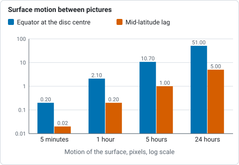
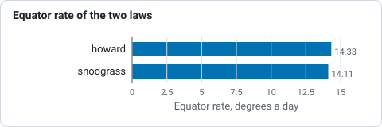

# Solar derotation

The Sun does not turn as one piece, and it does not hold still while you take pictures
of it. Helia can bring images of the Sun to one time by its **differential rotation**
(#26), so that features line up
across a long session, in a [time-lapse](timelapse.md), or between the panels of a
mosaic taken minutes apart. A worked example is in
[Tutorial: derotating H-alpha stacks to one time](../tutorials/derotation.md).

(This is not field rotation. The turning of the whole picture in an alt-azimuth
mount's camera is a different thing and is a different feature. Solar derotation
moves the surface of the Sun on the disc; the disc itself stays where it is.)

## Why it matters

A feature on the equator goes round in about 25 days, 14.3 degrees a day; at
40 degrees of latitude it takes about a day longer. Seen from the Earth, which moves
round the Sun too, the disc turns by about 13.3 degrees a day at the equator, which is
0.55 degree an hour. On a disc 220 pixels in radius that is:

| Time between pictures | Equator at the disc centre | Mid-latitude lag behind the equator |
|---|---|---|
| 5 minutes | 0.2 px | 0.02 px |
| 1 hour | 2.1 px | 0.2 px |
| 5 hours | 10.7 px | 1 px |
| 24 hours | 51 px | 5 px |



*Motion on a disc 220 pixels in radius, from the table above: the equator at the disc centre and the mid-latitude lag behind it.*

Registering by the limb or by phase correlation cannot take it out: the limb does not
move at all, and a phase correlation of the surface follows the rotation of the middle
and leaves the edge turned. The pictures have to be brought to one time by a model of the
rotation.

## How it works

The rotation of the surface is described by a law, the **sidereal angular rate at
latitude** `phi`:

`omega(phi) = A + B sin^2(phi) + C sin^4(phi)`




*Sidereal rotation rate at the equator of the two published laws, from the table of laws above.*
Helia has two published laws and takes your own.

| Law | Source | A | B | C | Equator, deg/day |
|---|---|---|---|---|---|
| `howard` (default) | Howard, Harvey and Forgach (1990), sunspots and plage | 2.894 | -0.428 | -0.370 | 14.33 |
| `snodgrass` | Snodgrass and Ulrich (1990), Doppler features | 2.851 | -0.343 | -0.474 | 14.11 |
| `A,B,C` | yours | degrees a day | degrees a day | degrees a day | A |

The published coefficients are in microradians a second (as SunPy documents them); Helia
converts them (one microradian a second is 4.95 degrees a day). Sunspots and the
bright features of the chromosphere follow the Howard law closely; Doppler features
turn a little slower. There is no law for H-alpha filaments in particular: they are
anchored in the chromosphere and the spot law is the usual choice.

To bring an image taken at `t1` to the time `t2`, every pixel of the result is traced
back to where its feature was at `t1`:

1. The pixel's place on the disc gives a latitude and a longitude from the central
   meridian for the Sun as it is seen at `t2`, using the tilt `B0` and the position
   angle `P` of the Sun at `t2` (Meeus, *Astronomical Algorithms*, chapters 25 and 29,
   as for the [sunspot search](sunspots.md)) and the way the picture sits against the Sun (below).
2. The Carrington longitude of the point is that longitude plus `L0(t2)`.
3. In the Carrington frame, which goes round at 360/25.38 = 14.18 degrees a day, the
   feature turned by `(omega(phi) - 14.18) (t2 - t1)` between the two times, so at
   `t1` it was at that much less longitude.
4. That longitude, less `L0(t1)`, is a longitude from the central meridian at `t1`; with
   `B0(t1)` and `P(t1)` it is a pixel in the picture taken then, which is sampled with a
   Lanczos-3 kernel.

Three details keep the result clean.

* **Brightness goes with the feature.** The contrast against the limb darkening
  (the model Helia fits for [flattening](sharpening.md), with the sky level) is carried:
  a spot that moves toward the limb is not dimmed twice. `--raw-brightness` moves the pixel
  values as they are instead.
* **The limb is left alone.** Outside the limb, and in a ring 2% of a radius wide inside
  it, the picture is left as it was and handed over smoothly. A pixel whose source was
  behind the limb at `t1` (the east edge, going forward) is left as it was too. For
  minutes this is invisible; for hours the last degrees of the east limb are the
  features that arrived from the far side, which no picture shows.
* **Colour planes move together,** and each keeps its own sky level.

### How the picture sits against the Sun

The geometry needs to know which way is solar north in the picture, as the sunspot
search does:

* by default solar north is up and west is on the right;
* `--north-angle DEG` turns north counter-clockwise from the top;
* `--celestial-north-up` is for an equatorial mount with the picture north up: solar
  north is then turned by the position angle `P` at each picture's own time, added
  to `--north-angle`;
* `--mirror` is for a mirror image (west on the left).

A wrong orientation does not move the features by the wrong amount so much as in the
wrong direction, so check it with a pair of pictures that you can see move.

## The command line

### `helia solar-derotate`

```sh
helia solar-derotate IMAGES... -o DIR [--to TARGET] [--date D --utc-offset H] [tuning]
```

Brings each image to one time and writes `NAME-derotated.EXT` to the directory. Each
image is derotated on its own, about the disc fitted to it, and is **not shifted**: it
does not register the pictures. Use it on stacks and panels, then register them with the
[time-lapse](timelapse.md) or a mosaic; or give `--derotate` to the time-lapse, which does both in the
right order (see below).

```sh
helia solar-derotate 0001-15_32_09.tif 0002-15_37_19.tif -o dd \
    --date 2026-10-20 --utc-offset 1 --to 2026-10-20T19:37:19
```

```text
bringing 2 image(s) to 2026-10-20 19:37:19 UTC, Howard rates
  0001-15_32_09.tif  14:32:09 UTC  +305.2 min  disc (288.5, 289.0) r 222.4 px  moved up to 10.96 px (centre 10.89)  -> dd/0001-15_32_09-derotated.tif
  0002-15_37_19.tif  14:37:19 UTC  +300.0 min  disc (271.5, 294.6) r 222.0 px  moved up to 10.76 px (centre 10.69)  -> dd/0002-15_37_19-derotated.tif
```

| Option | Meaning | Default |
|---|---|---|
| `IMAGES...` | `.tif`, `.tiff`, `.png` or `.fits` files with the whole disc in view, each with a time | required |
| `-o`, `--output DIR` | Directory for the results; created when missing | required |
| `--to TIME` | The time to bring every image to: `first`, `middle` or `last` (by time), or a UTC time such as `2026-10-20T14:30:00` | `middle` |
| `--date YYYY-MM-DD`, `--utc-offset HOURS` | The date and the clock of file names that hold only a time of day; see [Time-lapse](timelapse.md#where-the-times-come-from) | none, 0 |
| `--rotation-law LAW` | `howard`, `snodgrass` or `A,B,C` in degrees a day | `howard` |
| `--north-angle DEG` | Counter-clockwise from the top of the image to solar north | 0 |
| `--celestial-north-up` | Solar north is turned by the position angle `P` at each image's time | off |
| `--mirror` | The images are mirror images | off |
| `--raw-brightness` | Move the pixel values as they are, not the contrast against the limb darkening | off |

The times come as they do for the time-lapse: a FITS `DATE-AVG`, or the file name. A FITS
output keeps its header time; the note recorded in every result says what was done.

### In a time-lapse

`helia timelapse ... --derotate` brings every frame to the time of the reference frame,
or to `--derotate-to TIME`, after moving it into position. The order matters. The
pointing is found from the limb first; then, before the phase correlation of the disc
centre, the surface is derotated, so that the correlation follows the pointing and not the
rotation (without it the correlation of a series spanning hours would follow the
turning of the middle and shift the whole disc). `--rotation-law`, `--north-angle`,
`--celestial-north-up`, `--mirror` and `--raw-brightness` are those above. The series
must have a time for every frame, and the reference must have a clear limb. The CSV table gains a
`derotated_px` column: the most the surface of that frame moved, in pixels.

### In a mosaic

`helia mosaic ... --derotate` brings every panel to one time (the middle one by default,
or `--derotate-to`) before the panels are joined; see [Mosaics](mosaic.md). The disc is
fitted to a first joining, each panel is derotated with it, and the pairs are matched
again.

## In the app

The Time-lapse and Mosaic steps each have a **Derotation** section: **Off** or **To reference**, the
**Law** (Howard or Snodgrass) and **Celestial north is up**. It needs a time for every
capture (set the date and the clock's offset under **Times** for names that hold only a
time of day). The line under the viewer reports how far the surface moved in the frame
shown, and the step's summary says what time the frames were brought to. The command line
alone has `--north-angle`, `--mirror`, `--raw-brightness`, `--derotate-to` and a law of
your own.

## In the API

`POST /api/v1/solar-derotation` brings images in the data root to one time and writes
the results there. The time-lapse request takes a `derotate` object. See
[The API](api.md#post-solar-derotation) and the [API reference](../reference/api.md).

## How well it works

**On a synthetic Sun with known answers.** The Sun is drawn as a sphere with seven spots
from latitude -35 to 50 degrees, carried round by the Howard law, with the tilt and
longitude of the real ephemeris. A view six hours later is made by the derotation from
the first and compared with the view drawn for that time: the disc turned by 13.9
pixels at the centre, the RMS difference inside 0.9 of the radius falls from 0.052 to
0.0003 (of a disc of 1), and every spot lands within 0.015 pixel of where it belongs. For
24 hours, with the mid latitudes 5 pixels behind the equator, a rigid rotation at the
equatorial rate leaves an RMS of 0.0115; the differential law, 0.0009. These checks use
the same geometry in the drawing and in the correction; they test the arithmetic and the
signs of the rates, not the ephemeris, which is checked against Meeus's worked example.

**On real captures.** The only real pair so far was taken five minutes apart, too
close for the rotation to be more than 0.19 pixel at the centre. It is enough to see the
sign and the size: the phase correlation of the disc centre between the two H-alpha
stacks (after the limb fit) asked for 0.18 pixel in x without the derotation and 0.35
pixel with it, a difference of 0.17 pixel against the 0.185 the model predicts at the
disc centre, with a peak-to-sidelobe ratio near 180 both times. See the
[tutorial](../tutorials/derotation.md). **There is no real capture series spanning hours
yet**: one, with the Sun's features visible at both ends (a sunspot group or a
filament), would let the model be checked against the Sun itself.

## Limits

* The surface is moved, not the atmosphere: the filter's height, prominences above the
  limb, the Evershed flow and features that change in the interval (a filament that
  erupts) are not modelled. Over minutes this does not matter; over hours the longer
  the interval, the less a feature is the one it was.
* A single law is used for the whole disc. Individual features differ from it by
  tenths of a degree a day, and spots rotate differently from the plage around them.
* Derotation of a stack is of the stack: it does not move the frames inside a capture
  to one time before stacking. A capture of a few minutes changes by a fraction of a
  pixel, less than the seeing.
* It needs the whole disc in view in every image to fit the disc.
* The ephemeris ignores the difference between UT and terrestrial time (a minute) and
  the light travel time (8 minutes, the same for every image). Neither matters for the
  difference between two images.
* The time of a capture named from its start is the start, not its middle; give a time
  that is the middle for a long capture.
