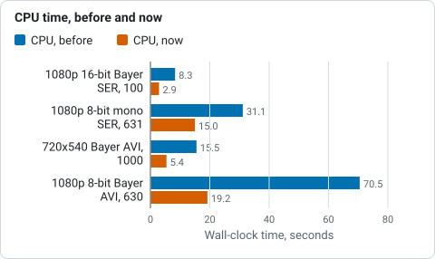
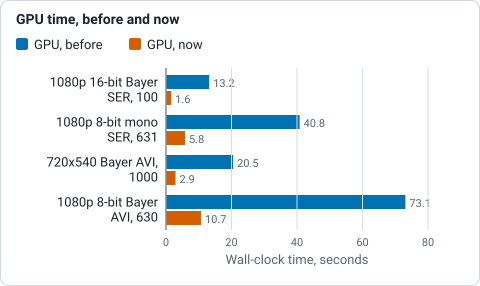

# GPU acceleration

Helia does its heavy maths on the GPU when there is one, through
[wgpu](https://wgpu.rs), a Rust library that speaks Vulkan, DX12, Metal and
OpenGL. There is nothing to install beyond your normal graphics driver, and no
vendor-specific toolkit: the same code runs on AMD, NVIDIA, Intel, Apple and
Raspberry Pi graphics.

## Backends

| Platform | APIs wgpu uses | Notes |
|---|---|---|
| Linux | Vulkan, then GLES | Needs a Vulkan driver for your GPU (Mesa for AMD, Intel and Raspberry Pi; NVIDIA's own driver). |
| Windows | DX12, Vulkan | Provided by the graphics driver. |
| macOS | Metal | Built in. Tested on an Apple M1: every shader agrees with the CPU. See [Apple silicon](performance.md#apple-silicon-m1) for the speed. |

## Choosing between GPU and CPU

The `--backend` option of `helia stack` (and the **Backend** setting in the
desktop app, and `backend` in an API job) takes three values:

| Value | Behaviour |
|---|---|
| `auto` (default) | Ask wgpu for the best hardware adapter. If it finds none, or only a software adapter, use the CPU path. On an Apple GPU only the alignment points run on it, the rest on the CPU (see [Apple silicon](performance.md#apple-silicon-m1)). |
| `cpu` | Always use the CPU. |
| `gpu` | Use a GPU for every stage. If there is no real GPU, fall back to wgpu's software adapter; if there is no adapter at all, fail with an error. |

Helia prints which one it chose. On the command line it is the `backend:` line
of the summary, for example `backend: GPU (<adapter> (Vulkan, DiscreteGpu))` or
`backend: CPU (16 threads)`. The desktop app shows it in a chip in the top bar,
and the API reports it under `backends` in `GET /api/v1/version`.

## The CPU path

The CPU path is not a poor relation. It is the **specification**: the GPU
kernels are tested to give the same results as the CPU code (see
[The GPU parity rule](../developer/gpu-parity.md)). It is multi-threaded and
vectorised, so a machine without a usable GPU still stacks, only more slowly,
and the output is equivalent either way.

## What runs on the GPU today

* Colouring the finished stack through a colour preset: a table lookup with
  linear interpolation, one thread per pixel. It matches the CPU reference to
  within 1e-5 per sample.
* Sharpening and the everyday edits (levels, curves, unsharp mask, a-trous
  wavelets and denoise, Richardson-Lucy deconvolution): separable convolution
  passes, element-wise kernels and, for an Airy blur, a direct 2-D convolution.
  The image stays on the device across a run of these operations. The noise level
  of a wavelet layer is estimated from a few thousand sampled pixels, which are
  the only values that come back to the host in between. They match the CPU
  reference to within 1e-4 (about 1e-6 observed); the live preview in the app
  uses them. Crop, rotate, flip and resize run on the CPU.
* Scoring every frame, straight from the stored bytes: decode, debayer, blur
  and the sharpness reduction all run on the device.
* Global registration by phase correlation, with Helia's own mixed-radix FFT
  (lengths up to 2048) written in WGSL.
* Alignment point correlation.
* Stacking.

Frames are sent in batches with two in flight, so uploading the next batch
overlaps work on the current one.

The robust stacking modes (`--robust sigma|huber|winsor`) run on the GPU for
the whole-frame stack, in two passes; with alignment points the per-point
tiles combine on the CPU and the whole-frame image that fills between them on
the GPU, under the same rule. CPU and GPU agree to 6e-4 at worst on real frames
(`crates/helia-gpu/tests/robust_real.rs`). Still on the CPU: registration of captures whose transform length would exceed 2048,
and, by design, fitting the correlation peaks and interpolating the shifts. The GPU returns the best offset and the 3x3 neighbourhood of each peak, and the same CPU code
makes the decision on either path, so the CPU and GPU paths give the same
answer (registration agrees to about 1e-5 px).

### Measured speed

Wall-clock seconds for `helia stack` with `--keep 25%`, end to end. Measured on a laptop: 16-thread CPU and an NVIDIA RTX 3050 Ti Laptop GPU
(4 GB, Vulkan), commit `ae49ddc`. The laptop GPU throttles when hot, so expect
run-to-run variation of 10% or so.

| Capture | Frames | CPU, before | CPU, now | GPU, before | GPU, now |
|---|---|---|---|---|---|
| 1920x1080 16-bit Bayer SER | 100 | 8.3 | 2.9 | 13.2 | 1.6 |
| 1920x1080 8-bit mono SER | 631 | 31.1 | 15.0 | 40.8 | 5.8 |
| 720x540 8-bit Bayer AVI | 1000 | 15.5 | 5.4 | 20.5 | 2.9 |
| 1920x1080 8-bit Bayer AVI | 630 | 70.5 | 19.2 | 73.1 | 10.7 |

*Wall seconds of `helia stack --keep 25%` on the CPU of the laptop, from the table above (lower is better).*

*Wall seconds of `helia stack --keep 25%` on the laptop RTX 3050 Ti, from the table above (lower is better).*

"Before" is the first release of the stacker, where only scoring and
accumulation ran on the GPU. Use `helia stack --timings` to see where the time
goes on your own machine.

On a data-centre GPU (NVIDIA A100) small captures come out level with the same
machine's 24-core CPU: starting the device costs about 0.4 s, which the GPU
only earns back on larger captures (a 5.6 GB, 2713-frame 1080p capture takes
27.6 s on the CPU and 11.4 s on the GPU, with a third of the memory). The
[Performance guide](performance.md) has the full table, how to see where the
time goes (`--timings`, `HELIA_GPU_TRACE`), `HELIA_GPU_DEVICE` to pick one
of several GPUs, and `HELIA_GPU_RESIDENT_MB`, the video memory a discrete card
may use to keep a capture's frames between stages (up to 6 GiB by default; the
guide has a step-by-step check)
(#10).

## Software adapters

A **software adapter** is a GPU implemented on the CPU: WARP on Windows,
lavapipe (Mesa) on Linux. They exist so that programs run on machines with no
GPU, and so that Helia's automated tests can exercise the GPU code on ordinary
build servers. They are slower than Helia's own multi-threaded CPU path.

How wgpu ranks adapters matters here. Helia asks for the high-performance
choice, and wgpu orders what it finds as discrete GPU, integrated GPU, other,
virtual GPU and, last, a CPU-hosted adapter. `auto` skips a CPU-hosted adapter
altogether, so a Linux machine with no GPU but with Mesa's lavapipe installed
uses Helia's faster CPU path (`backend: CPU (...)` in the summary).
`--backend gpu` still accepts a software adapter when there is no real GPU,
which is mainly useful for testing. Helia's own tests ask for the software
adapter explicitly (see
[the source repository](https://github.com/qisback/helia)).

## Troubleshooting

**The summary says `backend: CPU` and you expected a GPU.**

* Linux: install the Vulkan loader and your driver
  (`sudo apt-get install libvulkan1 mesa-vulkan-drivers`, or NVIDIA's driver),
  then check that `vulkaninfo --summary` (from the `vulkan-tools` package) lists
  your GPU. If it does not, Helia cannot see it either.
* Windows: update your graphics driver from the manufacturer. Remote desktop
  sessions and some virtual machines hide the GPU; run Helia on the local
  console.
* macOS: nothing to install; Metal is built in.
* A laptop with two GPUs: Helia asks for the high-performance one. If the
  system gives it the integrated GPU, use your system's graphics settings to run
  Helia on the discrete GPU.
* Run `helia stack ... --backend gpu`. Unlike `auto`, it reports an error when
  no adapter can be opened, and the message says why.

**"no suitable GPU adapter found" or "could not open GPU device".** These come
from `--backend gpu`. The first means no adapter of the requested kind exists;
the second means an adapter exists but refused to open (a driver problem).
Updating the driver is the usual fix.

**The GPU is used but the result differs very slightly from the CPU.** That is
expected. Floating-point sums are not bit-for-bit identical across devices; the
tests bound the difference (see the parity page).

**A bug that only happens on the GPU.** Re-run with `--backend cpu`. If the CPU
result is right, report it with your operating system, GPU, driver version and
`helia --version` (see [Contributing](https://github.com/qisback/helia/blob/main/CONTRIBUTING.md)).
