# Using the desktop app

`helia-gui` takes a capture from a file on disk to a stacked, sharpened and
coloured image in nine steps, shown down the left of the window, and two optional
steps, Time-lapse and Mosaic, that work on several captures at once. You do not have to visit them
all: open a file and press **Stack with recommended settings**, and Helia does
the rest (see [Quick start](quick-start.md)). The steps are there when you want
to look closer or change something. The screenshots on this page are produced
by the test suite from a synthetic capture, so they always match the current
interface.

The window has four areas:

* the **top bar**, with the capture details, the compute backend and the
  Open and Export buttons;
* the **pipeline rail** on the left, one row per step, each with its state and
  a one-line hint about what to do next;
* the **viewer** in the middle, with a frame scrubber and the quality curve
  underneath;
* the **inspector** on the right, which shows the settings of the selected
  step.

Click a step in the rail to select it. Everything that takes time (decoding,
scoring, stacking, colouring, file dialogs) runs on background threads, so the
window stays responsive and a stack can be cancelled at any moment.

## What the window tells you

**The rail hints.** Under each step is a plain sentence about what to do next,
which changes as you go: *Open a capture*, *Scoring the frames, please wait*,
*Ready: press Stack*, *Done: sharpen, colour and export*, *Save as TIFF, PNG or
FITS*. A step that has nothing to do yet says what it is waiting for, such as
*Open a capture first*.

**Notices while it works.** Whenever Helia is busy, a notice appears above the
picture: the stage in plain words, a progress bar, and a **Cancel** button where
stopping makes sense. Anything that takes longer than about a seventh of a second
gets one, so the window never looks frozen. Quicker work does not flash.

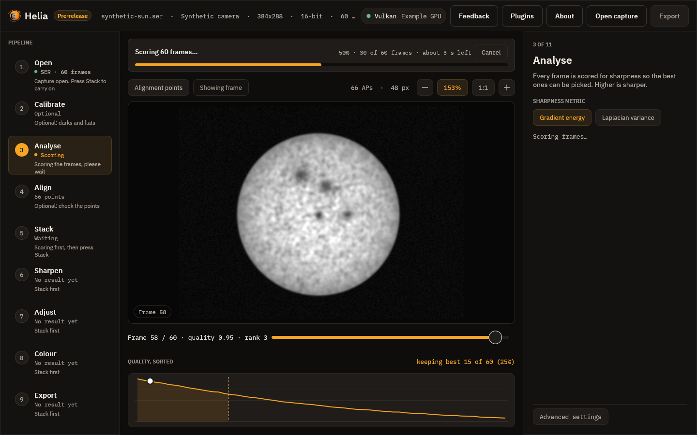

| Notice | Shown while |
|---|---|
| Opening the file and indexing its frames | a capture is opened (no bar: the length is not known) |
| Converting the video with ffmpeg | a video is converted to a capture, where that is offered |
| Decoding the frame | a frame is read for the viewer |
| Scoring N frames | every frame is scored; the bar counts frames and shows the time left |
| Building the reference image, Aligning the frames, Measuring the alignment points, Stacking the best frames, Finishing the image | the stages of a stack, one overall bar for the run |
| Colourising the image | a colour look is applied to the stack |
| Writing the file | the result is saved |

The time left appears once enough of the work is done to estimate it (after a
second and a twentieth of the way through), and is rounded to whole seconds.
Screen readers are given the same sentence: the stage, the percentage and the
time left.

**Messages when it is done.** A short message appears at the bottom right when
something finishes, such as *Stacked 250 of 1,000 frames in 2.1 s* or *Saved
/path/sun.tif*. It fades after a few seconds, or press **Close**. A failure,
such as *Could not open file: not a SER file*, stays until you press
**Dismiss**. The same failure twice shows once.

## 1. Open


Choose **Open capture** in the top bar (or press Ctrl+O), or drop a file on the
window. A **Recent** menu appears next to it once you have opened something: it lists
the last eight captures, newest first, and opens one when you choose it (a file that
has gone is dropped with a message). You can also start Helia with a capture:
`helia-gui capture.ser`, or **Open with > Helia** in your file manager once Helia is
[installed](installation.md). Helia reads SER files and uncompressed AVI files, including the large
OpenDML files SharpCap writes. With the optional `ffmpeg` installed it also
opens **MP4, MOV, M4V, MKV and WebM** files and compressed AVI files (see
[Installation](installation.md#optional-ffmpeg-for-mp4-and-other-video)).

A video is decoded once, by `ffmpeg`, before anything else happens, and the top
bar shows "Decoding video with ffmpeg" with a percentage while it runs; opening
another file cancels it. Afterwards scrubbing is as quick as for a SER file,
because the frames are on disk uncompressed. Changing the **Channel** chip
decodes the video again, because ffmpeg extracts the colour channel.

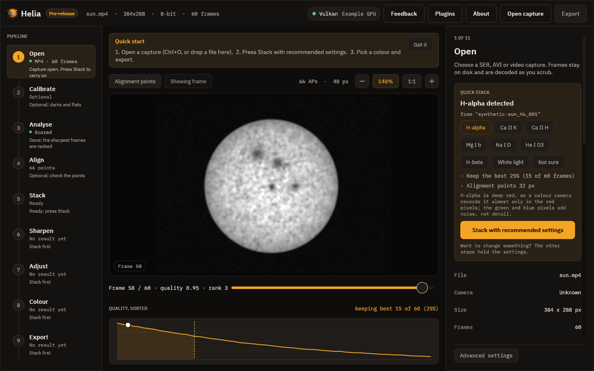

When the input is lossy video the Open inspector says so (here, "lossy 8-bit
4:2:0 video (h264): fine for quick results, SER/AVI raw captures keep more
detail"). See [Capturing for Helia](capturing.md#when-an-mp4-is-fine). If
`ffmpeg` is missing, an error strip above the viewer says how to install it.

**Quick stack.** Once a capture is open, the top of the inspector is a card that
says which filter Helia found (from the file name, the folder, the SharpCap
sidecar or the SER header; see [Colourising](colourising.md#how-the-filter-is-recognised))
and lists the settings it will use: the colour channel (shown only for a raw
colour camera), the share of frames to keep with the count, and the alignment
point size. One primary button, **Stack with recommended settings**, applies
those settings and runs the stack. Underneath, a row of filter buttons lets you
correct the guess, and **Not sure** returns to plain defaults. The card keeps
its advice short; the other steps hold the settings if you want to change them,
and a change made there stays until you press the button again, which puts the
recommended settings back.

**First-run tips.** The first time you use the app, a strip above the picture
lists the three steps. **Got it** hides it for good; Helia remembers in its
settings file (see [Settings file](#settings-file)).

The top bar then shows, in order: the file name, the camera model (taken from
the SharpCap `CameraSettings.txt` next to an AVI, when there is one), the frame
size, the bit depth with the Bayer pattern, and the number of frames.

### The header, and what Helia will use

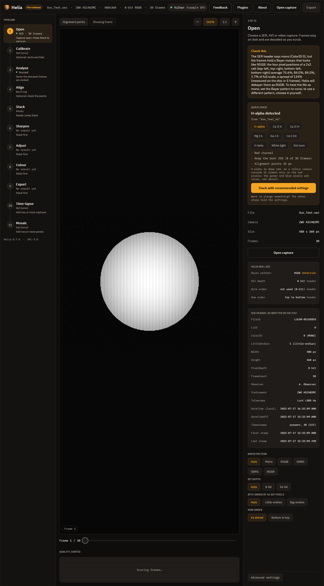

Under the file details the Open inspector shows two lists, so a header that is
wrong cannot go unnoticed:

* **Helia will use**: the Bayer pattern, bit depth, byte order and row order the
  capture is decoded with, each followed by where it came from: `header` (the
  file's own), `sidecar` (SharpCap's `CameraSettings.txt`), `detection` (measured
  from the pixels) or `override` (your choice, below). Anything that is not from
  the header is shown in the accent colour.
* **SER header, as written in the file**: every field, decoded: FileID, LuID,
  ColorID with its meaning, the LittleEndian flag, width, height, pixel depth,
  frame count, observer, instrument, telescope, DateTime (local) and DateTimeUTC
  as dates (*not set* when the recorder left them at zero), and whether the
  per-frame timestamps are present with the first and the last. For an AVI it
  lists the codec, pixel format, row order and the sidecar's fields instead.

When the file disagrees with itself or with you, a **Check this** card above the
Quick stack card says so in words. The screenshot is the case it exists for: the
header says mono (ColorID 0), the pixels are an RGGB mosaic, and Helia debayers
as RGGB and tells you why. A brief message also appears at the bottom right when
the capture opens. `helia info` prints the same lists and notices (see
[The command line](cli.md#helia-info)).

**Overrides.** Below the lists, chips say what the file gets wrong. Each one
reopens the capture, and the lists above update to show the override as the
source:

* **Bayer pattern**: Auto trusts the header, but checks a SER file labelled mono
  for a hidden mosaic; Mono treats the frames as monochrome whatever the header
  or sidecar say; RGGB, GRBG, GBRG and BGGR force a pattern.
* **Bit depth**: Auto, 8-bit or 16-bit, instead of the header's.
* **Byte order of 16-bit pixels**: Auto, Little-endian or Big-endian, instead of
  the header flag.
* **Row order**: for a SER file, as stored or bottom to top (for a file stored
  upside down). For FITS frames, Auto (a `ROWORDER` card if there is one, else
  Seestar S50 frames top-down and everything else bottom-up, as the FITS
  standard says), Top-down or Bottom-up.

Bit depth and byte order apply to SER files, and row order to SER and FITS; the
chips that do not apply are greyed out for an AVI. The overrides belong to the file: opening a different capture
starts again from Auto. They are written into the exported file (see
[What the files say](colourising.md#what-the-files-say)).

## 2. Calibrate


Optional. Calibration takes out what belongs to the sensor and the optics in
front of it and not to the Sun: dust shadows, vignetting, the fringes of an
etalon, a fixed pattern, hot and dead pixels. It is applied to every frame as it
is read, before the frame is demosaiced, scored or aligned, so everything after it
(the quality curve, the alignment points, the stack, the sharpening) sees the
calibrated frames. See [Calibration](calibration.md) for what to capture and why.

The inspector has a place for each file:

* **Dark** is a master dark (a FITS file from `helia calibrate`, or any FITS or
  TIFF) or dark captures to make one from. **File** picks a file; **Folder**
  picks a folder of captures (SER, AVI or FITS stills).
* **Flat** is the same for the flat. When it is captures, a **Dark for the flat**
  appears: darks at the exposure of the flats. Without them the flat keeps its
  offset and corrects too much in the dim parts.
* **Bad pixels** is a map (FITS) or a text list of `x y` pairs. Leave it empty
  and Helia finds the hot pixels of the dark and the cold ones of the flat itself.
* **Fix hot and cold pixels** turns that correction off.
* **Scale the dark by exposure** is for darks taken at another exposure from the
  Sun; the Sun's exposure is read from the SharpCap file beside the capture.

While the masters are prepared the rail shows **Preparing**; then it names what is
in force, and the inspector lists each master (frames used, how they were
combined, a fingerprint of its pixels) and any warning: a flat with rings, a dark
that could not be scaled, a flat built without a dark. **Before / after** in the
toolbar splits the picture, the frame as recorded on the left and calibrated on
the right; drag the line. **Save the masters** writes `master-dark.fits`,
`master-flat.fits` and `bad-pixels.fits` to a folder, so the next session can use
the files instead of the captures.

Changing a file scores the capture again, and a stack made before the change is
out of date: press **Stack** again. The masters are checked against the capture
when it opens (same size, same mosaic) and a mismatch is explained in the
inspector. Nothing here changes the capture file.

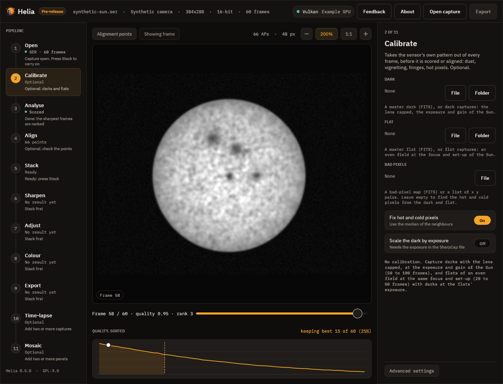

## 3. Analyse

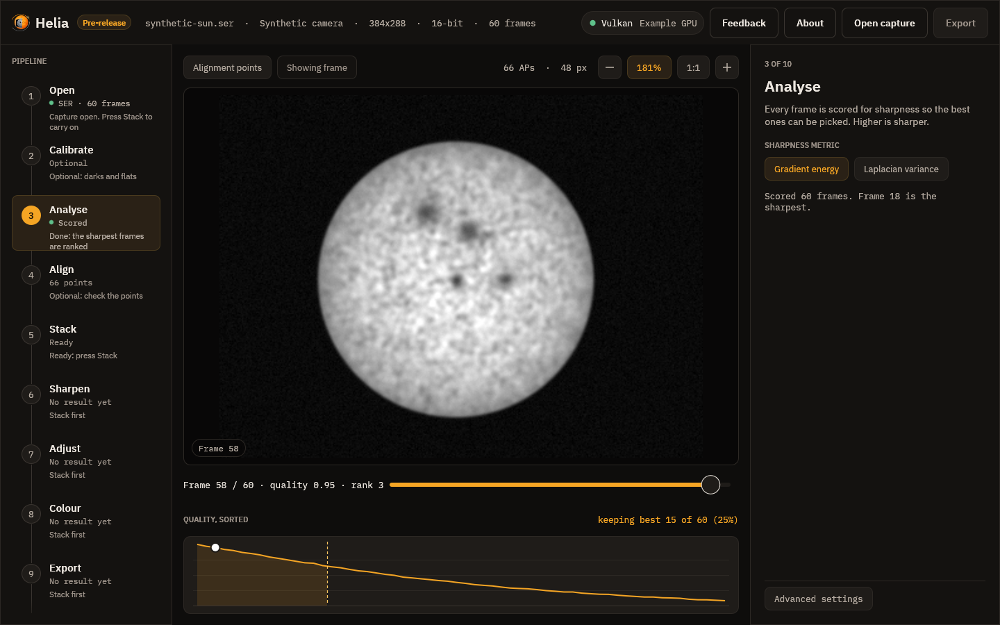

As soon as a capture opens, every frame is scored for sharpness in the
background. The rail shows **Scoring** and then **Scored**. The inspector lets
you choose the **sharpness metric**:

* **Gradient energy**, the default, is the mean squared gradient of the frame;
* **Laplacian variance** is the variance of the Laplacian.

Both ignore overall brightness and the sky pedestal, so a brighter frame does
not look sharper. Changing the metric scores the capture again.

## 4. Align

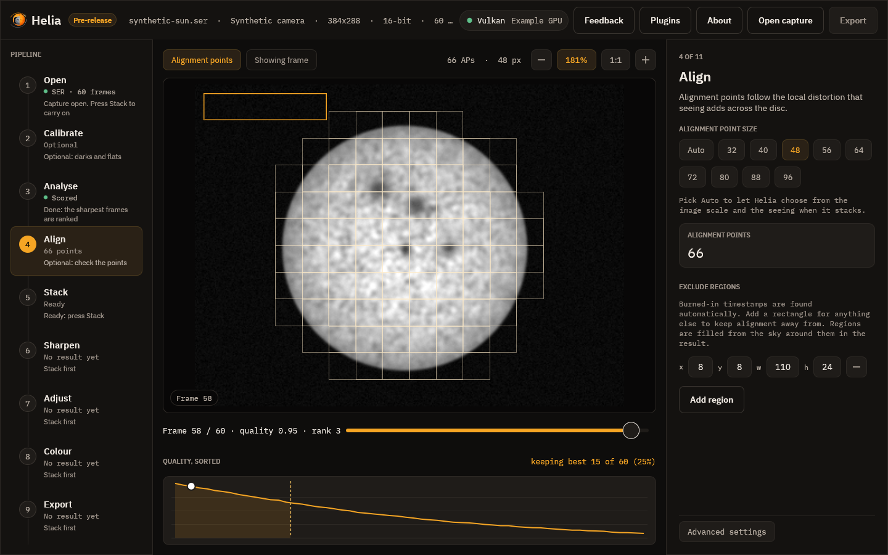

Seeing bends the image differently across the disc, so Helia aligns small
windows called alignment points as well as the whole frame. The grid is drawn
over the viewer as thin squares. The inspector offers the **point size**, from 32
to 96 pixels in steps of 8: small points follow finer detail but need more contrast to
lock on. The size Helia recommends for your image is already selected.

The **Auto** chip beside the sizes lets Helia choose when it stacks: it fits the
limb for the image scale, probes the seeing on a dozen frames, and picks the
size, the spacing and how far to search. The note under the chips explains this
before the stack and, afterwards, says what was chosen (for example *alignment
points 32 px every 16 px, search 4 px, 8.79 arcsec per pixel, local warp 0.35
px*); the grid then shows the chosen size. Picking a size turns Auto off. See
[How stacking works](how-stacking-works.md#choosing-the-points-automatically).


The card shows how many points are active, that is, bright and detailed enough
to be measured. After a stack, a second card shows the median drift of the
frames from the reference, in pixels.

Points are drawn only where the stack will use them: the centre of the window
must be inside the fitted limb of the sun, and no window may touch burned-in
text (which Helia finds by itself) or a rectangle you exclude.

**Exclude regions** lists rectangles that alignment and quality scoring must
stay off, for a logo or a stray label that the automatic text detection does
not cover. *Add region* creates one at the top-left corner; set its `x`, `y`,
width (`w`) and height (`h`) in pixels with the boxes, and use the minus button
to remove it. Each rectangle is outlined in amber on the frame. Excluded areas
are filled from the sky around them in the stacked result. Changing the list scores the capture again,
because the scores depend on it.

## 5. Stack


* **Keep best frames** is the share of frames, ranked by quality, that go into
  the stack, from 5 to 100 per cent in steps of 5. The line underneath converts
  it to a frame count.
* **Combine** is a weighted mean, which weights each frame by its quality. An
  unweighted mean is not available yet.
* **Outliers** guards against samples that do not belong, such as a hot pixel, a
  satellite trail or a cloud dimming a few frames. *Off* is the plain weighted
  mean; *Sigma* drops samples beyond 2.5 standard deviations of the mean,
  *Huber* gives samples beyond 1.345 less weight the further they are, and
  *Winsor* clamps them to 2 standard deviations. It is off by default and makes
  the run slower, because the frames are read twice. See
  [How stacking works](how-stacking-works.md#5-stacking) for what each costs.
* **Colour** chooses what is stacked. **Filter look** (the default) stacks one
  plane, coloured later from a filter's look in the Colour step. **True colour**,
  for white light with a raw colour camera, stacks red, green and blue on one
  alignment and gives a colour picture; **Auto balance** or **No balance** and
  **Align channels** (red and blue onto green) go with it. The chip is disabled
  for a capture that is not a Bayer mosaic. After a stack the note under it gives
  the gains and the channel shifts. See [True colour](colourising.md#true-colour).

  
* **Crop** cuts the stack to the solar disc: *Off* keeps the whole frame,
  *Disc* crops to a square around the fitted limb with a margin you set with the
  slider (0 to 50 per cent of the radius, 10 to start). It applies to every
  export, FITS included. The note under it says what will happen and, after a
  stack, the size it was cropped to, or why it was not (no clear disc). See
  [How stacking works](how-stacking-works.md#cropping-to-the-disc).
* **Plugins** is where a plugin steps in. **Stack on** chooses this computer or
  a plugin that can stack (one that is switched on), **Add a plugin step** puts a
  step of a plugin into the run, with its own settings, and **Plugins...** opens
  the [Plugins page](plugins.md#in-the-desktop-app). The card is described in
  [Using plugins](../tutorials/plugins.md#in-the-desktop-app).
* **Stack N frames** starts the run.


When it has finished, a line under the button says how whole frames were aligned
and how confident that was, for example *Aligned by limb fit, confidence 0.90*;
hover it for the reason. Helia picks the method itself: the solar limb when the
full disc is in view, phase correlation for a cropped region. The app has no
switch for it; use `--align` on the command line or `align` in an API job to
force one.

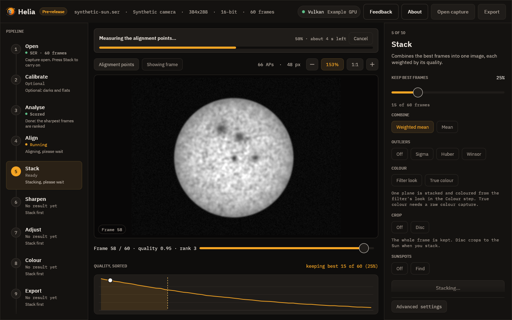

While it runs, a notice above the picture names the current stage and shows the
percentage and the time left, and the thin bar in the inspector shows overall
progress. **Cancel**, in either place, stops the run without losing the
settings.

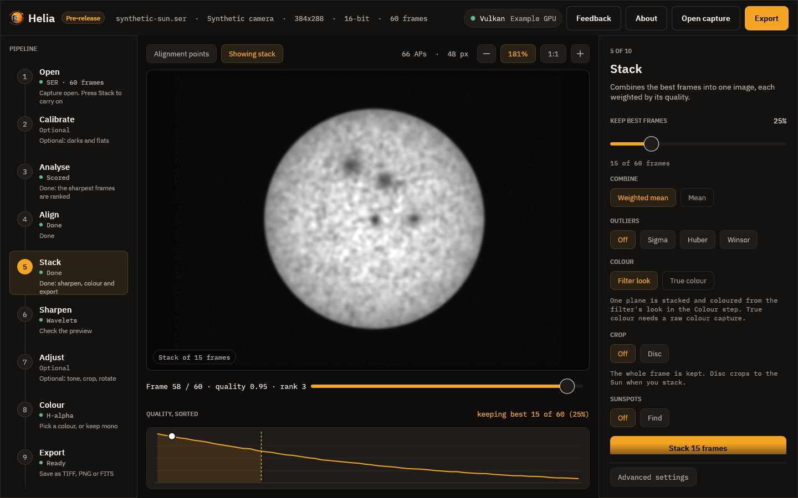

When it finishes, a message reports the frames used and the time taken, the viewer
switches to the stacked image, the Export button lights up and Helia moves on to
the Sharpen step.

## 6. Sharpen


The stack is sharpened on the mono image, before any colour. The recommended
**wavelets** for your filter are already on, so the picture you see here is
sharpened; press **Off** to see the plain stack. The method chips choose between
**Wavelets**, **Unsharp** and **Deconvolution**, and each shows its own controls:
the scheme, filter and linked layers of the wavelets with an amount, a sharpen and a denoise for each layer (as in RegiStax 6), the radius, amount and threshold of
the unsharp mask, or the blur, iterations, noise control and limb guard of the
deconvolution. Every slider updates the picture as you drag it. **Reset to
recommended** puts the filter's values back. **My presets** keeps and recalls
whole settings under a name.

At the top of the step, **Limb darkening** divides the disc by its brightness
profile before the sharpening runs, so the sharpening sees flat contrast from the
centre to the limb. **Model** divides by the fitted law (the chips under it choose
Linear, Quadratic or Neckel), **Profile** by the measured radial profile, and
**Off**, the default, leaves the disc alone. The line under the chips is the fit
made on your stack: the coefficients, how bright the limb is next to the centre and how
far the rings stray from the law. Only the disc changes; the gain eases to 1 at the
limb. See [Limb darkening](sharpening.md#limb-darkening).


The toolbar gains two chips here and on the next step: **Before / after** splits
the picture at a line you can drag, the stack as it was on the left and with your
edits on the right; **Full size** renders the preview at full size instead of
shrunk. The inspector says how long the last preview took.

Sharpening can create artefacts; the step says so, and so does
[Sharpening and adjustments](sharpening.md), which explains each method, when to
use it and what the recommended values are. The file notes what you did, and a FITS
file is the unsharpened stack unless you ask otherwise in Export.

## 7. Adjust


Everyday edits, each optional: **Denoise**, **Levels** (black point, white point,
gamma and an **Auto levels** button), a tone **Curve** (click and drag its
points, or type their input and output), **Crop** (a rectangle in pixels, or the whole image), **Rotate
and flip** (quarter turns, a fine angle, mirrors) and **Resize** (10% to 400%), and, for lines with prominences, the **Prominence layer**
(a stretched off-limb layer joined to the disc through a feathered edge; see
[Prominences and the disc together](prominences.md)). The
line under the controls gives the size of the picture that will be written, and
**Reset all adjustments** switches everything off. The adjustments are applied
after the sharpening, in a fixed order, and recorded in the file.

### Editing the curve

The curve plot is a control you can drag, with the mouse or the keyboard:

* **Click** empty space in the plot to add a point there; keep the button down and
  drag to place it.
* **Drag** a point to move it. The pointer turns into a hand over a point.
* **Double-click** a point, or right-click it, to remove it. The end points at
  input 0 and 1 cannot be removed; they only move up and down.
* With the plot focused (click it, or Tab to it), **[** and **]** choose the
  previous or next point, the **arrow keys** nudge the chosen point by 0.005
  (hold Shift for 0.05) and **Delete** removes it.

A point can never be dragged past its neighbours. It stays a little (0.005) to
the right of the point on its left and to the left of the one on its right, and
its output stays between theirs, so the curve never falls: a darker input is never
made brighter than a lighter one. This is the same rule the program enforces for
a curve typed into the boxes under the plot (a curve that breaks it is held back
and the line under the plot says why), so a dragged curve is always valid. There
are at most 16 points. **Add point** and **Reset** still work, and the boxes
under the plot show and edit the exact numbers.

## 8. Colour


Colour is for sharing; a filter stack stays mono. (A true-colour stack is colour
already: the step then shows its gains and channel shifts instead of the cards,
because no look applies, and sharpening and adjustments run on each channel.)

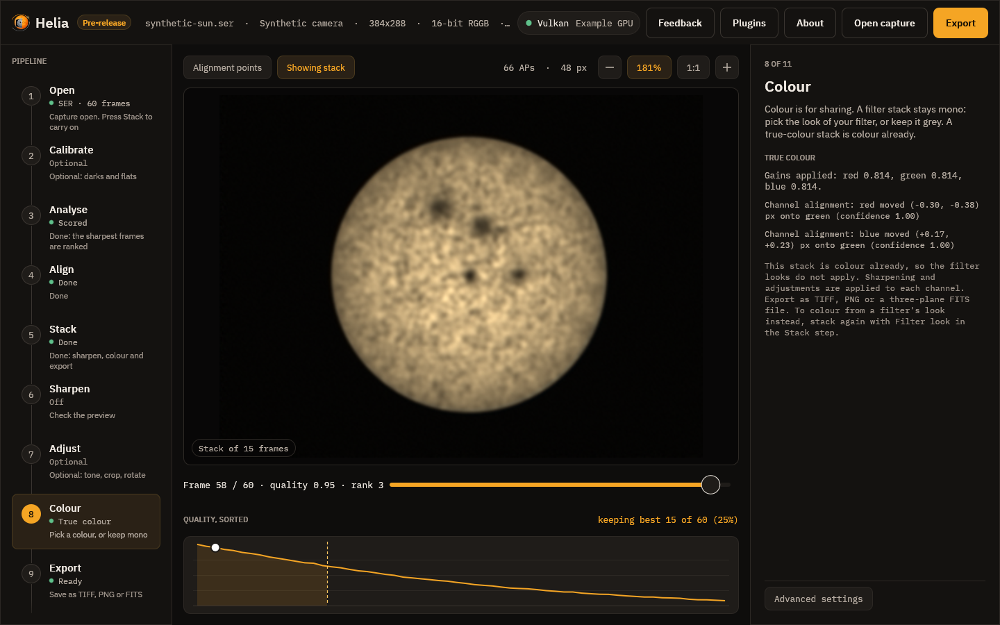

Each card shows a look as a
ramp from black to white, with its filter and wavelength: Mono, then H-alpha, Ca
II K, Ca II H, Mg I b, Na I D, He I D3, H-beta and White light. Click one and the
viewer shows the stack in those colours at once. Under the cards, a line says why
the look is what it is.

* **Invert** makes a negative before colouring, which shows filaments and
  prominences well.
* **Strength** mixes between grey and the full colour.
* **Continue to export** goes on.

The app remembers the look you chose for each filter. The look you leave here is
what Export writes, and the viewer, on this step and the next, shows exactly
that. [Colourising](colourising.md) explains the presets and the maths.

## 9. Export


Choose **TIFF 16-bit**, **PNG 8-bit** or **FITS** (32-bit float) and press
**Save as**, or press Ctrl+E from anywhere. The step says what will be written,
for example *16-bit RGB TIFF, H-alpha colours*. TIFF and PNG carry the sharpening, the adjustments
and the colour look; FITS is always mono, and is the unsharpened stack unless you
turn on **Edit the FITS too** (the step says which it will be). Every file notes
the edits and the look used (see
[What the files say](colourising.md#what-the-files-say) and
[Sharpening and adjustments](sharpening.md#what-the-files-say)). The edits run on
the full-size stack, then the colour. The file is written in the background, with
an *Applying the edits and writing the file* notice, and a message confirms where
it went.

## 10. Time-lapse


An optional step that works on its own list of captures. **Add captures** chooses
SER, AVI or video files (**Add the open capture** adds the one open in the other steps;
the minus on a row removes one; **Clear** empties the list). **Make time-lapse of N**
stacks each with the settings of the other steps, registers the stacks to each other and
shows them; the **frame scrubber** and **Play** move through the registered frames and
the line above the slider gives each frame's time, shift and method. The other controls
are **Register to** (First, Middle, Last), **Refine by phase correlation**, **Crop to the
common area**, **Brightness** (Off, Match, Smooth, with a Window of 3 to 21 frames),
**Derotation** (Off, or To reference, with the Law, Howard or Snodgrass, and Celestial
north is up; see [Solar derotation](derotation.md)),
**Times** (the UTC date and the clock's offset, for file names that hold only a time of
day), **Movie** (Auto, MP4, APNG, None), **Frames** (PNG or TIFF) and **FPS** (1 to
60). **Save time-lapse** writes the frames, the movie and `timelapse.csv` to a folder.
The method, every control and a worked example are in [Time-lapse](timelapse.md) and the
[tutorial](../tutorials/timelapse.md). Left and right arrow, Home, End and Space work on
the scrubber in this step.

## 11. Mosaic


An optional step that joins panels of the Sun into a full-disc mosaic. **Add panels**
chooses captures (SER, AVI, video) or stacked images (TIFF, PNG, FITS); **Add the open
capture**, the minus on a row and **Clear** edit the list; the first panel is the
reference. **Make mosaic of N** stacks each capture with the settings of the other steps,
matches the panels on their overlaps, places them all at once and joins them. The controls
are **Largest turn** (0 to 10 degrees), **Feather** (0 to 60 pixels), **Match brightness**,
**Seams of least difference**, **Derotation** (Off or To middle time, with the Law and
Celestial north is up) and **Times** (the UTC date and the clock's offset, for the
derotation). **Panel outlines** draws each panel's outline on the mosaic (the reference in
amber); **Save mosaic** writes the picture and its two tables. The method, every control and a
worked example are in [Mosaics](mosaic.md) and the [tutorial](../tutorials/mosaic.md).

## The viewer

The toolbar above the image has toggle chips:

* **Alignment points** shows or hides the grid;
* **Showing frame** or **Showing stack** switches between the current capture
  frame and the stacked result (Space does the same). On the Sharpen, Adjust,
  Colour and Export steps the stack is shown as it will be written, sharpened,
  adjusted and coloured, and the pill at the bottom of the picture names what
  has been done;
* **Before / after** and **Full size**, on the Sharpen and Adjust steps (see
  above).

On the right of the toolbar are the number of points and their size, and the
zoom controls: minus, the zoom readout (press it to fit the image to the
window) and plus. You can also scroll to zoom around the pointer, drag to pan
and double-click to fit.

Under the viewer, the **frame scrubber** reads, for example, `Frame 42 / 100 ·
quality 0.71 · rank 18`. Quality runs from 0 for the worst frame to 1 for the
best, on the same scale as the curve below, so it falls steadily as the rank
number rises, and rank 1 is the sharpest. Drag the slider or use the arrow keys to move through the
capture.

Below that, **Quality, sorted** plots every frame's score from best to worst.
The dashed line marks where the frames you keep end, the shaded area is the
kept set, and the white dot is the frame on screen. Hover the curve to read a
rank and click it to jump to that frame.

## Advanced settings

The foot of the inspector has an **Advanced settings** button. It is closed by
default, so the everyday path is not crowded; press it to show the groups of
settings that apply to every step:

* **Backend**: Auto uses the best adapter wgpu finds and the CPU otherwise;
  CPU and GPU force the choice (see [GPU acceleration](gpu.md)). The chip in
  the top bar shows the graphics API and the adapter that is in use, or CPU. A
  long adapter name is shortened with an ellipsis; hover the chip for the whole
  name.
* **Debayer**: the demosaic method (Bilinear or MHC, Malvar, He and Cutler).
  This matters only for colour sensor captures.
* **Channel**: the channel that is analysed and stacked (R, G, B or Lum). The
  recommended one for your filter is selected when a colour capture opens, unless that
  plane is clipped (most of its lit pixels sit at the sensor limit, as the red of an
  H-alpha capture exposed long): then the brightest plane that is not is selected, and the
  Stack step says so, as `helia stack` does. A channel you pick yourself is never changed
  until you open another file. Default: the filter's plane; range: R, G, B or Lum.
* **Aperture (mm)**: the telescope's aperture, 0 to 2000 (shown as *not set* at 0,
  the default). With it the seeing line of the Stack step gives an absolute `r0`
  and a grade; without it the line shows the relative motion index. The app does
  not use it for the diffraction cut-off of the granulation report: the
  cut-off is on the command line and in the API.
* **Field rotation**: for an altazimuth mount. Alt-az turns every frame to one
  orientation from the Sun's parallactic angle at its timestamp, so a long capture
  does not smear the limb. It needs the **site** (latitude north, longitude east,
  height; `HELIA_SITE` fills it in) and a capture with timestamps (SER), and
  **Mirror image** reverses the turn. The line under the controls says how far the
  capture rotates. It is not remembered between runs. See [Field
  rotation](field-rotation.md).


## Settings file

Helia keeps a small text file of choices it should not ask twice: whether the
first-run tips were dismissed, the colour look last chosen for each filter, the
backend, export format, outlier rejection and full-size preview you last chose, the
folders you last opened a capture from and exported to (the file dialogs start
there), the last eight captures you opened (the **Recent** menu), the size of the window
when you last closed it (not saved while it is maximised or full screen), and (only if you set it)
the address of the feedback service. The keep percentage, the alignment point size, Auto, the
crop and true colour are not remembered: the first two come from each capture's recommendation,
the others start off.
(Saved sharpening presets are separate files in their own folder; see
[Sharpening and adjustments](sharpening.md#saved-presets).)
It is `$HELIA_GUI_CONFIG` if that is set, otherwise `%APPDATA%\helia\gui.conf`
on Windows or `$XDG_CONFIG_HOME/helia/gui.conf` (`~/.config/helia/gui.conf`) on
Linux and macOS. The format is one `key=value` per line, for example:

```text
tips_dismissed=true
colour.ha=ha,false,1.00
colour.cak=cak,true,0.80
backend=auto
export_format=tiff
robust=off
full_preview=false
last_open_dir=/home/me/captures
last_export_dir=/home/me/stacks
window=1500x920
recent=/home/me/captures/sun.ser
recent=/home/me/captures/limb.ser
feedback_url=https://feedback.example.org
```

The first line `schema=1` is the file format. A file with a higher number was written by a newer Helia: Helia reads what it understands and never rewrites it. `recent` lines are newest first. Bug reports leave the recent list out, like the folders. `robust` is `off`, `sigma`, `huber` or `winsor`; a file from before the robust modes may still hold
`sigma_clip=true`, which is read as `sigma`. Delete the file to start afresh. A missing or damaged file is not an error (an
unknown value is ignored and the default stays), and the app writes nothing until
you change something it remembers.

## Log file and bug report

Helia (the app, the command line and `helia serve`) writes a small log so a
problem can be looked into afterwards. It is `helia.log` in
`%LOCALAPPDATA%\helia\logs` on Windows, or in `$XDG_STATE_HOME/helia`
(`~/.local/state/helia`) on Linux and macOS; `$HELIA_LOG_DIR` overrides the
folder. Each line is a UTC time, a level, the program and a message, for example
`2026-10-19T12:00:00Z INFO helia-gui: opened sun.ser, 1920x1080, 8-bit RGGB, 631
frames`. It records what was started, which capture file was opened (its name,
never its folder), what was exported and any error. It never holds image data, and
a path in an error message is cut down to the file name. At 512 KiB the log
rotates into `helia.log.1` and `helia.log.2` and the oldest is dropped, so it
stays under about 1.5 MiB. Nothing is sent anywhere.

**Save bug report** on the About page writes a `.zip` of four text files for you
to attach to an issue: `summary.txt` (the version block, operating system and GPU
adapter), `capture.txt` (the open capture's header in one line), `settings.txt`
(the settings file above, without folder names) and `log-tail.txt` (the last 300
log lines). It holds no images and no screenshot; open it and read it before you
send it. It is separate from [Send feedback](sending-feedback.md), which sends a
screenshot and a description to the relay when you press Send.

## Small windows

Below about 1100 pixels wide the rail and the inspector collapse so the viewer
keeps its space. Two buttons appear in the top bar to show either one; only one
is open at a time.

## About

The sun in the top bar, the **About** button next to it, or F1 opens the About
page, which replaces the viewer until you press Esc or Close. It leads with the
dedication, then gives the version and how this copy was built: git commit
(`+dirty` if the tree had uncommitted changes), build time in UTC, build profile,
target, Rust and wgpu versions, and the GPU adapter in use or CPU. **Copy version
info** puts those lines on the clipboard for a bug report. Below are the
copyright, the GPL notice with its no-warranty paragraph, links to the source,
the licence text and the releases page, and the third-party licences (from
`THIRD-PARTY-LICENSES.txt` beside the program in release archives). The page
makes no network connections of its own; a link opens in your browser only when you click it. The one exception is the **Updates** section: it shows whether a newer Helia exists, has **Check for updates**, and lets you choose when Helia may check (see [Updates](updates.md)).
While Helia is below version 1.0.0 the page, the top bar (a **Pre-release** badge
beside the name) and the window title (`Helia 0.3.0 (pre-release)`) all say that
this is a pre-release, and the version block has a `release: pre-release` line.
**Send feedback** on this page opens the feedback page, below.

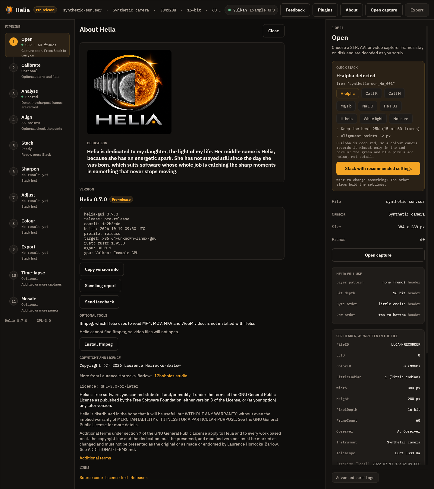

## Plugins

The **Plugins** button in the top bar opens a page that lists the plugins Helia
found, says which are on, shows where each comes from and its checksums, and is the
only place that switches one on. Nothing runs until you enable it, and a plugin
runs with your rights. See [Plugins](plugins.md#in-the-desktop-app) for the page and
[Using plugins](../tutorials/plugins.md#in-the-desktop-app) for a walk-through.

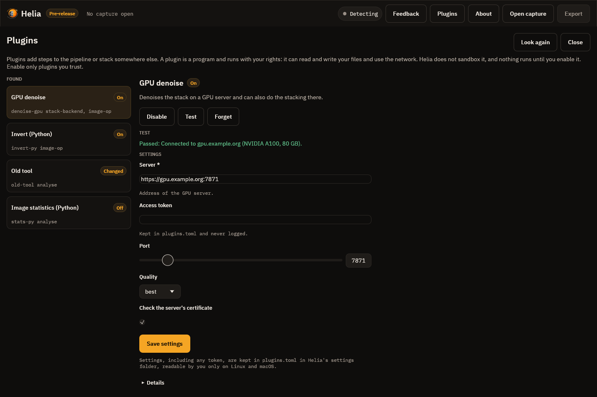

## Feedback

The **Feedback** button in the top bar (or Ctrl+Shift+F), at any step, takes a
picture of the Helia window and opens a page where you draw rectangles round the
problem, say whether it is a bug, a feature request, a question or something else,
and send it as an issue on the project's forge. Nothing is sent until you press
Send, and Helia has no telemetry. [Sending feedback](sending-feedback.md) has the
whole walk-through, what is and is not included, and what happens when the
feedback service cannot be reached.


## Keyboard shortcuts

| Keys | Action |
|---|---|
| Ctrl+O | Open a capture |
| Ctrl+E | Export the result |
| Left, Right | Previous or next frame |
| Shift+Left, Shift+Right | Ten frames back or forward |
| Home, End | First or last frame |
| Space | Switch between the frame and the stacked result (in the Time-lapse step: play or pause) |
| F1 | Open or close the About page (Esc also closes it) |
| Esc | Close the Plugins page |
| Ctrl+Shift+F | Send feedback (Esc closes the page) |
| Tab, Shift+Tab | Move between controls |

The arrow keys and Space act on the viewer when no control has keyboard focus.
Every control has an accessible name and a tooltip, and the window works with
screen readers through AccessKit.

## Testing the screenshots

The images above are checked by `cargo test -p helia-gui` (see
[the source repository](https://github.com/qisback/helia)). The tests render the
window at 1440 by 900 pixels (the Open header view is taller, at 1440 by 2600, to
show the whole inspector) on a software GPU, from a synthetic capture with
injected state, and fail if the result differs from the committed image. They
run only when `HELIA_GPU_TESTS=software` is set, and otherwise print a note and
pass. To regenerate the images after an intended change:

```sh
UPDATE_SNAPSHOTS=1 HELIA_GPU_TESTS=software cargo test -p helia-gui snapshots
```
