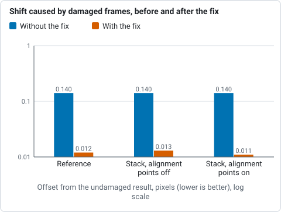
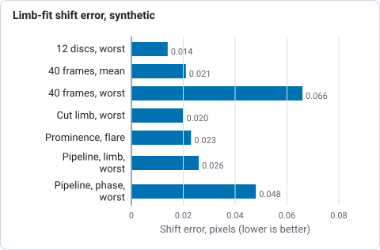
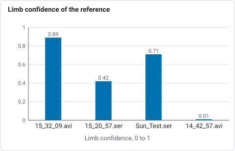
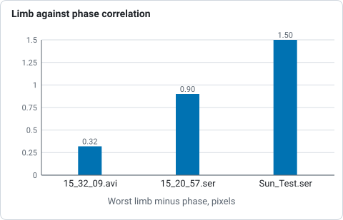
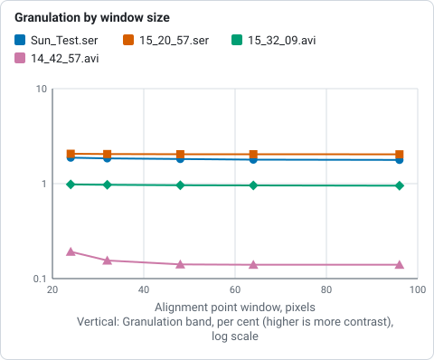
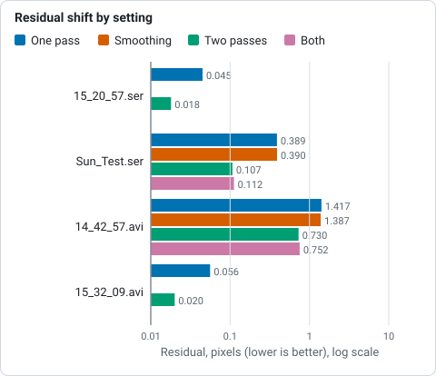
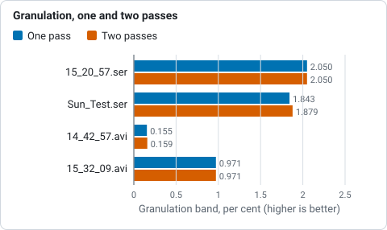
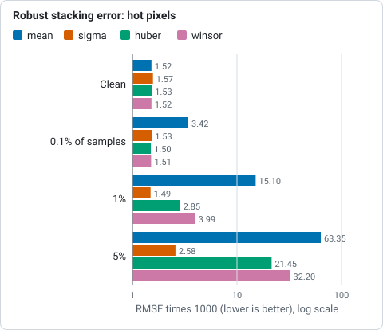
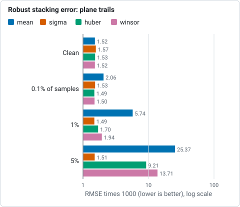
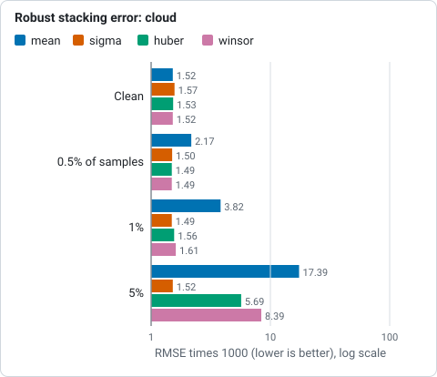

# How stacking works

This page explains what Helia does between a capture and a finished image, in
plain terms, and which setting changes which step. The precise maths and the
module layout are in the [Architecture](../developer/architecture.md) page.

## The problem

Between the Sun and your telescope is a few kilometres of moving air. In any
one short exposure the image is shifted, stretched and blurred by it, and the
pattern changes within milliseconds. Most frames are poor. Every now and then,
for a moment, the air over your telescope is steady and a frame is sharp.

Lucky imaging records thousands of frames, keeps the lucky ones, lines them up
and averages them. Averaging many aligned frames also cancels random noise.

<svg viewBox="0 0 640 120" role="img" aria-label="Pipeline: score frames, choose the best, build a reference, align globally, align per point, stack, blend and write" style="max-width:100%;height:auto" font-family="sans-serif" font-size="12" fill="none" stroke="currentColor" stroke-width="1.5">
<defs><marker id="arr" viewBox="0 0 10 10" refX="9" refY="5" markerWidth="7" markerHeight="7" orient="auto"><path d="M0 0 L10 5 L0 10 z" fill="currentColor" stroke="none"/></marker></defs>
<rect x="4" y="20" width="76" height="44" rx="6"/><text x="42" y="38" text-anchor="middle" fill="currentColor" stroke="none">Score</text><text x="42" y="54" text-anchor="middle" fill="currentColor" stroke="none">frames</text>
<rect x="96" y="20" width="76" height="44" rx="6"/><text x="134" y="38" text-anchor="middle" fill="currentColor" stroke="none">Keep the</text><text x="134" y="54" text-anchor="middle" fill="currentColor" stroke="none">best</text>
<rect x="188" y="20" width="76" height="44" rx="6"/><text x="226" y="38" text-anchor="middle" fill="currentColor" stroke="none">Build a</text><text x="226" y="54" text-anchor="middle" fill="currentColor" stroke="none">reference</text>
<rect x="280" y="20" width="76" height="44" rx="6"/><text x="318" y="38" text-anchor="middle" fill="currentColor" stroke="none">Align</text><text x="318" y="54" text-anchor="middle" fill="currentColor" stroke="none">whole frame</text>
<rect x="372" y="20" width="76" height="44" rx="6"/><text x="410" y="38" text-anchor="middle" fill="currentColor" stroke="none">Align each</text><text x="410" y="54" text-anchor="middle" fill="currentColor" stroke="none">point</text>
<rect x="464" y="20" width="76" height="44" rx="6"/><text x="502" y="38" text-anchor="middle" fill="currentColor" stroke="none">Weighted</text><text x="502" y="54" text-anchor="middle" fill="currentColor" stroke="none">stack</text>
<rect x="556" y="20" width="76" height="44" rx="6"/><text x="594" y="38" text-anchor="middle" fill="currentColor" stroke="none">Blend and</text><text x="594" y="54" text-anchor="middle" fill="currentColor" stroke="none">write</text>
<path d="M80 42 H94" marker-end="url(#arr)"/><path d="M172 42 H186" marker-end="url(#arr)"/><path d="M264 42 H278" marker-end="url(#arr)"/><path d="M356 42 H370" marker-end="url(#arr)"/><path d="M448 42 H462" marker-end="url(#arr)"/><path d="M540 42 H554" marker-end="url(#arr)"/>
<text x="320" y="104" text-anchor="middle" fill="currentColor" stroke="none">The capture is streamed through these steps; frames are never all held in memory.</text>
</svg>

## 0. Calibration (optional)

Before anything else, frames can be calibrated: a master dark is subtracted, the
result is divided by a master flat and bad pixels are replaced by the median of
their neighbours of the same colour. It happens as each frame is read, on the
stored pixels before any demosaicing, so the ranking, the alignment and the stack
all see calibrated frames. The reason it comes first is that the sensor's pattern
does not move with the Sun: alignment warps the picture, and a pattern that stayed
put turns into detail that moves. See [Calibration](calibration.md).

## 1. Ranking the frames

Helia gives every frame a **sharpness score**. The default metric, *gradient
energy*, is the average squared difference between neighbouring pixels: a
sharp frame has strong edges and fine contrast, a blurred one does not. The
alternative, *Laplacian variance*, measures the spread of the second
derivative. Choose between them with `--metric` or the **sharpness metric**
in the app. Five more metrics (Helmli and Scherer's mean, median-filter
gradient similarity, the DCT energy ratio, band-limited Fourier power and
local contrast) are available on the command line and the API; see
[Choosing a quality metric](choosing-a-quality-metric.md) for how to compare
them on your own capture and for the result on real ones.

Two details make the score trustworthy on the Sun:

* A small amount of image noise would raise a gradient score, so Helia
  estimates the noise floor of each frame and subtracts it.
* Overall brightness and the pedestal of the sky do not change the score, so a
  frame that is merely brighter does not rank higher.

An artefact fools the score. A satellite trail, a dark line or a burst of hot
pixels adds sharp edges, so the damaged frame scores *higher* than its
neighbours and would be ranked first. Seeing changes slowly from one frame to the
next compared with a trail, so Helia compares each score with the median of the
five frames either side of it. A score that is both more than four typical
spreads above that level (the spread is the median absolute deviation of the
whole capture, so the damaged frames do not widen it) and at least 8% above it is
put back to the neighbours' level before ranking: the frame is not dropped, it
just no longer ranks as the sharpest. The command line says which frames were
treated (`ranking:` line), and `StackOutput::score_outliers` has them with the
score they measured. Only rises are treated, and nothing happens on a capture
of fewer than five frames or with a zero or non-finite score. The limit: damage
that raises the score by less than the seeing varies (a handful of hot pixels
adds a few per cent) is not seen by this test, which is why the reference
(next section) does not trust any one frame either. Turn the test off with
`StackConfig::robust_ranking = false` in the API.

Measured on `15_20_57.ser` with a line drawn across two frames and hot pixels in two
others, ranked on the whole frame (damage injected as in
#168; the change is
#172). The two line frames
sat about 20% and 18% above their neighbours and are put back; the hot-pixel
frames raise the score by only 3 to 4%, which the median reference covers. An offset
is the length of the sub-pixel displacement, found by phase correlation, between the
reference (or the stack) made from the damaged capture and the one made from the
same capture without the damage, both with sigma clipping (kappa 2.5) and ranked on
the whole frame (the test `damaged_frames_do_not_move_the_reference_or_the_stack`; the
with-the-fix column was re-measured with its report test,
`report_reference_and_stack_shift_with_damage`, and the top five frames then held no
line frame):

| | Without the fix | With the fix |
|---|---|---|
| Damaged frames among the five reference frames | 4 of 5 | no line frame (the test requires it) |
| Offset of the reference (px) | 0.14 | 0.012, with and without alignment points |
| Offset of the stack, alignment points off (px) | 0.14 | 0.013 |
| Offset of the stack, alignment points on (px) | 0.14 | 0.011 |

*Offset of the reference and of the stack made with damaged frames from those made without the damage, in pixels, without and with the fix, with alignment points off and on (#172).*

Five clean captures with the defaults are unchanged: the ranking is the same, nothing
is put back, and the granulation and 4 to 12 px band contrast agree to four digits.

The frames are then sorted best first. You choose how many to keep with
`--keep` (a share such as 25%, the default; 12% for white light and Na D) or `--keep-frames` (a count). The
app draws the sorted scores as the **Quality, sorted** curve, with a dashed
line where the kept frames end.

<svg viewBox="0 0 420 190" role="img" aria-label="Illustrative sorted quality curve with the kept frames shaded" style="max-width:100%;height:auto" font-family="sans-serif" font-size="12" fill="none" stroke="currentColor" stroke-width="1.5">
<path d="M40 20 V150 H400" opacity="0.6"/>
<path d="M40 40 C70 42 90 60 110 80 C140 112 200 122 250 130 C300 138 360 142 400 146 V150 H40 Z" fill="currentColor" fill-opacity="0.08" stroke="none"/>
<path d="M40 40 C70 42 90 60 110 80 C140 112 200 122 250 130 C300 138 360 142 400 146" stroke="#d9822b" stroke-width="2.5"/>
<path d="M40 40 C70 42 90 60 110 80 L110 150 L40 150 Z" fill="#d9822b" fill-opacity="0.25" stroke="none"/>
<path d="M110 20 V150" stroke-dasharray="5 4"/>
<text x="75" y="14" text-anchor="middle" fill="currentColor" stroke="none">kept</text>
<text x="40" y="170" fill="currentColor" stroke="none">best frame</text><text x="400" y="170" text-anchor="end" fill="currentColor" stroke="none">worst frame</text>
<text x="30" y="85" text-anchor="end" fill="currentColor" stroke="none" transform="rotate(-90 30 85)">quality</text>
<text x="215" y="186" text-anchor="middle" fill="currentColor" stroke="none" opacity="0.7">Illustrative shape, not measured data.</text>
</svg>

The frames you keep are not all treated alike. Each gets a **weight** between
0.2 (the worst kept frame) and 1 (the best), following a smooth S-shaped curve,
so sharp frames dominate the average but borderline frames still help with the
noise. This is a smooth curve and not a cut-off.

## 2. A reference to line up against

To align frames you need something to align them to. Helia combines the best
few frames (five by default), after aligning them to each other, into a
**reference image**: the median of each pixel across them (the mean when there
are only two). Because they are the sharpest frames, the reference is already a
decent picture, and the other frames are measured against it. The median is
there for the artefacts: a line or a hot pixel in one or two of the five frames
does not reach the reference, where a mean would carry a fifth of it and shift
every other frame's alignment by a fraction of a pixel. On clean captures the
stack is the same to within noise (see the CHANGELOG for the figures).

## 3. Aligning the whole frame

The air tilts the image, so every frame sits a little differently on the
sensor. Helia finds each frame's shift relative to the reference by one of two
methods. This is the **global alignment**. It removes the largest part of the
blur, which is plain image motion.

* **Phase correlation** compares the frames in the frequency domain, which is
  fast and robust, and then refines the answer to a fraction of a pixel. It
  needs detail in the picture to lock onto, and it is the method for a cropped
  region of the Sun. With a GPU it runs on the device using Helia's own Fourier
  transform; the CPU fits the peak either way. See
  [GPU acceleration](gpu.md).
* **Limb fit** finds the edge of the solar disc, fits a circle to it, and takes
  the shift from where the circle's centre moved. A full-disc frame has no small
  patch to correlate, but it has a sharp circular edge. Helia casts 720 rays out
  from the disc, finds the fall in brightness along each to a fraction of a
  pixel, and fits the circle with a robust fit that ignores prominences, flares
  and sunspot edges. It runs on the CPU.

**Helia chooses for you.** With `--align auto` (the default) it fits the limb of
the reference. If the whole disc is in the frame and the fit is confident
(0.8 or more, see below) it aligns by limb fit. If the frame cuts the limb off,
there is no disc, or the fit is shaky, it uses phase correlation. Force one with
`--align phase` or `--align limb`. The choice, the reason and the confidence are
shown at the end of a run on the command line (the `align:` line), in the app
(under the Stack button, with the reason on hover) and by the API
(`summary.alignment`).

**Confidence** is a number from 0 to 1 for each frame.

* For the limb fit it is high when the edge is located precisely and
  consistently, and the visible limb is spread widely enough to pin the centre
  down. It comes from the predicted error of the centre in pixels (from the
  scatter of the edge points, and from refitting without each eighth of the limb
  in turn): 0.5 is a predicted error of 0.15 pixel and 0.9 is about 0.05 pixel.
  It is reduced when some edge points disagree with the circle or many rays
  found no edge.
* For phase correlation it comes from the sharpness of the correlation peak
  against its surroundings: 0 for a peak-to-sidelobe ratio of 4 or less, 1 at 10
  or more.

A frame whose limb fit is not confident (below 0.5) is aligned by phase
correlation instead, and the summary counts those frames. When phase correlation
runs on the GPU, which does not return a confidence, Helia re-measures eight
frames spread over the candidates on the CPU and reports those, marked
*sampled*.

When the limb is cut by the frame the radius is held at the reference's and only
the centre is fitted, because a short arc cannot tell a bigger circle from a
shifted one. That is why `auto` leaves such captures to phase correlation.
### How accurate is it?

Measured, not promised. On synthetic discs with known shifts (the tests in
`crates/helia-core/src/align/limb.rs` and `tests/limb_align.rs`) the shift error
of the limb fit is:

| Case | Error |
|---|---|
| 12 discs at random sub-pixel positions, blur 2 px, noise 2% | worst 0.014 px |
| 40 frames shifted by up to 15 px, blur 1.5 to 4 px, noise 3% | mean 0.021 px, worst 0.066 px |
| Limb cut by the frame (about 40% of it outside), 20 frames | worst 0.020 px |
| A prominence and a bright flare near the limb | 0.023 px |
| Whole pipeline, textured synthetic capture of 40 frames | limb worst 0.026 px, phase correlation worst 0.048 px |

*Shift error of the limb fit on synthetic discs with known shifts, from the table above; lower is better.*

On real frames there is no ground truth, so the limb fit is compared with phase
correlation on the same frames (the best 25% of the first 200 frames of each
capture, aligned to the pipeline's reference, CPU run on a 24-thread server):

| Capture | Disc in frame | `auto` chooses | Reference limb confidence | Limb minus phase |
|---|---|---|---|---|
| `15_32_09.avi` (720 x 540 after 2x binning) | whole | limb fit | 0.89 | median 0.09 px, worst 0.32 px |
| `15_20_57.ser` (1920 x 1080, raw colour) | whole | phase correlation | 0.42 | 15 of 25 frames fell back; the rest differ by up to 0.9 px |
| `Sun_Test.ser` (1920 x 1080, mono) | whole | phase correlation | 0.71 | 21 of 50 frames fell back; median 0.30 px, worst 1.5 px |
| `14_42_57.avi` (1920 x 1080) | 63% of the limb | phase correlation | 0.01 | every frame fell back |

*Limb-fit confidence of the reference frame on four real captures, from the table above; auto uses the limb only above 0.5.*

*Worst difference between the limb fit and phase correlation on three real captures, from the table above.*

So the limb fit and phase correlation agree to about a tenth of a pixel when
the limb is clean, and `auto` uses the limb only then. In the other captures the
seeing deforms the limb enough that its centre wanders by several tenths of a
pixel against the content, the confidence is lower, and `auto` stays with phase
correlation. In a global-only stack of these captures the two methods gave the
same sharpness to within 0.5% (limb over phase correlation: 1.000 for
`15_32_09.avi`, 1.002 for `15_20_57.ser`, 1.005 for `Sun_Test.ser`, 1.000 for
`14_42_57.avi`), which is a tie, not a win. Whether a better result is possible with the limb on the noisier
captures is not established; use `--align limb` to try it.

## 4. Aligning small patches: alignment points

Global alignment is not enough on the Sun. The air does not bend the image by
the same amount everywhere: over a patch a few arcseconds across the distortion
is roughly uniform, but the disc covers tens of thousands or more of such patches. After
a global shift, one part of the disc may still be a pixel off while another is
spot on, and the sharp moments differ from place to place too. So Helia aligns
many small points as well as the whole frame.

Helia lays a grid of overlapping square windows, the **alignment points**,
over the reference. The default is 64 pixels across, overlapping by half; you
change the size with `--ap-size` or the **point size** in the app.

<svg viewBox="0 0 320 200" role="img" aria-label="A solar disc covered by a grid of overlapping square alignment points, with points off the disc left out" style="max-width:100%;height:auto" font-family="sans-serif" font-size="12" fill="none" stroke="currentColor" stroke-width="1.2">
<circle cx="160" cy="100" r="80" fill="#d9822b" fill-opacity="0.18" stroke="#d9822b" stroke-width="2"/>
<g opacity="0.75">
<rect x="112" y="52" width="64" height="64"/><rect x="144" y="52" width="64" height="64"/>
<rect x="112" y="84" width="64" height="64"/><rect x="144" y="84" width="64" height="64"/>
<rect x="80" y="84" width="64" height="64"/><rect x="176" y="84" width="64" height="64"/>
<rect x="80" y="52" width="64" height="64"/><rect x="176" y="52" width="64" height="64"/>
</g>
<rect x="8" y="8" width="64" height="64" stroke-dasharray="4 4" opacity="0.45"/>
<text x="76" y="30" fill="currentColor" stroke="none" opacity="0.8">no detail: skipped</text>
<text x="160" y="192" text-anchor="middle" fill="currentColor" stroke="none" opacity="0.7">Schematic: real grids have many more points.</text>
</svg>

For each point and each frame Helia measures the local shift by correlating
the window against the reference, searching a small distance around the global
shift, and scores how sharp that window is in that frame. Then each point picks
**its own best frames**: a frame that was sharp over the left of the disc and
soft on the right contributes to the left only. To make this possible, Helia
aligns twice as many frames as you keep, so each point has a choice.

Points are placed only where there is something to align: the centre of a
point's window must be inside the solar disc (see
[Keeping alignment off text and sky](#keeping-alignment-off-text-and-sky)).
Some points cannot be measured: flat regions, flat regions, or a straight stretch
of limb, where the pattern fixes the shift across the edge but not along it.
Those points are not allowed to guess. They take the distance-weighted average
of their neighbours' shifts instead (or the global shift when there are no
neighbours). The app reports how many points are **active**, meaning bright and
detailed enough to be measured.

Alignment points are correlated on a smoothed copy of the frame with the slow
brightness gradient removed, because on low-contrast detail such as H-alpha
the limb darkening would otherwise flatten the correlation peak.

### Choosing the points automatically

`--ap-auto` (the **Auto** chip) chooses the point size, spacing and search range
from the capture instead of one size for everything.

* **Scale.** The reference's limb fit gives the radius in pixels; the Sun is
  959.6 arcseconds in radius, so the scale is that over the radius. The window
  is the size of the detail in arcseconds over the scale: 3.75 arcseconds (2.5
  granules) for white light and sodium, 90 arcseconds for the other filters (a
  starting point; no chromospheric capture has tuned it), rounded to a multiple
  of 8 and kept within 32 to 96 pixels. Without a limb the recommended size for
  the frame is used.
* **Seeing.** A dozen of the frames about to be stacked are registered globally
  and a coarse grid of 48 pixel points is measured in each. The **local warp**
  is the root mean square distance of a point's shift from the median shift of
  its frame, over the locked points of all the probe frames. The search radius
  covers three times that warp, between 4 and 12 pixels.
* **Spacing** is half a window, as before.

What the real captures said. All four are ASI482MC sodium captures, stacked with
the Na D preset on the CPU; the figure is the granulation band (1 to 4 px) of
`helia measure` at the disc centre, so higher is more granulation contrast:

| Capture | Scale | Warp | Auto chose | 32 px | 48 px | 64 px | 96 px |
|---|---|---|---|---|---|---|---|
| `Sun_Test.ser` | 2.16 arcsec/px | 0.74 px | 32 px, search 5 | 1.843% | 1.816% | 1.787% | 1.775% |
| `15_20_57.ser` | 2.16 arcsec/px | 0.24 px | 32 px, search 4 | 2.050% | 2.041% | 2.039% | 2.036% |
| `15_32_09.avi` | 4.31 arcsec/px | 0.24 px | 32 px, search 4 | 0.971% | 0.962% | 0.957% | 0.951% |
| `14_42_57.avi` | 1.44 arcsec/px | 2.29 px | 32 px, search 9 | 0.155% | 0.141% | 0.140% | 0.140% |

*Granulation band at the disc centre for each alignment point window, from the table and the 24 px figures below it.*

* At these scales a granule is under three pixels, so the rule lands on the
  32 pixel floor on every capture. Helia's automatic size is the preset's, and
  the auto run's granulation figure is the `--ap-size 32` one to the last digit
  on the two captures with a small warp, and within 0.001 points on `Sun_Test.ser`
  (1.842%) and 0.005 points on `14_42_57.avi` (0.150%), where the search range is wider. The window only grows on a scale finer than about 0.12 arcsec per
  pixel, or for a filter with larger detail.
* Smaller windows read higher in the granulation band (at 24 px: 1.878% on
  `Sun_Test.ser`, 2.064% on `15_20_57.ser`, 0.980% on `15_32_09.avi`, 0.192% on
  `14_42_57.avi`). On `14_42_57.avi`, where only 63% of the limb is in view and
  the contrast is low, the meso band (4 to 12 px) rises from 0.38% at 32 px to
  0.51% at 24 px and 1.18% at 12 px. That is blocking from windows that lock on
  noise, not detail, so 32 pixels stays the floor.
* Spacing, with auto's 32 pixel windows: a step of 8, 12 or 16 px (75% to 50%
  overlap) gave the same granulation band on the first three captures (within
  1%), while a step of 24 or 32 px (little or no overlap) lost 1% to 5% of it and
  blocked `14_42_57.avi` (meso 0.39% to 1.6%). Half a window is kept.
* The search radius made no measurable difference here (`14_42_57.avi` at 7 px
  against 4: 0.169% against 0.170%). It is there so a capture with large local
  motion does not lose its points at the edge of the search.

### Refining the shifts

Two options, both off by default, work on the table of shifts the points
produce (#4).

* `--ap-passes 2` stacks once, then measures every point again against that
  stack instead of against the reference, which is only the best few frames
  averaged and so noisier and softer. The second table is what the final stack
  uses. The cost is one more measuring pass and one more stack: about 30% more
  time on the sodium captures (3.0 to 3.8 s on the GPU, 4.6 to 6.7 s on the
  CPU for `Sun_Test.ser`).
* `--ap-smooth on` replaces a shift that sits further from the median of its
  neighbours (the points within one and a half grid steps) than three times
  the neighbours' own robust spread, and further than 0.3 px. Such a point has
  usually locked on the next granule over. A real local distortion varies
  smoothly, so its neighbours spread out and nothing is replaced.
  `--ap-smooth off` is the default.

What the real captures said. The same four sodium captures, Na D preset, GPU.
The three granulation columns are the bands of `helia measure` (fine 0 to 1 px,
granulation 1 to 4 px, meso 4 to 12 px). The residual is what
`--ap-residual` prints: the shifts are measured once more against the finished
stack, and the figure is the RMS distance in pixels from the shifts that were
used (smaller means the stack agrees better with the frames it was made from).

| Capture | Setting | Fine | Granulation | Meso | Residual (px) | Shifts replaced |
|---|---|---|---|---|---|---|
| `15_20_57.ser` | one pass | 1.571% | 2.050% | 1.719% | 0.045 | 0 |
| | two passes | 1.574% | 2.050% | 1.719% | 0.018 | 0 |
| `Sun_Test.ser` | one pass | 1.071% | 1.843% | 1.629% | 0.389 | 0 |
| | smoothing | 1.071% | 1.843% | 1.629% | 0.390 | 732 of 370272 |
| | two passes | 1.067% | 1.879% | 1.654% | 0.107 | 0 |
| | both | 1.067% | 1.879% | 1.654% | 0.112 | 1257 of 370272 |
| `14_42_57.avi` | one pass | 0.083% | 0.155% | 0.382% | 1.417 | 0 |
| | smoothing | 0.084% | 0.156% | 0.382% | 1.387 | 18366 of 691933 |
| | two passes | 0.082% | 0.159% | 0.389% | 0.730 | 0 |
| | both | 0.083% | 0.159% | 0.390% | 0.752 | 38199 of 691933 |
| `15_32_09.avi` | one pass | 0.314% | 0.971% | 0.790% | 0.056 | 0 |
| | two passes | 0.314% | 0.971% | 0.791% | 0.020 | 0 |

*Residual shift (RMS pixels against the finished stack) for each refinement setting, from the table above; lower is better.*

*Granulation band at the disc centre after one and two passes, from the table above; higher is more contrast.*

* The second pass cuts the residual by a factor of 1.9 to 3.6 on every capture, and
  adds 2.0% to the granulation band on `Sun_Test.ser` (1.843% to 1.879%) and
  2.6% on `14_42_57.avi` (0.155% to 0.159%), the two captures with the larger local warp (0.74 and
  2.29 px). Where the warp is small (0.24 px on `15_20_57.ser` and
  `15_32_09.avi`) the reference is already good and nothing moves.
* Smoothing changed the granulation band by 0.001 points or less everywhere. It
  replaces 2.7% of the shifts on `14_42_57.avi`, the low-contrast capture where
  mismatches are common, and lowers the residual there by 2%. Elsewhere it
  makes no measurable difference.
* Synthetic data with a known truth (48 frames of a warped, noisy synthetic
  sun, 32 px points, the test `refinement_does_not_hurt_on_noisy_warped_data`)
  did not show the second pass as an accuracy gain: the RMS error against the
  clean sun was 0.0471 with one pass and 0.0528 with two at noise 0.02, and
  0.0556 against 0.0606 at noise 0.2, with sharpness slightly higher (1% at
  both). That warp is much stronger than the seeing in the captures
  (2 px amplitude over 90 px, against windows of 32 px), so a window averages
  a distorted patch whichever reference it uses. Treat the second pass as
  a refinement for captures with real local motion, and confirm with
  `--ap-residual` and `helia measure`.

### Keeping alignment off text and sky

Capture programs such as SharpCap can draw the date and time into the picture.
That text is bright, sharp and different in every frame, which makes it the
worst possible thing to align on, and the empty sky around the disc has nothing
to align on at all. Before it scores anything, Helia therefore:

* **Finds burned-in text.** It looks at about 16 frames spread over the capture
  for pixels that flip between white and dark, in a small area at a frame edge.
  A region counts as text only with enough such pixels (at least 40) that flip
  often (at least twice each over the sample, as changing digits do; a limb that
  drifts crosses a pixel about once). A few flickering pixels near the limb are
  therefore not text. The unchanging part of the same line (the date) is added
  to it. The area is then replaced, in every frame, by the plane that best fits
  the pixels in a 12 pixel ring around it (the sky, with its scattered-light
  gradient, ignoring a bright limb in the ring), so that scoring, global
  alignment, alignment points and the stack all agree. A timestamp therefore
  disappears from the result instead of being smeared, and leaves no dark bar
  against the halo. Switch this off with `--no-overlay-detect`.
* **Fits the limb.** A circle is fitted to the steepest edge between sky and
  disc on the reference image. The fit ignores points that disagree with the
  circle (a prominence, a flare) and works when the frame cuts off part of the
  disc. An alignment point is used only when the centre of its window is inside
  the circle. `--prominence-band <px>` allows points that far outside the
  limb, so that they can follow prominences; the default is 0. If no clear disc
  is found (a capture of something other than the Sun) nothing is masked this
  way. Switch it off with `--no-disc-mask`.
* **Honours your rectangles.** `--exclude x,y,w,h` (repeat it for several), the
  `exclude` list of an API job, and the *Exclude regions* list in the app
  keep anything else out: a logo, a stray label, a hot pixel cluster. No
  alignment point window may overlap such a rectangle, and like detected text
  the area is filled from the sky around it.

## 5. Stacking

Each point's chosen frames are moved by their measured shifts (sampled at
sub-pixel positions) and combined as a **weighted mean**. That is the default,
and for a seeing-selected stack it is the right answer: the weights already say
how much each frame is worth.

Three optional guards deal with samples that do not belong, such as a hot pixel
a dark frame missed, a satellite or plane trail, a passing bird or a cloud
dimming a few frames. They are chosen with `--robust` (or `robust` in an API
job, or the *Outliers* chips in the app) and all work the same way: a first pass
over the frames collects, at every pixel, the sum and sum of squares of the
samples, a second pass judges each sample against the mean and spread of the
*other* samples at that pixel. The statistics ignore the frame weights: the
weights decide how much a surviving sample counts in the result, not how much
it is believed (a frame with an artefact often scores best, and would otherwise
carry the weight that hides it). Memory does not grow with the
number of frames, and the capture is read twice instead of once.

| `--robust` | A sample beyond K standard deviations of the mean of the others is... | Default K |
|---|---|---|
| `none` | kept (the weighted mean) | |
| `sigma` | dropped | 2.5 |
| `huber` | down-weighted by K sigma over its distance (a Huber M-estimator step) | 1.345 |
| `winsor` | clamped to K sigma from the mean (a winsorised mean) | 2 |

`--sigma-clip K` is the older spelling of `--robust sigma --robust-k K`. At a
pixel with fewer than three samples nothing is changed; with three to five the
plain spread of all the samples is used, and from six up each sample is left out
of the spread it is judged against. All of them are off by default, and none is
a cure for bad alignment.

**What it removes, and what it cannot.** These guards remove a sample that
differs from the same place in the other frames: a satellite or plane trail, a
cosmic ray, a bird, a cloud, or a hot pixel that the alignment moves relative
to the Sun. A defect fixed on the sensor (a hot pixel, dust, a dead column) is
in the same sensor pixel of every frame. The alignment only moves it by the
frame to frame drift, which on a steady mount is a fraction of a pixel, so at
the stack pixel it is present in every frame and is not an outlier; measured on
20 frames with 0.45 px of drift, 300 fixed hot pixels left exactly the same
error with `--robust sigma` as without. Take those out with calibration
(`--dark`, `--bad-pixels`, see [Calibration](calibration.md)).

How they compare, measured on synthetic data with a known answer (200 frames of
a 48 by 48 scene, noise 0.02 on a signal of 0.2 to 0.8, quality weights 0.5 to
1.5, default K; `cargo test -p helia-core --all-features --test robust_stack --
--nocapture`, re-run on the current build). Errors are RMSE against the truth, times 1000:

| Damage | Share of samples | mean | sigma | huber | winsor |
|---|---|---|---|---|---|
| none (clean) | 0 | 1.52 | 1.57 | 1.53 | 1.52 |
| hot pixels (+1.2) | 0.1% | 3.42 | 1.53 | 1.50 | 1.51 |
| | 1% | 15.10 | 1.49 | 2.85 | 3.99 |
| | 5% | 63.35 | 2.58 | 21.45 | 32.20 |
| plane trails (+0.5, 2 px wide) | 0.1% | 2.06 | 1.53 | 1.49 | 1.50 |
| | 1% | 5.74 | 1.49 | 1.70 | 1.94 |
| | 5% | 25.37 | 1.51 | 9.21 | 13.71 |
| cloud (frames at 40%) | 0.5% | 2.17 | 1.50 | 1.49 | 1.49 |
| | 1% | 3.82 | 1.49 | 1.56 | 1.61 |
| | 5% | 17.39 | 1.52 | 5.69 | 8.39 |

*RMSE against the truth, times 1000, for hot pixels at each share of samples, from the table above; lower is better.*

*RMSE against the truth, times 1000, for plane trails at each share of samples, from the table above; lower is better.*

*RMSE against the truth, times 1000, for cloud at each share of samples, from the table above; lower is better.*

On clean data the cost is small: against the weighted mean, the mean level
changes by at most 0.001% and the contrast of the fine texture by 0.07%
(sigma), 0.14% (Huber) and 0.013% (winsor), well inside the 1% budget. A
16 by 16 patch that 5% of the frames sample 2.5 px away (a bad alignment point
shift) has an RMSE of 1.86 for the mean and 1.70, 1.71 and 1.76 for sigma,
Huber and winsor: a modest gain, not a repair.

Two things to know. The spread comes from the same samples, so a heavy
contamination inflates it and the soft forms then let part of an outlier
through (they down-weight, they do not remove: on real frames with a dark line
written into two of twenty, sigma took the dip from -0.106 to 0.000 where Huber
and winsor left -0.045 and -0.053); a hard clip is the best at removing gross outliers (a hot pixel, a
trail) and the soft forms pay for it only in the 5% case. In exchange the soft
forms are gentler on real, asymmetric spread: with one sample in five pulled down
by 0.05 the result moves from the weighted mean by 0.98 (sigma), 1.32 (Huber) and
0.43 (winsor), times 1000. Winsor is therefore the gentlest on real data and
sigma the strongest on gross outliers; Huber at its customary 1.345 sits
between them on outliers and moves the result most on real spread, so raise K
for it with `--robust-k` if that matters. With real lucky-imaging stacks,
where the spread between frames is partly signal, leave it off unless the
capture has an artefact to remove.

## 6. Blending and writing

The per-point stacks overlap, so Helia blends them with smooth raised-cosine
weights that sum to one where windows overlap. This avoids visible seams. Where
no point could be measured, the globally aligned stack fills in. The result is
scaled so that its 99.99th percentile is 1 (full scale), and written as a
16-bit TIFF, an 8-bit PNG or a 32-bit FITS. See
[Output formats](../reference/output-formats.md).

### Cropping to the disc

`--autocrop` (the **Crop** chip) runs after the stack. The limb is fitted on the
stacked image, which is sharper and quieter than a single frame, and the result
is cut to a square around it with a margin, 10 per cent of the radius by
default. The pixels are the stack's own (cutting the uncropped image by the same
rectangle gives the same result), and the disc is reported in the cropped
image's pixels, so a FITS header's limb and plate scale stay right. A disc near
an edge moves the square inwards, a disc larger than the frame keeps the whole
of that side, and with no clear disc nothing is cropped. On the four captures
the crops were 979 x 979, 978 x 978, 490 x 490 and 1460 x 1080 pixels (the
last disc is larger than the frame, so its short side is whole).

## 7. Colour (optional)

Sharpening and the everyday adjustments are applied after the stack is finished,
as a recorded list of operations on the mono stack (see
[Sharpening and adjustments](sharpening.md)). The stack itself is never changed.

Colour is applied after the sharpening, to the finished image, and only
when you ask for it. The stack is a single channel; a preset for the filter
(orange for H-alpha, violet for calcium and so on) maps its grey values to
colours through a table, for a 16-bit RGB TIFF or an 8-bit PNG. FITS stays mono.
The colour is a presentation choice, and the file records it. See
[Colourising](colourising.md).

True colour is the other way round: with `--colour true` the three planes of a raw
colour capture are stacked on the one alignment above (the frames are scored and
aligned once, on the luminance, and the planes use the same shifts, alignment point
field and weights), the red and blue stacks are registered to the green by phase
correlation to remove dispersion, and a white balance and one common scale make
the picture. See [True colour](colourising.md#true-colour).

## What Helia does not do yet

* Two-pass refinement of the alignment points against a first stack
  (#4).
* Drizzle (#6).

See the [Roadmap](../roadmap.md).
