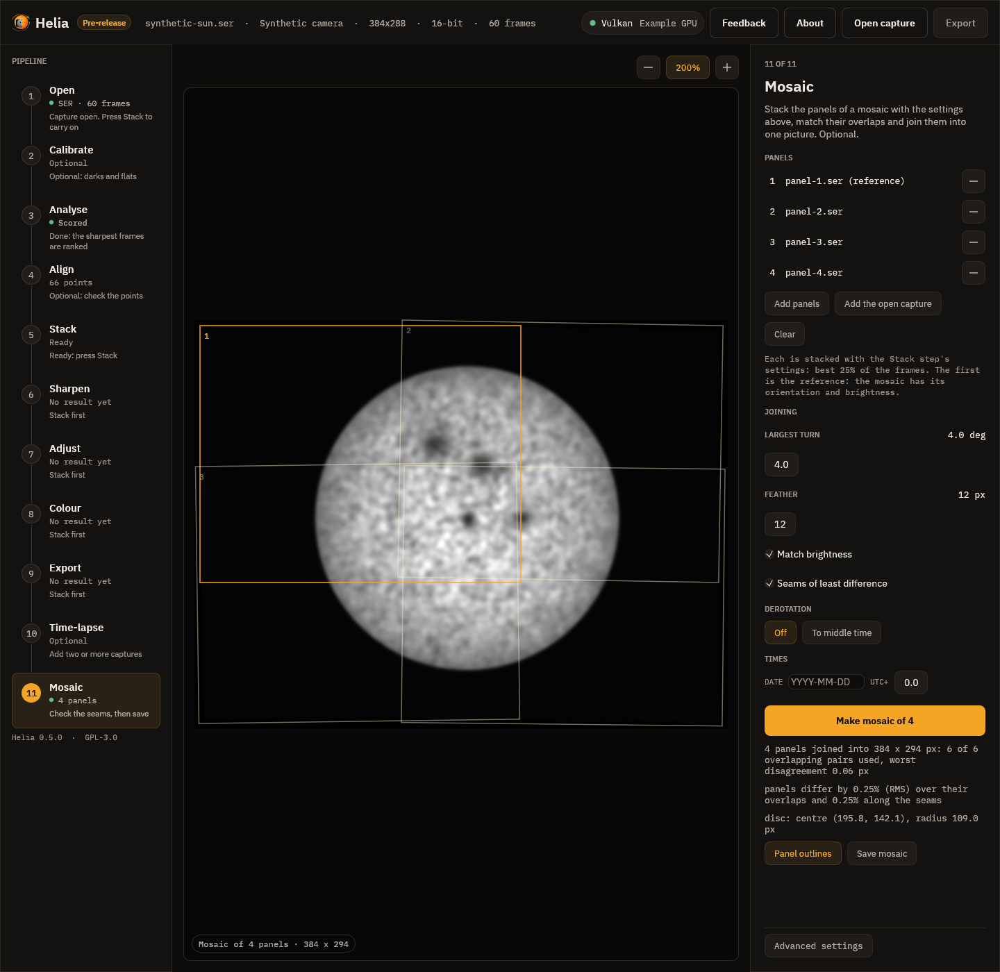

# Mosaics

A telescope and camera that see only part of the Sun take it in panels. Helia joins
panel stacks into one full-disc picture
(#26): it finds where each panel
lies from the strips they share, places all of them at once, matches their brightness,
joins them along seams where they differ least, and can bring the panels to one time
first with the Sun's [differential rotation](derotation.md). A worked example is in
[Tutorial: joining panels into a full-disc mosaic](../tutorials/mosaic.md).

**There is no real mosaic capture to test it on yet.** The method has been checked on
panels cut from a real full-disc stack with known offsets, turns and gains (see
[How well it works](#how-well-it-works)), and on a synthetic Sun, but not on the panels
of a real mosaic, which differ from these in ways that cannot be simulated well: seeing
that changes between panels, flat-field and vignetting that differ with the panel's
place on the chip, and an unknown rotation of the camera. If you have such a set of
captures, please send one.



## What it does

1. **Stacks** each panel with the settings you give (on the command line, the ones after
   `--`; in the app, those of the Stack step), or takes panels that are already
   stacked images.
2. **Matches every pair** of panels that might overlap: where does the second lie in
   the first, and how far is it turned? (See [How the panels are matched](#how-the-panels-are-matched).)
3. **Places all the panels at once** by weighted least squares, with a robust weight
   that puts a false match aside and names it.
4. Optionally **derotates** the panels to one time (the Sun turns by a fraction of a
   pixel in minutes and tens of pixels in hours; see [Solar derotation](derotation.md)) and
   matches again.
5. **Matches the brightness**, **joins along seams** and **feathers**.
6. Writes the mosaic and two tables: where each panel went, and how each pair matched.

The first panel is the reference: the mosaic has its orientation (it is not turned) and
its brightness (the others are scaled to it).

## How the panels are matched

Each panel is first turned into a picture of its detail only: the difference of two
Gaussian blurs (1.2 and 7 pixels), divided by its own local size (a Gaussian of 12
pixels over the square), so that a difference of brightness, a sloping background or
the dark sky do not matter. Each pair is then matched in two steps.

**A search.** On pictures shrunk to about 128 pixels on the short side, for each of a
few trial rotations of the second panel (every 0.75 degree up to `--max-rotation`), the
*masked normalised cross-correlation* of Padfield (2012) over every shift is
computed with FFTs: the correlation of only the pixels the two panels share, normalised
by their own sums, so that a small overlap does not win by being small. The best three
peaks at each rotation are kept, and the best six overall go on.

**A refinement.** From each candidate, a Gauss-Newton fit of shift and rotation (the
Lucas-Kanade method) on a pyramid of the pictures, from a factor of 8 down to full size,
brings the agreement to a small fraction of a pixel. The candidate that agrees best, by the
normalised correlation of the detail over its overlap at full size, is the pair's match.

A pair is believed when that correlation is at least `--min-correlation` (0.45) and the
overlap is at least 400 pixels and `--min-overlap` percent of the smaller panel (5%).
Panels that share a strip of sky only, or have no detail in common, are not.

## How the panels are placed

Panel `i` goes to the mosaic as `W_i(p) = R(theta_i)(p - c_i) + c_i + t_i`, a turn about
its own centre `c_i` and a shift. Panel 1 is fixed. The turns come first: each pair says
`theta_b - theta_a`, a linear system. With them known, each pair says where the centre of
panel `b` is in panel `a`, which gives a linear equation for the shifts. A few rounds of
iteratively reweighted least squares (a Huber weight about a pixel) follow, and a pair
still more than 3 pixels (or four times the median) from the solution is put aside, named in
the report, as long as the rest still connect every panel. A panel that no pair connects
to the others is an error that names it.

With more panels than a chain needs, the errors are shared out, not piled up: the
tables say how far each pair is from the solution (`residual_px`).

## Brightness, seams and feathering

**Gain and offset.** Panel `i` is scaled and shifted, `a_i x + b_i`, so that the panels
agree on their overlaps. Every overlap pixel of every pair goes into one least squares
fit for all the `a_i` and `b_i` at once (panel 1 is held at `a = 1, b = 0`), so three
panels around a corner agree with each other and not only in pairs. A light prior keeps
the gains near 1 and the offsets near 0 where the overlap is poor. This assumes the
panels are in the same units and not clipped: a panel with saturated pixels does not
follow a straight line against its neighbour. The gain and the offset are applied to all
the colour planes alike. A brightness that varies across a panel (vignetting) is not
corrected.

**Seams.** The panels are added in order. Where the next one meets what is there, the
seam is the path across the overlap, one pixel a row (or column), that passes through the
smallest differences between the two (dynamic programming, as in seam carving). It goes
round a feature that does not match, such as one that has changed or that the seeing
distorted, and follows a smooth patch of the disc. Everything on the new panel's side
belongs to it. `--no-seams` blends by the distance from each panel's edge instead.

**Feathering.** The panels' ownership masks are blurred with a Gaussian (`--feather`,
12 pixels), so the blend across a seam is gradual and the weights of all the panels at a
pixel sum to one. A panel's own border fades out too, so an edge with no seam on it does
not leave a step.

## The command line

```sh
helia mosaic PANELS... -o FILE [options] [-- STACK OPTIONS]
```

```sh
helia mosaic p1.avi p2.avi p3.avi p4.avi -o mosaic.tif --date 2026-10-20 --utc-offset 1 \
    --derotate -- --preset ha
```

The panels can be captures (stacked as in [Time-lapse](timelapse.md), with the settings
after `--`, in `NAME-stacks/`) or images that are already stacked. The first is the reference.

| Option | Meaning | Default |
|---|---|---|
| `PANELS...` | Captures or stacked images, at least two, each overlapping a neighbour | required |
| `-o`, `--output FILE` | The mosaic; the extension picks the format (`.tif` 16-bit, `.png` 8-bit, `.fits`). `NAME-panels.csv`, `NAME-pairs.csv` and the stacks (`NAME-stacks/`) are written beside it | required |
| `--max-rotation DEG` | The most the panels may be turned against each other; 0 holds them square to the first; 0 to 45 | 4 |
| `--min-overlap PERCENT` | The least overlap that counts, of the smaller panel | 5 |
| `--min-correlation R` | The least correlation of the detail for a pair to be believed, 0 to 1 | 0.45 |
| `--feather PX` | Width of the blend across a seam and at a panel's edge, 0 to 200 | 12 |
| `--no-gain-match` | Do not match brightness | match |
| `--no-seams` | Blend by the distance from each panel's edge | seams |
| `--derotate` | Bring every panel to one time first (needs the time of every panel and the limb in the mosaic) | off |
| `--derotate-to TIME` | `first`, `middle`, `last` or a UTC time (implies `--derotate`) | `middle` |
| `--rotation-law`, `--north-angle`, `--celestial-north-up`, `--mirror`, `--raw-brightness` | The rotation law and the orientation, as for [`helia solar-derotate`](derotation.md) | `howard`, 0, off, off, off |
| `--date YYYY-MM-DD`, `--utc-offset HOURS` | For file names that hold only a time of day; see [Time-lapse](timelapse.md#where-the-times-come-from) | none, 0 |
| `--reuse-stacks` | Use a stack already in `NAME-stacks` instead of stacking its capture again | off |
| `-- STACK OPTIONS` | Everything `helia stack` takes except the input and the output | the defaults of `helia stack` |

It prints where each panel went and how well they agree:

```text
6 panels joined into 713 x 545 px: 11 of 11 overlapping pairs used, worst disagreement 0.06 px
panels differ by 2.00% (RMS) over their overlaps and 2.08% along the seams
disc: centre (271.5, 299.6), radius 222.0 px
  panel 1 panel-1.png  at (    0.00,     0.00) px  turn +0.000 deg  gain 1.000 offset +0.0000
  panel 2 panel-2.png  at (  190.72,     3.41) px  turn +1.106 deg  gain 1.071 offset -0.0108
  ...
```

### The tables

`NAME-panels.csv` has a row for each panel: file, time, the shift (`x_px`, `y_px`) and turn
(`angle_deg`) that place it, the `gain` and `offset` that match it, and `derotated_px`, the
most the derotation moved its surface. `NAME-pairs.csv` has a row for each pair that
matched: the correlation (`ncc`), the overlap in pixels, how far the pair is from the
placement (`residual_px`) and whether it was `used`. A good set has correlations above 0.9, residuals
well under a pixel and every pair used.

`panels differ by ... over their overlaps and ... along the seams` is the RMS
difference between the panels, after the match, as a share of the mean level there. It
includes the noise of the stacks (two panels each with noise `s` differ by `1.4 s`), so it
does not go to zero; see [How well it works](#how-well-it-works).

## In the app

The Mosaic step is the eleventh in the rail. Like the Time-lapse step it has its own list
of panels and stacks each with the settings of the other steps; captures and stacked
images (TIFF, PNG, FITS) can both be added.

| Control | What it does |
|---|---|
| **Add panels** | Choose captures or stacked images |
| **Add the open capture**, **Clear**, the minus on a row | Add the open capture, empty the list or remove a panel; the first is the reference |
| **Largest turn** | `--max-rotation`, 0 to 10 degrees |
| **Feather** | `--feather`, 0 to 60 pixels |
| **Match brightness** | The gain and offset match (off is `--no-gain-match`) |
| **Seams of least difference** | The seam search (off is `--no-seams`) |
| **Derotation** Off, To middle time; **Law**; **Celestial north is up** | `--derotate`, `--rotation-law`, `--celestial-north-up` |
| **Date** and **UTC+** | `--date` and `--utc-offset` (only the derotation needs times) |
| **Make mosaic of N** | Stacks, matches and joins; the bar says which panel and stage. **Cancel** stops it |
| **Panel outlines** | Draw the outline of each panel on the mosaic, the first in amber, with its number |
| **Save mosaic** | Choose a file (TIFF, PNG or FITS); the two tables are written beside it |

The summary under the button is the same as the command line's. Zoom and pan as in other
steps.

## In the API

The panels are stacked by ordinary jobs, one per panel with the same `config`, and
`POST /api/v1/mosaic` joins the stacked images. See [The API](api.md#post-mosaic) and the
[API reference](../reference/api.md).

## How well it works

**On panels cut from a real stack.** The stack of the real H-alpha capture
`15_37_19.avi` (720 by 540, disc 222 pixels in radius) was cut into six 330 by 330
panels in two rows of three, overlapping their neighbours by about 140 pixels in x
and 125 in y. Each was cut with a known sub-pixel shift, a turn of up to 1.1 degrees, a
gain of 0.91 to 1.07 and an offset, and noise of 0.004 was added (about the noise of the
stack). The joined mosaic against the stack it was cut from:

| | |
|---|---|
| Placement error of the six panels (worst) | 0.031 px |
| Turn error (worst) | 0.006 degree |
| Gain and offset recovered | the gain to 0.3% |
| Pairs matched and used | 11 of 11, correlation 0.97 to 0.99, residual under 0.07 px |
| RMS against the stack, inside the disc | 0.0036 of full scale (the panels' noise is 0.004) |
| The same without noise | 0.00036 (0.1% of the mean level) |
| Seam RMS, without noise | 0.13% of the level |
| Without the gain match | RMS 0.023, seams 10.8% |
| Without seams (blend by distance only) | RMS 0.0036: the same, since the panels agree |

A seam that goes round a mismatch helps only where the panels differ; panels cut from one
image agree wherever they are cut. Real panels, taken at different times through changing
seeing, do not: that is where the seam search earns its place, and it is the part that
this check cannot show. See the
[tutorial](../tutorials/mosaic.md) for the pictures.

**With derotation.** On a synthetic Sun drawn as a rotating sphere, two panels taken four
hours apart (the second turned 1.2 degrees) join with an RMS error against the Sun at the
first panel's time of 0.0011 with `--derotate` and 0.018 without: the surface in the
overlap had moved by about 8 pixels.

## Limits

* Panels must share a strip of the Sun with a neighbour, with detail in it: a strip of
  sky, or of a smooth disc, does not match.
* The same scale: the panels must come from the same telescope and camera, with the same
  focus. A change of scale is not corrected.
* The motion between panels is a shift and a turn: no tilt, no perspective, no local
  distortion from the seeing (the alignment points of the stack have taken most of that out
  of each stack; what is left is not removed).
* Brightness is matched with one gain and offset a panel. A gradient across a panel is not.
* A panel with saturated pixels does not follow a straight line against its neighbour.
* With `--derotate` the mosaic must show enough of the limb to fit the disc, and every
  panel needs its time.
* The mosaic is held in memory with each panel resampled onto it: at most 64 panels
  through the API and the app.
