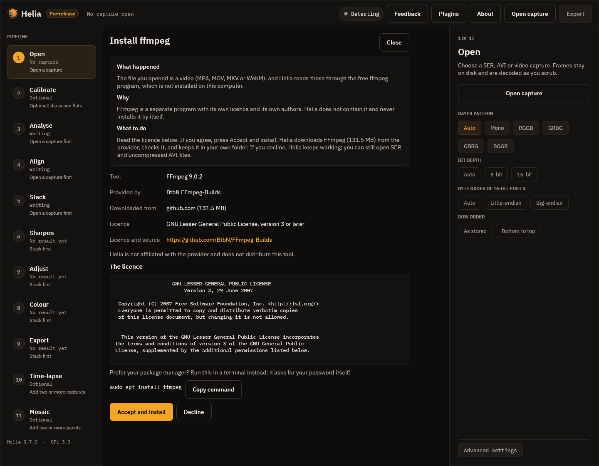
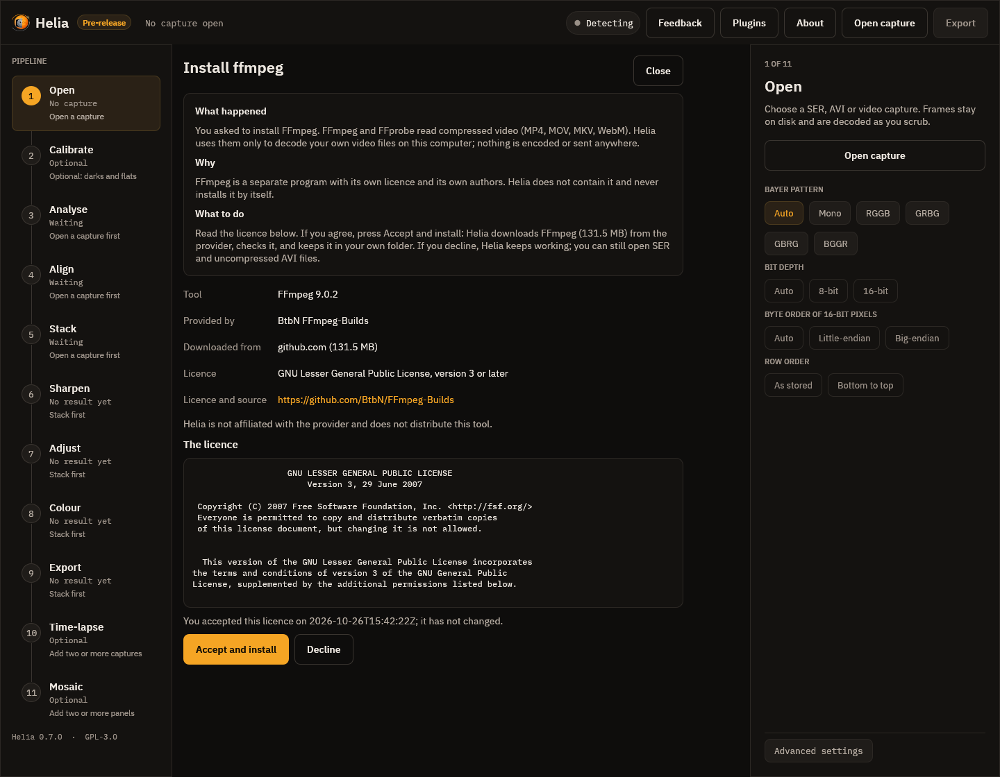
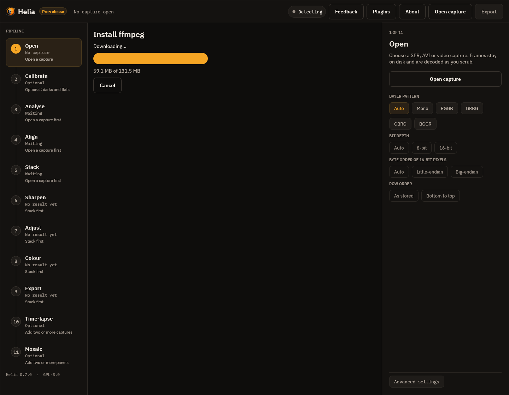
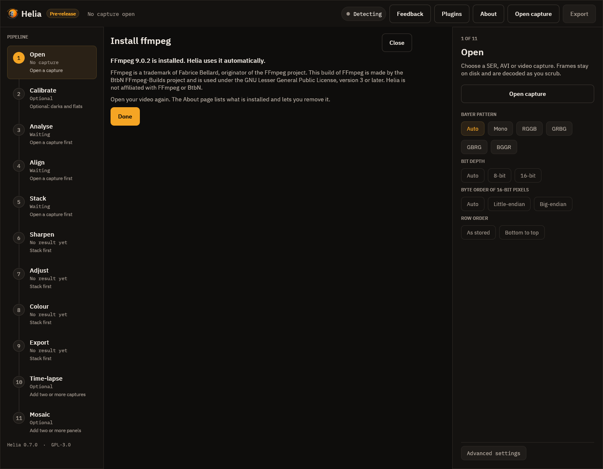
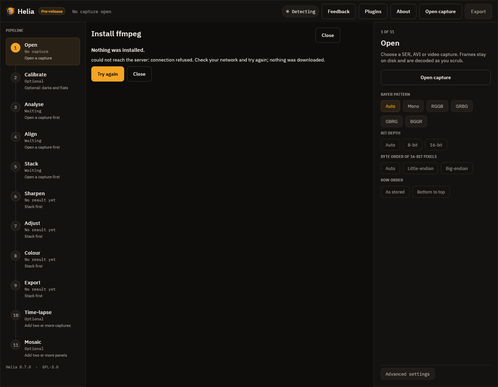
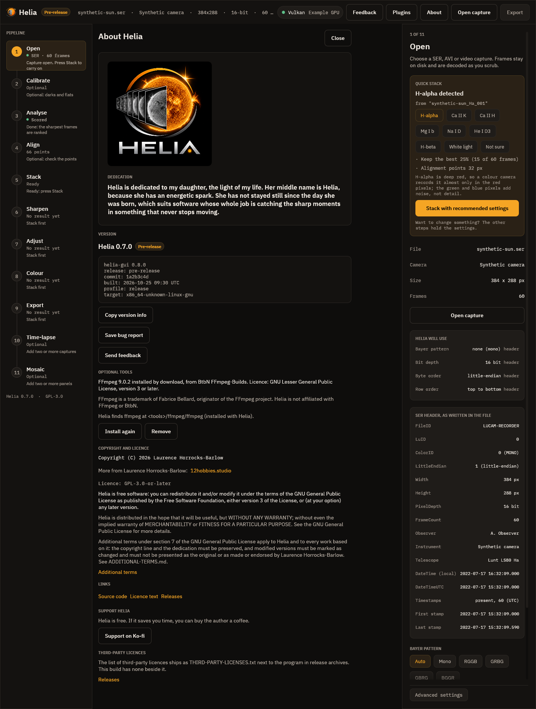

# Optional tools: installing ffmpeg

Helia reads SER and uncompressed AVI by itself. To open **MP4, MOV, M4V, MKV and
WebM** files, and AVI files that use a compressed codec, it uses the free
**ffmpeg** program. Helia does not contain ffmpeg and its installers never will:
ffmpeg belongs to its own authors and has its own licence. What Helia can do is
fetch it for you from the people who build it, **after you have read and accepted
their licence**, and keep it in a folder of your own. This page shows how, and how
to check, update and remove it.

!!! note "What always holds"

    - **Nothing installs by itself.** Helia never downloads a tool at start-up or in the
      background. It asks, and only when you start the install.
    - **The licence comes first.** You are shown the provider, the size, the source link and
      the whole licence text before anything is downloaded. Declining leaves everything as it
      was; Helia keeps working, apart from the video files that need ffmpeg.
    - **It stays on your computer.** Your acceptance (the tool, its version, the licence, a
      fingerprint of the text you read and the time) is written to one file in your own
      settings folder and is never sent anywhere. If the provider later changes the licence
      text, Helia asks again.
    - **Helia is not affiliated with ffmpeg or the people who build it.** FFmpeg is a
      trademark of Fabrice Bellard, originator of the FFmpeg project.

## Where it comes from

| Your system | What Helia offers | Provider | Licence |
|---|---|---|---|
| Windows (64-bit) | A download into your Helia tools folder | BtbN FFmpeg-Builds | GNU Lesser General Public License, version 3 or later |
| Linux (x86-64 and ARM 64-bit) | Your package manager (`apt`, `dnf` or `pacman`), if there is one; otherwise a download into your Helia tools folder | Your distribution, or BtbN FFmpeg-Builds | The package's own licence, or the LGPL 3 or later for the download |
| macOS | Homebrew, if it is installed; otherwise a download into your Helia tools folder | Homebrew, or Martin Riedl's builds (Apple silicon) or evermeet.cx (Intel) | The package's own licence, or the GNU General Public License, version 3 or later for the download. Both are signed by their makers; the Apple silicon build runs natively |

Helia downloads from the provider's own server, checks the file against a fingerprint
(SHA-256) that is signed with the same key that signs Helia's updates, and refuses
anything that does not match. The list of what is on offer is itself signed, so a change
to a provider's address or file needs no new Helia.

Video formats such as H.264 and H.265 are covered by patents in some countries. Whether
that matters to you is between you and the provider; Helia only uses ffmpeg to *read*
the videos you give it.

## Tutorial: install ffmpeg from the terminal

This walks through `helia tools` on Linux with no ffmpeg installed. The window version
is the same steps in a dialog ([see the app section below](#in-the-app)).

**1. See what you have.** This uses no network.

```text
$ helia tools status
Optional tools
  Nothing installed with Helia. `helia tools install ffmpeg` installs ffmpeg.
Helia cannot find ffmpeg. Video files need it; `helia tools install ffmpeg` fetches it.
Tools folder: ~/.local/share/helia/tools
```

**2. Start the install.** Helia fetches the signed list of tools, then shows what it
would do and the licence, and waits.

```text
$ helia tools install ffmpeg --method download
FFmpeg 9.0.2
  FFmpeg and FFprobe read compressed video (MP4, MOV, MKV, WebM). Helia uses them only to decode your own video files on this computer; nothing is encoded or sent anywhere.
  Provided by: BtbN FFmpeg-Builds
  Helia would download 131.5 MB from github.com into ~/.local/share/helia/tools.
  Licence: GNU Lesser General Public License, version 3 or later
  Licence and source: https://github.com/BtbN/FFmpeg-Builds
  Helia is not affiliated with the provider and does not distribute this tool.

The licence follows. Read it, then answer the question at the end.

                   GNU LESSER GENERAL PUBLIC LICENSE
                       Version 3, 29 June 2007

 Copyright (C) 2007 Free Software Foundation, Inc. <http://fsf.org/>
[... the licence text continues, 170 lines in all ...]

Type yes to accept the licence above and install FFmpeg. Anything else cancels:
```

On a terminal the licence opens in your pager (`$PAGER`, else `less`, else `more`): read
it, press `q`, and the question follows. Anything other than `yes` cancels:

```text
Type yes to accept the licence above and install FFmpeg. Anything else cancels: no
Cancelled. Nothing was downloaded. Helia keeps working without FFmpeg.
```

That ends with exit code 3 and no network request for the file was made.

**3. Accept.** Type `yes`. Helia records your acceptance, then downloads, checks and
unpacks. The download resumes if it is interrupted: run the same command again.

```text
Type yes to accept the licence above and install FFmpeg. Anything else cancels: yes
Downloading part 1/1: 0.0 MB of 131.5 MB (0%)
Downloading part 1/1: 13.2 MB of 131.5 MB (10%)
...
Downloading part 1/1: 131.5 MB of 131.5 MB (100%)
Checking the download...
Unpacking...
Installed FFmpeg 9.0.2 in ~/.local/share/helia/tools/ffmpeg.
FFmpeg is a trademark of Fabrice Bellard, originator of the FFmpeg project. This build of FFmpeg is made by the BtbN FFmpeg-Builds project and is used under the GNU Lesser General Public License, version 3 or later. Source code and build scripts: https://github.com/BtbN/FFmpeg-Builds and https://ffmpeg.org/download.html. Helia is not affiliated with FFmpeg or BtbN.
Helia uses it automatically; HELIA_FFMPEG and HELIA_FFPROBE still win if you set them.
```

On a 131.5 MB download over a fast home connection this took 44 seconds (your time depends
on your line). The archive is unpacked while it is read, so no second large copy is written to
disk.

**4. Use it.** Nothing else to set up. Open a video the way you always do:

```text
$ helia info test.mp4
file:        test.mp4
format:      MP4 (read with ffmpeg)
codec:       mpeg4 (Simple Profile)
size:        320 x 240
pixel format: yuv420p, 8 bit
frames:      50
frame rate:  25.000 per second
duration:    2.0 s
note:        lossy 8-bit 4:2:0 video (mpeg4): fine for quick results, SER/AVI raw captures keep more detail
```

Helia looks for ffmpeg in this order: the `HELIA_FFMPEG` and `HELIA_FFPROBE` variables, a
copy installed with `helia tools install`, then your `PATH`.

**5. Check it later.**

```text
$ helia tools status
Optional tools
  FFmpeg 9.0.2 (download), installed 2026-10-26T15:43:06Z from BtbN FFmpeg-Builds
    Licence: GNU Lesser General Public License, version 3 or later (https://github.com/BtbN/FFmpeg-Builds)
    FFmpeg is a trademark of Fabrice Bellard, originator of the FFmpeg project. ...
Helia finds ffmpeg at ~/.local/share/helia/tools/ffmpeg/ffmpeg (installed with Helia).
Tools folder: ~/.local/share/helia/tools
```

`status` re-checks that each file is still there and the right size, and says
`NEEDS ATTENTION` with what is wrong if not; run the install again to repair it.
`helia tools status --json` prints the same as JSON.

**6. Install again or update.** Run `helia tools install ffmpeg` again. If you accepted the
same licence text before, Helia says so and does not ask again:

```text
You accepted this licence on 2026-10-26T15:42:22Z; it has not changed.
```

If the provider has changed the text, you see it and are asked again. A new ffmpeg
version replaces the old folder as a whole.

**7. Remove it.**

```text
$ helia tools remove ffmpeg --yes
Removed FFmpeg.
```

Without `--yes` Helia asks. Add `--forget-licence` to also forget that you accepted the
licence, so installing again asks again.

## Choosing how to install: `--method`

| Option | What happens |
|---|---|
| `--method auto` (the default) | Uses your package manager if there is a supported one, otherwise downloads. |
| `--method package` | Shows the exact command (for example `sudo apt install ffmpeg`), asks a second `yes`, and runs it with your terminal, so `sudo` asks for your password itself; Helia never sees it. Only from a terminal. Helia records the install, but removing the package is left to your package manager and `helia tools remove` says so. |
| `--method download` | Downloads the provider's build into your Helia tools folder. Nothing outside your own folders changes. |

## In scripts

There is no terminal to ask on, so `install` refuses with exit code 3 and tells you how to
accept on purpose. Read the licence first:

```sh
helia tools licence ffmpeg          # provider, licence name, hash and the full text
helia tools install ffmpeg --method download --accept-licence 4b8f1c2d9a7e
```

`--accept-licence` takes the first 12 or more characters of the hash `licence` prints. If
the licence text changed since you read it, the hash differs and nothing is installed.

## In the app

When you open a video and ffmpeg is missing, Helia does not just refuse. It opens a page
that says what happened, why, and what to do, with the provider, the size, the source link
and the **whole licence** in a box you can scroll. Nothing is downloaded yet: the page has
fetched only the signed list of tools, to be able to show the licence.



- **Accept and install** records your acceptance of the text on screen (and checks that the
  text is still the same when the download starts), then downloads, checks and unpacks.
- **Decline**, **Close** or Esc leave everything as it was. Helia keeps working; you can open
  SER and uncompressed AVI files without ffmpeg.
- If your system has a package manager, the page shows its command with **Copy command**, to
  run yourself in a terminal. The window never runs it, because it may ask for your password.
- If you accepted exactly this licence text before, the page says so; the text is still
  shown, and **Accept and install** installs without recording anything new.



While it downloads, the page shows progress and **Cancel**. Cancel keeps the part that
arrived, so the next try carries on from there.



When it is done the page says so and shows the attribution the licence asks for.



If something goes wrong (no network, a file that does not match its checksum, a list that
is not signed by Helia's key) the page says what happened and that nothing was installed,
with **Try again**.



The **About** page has an **Optional tools** block. It lists what Helia installed, its
provider and licence, the attribution, where Helia finds ffmpeg, and buttons to **Install
again** (repair or update) and **Remove**.



## Where things are kept

| What | Where |
|---|---|
| The installed tool and its notes (`LICENCE.txt`, `SOURCE.txt`) | `%LOCALAPPDATA%\helia\tools\ffmpeg` on Windows, `~/.local/share/helia/tools/ffmpeg` elsewhere |
| Your acceptance, as plain JSON you can read | `%APPDATA%\helia\external-accepted.json`, `~/.config/helia/external-accepted.json` |
| The highest tool list seen (to refuse an old copy) | `external-state.json` beside it |
| A partly downloaded file, kept so the next try resumes | `tools/.staging` beside the tools |

`HELIA_EXTERNAL_DIR` puts everything under one folder of your choice (a portable copy, or
a test).

## When something goes wrong

| What you see | What it means | What to do |
|---|---|---|
| `could not reach the server` | No network, or the provider's server is down. | Try again later; a partly downloaded file resumes. |
| `the list of optional tools is not signed by a key this app trusts` | The tool list was changed on the way, or was not made by the Helia project. | Nothing was downloaded. Try again later, or update Helia. |
| `the list of optional tools expired` or `is older than one already seen` | An old copy of the list was served. | Try again later. |
| `the downloaded file does not match its checksum, so it was discarded` | The file is not the one the list describes. | Nothing was installed. Try again; if it repeats, tell the Helia project (`helia feedback`). |
| `is not on a server this app downloads tools from` | The list names a server this version of Helia does not trust. | Nothing was downloaded. Update Helia. |
| `the downloaded archive does not contain ...` | The provider changed the layout of the file. | Nothing was installed. Use the package manager, or wait for a new list. |
| `no supported package manager was found` | `--method package` on a system without `apt`, `dnf`, `pacman` or Homebrew. | Use `--method download`. |
| Exit code 3 | The licence was not accepted. | Read it with `helia tools licence ffmpeg`, then accept. |

The tool list and the file are fetched only when you run `licence` or `install`. `status`
and `remove` use no network, and Helia never checks for tool updates on its own.
