# Performance guide

How fast `helia stack` runs depends on three things you control (the
hardware, whether the GPU is used, and a few settings) and one you do not (the
capture). This page says what to expect, how to find out where the time goes on
your own machine, and what to change.

## What to expect

Wall-clock seconds for `helia stack` from the command line, end to end, on real
captures. Measured 2026-10-20 on a 24-core server CPU (shared with other jobs,
so the CPU figures are the pessimistic side) and an NVIDIA A100 80 GB over
Vulkan. The preset's own frame share and alignment points were used; the output
is the colour TIFF. "GPU, before" is the stacker as of release 0.5.0, "GPU, now"
includes the changes below (the "GPU now" column was re-measured, best of three, with the
alignment point read-back change as well). Peak memory is the process's maximum resident set.

| Capture | Frames | Size on disk | CPU (s) | CPU peak RSS | GPU before (s) | GPU now (s) | GPU peak RSS |
|---|---|---|---|---|---|---|---|
| 720x540 8-bit Bayer AVI (H-alpha) | 1000 | 0.4 GB | 1.9 | 315 MB | 2.2 | 1.4 | 437 MB |
| 1920x1080 16-bit SER | 100 | 0.4 GB | 1.6 | 2.2 GB | 2.0 | 1.8 | 769 MB |
| 1936x1088 8-bit mono AVI (Ca K) | 498 | 1.0 GB | 6.1 | 2.3 GB | 3.7 | 2.8 | 712 MB |
| 1920x1080 8-bit AVI (broad band) | 630 | 1.3 GB | 4.1 | 2.2 GB | 3.5 | 3.1 | 642 MB |
| 1920x1080 8-bit SER (H-alpha) | 631 | 1.3 GB | 5.8 | 2.2 GB | 3.9 | 3.5 | 629 MB |
| 640x480 8-bit AVI (Jupiter) | 10000 | 3.1 GB | 6.8 | 367 MB | 6.3 | 5.9 | 328 MB |
| 1920x1080 8-bit Bayer AVI (Ca K) | 2713 | 5.6 GB | 27.6 | 2.2 GB | 13.8 | 9.2 | 656 MB |

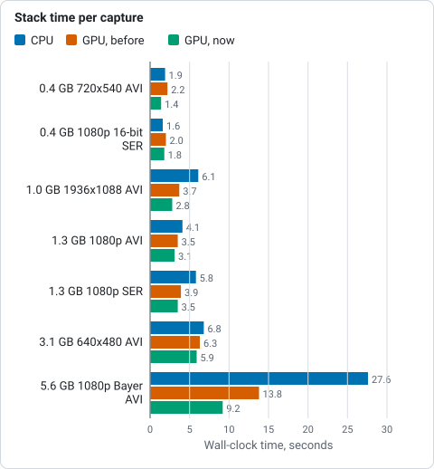

*Wall-clock seconds for `helia stack` on seven real captures, from the table above (lower is better).*

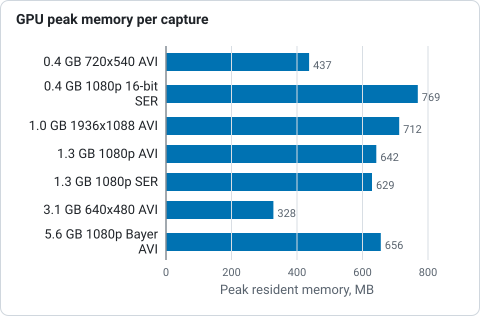

*Peak resident memory of the GPU run on the same seven captures, from the table above (lower is better).*

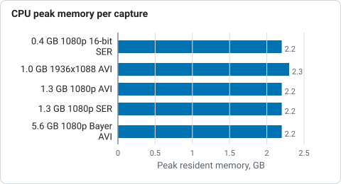

*Peak resident memory of the CPU run, from the table above, for the five captures the table gives in GB (the two given in MB are not drawn).*

Read the table like this:

* **Small captures do not need a GPU.** A 1000-frame 720x540 capture stacks in
  under two seconds on the CPU, and starting a GPU device costs about 0.4
  seconds, so the two come out level.
* **The GPU wins on large captures and on many alignment points.** The 5.6 GB
  capture takes 27.6 s on the CPU and 9.2 s on the GPU. On the CPU the time
  is the alignment points (18 of the 27 seconds: 635 points followed through
  1628 frames); on the GPU that stage is 1.5 of 9.2 seconds.
* **The GPU path uses a third of the memory** on large frames, because it holds
  a batch of raw frames, not the decoded ones.
* The first stack of a capture reads it from disk. All figures above were taken
  with the file already in the operating system's cache (a second run). A cold
  5.6 GB file adds the time your disk takes to read 5.6 GB.

In a controlled before-and-after (alternating the two builds on the same
machine, four runs each, best of four) the changes below gave 12.27 to 11.86 s
on the 5.6 GB capture, 3.58 to 3.21 s on the 630-frame broad-band capture, 2.31
to 2.07 s on the 1000-frame H-alpha capture and 3.45 to 3.15 s on the Ca K mono
capture: 3 to 10 per cent. The output is unchanged: the stacked FITS files are
identical byte for byte except the creation date in the header.

## Apple silicon (M1)

Measured 2026-10-21 on a Mac mini with an Apple M1 (4 performance and 4
efficiency cores, 8 GB of memory shared with the GPU, macOS 26, Metal), release
build, best of three, with the file already in the cache. Same preset and
settings as the table above; the captures are the four of that table that fit
on the machine. "Auto" is the default `--backend auto`; "GPU" is `--backend gpu`,
every stage on Metal.

| Capture | Frames | Size on disk | CPU (s) | CPU peak RSS | Auto (s) | Auto peak RSS | GPU (s) |
|---|---|---|---|---|---|---|---|
| 720x540 8-bit Bayer AVI (H-alpha) | 1000 | 0.4 GB | 3.7 | 216 MB | 2.7 | 165 MB | 4.5 |
| 1920x1080 16-bit SER | 100 | 0.4 GB | 2.2 | 787 MB | 1.8 | 663 MB | 3.1 |
| 1920x1080 8-bit AVI (broad band) | 630 | 1.3 GB | 8.8 | 766 MB | 5.9 | 684 MB | 9.3 |
| 1920x1080 8-bit SER (H-alpha) | 631 | 1.3 GB | 11.3 | 750 MB | 8.7 | 661 MB | 13.6 |

* **Only the alignment points run on the Apple GPU by default.** An Apple GPU
  shares memory with the processor, so there is no upload to hide, and the
  eight CPU cores with their vector units are strong for the per-frame work.
  Stage by stage on the 631-frame SER, CPU against Metal: scoring 1.5 against
  2.7 s, whole-frame alignment 1.9 against 4.0 s, stacking 0.8 against 2.5 s, but
  alignment points 6.8 against 3.9 s. `auto` therefore takes the one stage that
  wins and leaves the rest on the CPU, which is 24 to 33 per cent faster than
  the CPU alone on these captures, and 35 to 45 per cent faster than every
  stage on Metal. The `backend:` line says so: `CPU (8 threads), alignment
  points on GPU (Apple M1 (Metal, IntegratedGpu))`.
* The stacked images from the paths agree to rounding, as the parity tests
  require; they are not byte-identical.
* Memory: neither needs more than 800 MB on these captures.

## Where the time goes

Run with `--timings`:

```sh
helia stack --timings --preset cak -o out.tif 15_36_42.avi
```

It prints the wall time of each stage (open, scoring, building the reference,
global alignment, alignment points, stacking, finishing, write) and the busy
time of each kind of work summed over threads. For the 5.6 GB capture on the
GPU, from the same run:

| Stage | GPU wall (s) | CPU wall (s) |
|---|---|---|
| open and start the device | 0.6 | 0.6 |
| score all 2713 frames | 3.4 | 3.2 |
| build the reference | 0.1 | 0.1 |
| global alignment, 1628 frames | 1.6 | 2.4 |
| alignment points, 635 points, 1628 frames | 1.4 | 17.8 |
| stack 814 frames | 1.2 | 2.5 |
| finish and write | 0.1 | 0.1 |

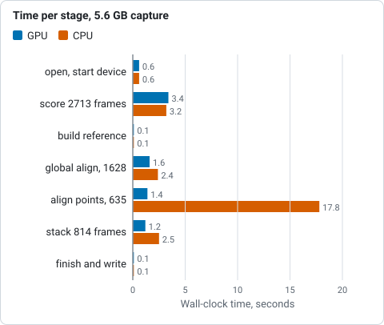

*Wall seconds of each stage for the 5.6 GB capture on the GPU and on the CPU, from the table above (lower is better).*

Scoring reads and decodes the whole file, so it is bound by how fast the frames
move from the file to the processor: on the GPU, about 2 GB/s of raw frames
are copied into device staging memory, with the kernels themselves taking less
than half of that time. If scoring dominates for you, a faster disk or a file
already in the cache is what helps; stacking fewer frames does not, because
every frame is scored.

For the GPU stages, add `HELIA_GPU_TRACE=1`. It prints, per stage, the wall
time split into upload, waiting for the reader, waiting for the device and the
host's own work, and the GPU time of each kernel:

```sh
HELIA_GPU_TRACE=1 helia stack --backend gpu --preset cak -o out.tif 15_36_42.avi
```

## Hardware

* **CPU.** The CPU path is multi-threaded over frames and over alignment points.
  Its time is roughly inversely proportional to the core count. It is what you
  get with no GPU, and it is the reference that the GPU is tested against.
* **GPU.** Any GPU that wgpu can drive (Vulkan, DX12 or Metal; see
  [GPU acceleration](gpu.md)). Memory is not a constraint: each stage needs a
  few hundred megabytes for its batch of frames, and a discrete card also keeps
  up to 6 GiB of the capture's raw frames between stages, as much as fits (see
  [Frames kept on the device](#frames-kept-on-the-device-between-stages)).
* **Several GPUs.** Helia uses the first real adapter the driver lists. If
  another job is using it (a language model server, say), pick another with
  `HELIA_GPU_DEVICE=N`, where N counts from 0 over the real adapters in the
  driver's order. `nvidia-smi` or `vulkaninfo --summary` shows the order. The
  CUDA setting `CUDA_VISIBLE_DEVICES` does not apply, because Helia talks to
  the driver through Vulkan.
* **Disk.** A capture is read several times: once to score, then again for
  alignment and stacking, but only the kept frames in the last stages. Put
  captures on an SSD, or make sure the machine has the RAM to cache them.
* **Memory.** The GPU path needs a few hundred megabytes beyond the frame
  batch, plus the frame store described below on a discrete card (video memory,
  not RAM). The CPU path holds the frames it is working on: 2.2 GB for 1080p
  captures above.

## Settings that change the time

| Setting | Effect on time | Cost |
|---|---|---|
| `--backend gpu` or `cpu` | See the table above. | None; the result is the same to rounding. |
| `--keep` | Alignment point measurement and stacking scale with the number of frames kept (twice that number is registered). Scoring does not change. | Fewer frames, noisier stack. |
| `--ap-size`, `--ap-auto` | More, smaller points cost more in measurement and stacking. | Smaller points follow finer detail. |
| `--no-multipoint` | Skips the alignment point stage, which is the largest on the CPU. | Loses the local correction; see [How stacking works](how-stacking-works.md). |
| `--ap-passes 2` | Measures the points twice. | Adds the alignment point stage again. |
| `--seeing` | Reads about 120 more frames. | A fraction of a second to a few seconds. |
| `--metric` | `helmli`, `fourier`, `contrast` and `mfgs` score on the CPU, 1.2 to 5 times as long as gradient energy. | See [Choosing a quality metric](choosing-a-quality-metric.md). |
| `HELIA_GPU_RESIDENT_MB` | Size of the store of raw frames kept in video memory between stages, in MiB; `0` turns it off. Default 6144 on a discrete GPU, off on a software or integrated one. On an A100 it moves the time by 0 to 5 per cent either way. | Video memory: up to the size you set. |

## What changed in this round, and how

The profile showed the work was already on the device; what was left was
scheduling, so the changes are about not idling:

* **Alignment point measurement keeps the device busy.** After each batch the
  host fits the correlation peaks and then asks the device for the window sums
  of the interpolated points. That request used to wait for the whole queue,
  including the next batch already submitted, so the device sat idle while the
  host fitted. The request is now submitted without waiting, and collected one
  batch later with a wait on that submission alone. On the 5.6 GB capture the
  host-side wait for window sums went from 3.8 s to 0.04 s, and the stage as a
  whole from 5.5 s to between 4.6 and 5.0 s: the device is the limit again, and
  the rest of the time is moving frames to it.
* **The device starts while the capture opens.** Creating the device takes a few
  tenths of a second; it now runs on a second thread while the capture is
  opened and probed.
* **`HELIA_GPU_DEVICE`** picks the adapter, so the tests and benchmarks can run
  on a GPU that nobody else is using.
* **Tried and dropped:** copying the uploaded frames to the device's staging
  memory in parallel (no gain: the copy is memory-bandwidth bound), and
  compiling for AVX2 (3 to 7 per cent on the CPU path on a busy machine, and a
  binary that does not start on older CPUs).

## Frames kept on the device between stages

Before this change each GPU stage (scoring, global alignment, alignment points,
stacking) read its frames from the file and uploaded them to the device again:
for the 5.6 GB capture that is 2713 + 1628 + 1628 + 1628 frame reads, about
15.8 GB, and as many uploads. Now a frame is uploaded by the first stage that
needs it and also copied, on the device, into a store in video memory. The later
stages copy it from the store into their batch instead of reading the file and
crossing the bus: 5.6 GB of reads instead of 15.8 GB.

What is stored are the frame's raw bytes, as the file holds them, not decoded
frames. Decoding and demosaicing stay on the device, run on the same bytes by
the same kernel, so the result is the same to the bit; and an 8-bit frame stays
a quarter of the size it would be as floats (the 5.6 GB capture needs 5.4 GiB
rather than the 13 GB its registered frames would as floats). Only the stack is
read back.

The store is bounded and falls back to the file:

* **Budget.** wgpu does not report how much memory a card has (the limits it does
  report do not follow it: 4 GiB on an 80 GB A100), so the budget is a fixed
  6 GiB on a discrete GPU and none on a software or integrated one, where the
  "upload" is already a memory copy. `HELIA_GPU_RESIDENT_MB` sets it in MiB.
* **A card that runs out.** The store grows a chunk at a time and asks the
  device each time. When the device says it is out of memory the store stops,
  gives back 1.5 GiB for the stages' own buffers, and keeps what it has; frames
  that did not fit are read from the file as before. Tested on the A100 by asking
  for a 4 TiB store: the device refused at 78 GB, the store kept 76 GB and
  carried on.
* **Which frames.** Scoring fills the store first come, first served. Each later
  stage names the frames it will use; frames outside that set are swapped out
  for frames inside it, and a frame the stage uses is never swapped out for
  another it uses. With a 1 GiB store on the 5.6 GB capture, registration found
  362 of its 1628 frames on the device, and the alignment points and the stack
  517 each.
* **Lifetime.** The store belongs to the capture being processed and is freed when
  the run (or a scoring pass) ends, so a capture the app keeps open does not hold
  video memory.

### Measured effect

Interleaved runs of the 0.5.0 build and this one, three each, on the A100
(`HELIA_GPU_DEVICE=2`), 24-core host shared with other jobs (its load average
reached 32, so single runs vary by 10 per cent). Wall seconds, best of three
(median in brackets); peak video memory is the rise in `nvidia-smi` memory used
during the run; RSS is the process's peak resident set.

| Capture | Before (s) | After (s) | Peak VRAM before | Peak VRAM after | Peak RSS before | Peak RSS after |
|---|---|---|---|---|---|---|
| 1920x1080 8-bit Bayer AVI (Ca K), 2713 frames, 5.6 GB | 11.37 (11.80) | 11.06 (12.15) | 0.97 GiB | 6.2 GiB | 674 MB | 652 MB |
| 640x480 8-bit AVI (Jupiter), 10000 frames, 3.1 GB | 5.61 (6.39) | 5.82 (6.26) | 0.48 GiB | 3.2 GiB | 332 MB | 326 MB |
| 1920x1080 8-bit Bayer AVI, 630 frames, 1.3 GB | 2.94 (3.45) | 3.00 (3.09) | 0.97 GiB | 2.2 GiB | 641 MB | 626 MB |
| 1920x1080 8-bit SER, 631 frames, 1.3 GB | 3.48 (3.48) | 3.43 (3.47) | 0.97 GiB | 2.2 GiB | 665 MB | 633 MB |
| 1936x1088 8-bit mono AVI, 498 frames, 1.0 GB | 3.34 (3.35) | 3.21 (3.22) | 1.3 GiB | 2.3 GiB | 718 MB | 679 MB |
| 1920x1080 16-bit SER, 100 frames, 0.4 GB | 1.74 (1.90) | 1.75 (1.78) | 1.1 GiB | 1.5 GiB | 777 MB | 771 MB |
| 720x540 8-bit Bayer AVI, 1000 frames, 0.4 GB | 1.92 (1.98) | 1.99 (2.13) | 0.48 GiB | 1.0 GiB | 437 MB | 439 MB |

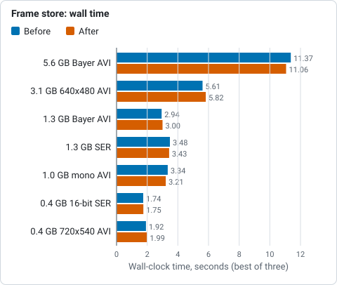

*Wall seconds before and after keeping frames on the device, best of three, from the table above (lower is better).*

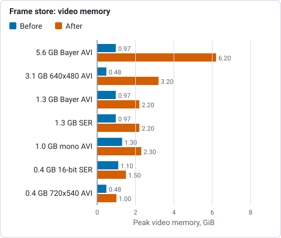

*Peak video memory before and after, from the table above: it rises by about the size of the capture.*

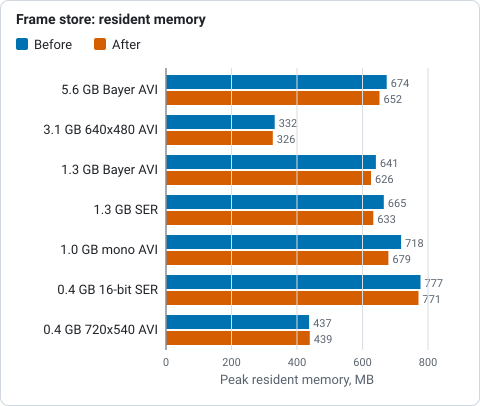

*Peak resident memory before and after, from the table above (lower is better).*

The stacked images are identical: the TIFF files of the two builds have the same
checksum on every capture, at every store size below, and on the software adapter.
That is stricter than the 1e-6 the change was held to.

**The time did not move.** Peak video memory rose by about the size of the
capture, and the wall time stayed within the noise (-4 to +4 per cent on the best
runs). By stage, on the 5.6 GB capture (best of three):

| Stage | Before (s) | After (s) |
|---|---|---|
| score all 2713 frames | 3.42 | 3.50 |
| global alignment, 1628 frames | 1.56 | 1.22 |
| alignment points, 635 points | 3.91 | 3.81 |
| stack | 1.04 | 0.98 |

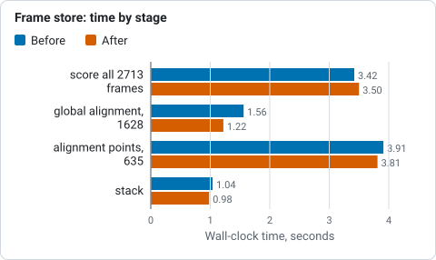

*Wall seconds of four stages on the 5.6 GB capture before and after, best of three, from the table above (lower is better).*

On this capture global alignment got 22 and stacking 6 per cent faster (more on
smaller captures), because they no longer wait for the file and the upload. The other two did not. Scoring has to upload
every frame once, and still does, at the memory-copy speed of the host (about
2.3 GB/s into the device's staging memory here; several threads were no faster).
The alignment point stage, the longest after scoring, was already overlapping its
uploads with the device's work (the host had 2.5 s of uploading to do while the
device worked on the previous batch). With no uploading left the device is the
limit, and it takes the same 3.8 s: that stage is bound by the device's work on
each batch and by the read-back of the correlation surfaces (12 MB a batch), not
by the frames crossing the bus. The change is worth having where that bus is
slower than this machine's, or where the file is not in the cache, and costs video
memory where it is not; `HELIA_GPU_RESIDENT_MB=0` returns to the old behaviour.

On the **software adapter** (lavapipe, 24 cores) the store is off by default,
because the same comparison with it forced on gave 17.5 s before and 17.2 s after
(0.4 GB AVI), 12.7 and 13.2 s (0.4 GB SER) and 65.7 and 67.0 s (1.0 GB), best of
three (two for the last), with 0.3 to 0.9 GB more RSS. The checksums match.

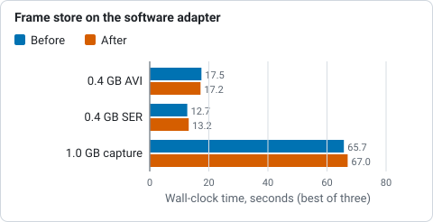

*Wall seconds on the software adapter (lavapipe, 24 cores) with the store off and forced on, from the text below the stage table.*

**A card that cannot hold the capture** was tested by limiting the store on the
A100 (best of two; the checksum is `41c66afd` throughout on the 5.6 GB capture,
as without the store; the spread between runs, 10 per cent, is larger than the
difference between the sizes):

| `HELIA_GPU_RESIDENT_MB` | 0 | 512 | 1024 | 2048 | 6144 |
|---|---|---|---|---|---|
| 5.6 GB capture, wall (s) | 12.45 | 12.01 | 12.66 | 11.34 | 12.03 |
| 5.6 GB capture, peak VRAM (GiB) | 0.97 | 1.5 | 2.0 | 3.0 | 6.2 |
| 1.3 GB capture, wall (s) | 3.71 | 3.28 | 3.28 | 3.04 | 3.19 |
| 1.3 GB capture, peak VRAM (GiB) | 0.97 | 1.5 | 2.0 | 2.2 | 2.2 |

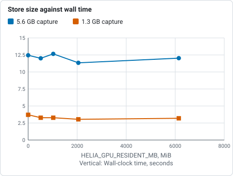

*Wall seconds against the size of the store, best of two on the A100, from the table above; the spread between runs, 10 per cent, is larger than the differences.*

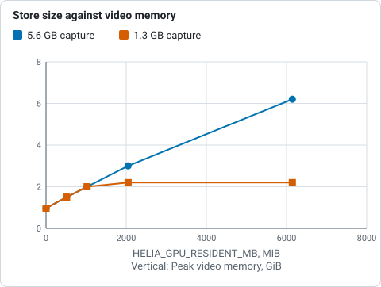

*Peak video memory against the size of the store, from the table above: it grows with the store until the capture fits.*

### Tutorial: see what the store does on your capture

This follows a run of the 1936x1088 8-bit AVI of the Sun in Ca K (498 frames, 1.0
GB, from the project's test captures) on a discrete GPU. You need a discrete GPU
and a capture of a few hundred frames or more; on a software or integrated adapter
the store is off and this shows nothing.

1. **Run once with the trace on.** `HELIA_GPU_TRACE` prints, for each stage, where
   the frames came from:

   ```sh
   HELIA_GPU_TRACE=1 helia stack --backend gpu --preset cak -o out.tif 15_44_48.avi 2>&1 | grep -E "^resident|backend"
   ```

   Expect `backend: GPU (...DiscreteGpu)` and four `resident:` lines, one per
   stage, in the order score, align, points, stack:

   ```text
   resident: 0 frames from the device, 498 from the file; holds 498 frames, 1012 MiB
   resident: 298 frames from the device, 0 from the file; holds 498 frames, 1012 MiB
   resident: 298 frames from the device, 0 from the file; holds 498 frames, 1012 MiB
   resident: 298 frames from the device, 0 from the file; holds 498 frames, 1012 MiB
   ```

   Scoring reads everything from the file (nothing is resident yet) and fills the
   store; the 298 frames the later stages use (twice the 149 kept) all come from
   it. "Holds 498 frames, 1012 MiB" is the video memory taken.

2. **Limit it to see the fallback.** Give the store room for about a fifth of the
   capture:

   ```sh
   HELIA_GPU_RESIDENT_MB=200 HELIA_GPU_TRACE=1 helia stack --backend gpu --preset cak -o out2.tif 15_44_48.avi 2>&1 | grep ^resident
   ```

   The later stages now report some frames from the device and the rest from the
   file; the lines show how many fit. Nothing else changes.

3. **Check the result is the same.** Compare the two files (`cmp out.tif out2.tif`
   prints nothing when they are identical). They always are: the store changes
   where the frame comes from, not what is done with it.

4. **Turn it off** with `HELIA_GPU_RESIDENT_MB=0` if the card is shared with
   something that needs its memory. The trace then prints no `resident:` lines.

What to expect: the same image, to the bit. A run that is 0 to 5 per cent faster
or slower on a fast bus; a larger gain where the file has to be read again from a
slow disk or a network share between stages, which the store avoids.

Troubleshooting: *no `resident:` lines* means the store is off (a software or
integrated adapter, `HELIA_GPU_RESIDENT_MB=0`, or `--backend cpu`). *Every stage
reads everything from the file* means the store has no room: the card is full
(check `nvidia-smi`), or the budget is smaller than one frame. *Video memory use
is higher than before* is the store; lower it with `HELIA_GPU_RESIDENT_MB`.

## Reading less back from the device (alignment points)

The profile of the frame store (above) found the alignment point stage bound by
the read-back: a batch of 8 frames of the 5.6 GB capture took 7.7 ms with every
kernel skipped, against 1 ms to decode it. Each batch sent two things back to the
host: the correlation surface of every point (81 correlations at a search radius
of 4; 635 points; 1.7 MB a batch) and the samples the noise floor is taken from
(every third pixel of each frame, 7.4 MB a batch). The host then selected the
floor and fitted the peaks.

Now the device does the selection and the search, and sends back only the
answer:

* **The noise floor** is the value of rank n / 100 among the finite samples of
  the frame (the 1st percentile). A new kernel (`floor_select.wgsl`) finds it by
  radix selection: four rounds, each a histogram of one byte of an
  order-preserving key of the samples that match the bytes chosen so far (32
  workgroups per frame add into one histogram), then one thread picks the byte
  that holds the wanted rank. It returns one float per frame. The result is a
  sample of the frame, not an estimate, and counting does not depend on the
  order the threads add in, so it is the host's value to the bit (tested against
  the host on ties, infinities, NaN, negative zero and frames with no finite
  sample, on a software and a hardware adapter).
* **The peak** is found by the correlation kernel, which already scanned the
  surface for the best offset to sum the window there. It now also applies the
  correlation threshold and the border-of-the-search test, and returns 14 floats
  per point and frame: the offset, the peak correlation, the two window sums and
  the 3x3 neighbourhood of the peak. The surface stays on the device. A batch of
  the 5.6 GB capture now reads 0.29 MB instead of 9.1 MB.
* **The sub-pixel fit stays on the host**, run on those nine values by the same
  function as before (`fit_patch`, split out of `fit_peak`). It was tried on the
  device and dropped, because the fit comes out differently in the last digits.
  On three real captures 80 to 93 per cent of the fits differed from the host's
  (275,698 of 353,307 on the 1.3 GB capture), by up to 1.5e-5 px: more than the
  1e-6 this change was held to, and enough to change the stack. The cause is
  arithmetic, not a bug: a compiler may fuse a multiply and an add in the
  Hessian and the determinant (the host never does), and the device's logarithm,
  which the fit takes of the nine correlations, is not the host's `ln` to the
  last bit. Which points are measured did not differ, only the digits. Sending
  nine values rather than one fitted pair costs little and keeps the output
  identical. The quality formula (`combine_sums`, in double precision), the
  interpolation of unreliable points and the sums for the interpolated points
  are likewise the same code on the same numbers.

**A note for kernel authors: WARP.** The Windows lane runs the GPU tests on WARP,
Windows' software DX12 adapter, whose shader compiler differs from lavapipe's and
the A100's. The first version of the floor kernel passed on both of those and
failed three parity tests on WARP: the device floor was -0.5 where the host had
-0.96. The bin search in `pick` was a loop with a data-dependent `break` and a
counter read after it; WARP compiled it so that the loop never broke after the
first round, leaving the last bin (255) in every byte, which decodes to -0.5.
The search is now a fixed 256-step scan with a "done" flag and `select`, no
`break` and no `&&`. This is the second miscompile of that shape (the tone-curve
kernel's segment search was the first). Rule: in a kernel that must run on WARP,
do not break out of a loop on data and then use the loop's variable; scan the
whole range with `select`. The Windows workflow dispatched on the branch is the
test; lavapipe will not show it.

The batch size is unchanged (8 frames on this capture). The buffers that used to
hold the surfaces and the samples are still counted when the size is chosen,
because a different grouping of frames changes the stack in the last digits (see
the next steps).

### Measured effect

Interleaved runs of the build before and after, three each, best of three, on the
A100 with `HELIA_GPU_DEVICE=2` (GPU 0 was busy with a language model), on the
24-core host shared with other jobs. Seconds: the alignment point stage as
`--timings` prints it, and the whole run.

| Capture | Points stage before | after | Whole run before | after |
|---|---|---|---|---|
| 720x540 8-bit Bayer AVI, 1000 frames, 0.4 GB | 0.59 | 0.24 | 1.73 | 1.35 |
| 1920x1080 16-bit SER, 100 frames, 0.4 GB | 0.27 | 0.14 | 1.93 | 1.84 |
| 1936x1088 8-bit mono AVI, 498 frames, 1.0 GB | 0.97 | 0.36 | 3.40 | 2.77 |
| 1920x1080 8-bit AVI, 630 frames, 1.3 GB | 1.11 | 0.50 | 3.88 | 3.13 |
| 1920x1080 8-bit SER, 631 frames, 1.3 GB | 1.18 | 0.64 | 4.13 | 3.50 |
| 640x480 8-bit AVI (Jupiter), 10000 frames, 3.1 GB | 1.57 | 0.61 | 6.94 | 5.88 |
| 1920x1080 8-bit Bayer AVI, 2713 frames, 5.6 GB | 4.94 | 1.50 | 12.06 | 9.19 |

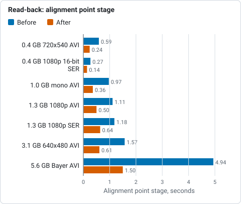

*Wall seconds of the alignment point stage before and after reading less back, best of three, from the table below (lower is better).*

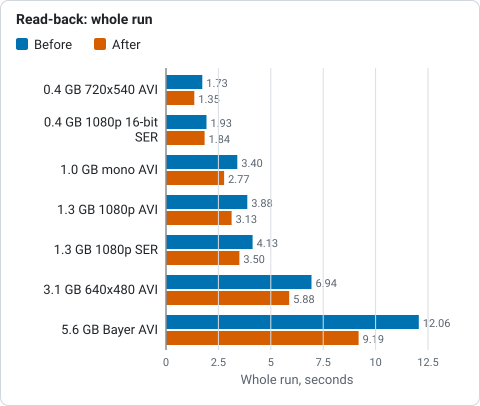

*Wall seconds of the whole run before and after reading less back, best of three, from the table below (lower is better).*

The stacked images are identical: the TIFF files of the two builds have the same
checksum on all seven captures (and on the three smaller ones on the software
adapter). Peak video memory rose by about 25 MB and peak RSS did not change. On
the 5.6 GB capture the stage went from 4.9 to 1.5 s and the whole run from 12.1
to 9.2 s (24 per cent); on the smaller captures the stage more than halves, which is 0.1
to 1.1 s of a run of 2 to 7 s. The stage still waits for the device, not the bus:
of its 1.5 s the kernels take about 1.0 s (correlation 0.29, Gaussian passes
0.44, decode 0.20, the floor selection 0.05). The trace, which records at most
4096 passes, stops about 60 per cent of the way through this capture now that
there are more passes per batch; those figures are scaled up.

**On the software adapter (lavapipe) it makes no measurable difference**: the
stage took 3.24 and 3.01 s, 6.12 and 6.18 s, and 9.43 and 9.07 s on the three
smaller captures (whole runs 12.6 and 12.2, 16.3 and 16.5, 40.7 and 43.3 s; the
spread between runs of the same build is as large as that). There the read-back
was a memory copy, and the stage is bound by kernels running on the CPU.

### Tutorial: see the read-back shrink on your capture

You need a discrete GPU and a capture with a few hundred frames or more.

1. **Run with the trace on** and pick out the points stage:

   ```sh
   HELIA_GPU_TRACE=1 helia stack --backend gpu --preset cak -o out.tif 15_44_48.avi 2>&1 | grep -E "^points:|^trace points|^gpu kernels points"
   ```

   Expect a `points:` line that splits the stage into `device (upload, kernels,
   read-back)`, `host fit` and `window sums`; a `trace points:` line whose
   `wait surfaces` is the device's own work and whose `wait floors` is near
   zero; and `floor_hist` and `floor_pick` among the kernels.
2. **Compare with an older build** (0.5.0 or earlier) on the same file. On a
   discrete GPU the `measuring alignment points` figure in `timing:` should be a
   half to a third of the old one, and `cmp` of the two TIFF files should print
   nothing.
3. **Nothing needs setting.** On a software adapter expect no change in time, and
   the same image.

Troubleshooting: *no speed-up on a discrete GPU* means the stage was not the
limit (a short capture or few points: the stage is a tenth of a second, so
scoring and stacking dominate), or the card is shared and busy
(`HELIA_GPU_DEVICE` picks another). *The two TIFF files differ* is a bug: report
it with both builds' versions.

## Next steps

What the profile of this round found, in order of what it would save on the 5.6 GB
capture (A100):

* **The alignment point stage is now bound by the device's kernels, not the
  read-back** (see above): of 1.4 s on the 5.6 GB capture, about 1.0 s is
  kernels. Larger batches cut the stage further (a batch is 8 frames for this
  stage, set by a 256 MiB buffer budget so that small cards fit; the buffers
  the stage no longer holds are still counted in that budget on purpose), but
  they change the stack in the last digits because frames are then summed in
  different groups, so they need a per-stage size that leaves the stack alone.
  The Gaussian passes (0.44 s) are the largest kernels left.
* **Coarse-to-fine alignment point correlation on the CPU.** It would need
  roughly a sixteenth of the operations, but it can pick a different peak, so
  the output would change by more than the 1e-6 this round was held to.

## How this compares with AutoStakkert

AutoStakkert! is a trademark of its owner; Helia is not affiliated with it. What follows is
from its public change notes and was not checked by running it.

AutoStakkert!'s author publishes no timings: the
[change notes](https://www.autostakkert.com/wp/change-notes/) for 4.0.1 to
4.0.13 mention "performance optimizations, particularly when processing very
large files" (4.0.1), "additional performance improvements" (4.0.5) and a
faster memory manager (4.0.7), without a figure. A search of the forums turned
up no report of stacking time against frame count and size either. The
[state-of-the-art review](../developer/research/state-of-the-art-2026.md) no longer
repeats a beta tester's second-hand speed remark, because it could not be checked.
AutoStakkert was not run for this page, so there is no like-for-like comparison to
give, and none is claimed. What can be said is Helia's own: the stacks above, including a
5.6 GB, 2713-frame 1080p capture in 8 seconds on a data-centre GPU and 28
seconds on 24 CPU cores.

## Troubleshooting

* **The GPU is slower than the CPU.** On small captures it can be: see above.
  Use `--backend cpu`, or leave the default `auto`, which picks the GPU whenever
  one exists; for batch work on small captures name the backend.
* **Times jump from run to run.** The machine is shared, the GPU is shared
  (try `HELIA_GPU_DEVICE`), or the file was not in the cache the first time.
* **The first run is much slower.** The capture was read from disk. Run it again
  to see the compute time.
* **Out of memory on the CPU path.** Lower `--keep`, or use the GPU path, which
  holds much less.
