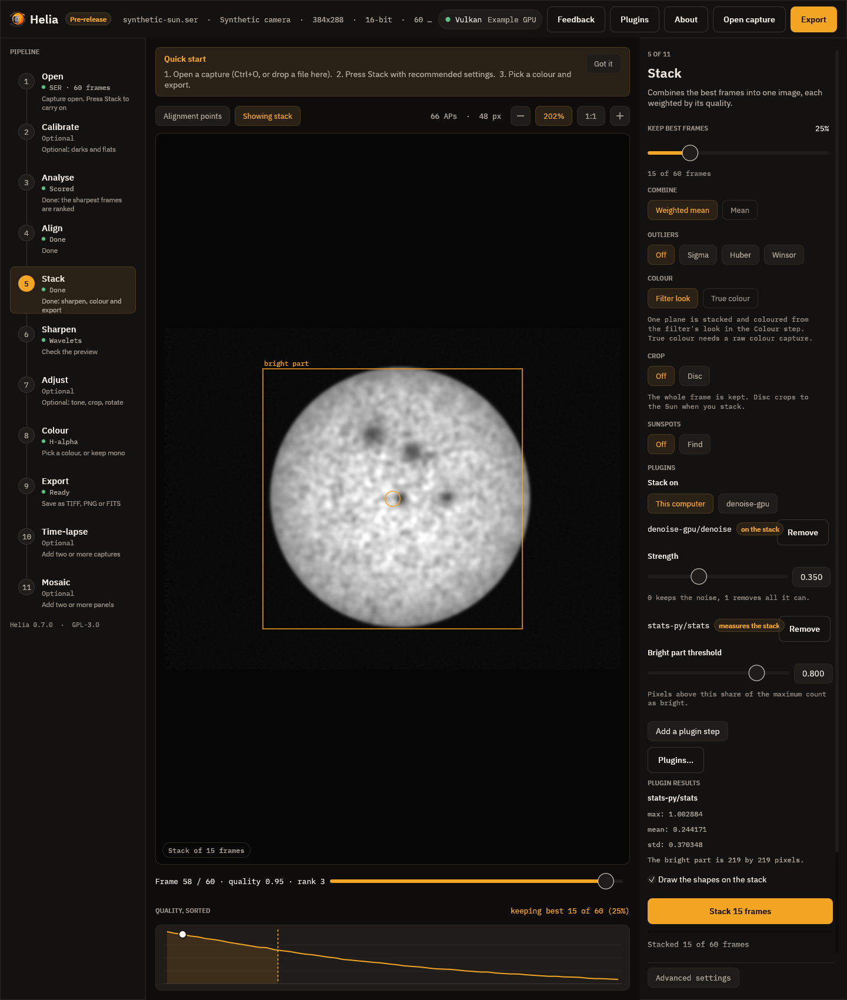

# Plugins

A plugin is a separate program that Helia starts when a step needs it. It can stack on another computer,
add a step to the pipeline (a denoise, a deconvolution, super-resolution, a mask), or measure the result and
report numbers and shapes. Helia knows nothing about what a plugin does inside; the two talk in a small
published protocol ([the specification](../developer/plugins.md)), so a plugin can be written in any
language.

This page is the summary. The walk-throughs are [Using plugins](../tutorials/plugins.md) and
[Writing a plugin](../tutorials/writing-plugins.md); every field and flag is in the
[Plugins reference](../reference/plugins.md).

## Plugins run with your rights

**A plugin is a program, and it runs with your rights.** It can read and write your files, use the network
and start other programs, exactly like any program you download. Helia does not sandbox it. So:

* **Nothing runs until you enable it.** Finding a plugin only lists it. Enabling shows where it is, its
  SHA-256 checksums, what it can do and what it asks for, and waits for your yes.
* **A change switches it off.** Helia hashes the plugin's program and manifest every time it starts it. If
  either differs from what you approved, the plugin is off until you approve it again.
* **Enable only plugins you trust**, and compare the checksum with the one the author publishes.

## Where plugins live

Helia looks in its settings folder, `plugins/NAME/plugin.toml` (on Linux `~/.config/helia`, on Windows
`%APPDATA%\helia`, or the folder named by `HELIA_CONFIG_DIR`), and in any folder you name with
`--plugin PATH` on the command line, which is how you try a plugin you are writing.

## In the desktop app

The **Plugins** button in the top bar opens the Plugins page. It lists what Helia found, with a badge
for each: **On**, **Off**, **Changed** (the program or manifest differs from what you approved, so it is off
until you approve it again) or **Damaged**. Choosing a plugin shows its details; **Enable...** shows the
source, both SHA-256 checksums, what the plugin can do and what it asks for, and a statement that it runs with
your rights, and only the **Enable plugin** button there switches it on. A plugin that is on has **Disable**,
**Test** (starts it, runs its own check and shows the result and its log) and **Forget**, and a form for its
settings, drawn from the plugin's own settings schema, with **Save settings**. **Look again** reads the plugins
folder again. Esc closes the page.


In the Stack step, the **Plugins** card chooses where to stack (this computer or a plugin) and the steps to run,
each with its own parameter form, and shows what an analysis step reported, with the shapes it drew on the
stack. In the desktop app every `image-op` step runs on the stack straight after stacking, before the
sharpening and edits of the later steps (the command line's `pre:` position); use the command line to run a
step after the edits.



`helia-gui --plugin PATH` names a plugin folder for one run, as on the command line.

## On the command line

```sh
helia plugins list                          # what Helia found and whether each is on
helia plugins info invert-py                # source, checksums, capabilities, steps, settings
helia plugins enable invert-py              # show it, ask, record the checksums (--yes skips the question)
helia plugins set myplugin server=gpu.example port=7871
helia plugins test myplugin                 # start it, run its own check, show its log
helia plugins disable invert-py             # off, settings kept
helia plugins forget invert-py              # off, and its approval and settings removed
```

Use a plugin in a run with `--plugin-step`:

```sh
helia stack capture.ser -o out.tif --plugin-step invert-py/invert
helia stack capture.ser -o out.tif --plugin-step pre:dn/denoise:strength=0.5 --plugin-step stats-py/stats
helia edit stack.tif -o out.tif --plugin-step invert-py/invert
helia stack capture.ser -o out.tif --stack-backend remote-gpu
```

`--plugin PATH` names a plugin folder for one run. A `frame-op` step works on every frame before stacking;
an `image-op` step on the stack, after Helia's own edits or, with `pre:`, before them; an `analyse` step
reads the result and writes `OUTPUT.analysis.json`. `--stack-backend PLUGIN` replaces the local stacking
(not with true colour, calibration or field rotation). A plugin that is off, changed or out of range stops
the run before any work, and says what to type to fix it.

## Through the API

A job's `config` takes `plugin_steps` (the same `PLUGIN/STEP[:KEY=VALUE,...]` strings, at most 16) and
`stack_backend`. The plugins must have been enabled for the user the server runs as, and they run with that
user's rights; a plugin that is off or a value out of range is a 422 before the job is queued. What the
`analyse` steps report comes back in `summary.plugins`, and `summary.stacked_by` names the backend. See the
[API reference](../reference/api.md).

## Writing one

Start from the examples in `examples/plugins`: `invert-py` and `stats-py` (Python, standard library only)
and `invert` (Rust with the SDK, which is MIT OR Apache-2.0 so that your plugin can have any licence). The
author tutorial builds them from nothing.
