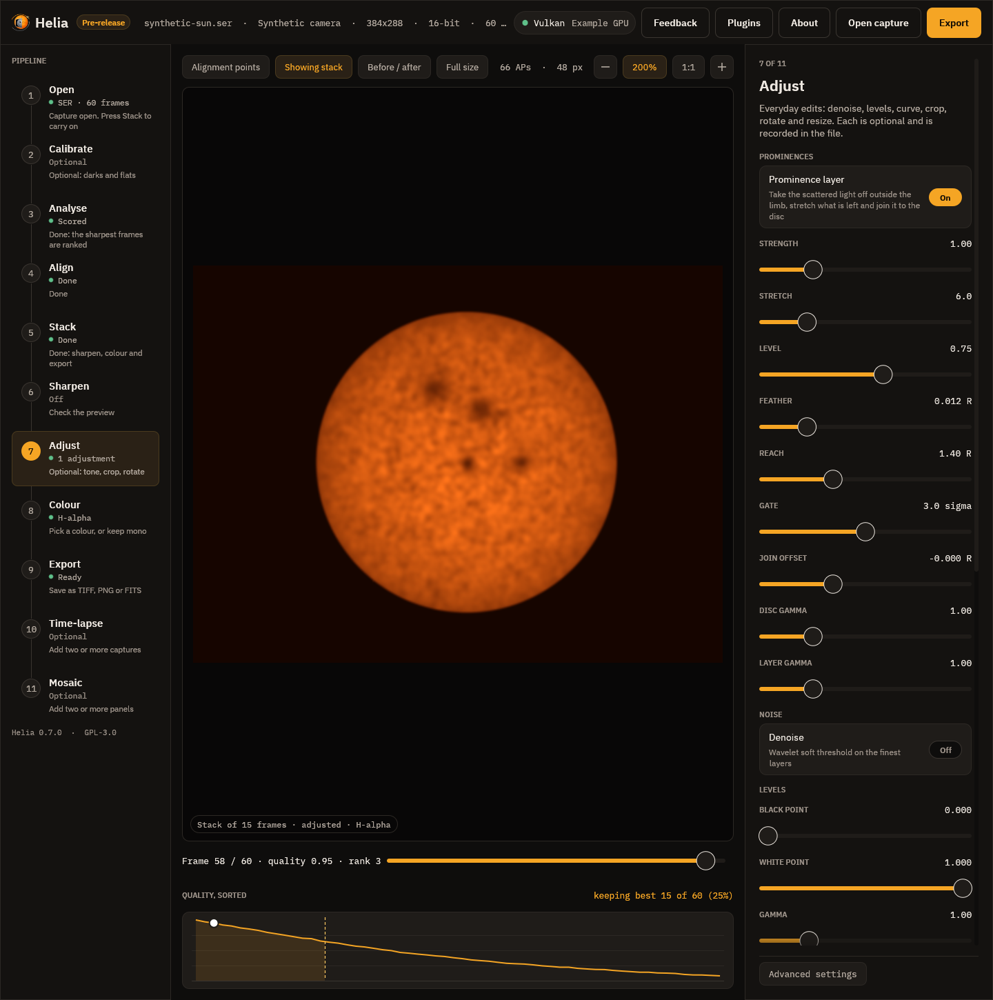
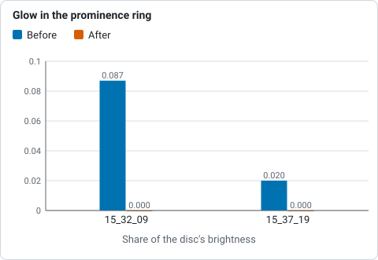
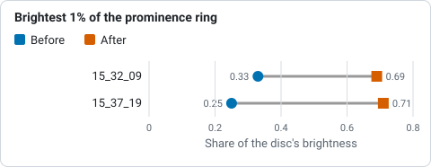
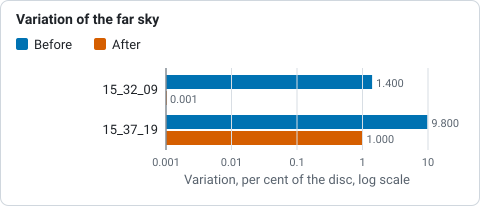

# Prominences and the disc together

A narrow-band stack holds two pictures at once. The disc is bright and the
prominences above the limb are a few per cent of it, so one tone curve cannot
show both: lift the prominences and the disc burns out
(#23). The **prominence
layer** makes the second exposure from the same stack and joins it to the disc.
It is an edit like the others, for H-alpha and the other lines with prominences,
and it runs after the sharpening and before levels and the curve.



## Using it

* **App:** the Adjust step, under *Prominences*: **Prominence layer** on, then
  the sliders. The preview shows the composite as you move them.
* **Command line:** `--prominence`, in `helia stack` and `helia edit`, with
  `--prominence-strength`, `--prominence-stretch`, `--prominence-level`,
  `--prominence-feather`, `--prominence-reach` and `--prominence-gate`:

  ```sh
  helia stack sun_Ha.ser -o sun.tif --preset ha --sharpen wavelet --prominence --colour auto
  helia edit sun.fits -o sun.png --preset ha --sharpen wavelet --prominence
  ```

* **API:** an `edits` entry, `{"op": "prominence"}`, with the same values as
  fields (`strength`, `stretch`, `level`, `feather`, `reach`, `gate`); see
  [The API](api.md#sharpening-and-edits).

FITS output stays the unedited stack unless you ask for `--sharpen-fits`, as for
the other edits.

## Adjusting it like a prominence processor

Programs such as IMPPG (GPL, by Michal Wisniewski; its README describes a tone curve
applied last, brightness-adaptive unsharp masking whose amount differs for the disc and
the dim prominences, and live preview of a selection) make the disc and the
prominences separately adjustable. The same controls are here, as sliders with a live
preview in the Adjust step, where the layer is the first thing in the panel:

* **Strength**, **Stretch**, **Level** and **Gate**: how bright and how far into the
  noise the off-limb layer is lifted (the boost).
* **Join offset** and **Feather**: where the join of layer and disc sits, in disc radii
  from the fitted limb, and how soft it is.
* **Disc gamma** and **Layer gamma**: a separate tone for the disc and for the layer
  (`--prominence-disc-gamma`, `--prominence-layer-gamma`, `--prominence-offset`). Both
  are 1 by default, which leaves the disc bit-identical.

Helia's own tone curve and levels follow in the same step and apply to the whole picture.
No IMPPG code was used; only its public README was read to match what users expect.
ImPPG is a trademark of its owner; Helia is not affiliated with it.

## How it works

1. **The limb.** The disc is fitted as a circle ([`fit_disc`](how-stacking-works.md)),
   the same fit the alignment and the crop use. Everything at the limb and a few
   pixels beyond it (the seeing blurs the edge) is still treated as disc.
2. **The glow.** Scattered light and sky fall away from the limb, and are often
   brighter on one side. The background at a radius and angle is the **median** of
   the pixels at that radius in a window of 45 degrees, found for 24 sectors and
   interpolated between them. A prominence fills a small part of such a window, so
   the median is the glow and not the prominence. Where a ring has too few pixels
   (the frame cuts it) the all-round median is used.
3. **The signal.** The frame less that background, blurred by a Gaussian of 1.2
   pixels, less a gate, floored at zero. The gate is `--prominence-gate` noise
   sigmas (3 by default; the noise is the median absolute deviation of the outer
   part of the field) and never less than 0.4% of the disc's brightness, below
   which the background model's own error is as big as the noise and stretching it
   would show the model.
4. **The stretch.** The signal as a share of its own 99.5th percentile just outside
   the limb, through `asinh(k x) / asinh(k)` (`--prominence-stretch`, `k` = 6; 0 is
   linear) and held at 1, scaled so the brightest prominences reach
   `--prominence-level` (0.75) of the disc's brightness. The reference is never less
   than 8 noise sigma, so a field with no prominences stays dark and is not
   stretched into noise. `--prominence-strength` multiplies the signal before the
   stretch.
5. **The join.** Inside the limb the disc is untouched. Across a feather of
   `--prominence-feather` (1.2% of the radius) on each side of the limb the two are
   mixed by a smooth step. Outside, the layer replaces the picture, at the black
   level the stack had (the median beyond `--prominence-reach` radii, 1.4 by
   default, when the frame holds enough of it). The layer fades to black at the
   reach.

The colour table is applied afterwards, so the layer takes the look of the filter.

## What was measured

**Known answers.** The unit tests render a limb-darkened disc with a glow that falls
off from the limb, noise and three prominences, and check that the disc is
identical well inside the limb, that the brightest prominence (11% of the disc
with the glow, before) is lifted to above 40% and more than three times its
brightness, that a
faint one is lifted too and the order of brightness is kept, that the glow above the
limb is taken off and the far sky is the black level, that the join across the limb
has no rim, no overshoot and no step back, that a field with no prominences is not
lifted into noise (under 0.5% of the pixels above 5% of the disc), and that a frame
with no disc passes unchanged.

**The H-alpha captures** (`15_32_09.avi` and `15_37_19.avi`, 720 by 540, 1000
frames, the best 25% stacked, wavelet sharpened): the brightness of the brightest
1% of the ring from 1.02 to 1.15 radii, as a share of the disc's, and the median of
that ring (the glow):

| Capture | Brightest 1% before | after | Ring median before | after |
|---|---|---|---|---|
| `15_32_09` | 0.33 | 0.69 | 0.087 | 0.000 |
| `15_37_19` | 0.25 | 0.71 | 0.020 | 0.000 |



*Median of the ring from 1.02 to 1.15 radii (the glow), before and after the layer, from the table above (lower is better).*



*Brightness of the brightest 1% of the ring from 1.02 to 1.15 radii, before and after the layer, from the table above (higher shows the prominences better).*

The share of the ring above 5% of the disc falls from 97% to 10% for the first (the
glow was above 5% nearly all round; what is left is the prominences) and stays 4%
for the second (a clean sky), and the disc inside 0.9 of the radius is bit-identical.
The brightness of the field beyond 1.35 radii varies by 1.4% of the disc before and
0.001% after for the first (it was glow and vignetting; it is the flat black level
now), and by 9.8% before and 1.0% after for the second (that capture has a shifted
band across the frame that the layer cannot remove completely). In the pictures the
prominences on the left limb and the large one at the bottom of the first
capture, which the plain stack shows as a smudge in the glow, stand out with their
shape.



*Variation of the brightness beyond 1.35 radii before and after the layer, from the paragraph below the table (lower is better).*

## Limits

* One pass of one exposure. The faintest prominences are limited by the noise of the
  stack; a second, longer exposure for the prominences is not combined (yet), so a
  capture whose prominences are lost in the noise stays lost.
* The glow model assumes a prominence fills less than half of a 45 degree window. A
  prominence group wider than that raises the background under it and is dimmed.
* The limb is a circle. A disc cut by the frame, or out of round, leaves a ring of
  disc just outside the fitted limb that the feather has to hide.
* The stretch is a presentation choice, like colour: it makes prominences visible,
  not measurable. The FITS file, which keeps the unedited stack, is the measurement.

## Reference: every option

| Setting | CLI (`helia stack`, `helia edit`) | API (`edits` entry `{"op": "prominence"}`) | App slider (Adjust step) | Range | Default |
|---|---|---|---|---|---|
| Prominence layer | `--prominence` | the entry itself | Prominence layer toggle | on or off | off |
| Strength | `--prominence-strength` | `strength` | Strength, 0.1 to 4 | 0 to 100 | 1 |
| Stretch (`asinh` k) | `--prominence-stretch` | `stretch` | Stretch, 0 to 30 | 0 to 1000 | 6 |
| Level (share of the disc) | `--prominence-level` | `level` | Level, 0.1 to 1.2 | above 0 to 2 | 0.75 |
| Feather (radii) | `--prominence-feather` | `feather` | Feather, 0 to 0.06 | 0 to 0.2 | 0.012 |
| Reach (radii) | `--prominence-reach` | `reach` | Reach, 1.1 to 2 | 1.05 to 3 | 1.4 |
| Gate (noise sigma) | `--prominence-gate` | `gate` | Gate, 0 to 6 | 0 to 20 | 3 |
| Join offset (radii) | `--prominence-offset` | `offset` | Join offset, -0.05 to 0.1 | -0.1 to 0.2 | 0 |
| Disc gamma | `--prominence-disc-gamma` | `disc_gamma` | Disc gamma, 0.4 to 3 | 0.2 to 5 | 1 |
| Layer gamma | `--prominence-layer-gamma` | `layer_gamma` | Layer gamma, 0.4 to 3 | 0.2 to 5 | 1 |

The tuning flags need `--prominence`. The slider ranges are narrower than the accepted
ranges. A value outside the accepted range is `422 invalid_config` in the API and an
error on the command line. The edit runs after the sharpening and before levels and the
curve, once per list.
