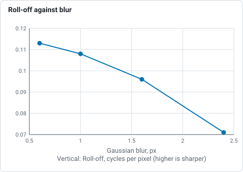

# The granulation and seeing report

A stack of the Sun's surface is only as good as the detail it holds. For
white-light and sodium D captures (the photospheric filters, the ones that show
granulation) Helia turns the finished stack into a short report you can compare
between runs, settings, nights and equipment
(#56). It is printed by
`helia stack` after the stack, written into the FITS header, returned by the API
as `summary.granulation`, shown as one line in the Stack step of the app, and
available for any finished image with `helia measure`.

Hydrogen-alpha, calcium and the other chromospheric filters have no granulation
to measure, so they get no report.

## What it measures

The report is made on the central 240 x 240 pixel square of the disc, which keeps
it away from the limb in most captures. Before anything is measured the square is
flattened: it is divided by a copy of itself blurred by an eighth of its side,
which removes limb darkening, vignetting and any slow gradient but not granules.
Everything below is therefore independent of how bright the capture was.

* **RMS contrast.** The standard deviation of the flattened square. This is the
  number that matters scientifically: it falls with seeing and defocus and rises
  with sharpening, so report it on the unsharpened stack (the FITS file is that).
  It depends on bit depth and noise, so quote the conditions.
* **Power spectrum.** The azimuthally averaged power of the square, with its noise
  floor taken from the highest frequencies. Two landmarks are read from it: the
  **roll-off**, the frequency where the power above the noise has fallen to 10% of
  its peak (seeing and defocus move it down), and the **resolved** frequency, the
  highest one still above 1% of the peak (noise limits it). They are given in
  cycles per pixel, as a period in pixels, and in arcseconds when the image scale
  is known (the fitted limb gives it).
* **Diffraction cut-off.** With the aperture (`--aperture-mm`, API `aperture_mm`)
  Helia also gives `D / lambda` in cycles per pixel, taking 550 nm for white light
  and 589.3 nm for sodium, and how much of it the data reaches. No stack resolves
  all of it: the optics' transfer function falls to zero there.
* **Cell size.** The square is band-passed at the scale where the contrast peaks,
  the bright cells are labelled and counted, and the report gives the mean spacing
  of granules (the square root of the area per cell) and the mean diameter of those
  that lie wholly inside. It is only meaningful when a granule covers at least
  three pixels; the report says when it does not.

```text
$ helia stack Sun_Test.ser -o sun.fits --preset na --aperture-mm 80
...
granulation: region:         240 x 240 at (708, 416)
granulation: RMS contrast:   3.756%
granulation: cell size:      pitch 13.65 px (29.45 arcsec), diameter 7.69 px (16.59 arcsec) (309 cells)
granulation: power spectrum: roll-off 0.146 cycles/px (period 6.86 px, 14.79 arcsec), resolved to 0.292 (period 3.43 px, 7.39 arcsec)
granulation: telescope:      diffraction cut-off 1.419 cycles/px lies above the sampling limit (0.5): the pixel scale, not the telescope, limits the detail; resolved 58% of the sampling limit
granulation: noise floor:    3.091e-5
granulation: note:           a granule (1.5 arcsec) spans 0.7 px at this scale; below 3 px the cell size measures larger structure and noise, not granules. The contrast and the spectrum still compare runs of the same capture.
```

The Stack step of the app shows the RMS contrast in one line once a white-light or
sodium stack has finished, with the whole report in the tooltip.


(The picture is the app's synthetic demo capture with fixed example figures in the
report lines, not measurements of it; the seeing line is the one of
[Seeing estimation](seeing.md).)

The FITS header gets `GRANRMS`, `GRANPITC`, `GRANDIAM`, `GRANPARC`, `GRANGPIX`,
`GRANROLL`, `GRANRESO` and, with the aperture, `GRANCUT`.

## On any image: `helia measure`

```sh
helia measure sun.fits --scale 2.16 --aperture 150 --wavelength 589.3
```

prints the three band-pass contrasts of [`helia measure`](cli.md#helia-measure) and
the report above. `--scale` is arcseconds per pixel; `--aperture` needs
`--wavelength` and `--scale`.

## How well it tells good from poor

Known-answer tests (`cargo test -p helia-core granulation`) on synthetic Voronoi
mosaics with a known cell size and contrast, blurred by known Gaussians and with
added noise:

| Test | Result |
|---|---|
| Mean cell size, 8, 12 and 16 px | recovered to 3.3%, 3.3% and 0.3% |
| RMS contrast against the truth, blur 0 to 3 px | within 3%, and falls with blur |
| Brightness x4 and a 25% gradient | contrast within 3%, cell size within 5% |
| Band-limited to 0.2 cycles per pixel | resolved frequency 0.200 |
| Roll-off against blur of 0.6, 1.0, 1.6, 2.4 px | 0.113, 0.108, 0.096, 0.071 cycles per pixel |
| More noise | the noise floor rises by over 20 times; the resolved frequency does not rise |



*Roll-off frequency of synthetic granulation blurred by known Gaussians, from the known-answer tests above.*

On the project's four sodium captures (ASI482MC; Na D preset, GPU; FITS output, so
unsharpened). Each is stacked three ways: the preset's best 12% of frames with
alignment points; all frames (`--keep 100%`); the best 12% with global alignment
only (`--no-multipoint`). The eye ranks the first above the others, and the report
agrees:

| Capture | Stack | RMS contrast | Roll-off (period, px) | Resolved (period, px) |
|---|---|---|---|---|
| `15_20_57.ser` | best 12%, points | 4.17% | 6.7 | 3.0 |
| | all frames | 3.99% | 7.1 | 3.1 |
| | best 12%, global | 4.14% | 6.7 | 3.0 |
| `Sun_Test.ser` | best 12%, points | 3.76% | 6.9 | 3.4 |
| | all frames | 3.44% | 8.3 | 4.3 |
| | best 12%, global | 3.64% | 6.9 | 3.4 |
| `15_32_09.avi` | best 12%, points | 1.95% | 13.3 | 6.3 |
| | all frames | 1.86% | 14.1 | 6.5 |
| | best 12%, global | 1.91% | 15.0 | 6.5 |
| `14_42_57.avi` | best 12%, points | 1.39% | 34.3 | 26.7 |
| | all frames | 0.53% | 48.0 | 21.8 |
| | best 12%, global | 0.55% | 34.3 | 12.0 |


*RMS contrast of each sodium capture stacked three ways, from the table above (ASI482MC, Na D preset).*


*Roll-off of each sodium capture stacked three ways, from the table above (ASI482MC, Na D preset).*


*Resolved of each sodium capture stacked three ways, from the table above (ASI482MC, Na D preset).*

* The contrast ranks all four captures as expected: alignment points above global
  alignment, and a selected 12% above all the frames. The roll-off period agrees
  or ties on every pair (it cannot tell points from global alignment on the first
  two captures, whose seeing is good).
* `14_42_57.avi` is the blocky capture with no visible granulation: its contrast is
  mostly compression blocks and its resolved frequency flips between stacks, so
  read nothing into it beyond "much worse".
* The cell size is not in the table because it is not granulation on these
  captures. At 2.16 arcsec per pixel (`Sun_Test.ser`, `15_20_57.ser`), 4.31
  (`15_32_09.avi`) and 1.44 (`14_42_57.avi`) a 1.5 arcsec granule is 0.3 to 1
  pixel, so the cells found are 9 to 14 pixels across (20 to 30 arcsec): larger
  structure and noise texture. The report prints a note saying so. The cell size
  becomes meaningful at about 0.5 arcsec per pixel or finer.
* The report is repeatable: it uses no random numbers.

## Limits

* The region is the disc centre. A spot, a facula or a filament there raises the
  contrast; check the crop, and use `helia measure --crop` or crop the image first.
* A sharpened image reads higher. Compare sharpened with sharpened, or use the FITS
  stack.
* Hydrogen-alpha has no granulation: no report is made for it.
