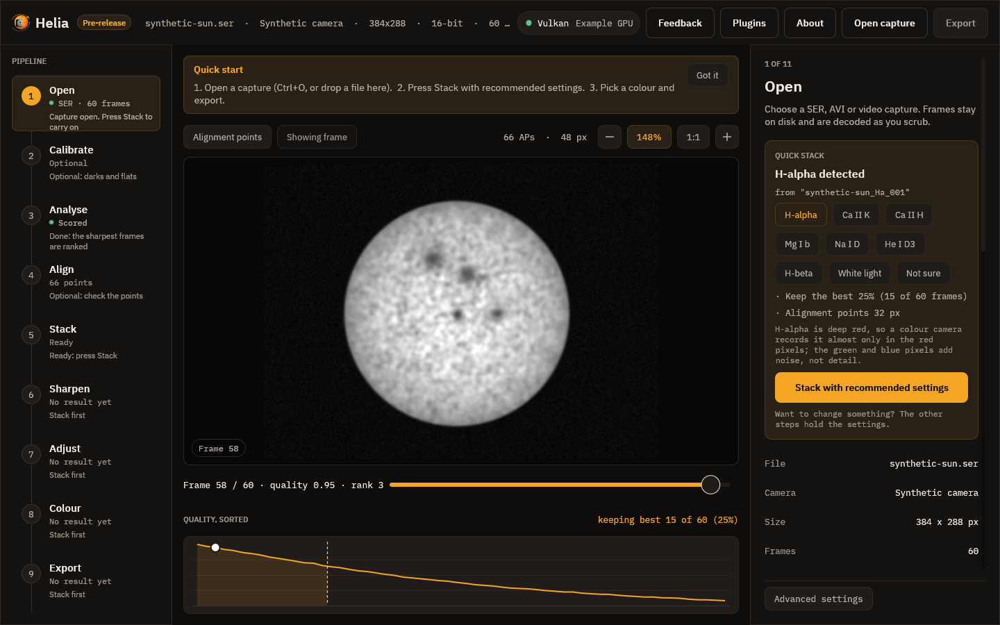
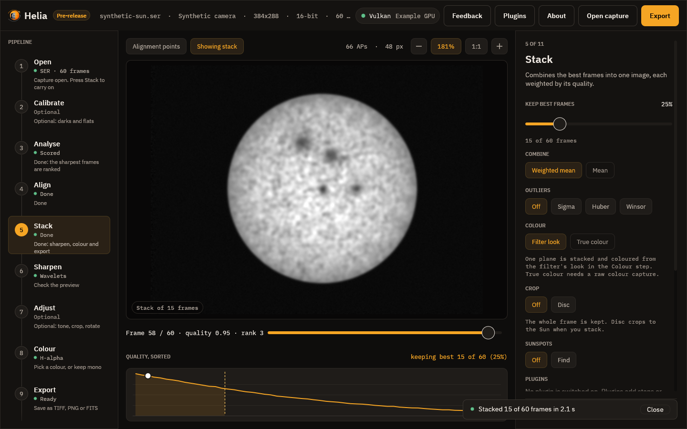
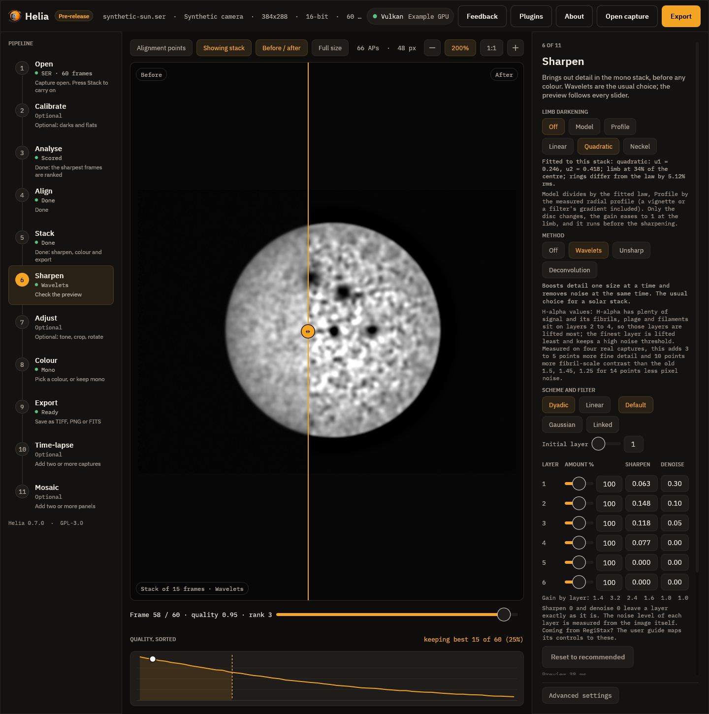
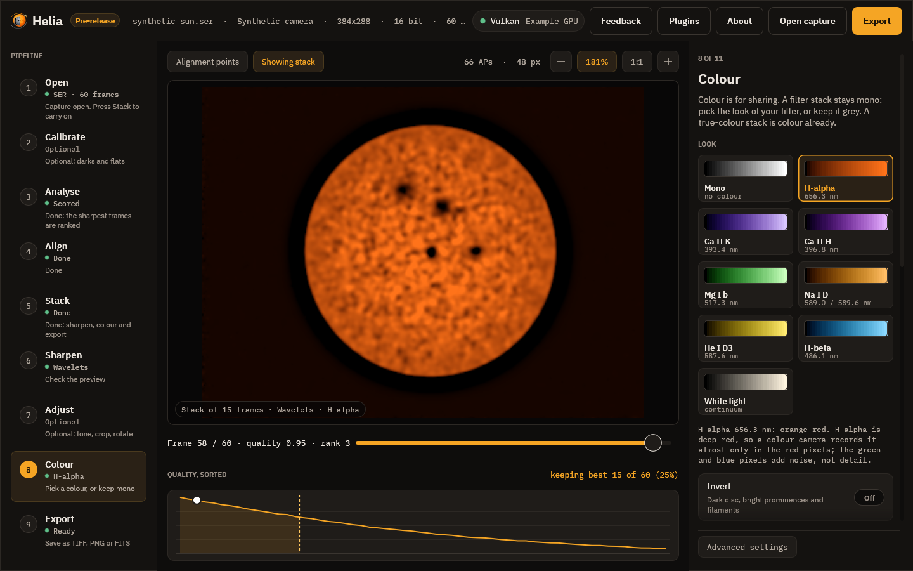
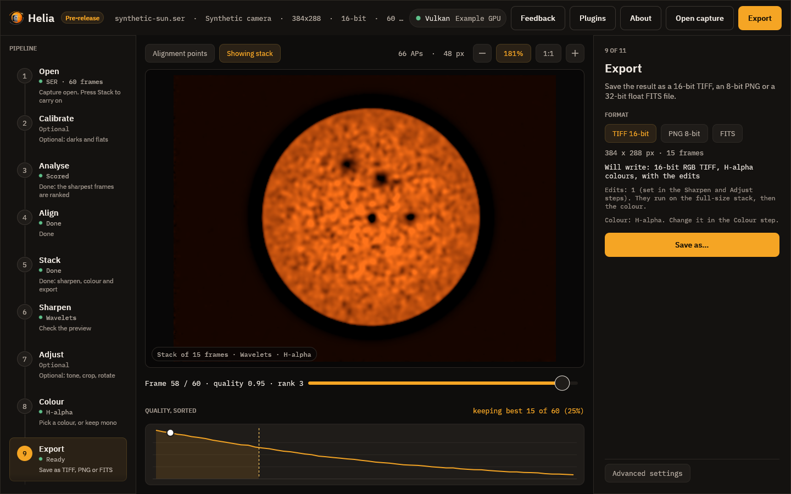

# Quick start

A few steps take you from a capture to a sharp, coloured, shareable picture:
**open the file**, press **Stack with recommended settings**, then **look at the
sharpening, choose a colour and export**. Helia works out the rest. This page shows the desktop app first,
then the command line. You need Helia built or installed as described in
[Installation](installation.md).

## Have a capture ready

Use a SER or uncompressed AVI file of the Sun (or, with the optional ffmpeg
installed, an MP4), ideally a few hundred frames or more. [Capturing for Helia](capturing.md) explains how to record a good one.

**Put the filter in the file name.** Helia reads the name of the file, the
folder it is in, the SharpCap sidecar and the SER header for the filter, and
recommends settings for it: `2026-10-19_Sun_Ha_001.ser`, `CaK_session/capture.ser`
and `sodium-d.avi` are all recognised. Part of a word does not count, so
`Hampshire` is not H-alpha. If Helia cannot tell, it asks once. The words it
looks for are in [Colourising](colourising.md#how-the-filter-is-recognised).

No capture to hand? From a source checkout you can write a synthetic one (a
made-up sun with known blur and shifts, 400 frames, 320 by 288 pixels):

```sh
cargo xtask sample synthetic-sun_Ha.ser
```

It is a way to try the tools, not a picture of the real Sun. The `_Ha` in the
name makes Helia treat it as an H-alpha capture.

## With the desktop app

Start the app, optionally with a file:

```sh
helia-gui synthetic-sun_Ha.ser
```

The first time, a short **Quick start** strip reminds you of these steps. Press
**Got it** and it never comes back; Helia remembers in its settings file.



1. **Open.** Press Ctrl+O (or choose **Open capture**) and pick the file, or
   drop it on the window. The **Quick stack** card appears on the right. It
   says which filter Helia found and from what, and lists the settings it will
   use: the colour channel (for colour cameras), the share of frames to keep,
   and the alignment point size for your image. If it guessed wrong, press the
   right filter; if the filter is not in the list, press **Not sure** for plain
   defaults.
2. **Stack.** Press **Stack with recommended settings**. A notice above the
   picture says what Helia is doing (scoring the frames, aligning them,
   stacking) with a progress bar and the time left, and a **Cancel** button.
   When it finishes, a message says how many frames went into the stack and how
   long it took, and then fades away.

   

3. **Sharpen.** Helia moves on to the **Sharpen** step. The recommended wavelets
   for your filter are already applied, so the picture is sharpened; press
   **Before / after** to compare it with the plain stack, drag a slider to change
   something, or press **Off** to skip it. Sharpening can create artefacts, so
   look closely; see [Sharpening and adjustments](sharpening.md).

   

4. **Choose a colour.** Next is the **Colour** step. The stack is
   shown in the colours of your filter, such as orange for H-alpha. Pick another
   look if you like, turn on **Invert** to bring out prominences, or keep it
   grey. Colour is for sharing; see [Colourising](colourising.md).

   

5. **Export.** Choose TIFF, PNG or FITS and press **Save as**, or press Ctrl+E.
   The step says exactly what will be written, such as *16-bit RGB TIFF,
   H-alpha colours, with the edits*. A FITS file is the unsharpened stack unless
   you turn on **Edit the FITS too**.

   

Every step in the rail on the left carries a one-line hint about what to do
next: *Open a capture*, *Ready: press Stack*, *Done: sharpen, colour and
export*. If you want to change a setting, the other steps hold them, and
**Advanced settings** at the foot of the right-hand panel shows the backend,
demosaic method and channel. [Using the desktop app](gui.md) describes every
control.

## With the command line

First, check Helia can read the file:

```sh
helia info synthetic-sun_Ha.ser
```

```text
file:        synthetic-sun_Ha.ser
format:      SER
size:        320 x 288
colour:      Mono
depth:       16 bit
byte order:  header flag says little-endian, pixel data decoded as little-endian
frames:      400
timestamps:  absent
```

Then stack it. With nothing but an input and an output, Helia detects the
filter, the channel and the alignment point size itself:

```sh
helia stack synthetic-sun_Ha.ser -o sun.tif
```

The output extension picks the format: `.tif` for a 16-bit TIFF, `.png` for an
8-bit PNG, `.fits` for FITS. Helia prints the choices it made, a line as each
stage starts, and then a summary. This is the real output for the synthetic
capture above, run on the CPU of a 24-thread server (`--backend cpu`); the
timings are that machine's, not a promise:

```text
input:    SER 320x288 16-bit, 400 frames
backend:  CPU (24 threads)
settings: H-alpha (from "synthetic-sun_Ha"); keep 25%, alignment points 32 px
tip:      add --colour auto for H-alpha colours
[   0.0s] scoring frames
[   0.1s] building reference
[   0.1s] aligning frames
[   0.1s] measuring alignment points
[   0.3s] stacking
[   0.3s] finishing
[   0.3s] writing
frames:  400 total, 100 kept, 200 registered
points:  123 of 399 alignment points active
disc:    centre (164.5, 146.9), radius 100.4 px
detail:  stack 0.00526 vs best single frame 0.00525 (1.00x)
timing:  scoring frames 0.06s, building reference 0.01s, aligning frames 0.03s, measuring alignment points 0.12s, stacking 0.06s, finishing 0.00s (total 0.31s)
wrote:   sun.tif
```

Reading it:

* **settings** is what Helia chose and why. A colour camera in H-alpha would
  also say `red channel`. Anything you pass on the command line (`--keep`,
  `--ap-size`, `--channel`) wins over the recommendation.
* **kept** is the number of frames that went into the stack. The default is
  the best 25 per cent (12 per cent for the photospheric filters, white light and Na D); change it with `--keep 10%` or `--keep-frames 500`.
* **registered** is how many frames were aligned. With multi-point alignment
  Helia registers twice as many frames as it keeps, so each alignment point can
  choose its own best ones. See [How stacking works](how-stacking-works.md).
* **ranking** appears only when a frame's score was raised by an artefact
  (a satellite trail, a line, hot pixels) and was put back to the level of its
  neighbours before ranking; it lists those frames, counting from 0. Nothing to
  do: see [How stacking works](how-stacking-works.md#1-ranking-the-frames).
* **points** is how many alignment points were bright and detailed enough to
  measure.
* **detail** compares the sharpness of the stack with that of the best single
  frame (a synthetic capture has nothing to sharpen, so it reads 1.00x), and
  **timing** gives the time of each stage.

`--quiet` hides the stage lines, the progress bar and the summary.

The file is greyscale. To colour it for your filter, add `--preset`, which also
applies the filter's recommended channel and frame share:

```sh
helia stack synthetic-sun_Ha.ser -o sun-ha.tif --preset ha
helia stack cak.ser -o cak.png --preset cak --invert
helia presets                      # the presets and what each does
```

`--preset` colours `.tif` and `.png` output. A `.fits` file stays mono and
unaltered; the preset is noted in its header. See
[Colourising](colourising.md) for what each look is and why.

Useful variations:

```sh
helia stack sun.ser -o sun.fits --keep 10%     # fewer, better frames, FITS output
helia stack sun.ser -o sun.tif --ap-size 48    # smaller alignment points
helia stack sun.ser -o sun.tif --backend cpu   # force the CPU
helia stack sun.ser -o sun.tif --quiet         # no progress bar, no summary
```

Add `--sharpen wavelet` to sharpen the stack with the recommended values for the
filter (and `unsharp`, `rl` or `none`); it runs on the mono stack before any
colour. A FITS file stays the unsharpened stack unless you add `--sharpen-fits`.
`helia edit` sharpens and adjusts an image that already exists. See
[Sharpening and adjustments](sharpening.md). The full list of options is in
[The command line](cli.md) and the [CLI reference](../reference/cli.md).

## What next

* Sharpen well, and know the risks: [Sharpening and adjustments](sharpening.md).
* Understand the colours and the presets: [Colourising](colourising.md).
* Record a better capture: [Capturing for Helia](capturing.md).
* Understand the settings: [How stacking works](how-stacking-works.md).
* Something not right: [Troubleshooting and FAQ](troubleshooting.md).
