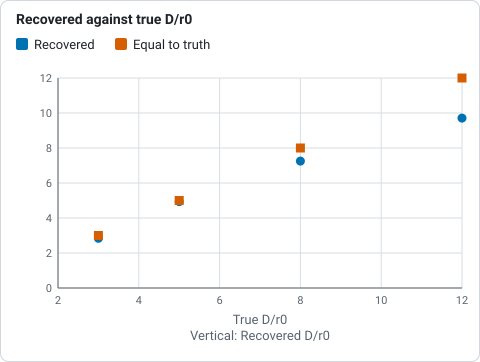
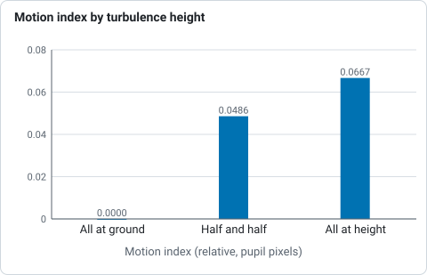
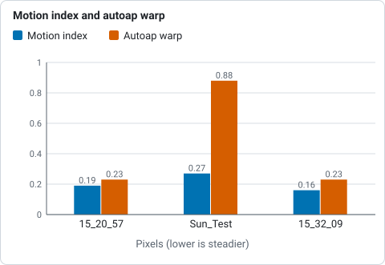
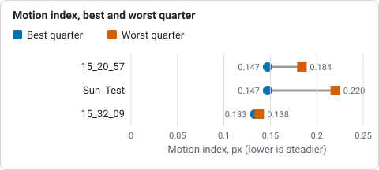
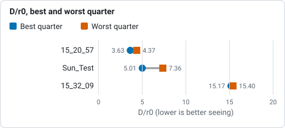

# Seeing estimation

Helia can estimate the seeing from the capture itself, with no reference star
(#49). It gives two
numbers that answer different questions:

* **`r0`, the Fried parameter, from the spectral ratio.** An absolute figure: the
  diameter of the patch of atmosphere over which the wavefront is flat to about
  a radian, at the capture's wavelength and scaled to 500 nm. `D / r0` (the
  aperture over `r0`) says how many seeing cells the telescope looks through, and
  with it how rare a lucky frame is. It needs the telescope aperture.
* **A motion index from the alignment points.** A relative figure: how much
  neighbouring alignment points move against each other from frame to frame.
  It needs nothing but the capture, and is **not** an absolute `r0`.

Switch it on with `--seeing` (add `--aperture-mm 150` for `r0`), `seeing` and
`aperture_mm` in an API job, or set the telescope aperture under *Advanced
settings* in the app (the Stack step then shows a seeing line). It reads about
120 more frames, spread evenly over the capture, after the stack: about two
seconds on the project's captures. The result is printed after the stack, written
into the FITS header (`SEEMOTPX`, `SEEMOTAS`, `SEEDR0`, `SEER0500`, `SEEGRADE`)
and returned by the API as `summary.seeing`.

```text
$ helia stack Sun_Test.ser -o sun.fits --preset na --seeing --aperture-mm 80
...
seeing:  followed 16 tiles of 64 px through 120 frames spread over the capture
seeing:  motion index:   0.274 px (0.59 arcsec) RMS differential motion per axis between points 72 px (154 arcsec) apart (14 pairs); relative, not r0
seeing:  spectral ratio: D/r0 8.2, r0 1.0 cm at the capture's wavelength, 0.8 cm at 500 nm (18 rings, 16 tiles, tiles differ by 25%)
seeing:  note:           a 64 px tile spans 138 arcsec, more than one isoplanatic patch (a few arcseconds); the method is validated for one transfer function per tile, so r0 is indicative and no grade is given
seeing:  note:           the cut-off (1.42 cycles/px) is above the sampling limit, so fine detail is aliased and the r0 is indicative; a scale of 0.76 arcsec per pixel or finer avoids it
```

(The aperture here is a guess: the project's captures do not say what telescope
they were taken with.)

## The spectral ratio

For an object that does not change during the burst, the Fourier transform of a
tile of frame `k` is `F_k = O S_k`: the object's transform times the transfer
function of that frame's atmosphere and telescope. Average over the frames, once
aligned, and the ratio `|<F>|^2 / <|F|^2>` equals `|<S>|^2 / <|S|^2>`. The object
cancels (von der Luehe 1984), leaving a curve that depends only on `D / r0` and on
the frequency in units of the telescope's cut-off `D / lambda`. Helia matches the
measured curve to the one a Kolmogorov atmosphere gives, which it holds as a
table made by Monte Carlo over phase screens (`cargo run --release -p helia-core
--example seeing_table`; the structure of the screens is checked against Noll's
tilt-removed variance, 0.134 (D / r0)^(5/3), to within 1%).

In practice: up to 16 tiles of 64 x 64 pixels, the ones with the most detail and
wholly inside the disc, are followed through the sample by correlation. Each tile
is cut at its integer position, the sub-pixel remainder removed in Fourier space,
and the mean transform and the mean power accumulated. The noise is measured on the
tiles (Immerkaer's estimator) and its power taken out of the denominator; the
finite-sample bias of `|<F>|^2` is taken out of the numerator. Rings of the
spectrum with a signal to noise above three, between 5% and 90% of the cut-off (and
below the sampling limit), are fitted by least squares.

The frames are a sample of **all** the frames, not the best ones: this is the
seeing of the session, not of its lucky moments.

### Validation on synthetic data

Kolmogorov phase screens, a granulation-like object, known `D / r0` and noise
(`cargo test -p helia-core seeing`):

| Test | Result |
|---|---|
| `D / r0` 3, 5, 8, 12, 160 frames, 4 tiles | recovered 2.84, 4.94, 7.25, 9.71 (-5%, -1%, -9%, -19%) |
| Object: granulation, limb, pore, `D / r0` 6 | 5.85, 5.50, 5.76: within 10% of each other |
| Noise 0.02 and 0.05 (of a mean of 1), estimated or known | 6.03 and 5.67 for a truth of 6 |
| The same atmosphere at 656 nm and 393 nm | `r0` at 500 nm 17.9 and 19.6 cm: within 10% |
| Cut-off at twice the sampling limit, aliased | 5.25 for a truth of 5 |
| Two independent patches in a tile | 3.92 for a truth of 4 (one patch: 3.86) |



*D/r0 recovered from Kolmogorov phase screens of known D/r0 (160 frames, 4 tiles), from the validation table above.*

It loses sensitivity as `D / r0` grows (above about 12 only the lowest frequencies
carry any signal, and the estimate reads low); the report says so.

### What limits it on real data

* **The aperture must be right.** It sets the cut-off, and `r0` is `D` over the
  fitted `D / r0`. A wrong aperture gives a wrong `r0` in proportion.
* **Sampling.** When the telescope's cut-off `D / lambda` is above 0.5 cycles per
  pixel (for 80 mm at 589 nm, a scale coarser than 0.76 arcsec per pixel) detail
  aliases. The synthetic test above shows aliasing does not by itself spoil the
  estimate, but the report says so as a caution.
* **Tile size.** The method assumes one transfer function per tile, that is a tile
  within the isoplanatic patch, a few arcseconds in daytime. A 64 pixel tile is
  that only at about 0.1 arcsec per pixel or finer. When a tile spans more than 15
  arcseconds (a scale coarser than 0.23 arcsec per pixel) the report gives `r0` as
  indicative and no grade, because it has not been validated there: the
  simulation above covers only the limiting case of independent patches, and real
  neighbouring patches are partly correlated.
* **Few frames.** Under 40 frames the report makes no `r0`.
* **The object must not change** during the burst. Granulation evolves in minutes;
  a capture of a minute or two is fine.

### The grade

From `r0` at 500 nm: 10 cm or more is *excellent*, 7 to 10 *good*, 4 to 7 *fair*,
2.5 to 4 *poor*, under 2.5 *bad*. These are day-time solar thresholds, not a
standard.

## The alignment point motion index

Tip and tilt of the whole frame (and tracking error and wind shake) move every
patch of the Sun together, so they cancel when the shifts of two neighbouring
alignment points are subtracted. What remains is the differential image motion,
which turbulence causes (Scharmer and van Werkhoven 2010). Helia takes the tiles
above, measures their shift in each of the sampled frames, subtracts neighbours
(points up to one and a half grid spacings apart), removes each pair's mean
difference (the static offset between the reference and the scene) and takes the
RMS of what is left, per axis, in pixels and in arcseconds.

It is a **relative** index, for comparing captures taken through the same optics
at the same scale. The patches look through the atmosphere at different field angles,
so it depends on how high the turbulence is: for the same `r0`, turbulence at 5 km
gives more differential motion than turbulence at the ground. On synthetic phase
screens at `D / r0` 6, with tiles 16 pupil pixels apart at height:

| Where the turbulence is | Index |
|---|---|
| All at the ground | 0.0000 |
| Half at the ground, half at height | 0.0486 |
| All at height | 0.0667 |



*Motion index of synthetic phase screens at D/r0 6, by where the turbulence is, from the table above.*

and for turbulence at height it grows monotonically with `D / r0` (3 to 12) with a
log-log slope of 0.83, the 5/6 the theory gives for the RMS of a differential
tilt.

## On the real captures

The motion index of the whole of each capture (a sample of 120 frames; the fourth
capture is too blocky to lock tiles):

| Capture | Index | Pairs | Autoap's warp |
|---|---|---|---|
| `15_20_57.ser` (2.16 arcsec/px) | 0.19 px, 0.41 arcsec | 18 | 0.23 px |
| `Sun_Test.ser` (2.16 arcsec/px) | 0.27 px, 0.59 arcsec | 14 | 0.88 px |
| `15_32_09.avi` (4.31 arcsec/px) | 0.16 px, 0.69 arcsec | 26 | 0.23 px |
| `14_42_57.avi` | not enough points locked | | 1.59 px |



*Motion index of the whole capture (120 frames) beside the warp `--ap-auto` measures, from the table above; 14_42_57 has no index.*

The ranking agrees with the warp `--ap-auto` measures on a different principle (the
spread of a point's shift about its frame's median).

The independent check on the real data: the quarter of the frames the stacker
ranks sharpest (a half for the 100-frame capture) should read as better seeing than
the quarter it ranks worst, in the same capture. `cargo test -p helia-core --test
seeing_real` with `HELIA_REAL_DATA` set (Na D, green channel, 240 frames, the
aperture taken as 80 mm, so only the comparison means anything):

| Capture | Motion index, best / worst | `D / r0`, best / worst |
|---|---|---|
| `15_20_57.ser` | 0.147 / 0.184 px | 3.63 / 4.37 |
| `Sun_Test.ser` | 0.147 / 0.220 px | 5.01 / 7.36 |
| `15_32_09.avi` | 0.133 / 0.138 px | 15.17 / 15.40 |



*Motion index of the quarter of frames ranked sharpest and of the quarter ranked worst, on three captures, from the table above.*



*D/r0 of the quarter of frames ranked sharpest and of the quarter ranked worst, on three captures, from the table above.*

Both rank the best frames as the better seeing on all three captures. On
`15_32_09.avi` the difference is small (a few per cent): the capture is short and
steady.

The absolute values are not to be trusted on these captures: at 1.4 to 4.3 arcsec
per pixel a 64 pixel tile is 90 to 280 arcsec wide, far beyond an isoplanatic
patch, and Helia says so and gives no grade. The method is meant for scales near
0.1 arcsec per pixel; on a capture like that `--seeing --aperture-mm` is the one to
use. There is no such capture in the test set yet, so the absolute `r0` is
validated on synthetic data only.

## Using it

* To compare nights or settings with the motion index: same telescope, same scale,
  same filter.
* For `r0` and `D / r0`: give the aperture, use a scale of 0.1 to 0.3 arcsec per
  pixel, and expect a grade.
* To choose how many frames to keep: the lower `D / r0` is, the larger the share of
  good frames (Fried 1978). `D / r0` under 4 makes a high keep share (25% or more)
  reasonable; above 10, keep fewer. Automatic keep share from this number is future
  work.

## Sources

* von der Luehe, O. (1984), JOSA A 1(5), 510-519: estimating Fried's parameter from
  a time series of an arbitrary resolved object imaged through atmospheric
  turbulence.
* Scharmer, G. B. and van Werkhoven, T. I. M. (2010), A&A 513, A25: S-DIMM+ height
  characterisation of day-time seeing using solar granulation.
* Noll, R. J. (1976), JOSA 66, 207: Zernike polynomials and atmospheric turbulence.
* Immerkaer, J. (1996), Computer Vision and Image Understanding 64, 300: fast noise
  variance estimation.
* Lane, R. G., Glindemann, A. and Dainty, J. C. (1992), Waves in Random Media 2,
  209: simulation of a Kolmogorov phase screen.
