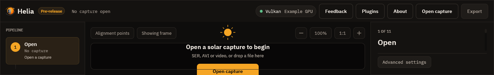
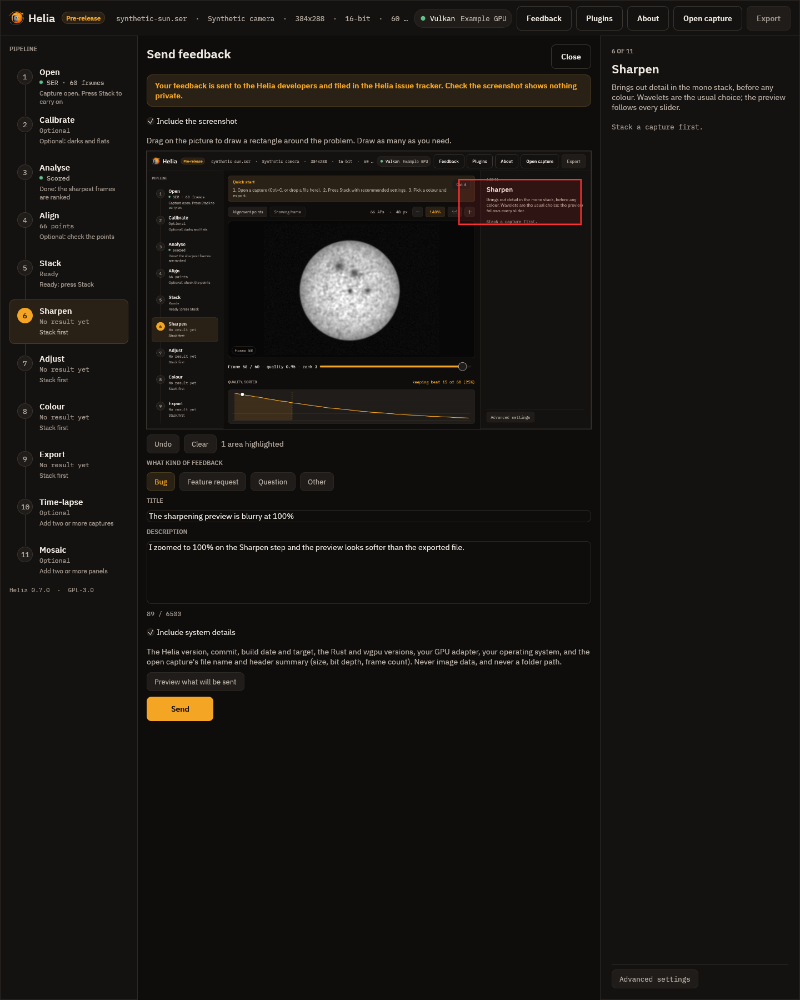
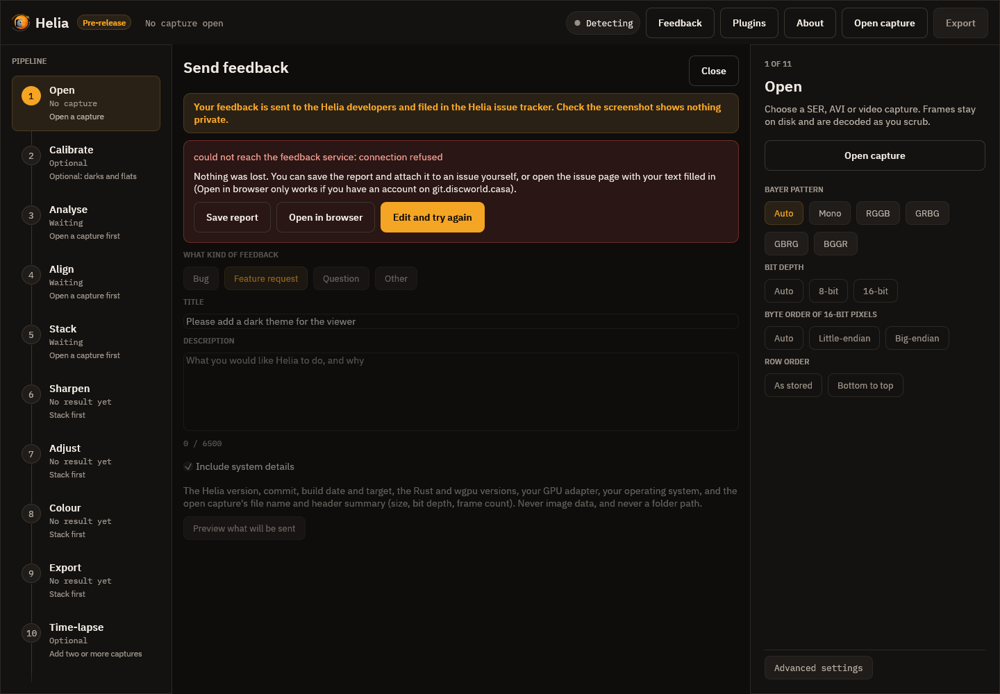

# Sending feedback

Helia is a pre-release, and the quickest way to make it better is to tell us what
is wrong or missing. There is a **Feedback** button in the top bar, at every step,
and a matching command for people without a display.



## Privacy first

* **Nothing is sent until you press Send.** Opening the page, drawing on the
  screenshot and typing send nothing, and nothing you type is saved to disk.
* **Helia has no telemetry.** It never sends usage, crash or error reports of its
  own accord. The only network request Helia ever makes about feedback is the one
  you start with Send (or with `helia feedback`).
* **It goes to the Helia developers.** Your feedback is sent to them and filed in the Helia issue
  tracker (github.com/qisback/helia), which may be visible to more people
  than the developers, now or later. Look at the screenshot before you send it: it is a picture
  of the Helia window, and the window can show the file name of your capture, your
  GPU and anything else on the screen inside it. Untick **Include the screenshot**
  if in doubt.
* **You see exactly what will be sent.** **Preview what will be sent** shows the
  report as text and the screenshot with your rectangles on it.
* **System details are optional and limited.** If you tick **Include system
  details**, the report carries the Helia version, commit, build date and target,
  the Rust and wgpu versions, your GPU adapter, your operating system, and the open
  capture's file name and header summary (size, bit depth, frame count). It never
  carries image data, a folder path, your name, a host name or an address.

## In the app

Press **Feedback** in the top bar, or Ctrl+Shift+F. (The About page has a **Send
feedback** button too. F1 still opens the About page.) Helia takes a picture of its
own window and then shows the feedback page in place of the viewer.



1. **Highlight the problem.** Drag on the screenshot to draw a rectangle round it.
   Draw as many as you need; **Undo** removes the last, **Clear** removes them all.
   If the screenshot would show something private, untick **Include the
   screenshot**.
2. **Choose the kind**: Bug, Feature request, Question or Other.
3. **Write a title** (one line, up to 120 characters) and a **description** (up to
   6500 characters; the rest of the 8000 is kept for the system details).
4. **Decide about system details** and look at **Preview what will be sent**.
5. Press **Send**.

Sending runs in the background and the window stays usable. A notice says
**Preparing your feedback** (Helia asks the service for a small puzzle and solves
it, which takes well under a second; it keeps casual spam out) and then **Sending
your feedback**, with a **Cancel** button. When the service has filed the issue
the page shows its number as a link, and a notice confirms it.

Press Esc or **Close** to leave the page; what you typed is kept until you send it
or quit.

### When the service cannot be reached

If the feedback service is down, busy or unreachable, or you are offline, nothing
is lost. The page says what happened and offers:



* **Save report** writes a `.zip` with `report.json` (including your highlights as
  numbers), `screenshot.png` (the screenshot with your rectangles drawn on) and
  `screenshot-clean.png`. Attach it to an issue yourself, or send it to the author.
* **Open in browser** opens the project's new-issue page with the title and text
  already filled in. It only works if you have an account on github.com, and the screenshot
  cannot be attached from here, so attach `screenshot.png` from the saved report.
* **Edit and try again** returns to the form.

### A bug report for an issue

If you would rather open an issue yourself, **Save bug report** on the About page
writes a `.zip` of text only (version, GPU, the open capture's header, settings and
the end of the log) to attach to it. See
[Log file and bug report](gui.md#log-file-and-bug-report).

## From the command line

```sh
helia feedback --kind bug --title "Stack fails on my AVI" \
    --description "Fails at the alignment stage with ..." \
    --screenshot problem.png --highlight 40,60,200,120 --system-info
```

`--kind` is `bug` (the default), `feature`, `question` or `other`. `--description -`
reads the text from standard input. `--screenshot` takes a PNG (check it first: it is
filed in the issue tracker) and `--highlight x,y,w,h` draws a rectangle on it, in the
screenshot's pixels; give it more than once for more rectangles. `--system-info`
adds the version, commit, target and operating system. `--dry-run` prints exactly
what would be sent and sends nothing. If the service cannot be reached,
`--save report.zip` keeps the report, and the command prints the pre-filled
new-issue address. See the [CLI reference](../reference/cli.md#helia-feedback).

## Changing the service address

Normally you do not need to. For a private or test service, set the environment
variable `HELIA_FEEDBACK_URL`, or put `feedback_url=https://...` in the app's
[settings file](gui.md#settings-file), or use `--url` on the command line. The
variable wins over the file, and `--url` wins over the variable. The address must be HTTPS (plain HTTP only for
`localhost`).

## For developers

The wire format, the proof of work and the answers are in the
[feedback protocol](../reference/feedback-protocol.md).
