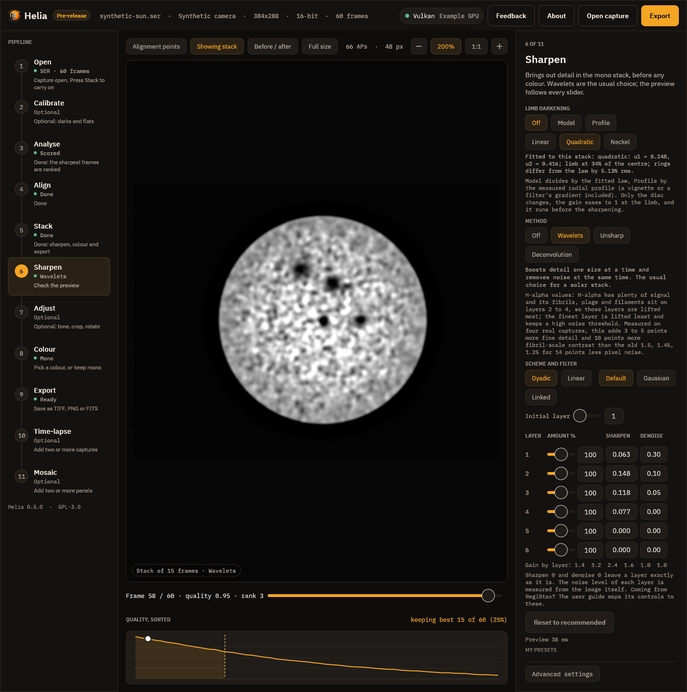
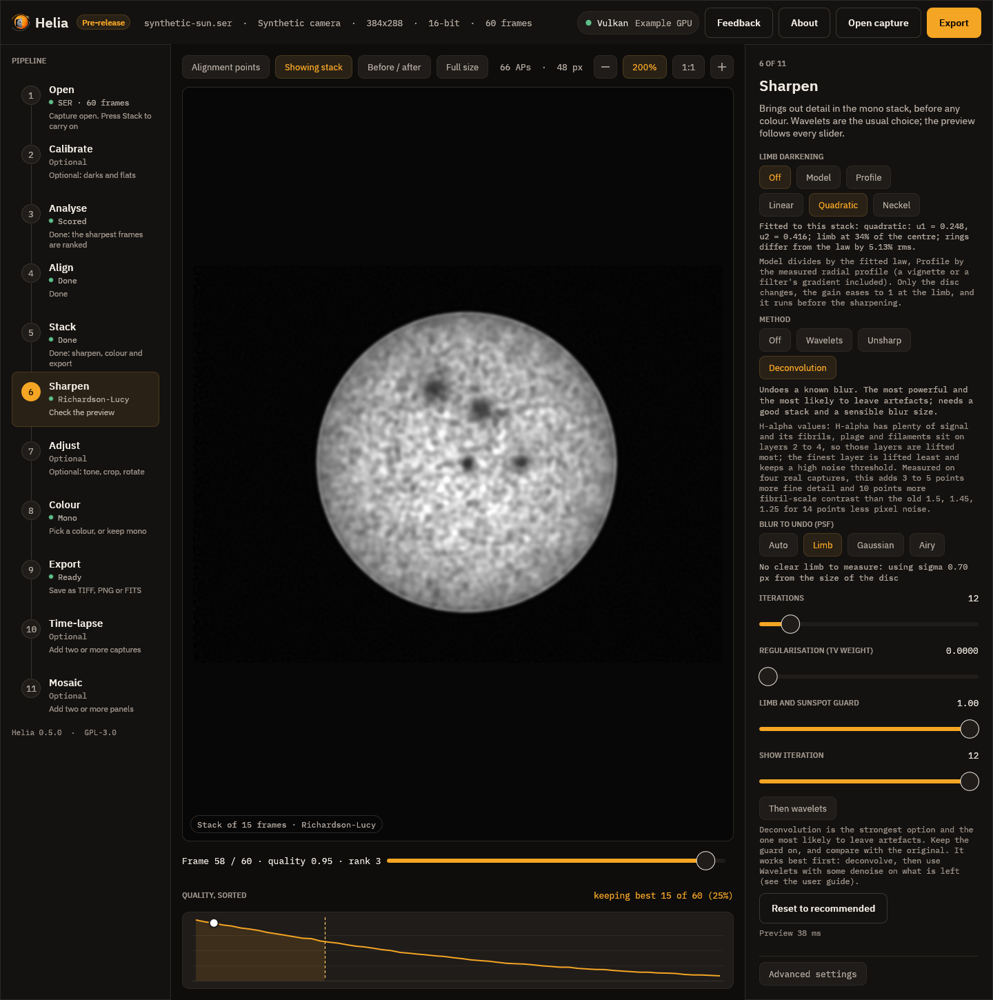
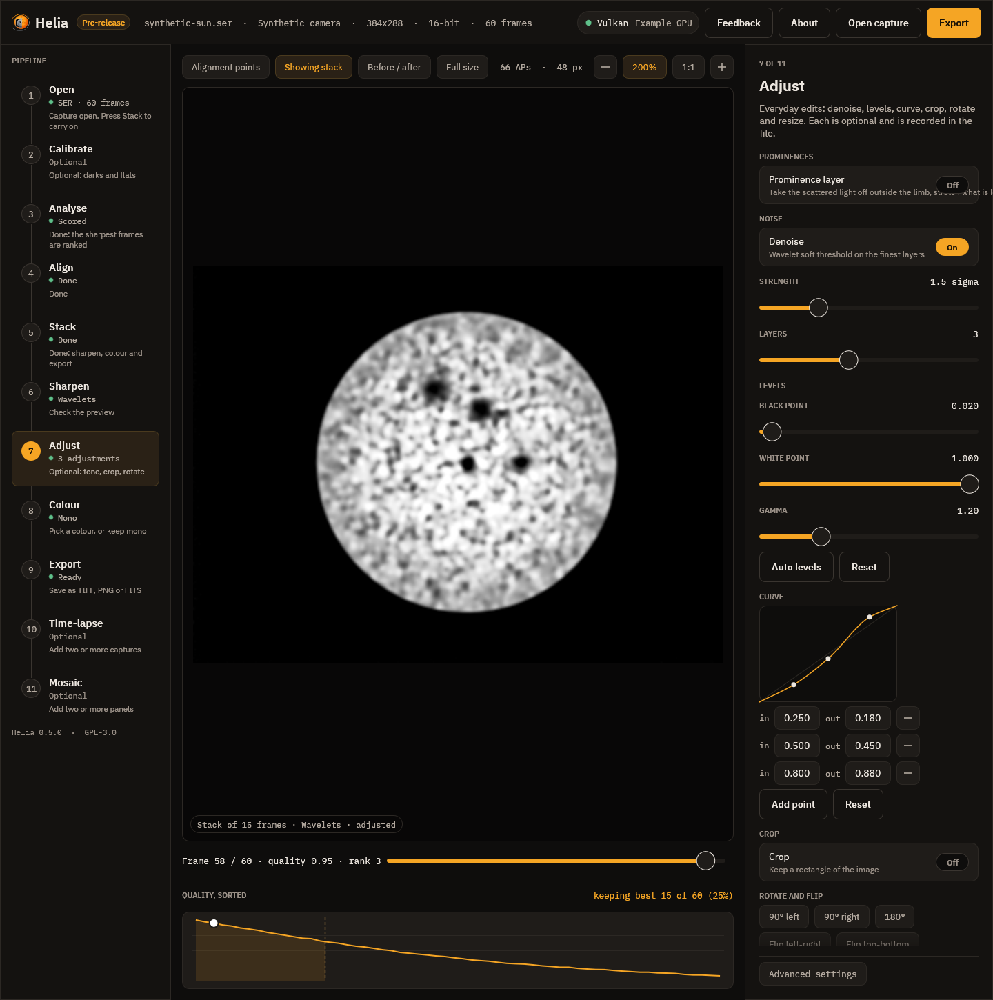

# Sharpening and adjustments

A stack is cleaner and smoother than any single frame, but it is not as sharp as
the telescope could be. Sharpening brings the fine detail back. Helia offers
three methods, each with recommended values for your filter, and a set of
everyday adjustments: denoise, levels, a curve, crop, rotate, flip and resize.

Everything here is **non-destructive**. The stack is never changed. Your choices
are an ordered list of operations that Helia applies to the stacked image: on a
shrunk copy for the live preview, and on the full-size stack when you export. The
list is written into the output file, so a picture always says how it was made.

Sharpening runs on the **mono stack, before colour**. Detail and noise are
measurements; colour is presentation, and is applied to the sharpened image
afterwards (see [Colourising](colourising.md)).

> **Sharpening can create artefacts.** Every method can draw halos beside bright
> edges, ring around the limb and round sunspots, turn noise into a texture that
> looks like detail, and make a soft image look processed. None of them can add
> detail the telescope and the seeing did not record. Use **Before / after** to
> compare, and ease off as soon as the picture starts to look different in kind
> rather than just crisper. If the recommended values look overdone for your
> capture, they are overdone: turn them down.

## Which method

| Method | What it does | Reach for it when | Risk |
|---|---|---|---|
| **Wavelets** (the default) | Splits the image into layers by detail size (an a-trous transform), lifts or lowers each layer, and removes what is not clearly above the noise in each | Almost always: it sharpens fine and medium detail and keeps noise down at the same time | Low if the noise cuts are set; noise turns to grain if they are zero |
| **Unsharp mask** | Adds back a share of the difference between the image and a blur of it | You want a light, predictable touch, or one size of detail | Halos beside sharp edges at high amounts |
| **Deconvolution** (Richardson-Lucy) | Undoes a known blur, the point spread function (PSF), by repeated correction | The stack is good, the blur is about the same everywhere and you want the best the data can give | The most: ringing, speckle and over-sharpening. The limb guard (below) controls the worst of it |

## Wavelets

The image is smoothed repeatedly with a small kernel (the a-trous, or "with
holes", transform), the taps spread further apart at every step. The difference
between two steps is a **layer**. Layer 1 holds the finest detail and most of
the noise; layer 2 fine detail such as granulation and fibrils; each higher layer
larger structure. This is the transform behind RegiStax, and the controls are
modelled on RegiStax 6, so a user of that program is at home: see
[Coming from RegiStax](coming-from-registax.md) for the mapping and
[Sharpening like RegiStax](../recipes/sharpening-like-registax.md) for a worked
example on a real capture.



### The controls

| Control | What it does | Range | Default |
|---|---|---|---|
| **Dyadic / Linear** | How the layer size grows. Dyadic: 1, 2, 4, 8, 16, 32 pixels. Linear: the initial size plus the step for each layer | | Dyadic |
| **Default / Gaussian** | The smoothing kernel: the B3 spline, or a Gaussian (smoother layers; the usual choice with denoise) | | Default |
| **Linked** | Each layer works on the result of the finer ones, so sharpened fine detail carries into the larger layers. Stronger; needs more denoise | | off |
| **Initial layer** | Where the first slider sits in the scheme. 2 skips the pixel-scale noise layer | 1 to 8 | 1 |
| **Step** (Linear) | Pixels added to the layer size for each layer; 0 keeps every layer at the initial size | 0 to 8 | 1 |
| **Amount %** (the layer slider) | How much of the layer's sharpen and denoise is applied. More than 100 pushes further | 0 to 200 | 100 |
| **Sharpen** | The boost: gain = 1 + amount/100 x 100 x sharpen x abs(sharpen) | -0.1 to 1 | 0 |
| **Denoise** | The noise cut: detail weaker than 10 x denoise x amount/100 noise sigmas is removed from the layer | 0 to 1.5 | 0 |

The gain of each layer is shown under the grid. Every control has a numeric box
you can type into, and the preview follows each one.

* **Gain.** 1 leaves the layer alone, above 1 sharpens it, below 1 softens it.
  The sharpen scale is quadratic: at an amount of 100% a sharpen of 0.14 is a
  gain of 3, 0.25 a gain of 7, 0.5 a gain of 26 and 1 a gain of 101, so the
  10x to 100x that a soft stack sometimes needs is there, and 0.1 to 0.25 (what
  RegiStax tutorials use) gives a firm result with fine control.
* **Noise cut.** Detail weaker than this many noise sigmas is taken to be noise
  and removed before the boost. 0 keeps everything. The noise level of each layer
  is measured from the image itself, from the median absolute deviation of the
  layer (a few bright features do not move it), so the cut follows your capture
  rather than a fixed number.

A layer with a sharpen of 0 and a denoise of 0 is left exactly as it is: with
every layer at its neutral setting the result is the input, bit for bit. On the
CPU and the GPU the result is the same to float rounding (the GPU parity tests
cover the schemes, both filters and the linked layers).

### How to work

Work from the layer that matters most to the one that matters least. On a solar
stack that is layer 2 (fibrils, granulation), then layer 3, then layer 1 (which
carries the noise), and leave the coarse layers alone unless the picture is
flat. For each layer raise **Sharpen** until detail appears, then raise
**Denoise** until the noise goes. Stop when the picture starts to look
processed. Press **1:1** in the toolbar to look at 100%. Use **Before / after**
to check you are not inventing structure.

## Unsharp mask

The **radius** (a Gaussian sigma in pixels) is the size of the blur that is
subtracted, so it picks the size of detail that is boosted. The **amount** is how
much of the difference is added back: 0.6 is gentle, 2 strong. The **threshold**
leaves detail weaker than it alone, so noise is not boosted.

## Deconvolution

Richardson-Lucy deconvolution estimates the sharp image that, blurred by the PSF,
gives the stack you have, by repeating a multiplicative correction. Helia adds
**total-variation (TV) regularisation** (Dey et al., 2006), which keeps noise
from being amplified into speckle.

* **Blur to undo (PSF).** *Limb* (the default) measures the blur from the edge of
  the Sun in the stack (a Gaussian fitted to the limb profile, the pixel width
  taken out; it falls back to *Auto* when there is no clear limb). *Auto* is a Gaussian sized from the image scale: Helia
  measures the radius of the disc in pixels, from that works out the arc seconds
  per pixel, and assumes a stack that is about 2 arc seconds across at half
  maximum. It never goes below 0.7 pixel, because a smaller blur is below the
  sampling and there is nothing to recover. *Gaussian* is the same shape with a
  sigma you choose, for seeing and a slightly soft focus. *Airy* is the
  diffraction pattern of a circular aperture, for a sharp, steady image through a
  small telescope; give the radius of its first dark ring in pixels (on the
  command line, `airy-scope:656,100,0.9` works it out from the wavelength in
  nanometres, the aperture in millimetres and the pixel scale in arc seconds).
* **Iterations.** More is sharper and noisier; stop when noise starts to look
  like texture.
* **Regularisation (TV weight).** 0 to 0.05, default 0. On the real stacks it
  raised the noise it was meant to hold, so it is off by default.
* **Show iteration.** A preview scrub: the result after k iterations (0 is the
  original). The export runs all of them.
* **Then wavelets.** Follow the deconvolution with the wavelet settings. See
  [Deconvolution](../recipes/deconvolution.md) for the order and the noise warning.
* **Limb and sunspot guard.** Deconvolving a bright edge leaves a bright halo
  inside it and a dark one outside; the solar limb and the edge of a sunspot are
  the worst cases. For every pixel the guard measures how large a step lies
  within reach of the blur, as a share of the image's range, and where that is
  large (the limb, an umbra) it holds the result inside the range of the
  original image around that pixel. A true sharpening of an edge has its values
  on the two sides of the edge, so the edge still steepens, but a halo beyond
  them cannot form. Granulation and filaments, which have little contrast, are
  untouched. The guard is on by default; its strength runs from 0 (off) to 1.

How well the guard works is measured, not asserted. On a synthetic limb (a flat
disc on dark sky, blurred by a Gaussian of sigma 2 pixels, with noise, then
deconvolved for 30 iterations) the largest excursion beyond either plateau within
12 pixels of the limb is 16.7% of the step without the guard and 1.1% with it.
Round a synthetic sunspot of the same blur the figures are 10.9% and 1.9%. The
test suite fails if the guarded figures reach 2%.

## Recommended values for each filter

The values come with the filter presets and follow the same rule as the rest of
the recommendations: a safe starting point, never the last word. Faint lines
(Ca II K and H, He I D3, H-beta) are noisy, so they get higher noise cuts, gentler
gains and a shorter deconvolution. White light has the most signal and the finest
structure, so it takes the strongest settings. H-alpha sits between, with its
fibrils on layers 2 and 3.

The two photospheric filters, white light and Na I D, are tuned for granulation.
It sits on layers 2 and 3 at a few per cent contrast, so those layers get the
largest gains and no noise cut (a cut there removes granulation with the noise,
which is how the 0.2.0 defaults lost it); the finest layer keeps its cut so pixel
noise is not boosted. See [White-light granulation](../recipes/white-light-granulation.md),
which also shows how to measure the result with `helia measure`.

| Filter | Wavelet gains, layers 1 to 6 | Noise cuts, layers 1 to 6 | Unsharp amount | Deconvolution iterations |
|---|---|---|---|---|
| H-alpha | 1.40, 3.20, 2.40, 1.60, 1, 1 | 3.0, 1.0, 0.5, 0, 0, 0 | 0.60 | 12 |
| Ca II K and H | 1.70, 2.80, 2.00, 1.40, 1, 1 | 3.0, 1.5, 0.8, 0.2, 0, 0 | 0.45 | 8 |
| Mg I b | 1.60, 2.80, 2.00, 1.40, 1, 1 | 2.5, 1.2, 0.6, 0, 0, 0 | 0.50 | 10 |
| Na I D | 1.50, 2.60, 2.00, 1.30, 1, 1 | 2.0, 0, 0, 0, 0, 0 | 0.50 | 10 |
| He I D3 | 1.50, 2.40, 1.80, 1.30, 1, 1 | 3.0, 1.5, 0.8, 0.2, 0, 0 | 0.40 | 8 |
| H-beta | 1.50, 2.40, 1.80, 1.30, 1, 1 | 3.0, 1.5, 0.8, 0.3, 0, 0 | 0.45 | 8 |
| White light | 2.00, 2.80, 2.20, 1.30, 1, 1 | 1.0, 0, 0, 0, 0, 0 | 0.80 | 20 |
| Not recognised | 1.50, 2.60, 2.00, 1.40, 1, 1 | 3.0, 1.2, 0.6, 0, 0, 0 | 0.60 | 12 |

These are gains and noise cuts, the engine terms of the table in
[Coming from RegiStax](coming-from-registax.md#how-a-slider-value-turns-into-a-result).
In the app they appear as a sharpen and a denoise at an amount of 100%: a gain of
3.2 is a sharpen of 0.148, a noise cut of 3 a denoise of 0.30. The H-alpha and
Ca K values were re-tuned on real captures (see below) because the first ones, a
gain of 1.2 to 1.5 on the fine layers, left a stack visibly soft: the 1 to 4 pixel
band rose by about a quarter; it now roughly doubles. The Mg, Na, He, H-beta and
white-light values have no real capture to tune on and follow the same lift;
they are a starting point.

The unsharp radius follows the image scale (1.4 times the default blur, between 1
and 3 pixels). The full table, with the thresholds, TV weights and denoise
strengths, is generated from the code: see
[Colour presets](../reference/presets-table.md).

## Limb darkening

The disc is brighter at the centre than at the limb, because the line of sight
reaches a cooler, shallower layer there. With `mu` the cosine of the angle from
the local vertical (`sqrt(1 - (r/R)^2)` at radius `r` on a disc of radius `R`),
the brightness relative to the centre is a law `L(mu)`:

| Law (`--limb-law`) | `L(mu)` | Coefficients |
|---|---|---|
| `linear` | `1 - u (1 - mu)` | `u` |
| `quadratic` (default) | `1 - u1 (1 - mu) - u2 (1 - mu)^2` | `u1`, `u2` |
| `neckel` | `1 - sum a_k (1 - mu^k)`, k = 1 to 5 | `a1` to `a5` |

**The fit.** Helia fits the law to the azimuthal median of the stack, in rings
one pixel wide about the fitted disc centre, out to 97% of the radius (the limb
itself is blurred by the seeing). A median ignores sunspots, granulation,
filaments and plage, which cover a minority of each ring. The sky level just
outside the limb is subtracted first. The fit is linear in the coefficients and
exact; the five-term form has a light ridge, because the powers of `mu` are
nearly collinear and the rings barely determine five numbers (compare the law,
not the terms). Every `helia stack` prints it and the API returns it:

```text
limb:    quadratic: u1 = 0.470, u2 = 0.046; limb at 48% of the centre; rings differ from the law by 0.67% rms
```

`helia measure image.fits --limb` fits all three laws to an existing image and
prints the measured profile beside them. The fit measures the image, not the
Sun: an uncorrected vignette, a radial gradient from an etalon, or a disc that
is cut by the frame all read as limb darkening. Flats
([Calibration](calibration.md)) remove the first; the last is the reason for the
partial-disc row below.

**Flatten.** `--flatten model` (or the **Model** chip in the Sharpen step) divides
the disc by the fitted law; `--flatten profile` divides it by the measured
profile itself (smoothed over a few rings), which also removes any other radial
gradient. It runs first in the list, before denoise and sharpening, so the
wavelets and deconvolution see flat contrast and a gain set for the centre is
right at the limb too. It works on `helia edit` as well, and as an edit
`{"op": "flatten", "source": "model", "law": "quadratic"}` in a preset or an API
job. What it leaves alone:

* Everything outside the limb: prominences have their own brightness, which has
  nothing to do with the photosphere's darkening.
* The last 1.5% of the radius: the gain eases to 1 there. The limb is a blur of
  disc and sky, and a gain of two or three would turn it into a bright rim.
* The bright end of the disc: the gain is scaled so the 99.9th percentile of the
  disc is where it was. Dividing out the darkening brightens the limb side, and an
  image with a brighter side (the etalon sweet spot in these captures) would
  otherwise clip at white.

With no clear disc (a cropped region) the edit leaves the image alone, and the
`limb:` line says so. A flat disc is for looking and for sharpening and
compositing; the stack itself and the FITS file are not flattened unless you ask
(`--sharpen-fits` applies the edits to FITS too).


The picture is a synthetic capture; the fit under the chips is the one made on
that stack.

### What the real captures say

The four captures of 2022-07-17 (ASI482MC) were taken for sodium, but the owner
has since said `15_32_09.avi` is H-alpha, and the other two whole-disc captures
show the same scene and prominence, so these are H-alpha (656.3 nm) read through
the green plane, where the red is clipped. `14_42_57.avi` is broad band. Fitted
with `helia measure --limb`:

| Capture | Disc | Linear `u` | Quadratic `u1`, `u2` | Limb level (linear, quadratic) | Rings off the law (quadratic) |
|---|---|---|---|---|---|
| `Sun_Test.ser` | whole | 0.539 | 0.546, -0.012 | 46%, 47% | 0.71% |
| `15_20_57.ser` | whole | 0.497 | 0.470, 0.046 | 50%, 48% | 0.67% |
| `15_32_09.avi` | whole | 0.555 | 0.515, 0.070 | 44%, 41% | 0.79% |
| `14_42_57.avi` | 63% of the limb | 0.720 | 0.710, 0.018 | 28%, 27% | 3.58% |

The five-term fit of the three whole discs gives `a1` = 0.44 to 0.45, `a2` = 0.04
to 0.14, `a3` = 0.02 to 0.04, `a4` = -0.001 to 0.07, `a5` = -0.10 to -0.08, with
the limb at 47% to 52% of the centre.

Against the literature, as far as it could be checked from the sources
available while writing this (the Neckel and Labs 1994 coefficient table itself
was not available, so the five-term values are not compared):

* Allen's Astrophysical Quantities (Cox 2000), as quoted for the Sun at 550 nm:
  quadratic `u1` = 0.47, `u2` = 0.23, a limb at 30% of the centre.
* The linear coefficient is 0.56 at 600 nm and 0.95 at 320 nm (Tatum, Stellar
  Atmospheres, chapter 6); darkening is weaker towards the red.

That passage was written for sodium, and the numbers are H-alpha's, so the
comparison below is with a continuum that H-alpha is not: the line is formed in
the chromosphere, where the darkening is weaker. The fits sit where a red band
puts them.
The linear coefficient of the three whole discs (0.50 to 0.56) brackets the 0.56
at 600 nm, and the quadratic `u1` of `15_20_57.ser` (0.470) is the 0.47 of the
550 nm table. The limb is brighter than at 550 nm (41% to 48% against 30%),
which is the direction a redder band predicts. Caveats on all of this: `u2` is
poorly determined (it is -0.012 on one capture and 0.23 in the table) because
`u1` and `u2` trade against each other when the rings stop at `mu` = 0.24; a
narrow line image is not a continuum, and the D lines are formed higher than the
continuum, so line-core darkening differs from continuum darkening; the cameras
are not radiometrically calibrated and the captures are not flat-fielded; and
the green channel of a colour camera is a broad band. The partial disc
(`14_42_57.avi`) is outside what the method supports: the rings are not full
circles, the fitted radius is larger than the frame and the fit is a poor one
(3.6% rms), so its coefficients are not a measurement of anything.

### Limb darkening per band, from the 2026-10-20 captures

Quadratic fits of the unsharpened stacks (`helia measure --limb`); the
`mu` columns are the measured profile (share of the centre):

| Band | Capture, plane | Disc | Linear `u` | `u1`, `u2` | mu 0.5 | mu 0.3 |
|---|---|---|---|---|---|---|
| H-alpha | `15_37_19.avi`, green | whole | 0.495 | 0.584, -0.155 | 0.761 | 0.660 |
| H-alpha | `15_32_09.avi`, green | whole | 0.552 | 0.503, 0.087 | 0.731 | 0.613 |
| H-alpha | `Sun_Test.ser`, green | whole | 0.537 | 0.545, -0.014 | 0.742 | 0.623 |
| H-alpha | `15_20_57.ser`, green | whole | 0.498 | 0.471, 0.046 | 0.761 | 0.650 |
| Ca K | `15_36_42.avi`, brightest plane | whole | 0.435 | 0.345, 0.156 | 0.791 | 0.678 |
| Ca K | `15_44_48.avi`, mono | partial (centre 1513, 421; R 935 px) | 0.428 | 0.293, 0.235 | 0.797 | 0.678 |
| White light | Seestar MP4, green | whole | 0.612 | 0.463, 0.263 | 0.704 | 0.547 |

The two Ca K captures, from different cameras, agree to 0.005 at mu 0.3 and 0.01
at mu 0.5 although their `u1` and `u2` differ (the same trade-off between the two
terms as above); that agreement is the evidence they are the same band, and it
is how `15_36_42.avi` was told from white light. All three planes of the colour
capture give the same profile (mu 0.3: 0.676, 0.676, 0.685 for the three planes), where broad band
light would darken blue much more than red. The fit
radius reads the red plane's halo: on H-alpha it is 0.1 to 0.6 per cent larger
than on green, so use the green profile. The white-light profile is the steepest
(0.55 at mu 0.3), as a continuum should be, but it is an MP4 with the app's tone
map, so treat it as indicative.

Flattening `15_20_57.ser` with either source takes the fitted linear
coefficient from 0.497 to -0.000 (model) and 0.000 (profile), with the rings
0.74% and 0.35% off a flat line (the profile removes the whole radial gradient,
the model only the law). The granulation does not move: the granulation band of
`helia measure` is 2.050% before, 2.052% with the model and 2.049% with the
profile, the fine band 1.573%, 1.572% and 1.571%. This capture also has a bright
patch on one side that is not radial (the filter's sweet spot); flattening leaves
it, as it should, and the bright-end scaling is what stops it clipping.

## Adjustments

The **Adjust** step holds the everyday edits. Each is optional and each is
recorded in the file.

* **Denoise.** A wavelet soft threshold on the finest layers: strength is the
  threshold of layer 1 in noise sigmas, and each coarser layer gets less. On
  flat sky it lowers the noise a good deal; across a sharp edge it leaves the
  contrast alone (see the tests, below). It runs before sharpening.
* **Levels.** A black point, a white point and a gamma. Above gamma 1 the
  mid-tones are brighter. **Auto levels** sets the points to the 0.1% and 99.9%
  points of the stack. Levels never lower a darker pixel below a lighter one,
  and between the two points they can be undone exactly.
* **Curve.** A tone curve through up to 16 points, drawn as a monotone cubic, so
  it never overshoots between the points and never makes a darker input brighter
  than a lighter one. In the app you click the plot to add a point, drag a point
  to move it and double-click it to remove it; with the plot focused, `[` and `]`
  choose a point and the arrow keys nudge it. A dragged point stops at its
  neighbours (0.005 apart in input, and between their outputs), which is what keeps
  the curve rising. See [Editing the curve](gui.md#editing-the-curve).
* **Crop.** A rectangle, in pixels. Exact.
* **Rotate and flip.** Quarter turns and mirrors move whole pixels and are
  exact. Other angles are interpolated (Lanczos-3) and enlarge the canvas to hold
  the whole picture; the corners are filled with the level of the image border.
* **Resize.** A scale from 10% to 400%. Shrinking averages exactly the area each
  new pixel covers; enlarging interpolates with Lanczos-3.

The order is fixed: flatten (if asked), denoise, the sharpening method, levels, the curve, crop,
rotate, flip, resize. For another order, write the list by hand (see saved
presets below).

## The live preview

In the app, every slider updates the picture as you drag it. While you drag, the
preview is made from the stack shrunk by a power of two until it is at most 1280
pixels on a side, the sizes in pixels (radii, crop, the wavelet layer sizes)
shrink with it, and the wavelet layers finer than the preview can show are left
out, so a drag stays within a fraction of a second even on a large stack. When you
let go, the preview is made again at full size, so what you look at at **1:1**
(the toolbar button, 100% zoom) is the true result. It is still a close look
rather than a proof: what is written is always made from the full-size stack. Press
**Full size** in the toolbar to keep the preview at full size while you drag, which
is slower and a notice says so.

The work runs on the GPU when there is one, and on the CPU otherwise, off the
window's thread. One preview is made at a time: while you drag, the latest
position is picked up when the last render ends, so the window never queues work
it will throw away. The inspector shows how long the last preview took. Anything
slower than about a seventh of a second gets a notice, as everything else does.

**Before / after** splits the picture: the stack as it was on the left, with your
edits on the right, and a line to drag. Both halves have the same crop, rotation
and size, so they line up.


Deconvolution has a blur, iterations, noise control and the guard:



The Adjust step:



## Saved presets

**My presets**, in the Sharpen step, keeps the whole list (sharpening and
adjustments) under a name. Type a name and press **Save**; press a preset to use
it, or the minus beside it to delete it. A preset is a small readable file in
the presets folder: `$HELIA_EDIT_PRESETS` if that is set, otherwise
`%APPDATA%\helia\edit-presets` on Windows or
`$XDG_CONFIG_HOME/helia/edit-presets` (`~/.config/helia/edit-presets`) elsewhere.
For example:

```json
{
  "name": "H-alpha gentle",
  "filter": "ha",
  "edits": [
    {"op": "wavelet", "filter": "gaussian", "layers": [{"amount": 100, "sharpen": 0.09, "denoise": 0.2}, {"amount": 100, "sharpen": 0.09, "denoise": 0.1}]},
    {"op": "levels", "gamma": 1.1}
  ]
}
```

A file can also hold just the list, `[ ... ]`. Missing values take their defaults.
The app shows one operation of each kind in the fixed order; a preset with
repeats or another order is still run in full by the command line and the API.

The operations are objects with an `op` of `unsharp` (`radius`, `amount`,
`threshold`), `wavelet` (`layers`, each with `amount`, `sharpen` and `denoise`; `scheme`
`dyadic` or `linear`; `initial`; `step`; `filter` `default` or `gaussian`; `linked`;
the older `gain` and `threshold` of a layer are still read),
`deconvolve` (`psf`, `iterations`, `tv`, `protect`; the `psf` is
`{"kind": "auto"}`, `{"kind": "gaussian", "sigma": 1.6}` or
`{"kind": "airy", "radius": 2.2}`), `denoise` (`strength`, `layers`), `levels`
(`black`, `white`, `gamma`, `out_black`, `out_white`), `curve` (`points`, each
`[in, out]`), `crop` (`x`, `y`, `width`, `height`), `rotate` (`degrees`), `flip`
(`axis`: `horizontal` or `vertical`) and `resize` (`scale`, or `width` and
`height`).

## On the command line

`helia stack` sharpens with `--sharpen wavelet`, `unsharp`, `rl` or `none` (the
default), using the recommended values of the filter; every value has a flag that
overrides it:

```sh
helia stack sun_Ha.ser -o sun.tif --sharpen wavelet
helia stack sun_Ha.ser -o sun.tif --sharpen wavelet --wavelet-gains 2.0,1.5 --wavelet-noise 2.5
helia stack sun_Ha.ser -o sun.tif --wavelets registax:l1=100/0.14/0.2,l2=100/0.13/0.15,l3=50/0.11/0.1,filter=gaussian
helia stack sun_Ha.ser -o sun.tif --sharpen unsharp --unsharp-radius 1.8 --unsharp-amount 0.9
helia stack sun_Ha.ser -o sun.tif --sharpen rl --rl-iterations 25 --rl-psf airy-scope:656,100,0.9
helia stack sun_Ha.ser -o sun.tif --sharpen wavelet --denoise --gamma 1.2 --crop 100,80,1600,900
helia stack sun_Na.ser -o sun.tif --flatten model --sharpen wavelet
helia edit stack.fits -o flat.tif --flatten profile --limb-law neckel
```

`--wavelets` takes the layers as in RegiStax 6, `registax:l1=AMOUNT/SHARPEN/DENOISE,
l2=...,scheme=dyadic|linear,filter=default|gaussian,initial=N,step=X,linked=on`;
layers you do not name are left alone, and it implies `--sharpen wavelet`. The
meaning and ranges of the numbers are in
[Coming from RegiStax](coming-from-registax.md). A flag for one method without
that method is an error that says which method to add. Lists such as `--wavelet-gains 2.0,1.5` replace the first layers and leave
the others at their recommended values.

`helia edit` applies the same operations to an image that already exists, a
TIFF, PNG or FITS, mono or colour:

```sh
helia edit stack.fits -o sharp.tif --sharpen wavelet --preset ha
helia edit sun.tif -o sun-cropped.tif --crop 200,150,1200,900 --rotate 90 --resize 50%
helia edit stack.fits -o again.tif --edits "H-alpha gentle"
helia edit stack.fits -o x.tif --sharpen rl --save-edits "My deconvolution"
```

`--edits` takes the name of a saved preset or a path to a `.json` file, and the
other flags are added after it. `--save-edits` keeps the resulting list as a
preset. A colour image is edited channel by channel and stays colour. When the
image is mono, `helia edit` prints how much finer detail the edits gave it and
what they did to the noise (see below).

## In the API

A job's `config` takes `sharpen` (`wavelet`, `unsharp`, `rl` or `none`, with the
filter's recommended values) and `edits`, a list of operations in the form above,
applied after `sharpen`, and `wavelets`, the same RegiStax-style text as the
command line's `--wavelets`, which replaces the recommended layers. See
[The API](api.md#sharpening-and-edits).

## What the files say

The edits are recorded, in words and as the list itself, so that a file says how
it was made and the edit can be repeated:

| File | Where the note is |
|---|---|
| TIFF | the `ImageDescription` tag |
| PNG | the `Description` text chunk |
| FITS | `HISTORY` cards in the header |

The note reads, for example: *Helia edits, applied in order to the stack (2
operations); sharpening runs on the mono stack before any colour*, then
*1. wavelet sharpen, 6 layers, gains 1.50,1.45,..., noise thresholds ...*, and
last *Helia edit list (JSON):* followed by the whole list as JSON.

**FITS is the unsharpened stack by default.** A FITS file is for further
processing and measurement, so Helia writes the stack as it is and says so in the
header; the edits go into TIFF and PNG. If you want the sharpening in the FITS
file too, ask for it: the **Edit the FITS too** switch in the Export step,
`--sharpen-fits` on the command line, or `"sharpen_fits": true` in a job. The
file then holds the edited mono image, and its header says so.

## Does it work?

The tests check the claims on synthetic images where the truth is known:

* **Deconvolution recovers detail.** A synthetic sun with granulation and
  sunspots, blurred by a Gaussian of sigma 1.8 pixels with noise: after 25
  iterations the root-mean-square error against the clean truth falls from 0.0349
  to 0.0163 (the test requires below 80% of the start). The same with an Airy
  blur: from 0.0180 to 0.0044.
* **The limb guard holds.** See the figures above.
* **Wavelet layers at gain 1 and noise cut 0 return the input exactly.**
* **Levels and curves** rise monotonically for every valid setting, and levels
  undo exactly between their black and white points.
* **Crop, rotate, flip and resize** move the right pixels: a quarter turn
  clockwise sends the top-left corner to the top-right, four turns return the
  original, and halving averages 2 by 2 blocks.
* **Denoise** lowers the noise on flat regions from 0.0202 to 0.0048 (the test
  requires under 60% of the start) while the contrast of an edge goes from 0.401
  to 0.390 (the test requires above 95%).
* **The GPU agrees with the CPU** on every operation, within 1e-4 for the filter
  operations and 2e-3 after 12 iterations of deconvolution (see
  [The GPU parity rule](../developer/gpu-parity.md)).

### On real captures

Four captures of the Sun from 2022-07-17 (a ZWO ASI482MC; the files are not in
the repository, and Helia could not tell their filter from the names, so the
generic recommended values apply) were stacked with the defaults, written as FITS
(the unsharpened stack), and then sharpened by each method with its recommended
values. The figures are from the `helia edit` summary. *Detail* is Helia's
existing sharpness metric, the gradient energy of the image after a 2 pixel
Gaussian smoothing, as a ratio to the stack; *noise* is the median-based sigma of
the finest wavelet layer, which is mostly noise, before and after.

| Capture | Wavelets: detail, noise | Unsharp mask: detail, noise | Deconvolution: detail, noise |
|---|---|---|---|
| `15_20_57.ser`, 1920 x 1080, 16-bit, 100 frames | 1.25x, 0.00028 to 0.00001 | 1.03x, 0.00028 to 0.00028 | 1.03x, 0.00028 to 0.00028 |
| `15_32_09.avi`, 720 x 540, 8-bit, 1000 frames | 1.25x, 0.00036 to 0.00010 | 1.03x, 0.00036 to 0.00036 | 1.03x, 0.00036 to 0.00039 |
| `14_42_57.avi`, 1920 x 1080, 8-bit, 630 frames | 1.22x, 0.00031 to 0.00008 | 1.03x, 0.00031 to 0.00031 | 1.02x, 0.00031 to 0.00200 |
| `Sun_Test.ser`, 1920 x 1080, 8-bit, 631 frames | 1.24x, 0.00679 to 0.00001 | 1.04x, 0.00679 to 0.00835 | 1.02x, 0.00679 to 0.00777 |

What it says:

* **Wavelets** raise the detail metric by about a quarter on all four and take
  most of the noise out of the finest layer at the same time. With the
  white-light values the gain is 1.29x to 1.32x. (After a noise cut the
  median-based noise figure is close to zero by construction: most of the layer
  is zero.)
* **Unsharp mask and deconvolution** barely move this metric. That is partly the
  metric: it smooths by 2 pixels, and these two work below that scale (the
  default unsharp radius is 1 pixel and the automatic blur is 0.7 pixel, the
  smallest allowed). It is not only the metric, though. On `14_42_57.avi` the
  deconvolution raises the finest-layer noise six-fold. This was first put down to
  a fixed pattern of the sensor (faint vertical stripes), and
  [Calibration](calibration.md#does-it-work) measures it: the sensor does have
  stripes, but they grow by 5% under deconvolution, while the share of the energy
  above 0.3 cycles per pixel goes from 2% to 70%. So the rise is broadband noise at
  the finest scale, which no dark or flat removes, and a calibration estimated from
  the capture itself did not change it. Look at the picture, not the number, and
  take the wavelets.

On these stacks the recommended wavelets are the method to start with, and
deconvolution gains little and risks a lot. That is one capture session through
one camera, not a general result.

### How fast

The live preview renders at most 1280 pixels on a side. Best of five on an NVIDIA
A100 (Vulkan) and on the same machine's 24 CPU threads (not otherwise idle),
`cargo test -p helia-gpu --test parity preview_latency -- --ignored --nocapture`:

| Edit, 1280 x 960 | CPU | GPU |
|---|---|---|
| Wavelets, 6 layers (recommended) | 25 ms | 20 ms |
| Unsharp mask | 6 ms | 7 ms |
| Denoise and levels | 21 ms | 16 ms |
| Deconvolution, 20 iterations, Gaussian blur | 433 ms | 74 ms |
| Deconvolution, 20 iterations, Airy blur | 1549 ms | 112 ms |

On the GPU every preview is within the 150 ms the sliders aim for. On the CPU the
filters are too, but deconvolution is not, and the app says so with a notice
(*Sharpening and colouring the preview*) while it works. A one-off `helia edit`
of a 1920 x 1080 image, process start to file written, took 0.1 to 0.3 s for
wavelets on the CPU and about 1 s on the GPU (most of it opening the device),
and 0.3 to 1.4 s for deconvolution at its recommended iterations on either. The
app opens the device once and keeps it.


## Limits

* Geometry (crop, rotate, flip, resize) always runs on the CPU; it costs next to
  nothing beside a filter.
* Deconvolution handles one PSF for the whole image. Seeing that changes across
  the disc is handled by the alignment points of the stack, not here.
* An Airy blur is limited to a first dark ring of 6 pixels; wavelet transforms
  to 8 layers; curves to 16 points; a list to 64 operations.
* The preview approximates the export (see above); it is not a bit-exact
  rehearsal of it.
