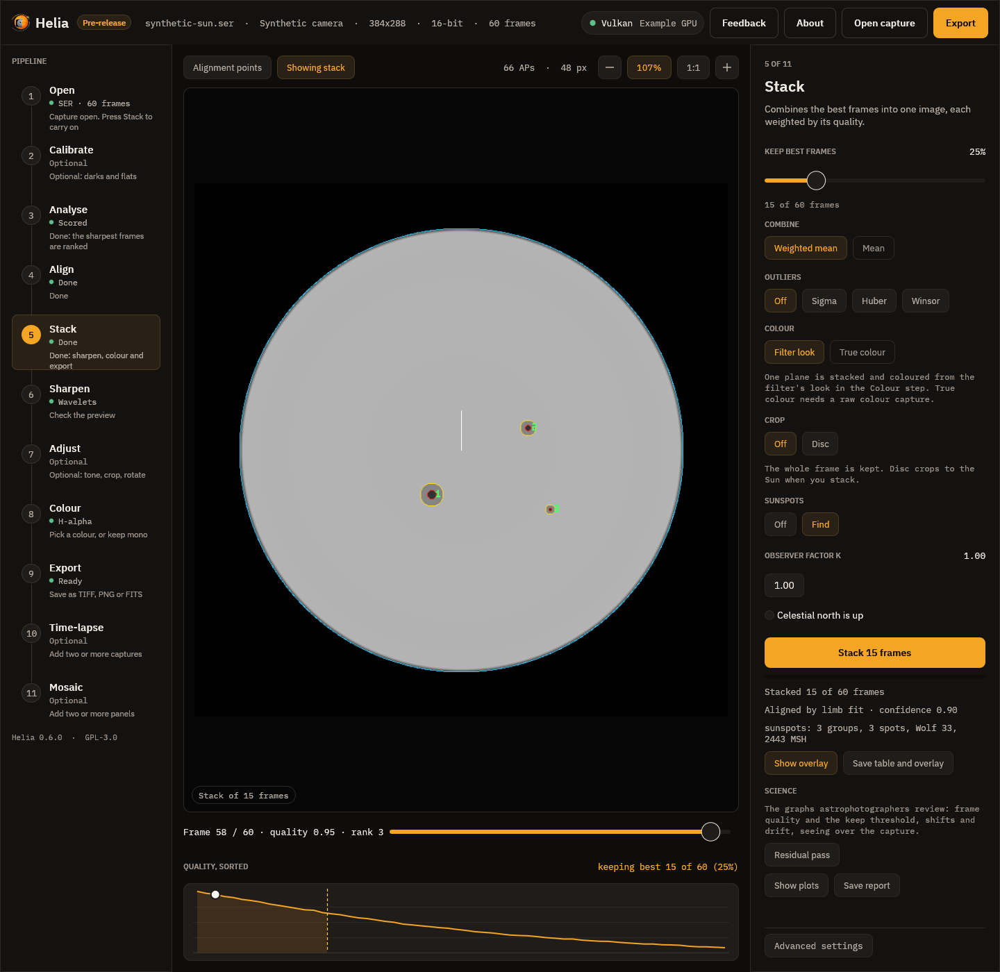

# Sunspots, groups and the Wolf number

Helia can find the sunspots on a white-light stack, group them, count them and
measure their areas
(#57). It gives:

* the **number of groups** `g` and of **individual spots** `s`;
* the relative **Wolf number** `R = k (10 g + s)`, with the observer factor `k` you
  set (1 is the raw count);
* each spot's **area** in millionths of the solar hemisphere (MSH), as seen and
  **corrected for foreshortening**, and its **umbra** alone;
* each spot's and group's **position** on the Sun: latitude, central meridian
  distance and, when the capture has a time, Carrington longitude;
* an **overlay picture**: the flattened disc with the penumbra (yellow) and umbra
  (red) outlined, the limb (cyan), the group numbers (green) and an arrow to solar
  north.

It is for white light, with the whole disc in the frame. In H-alpha or calcium
the contrast of a spot is different and the filaments and plage give false spots;
the thresholds below mean nothing there.



## Using it

```text
$ helia sunspots stack.tif --date 2025-09-17T16:14:00 --csv spots.csv --json spots.json --overlay spots.png
file:        stack.tif
image:       1080 x 1920
disc:        centre (554.5, 980.8), radius 401.7 px
time:        2025-09-17T16:14:00.000 UTC
7 groups, 14 spots; Wolf number 84.0 (k = 1)
area 1218 millionths of the hemisphere corrected (795 as seen), umbra 380
P 24.49, B0 7.16, L0 247.82 degrees
group 1: 1 spot, 1 umbra, lat +33, L 174, 326 MSH (98 as seen)
...
spot group    x     y    lat   cmd   lon    mu umbrae  as seen corrected umbra (MSH)
   1     1   229   778 +32.5 -73.8 174.0  0.30      1       98       326         114
```

* On a stack as it is made: `helia stack capture.ser -o sun.fits --sunspots`
  (white-light captures; the time comes from the capture). The table, JSON and
  overlay are saved beside the output as `sun-sunspots.csv`, `.json` and `.png`, the
  summary is printed, and a FITS output carries it in its header.
* On any stacked image: `helia sunspots image.tif`. The time comes from
  `--date` (UTC, `2025-09-17T16:14:00`), from the frame stamps of the capture the
  image was made from (`--capture file.ser`), or from the `DATE-AVG` or
  `DATE-OBS` card of a FITS file.
* In the API: `"sunspots": {}` in a job's `config`; see [The API](api.md).
* In the app: the **Sunspots** chips in the Stack step. After the stack the step
  shows the count, **Show overlay** puts the overlay in the viewer, and **Save table
  and overlay** writes the CSV, JSON and PNG.

## How it works

1. **Flatten.** The limb darkening is fitted and divided out
   ([Sharpening](sharpening.md)), so one threshold means the same thing at
   the centre and near the limb. The disc centre and radius come from the same fit.
2. **Quiet level.** The image is smoothed a little (a Gaussian of about a pixel per
   400 px of disc radius). The quiet-Sun level at each pixel is the mean of the
   surrounding disc (a box 40% of the radius across) with the dark and the bright
   pixels left out, found in four passes that tighten from 60% to 93%. A gradient the
   flattening cannot remove (a vignette, a thin cloud, a one-sided filter) is then
   not read as spot. "Dark" below means a share of this local level, above the sky.
3. **Penumbra and umbra.** A pixel darker than the penumbra threshold (0.88 by
   default) is spot; a spot's pixels darker than the umbra threshold (0.55) are its
   umbra. 0.88 and 0.55 are the middle of a typical penumbra (0.75 of the
   photosphere) against the photosphere and of an umbra (0.3) against the penumbra,
   because a blurred edge sits half way. They are the options `--sunspot-penumbra`
   and `--sunspot-umbra`.
4. **Spots.** Connected regions (eight-neighbour) of at least 4 pixels and 2 MSH are
   spots. Each umbra of 2 pixels or more counts as one individual spot for the Wolf
   number, and a region with no umbra (a pore) counts as one.
5. **Groups.** Two spots whose edges are closer than 3 degrees on the Sun
   (`--sunspot-group-gap`) are in one group, and the grouping is transitive. The edge
   of a spot is taken as a circle of the spot's own corrected area about its centroid.
   This is not the Zurich classification, and the Wolf number depends on how groups
   are drawn: it is a relative figure.
6. **Foreshortening.** A pixel at a distance `u` from the disc centre, in radii, is
   `1 / mu` of its picture area on the Sun, with `mu = sqrt(1 - u^2)`. Helia sums
   `1 / mu` over every pixel of the spot, so a spot that spans a lot of the disc is
   treated correctly. The hemisphere is `2 pi R^2` pixels, so one MSH is
   `R^2 pi / 500000` pixels (1.6 pixels at a radius of 500). The corrected area is
   what the spot really covers; "as seen" is what it covers in the picture.
7. **Position.** The pixel position, the disc centre and radius and the orientation
   give a point on the disc; with `B0` (the tilt of the Sun's axis towards us) that
   is a heliographic latitude and a longitude from the central meridian. With the
   capture time `L0` makes it a Carrington longitude.

Spots nearer the limb than 97% of the radius are not measured: the limb fit and the
flattening are least certain there, and a pixel is foreshortened by more than four
to one. A dark region larger than 6000 MSH (the largest groups ever recorded are
about that size, `--sunspot-max-area`) is left out with a note: it is a cloud, a
vignette or an uneven flat, not a spot.

## Time, orientation and the Sun's axis

`P` (position angle of the Sun's axis), `B0` and `L0` come from the Sun's position at
the capture time, from the low-precision series of Meeus, *Astronomical Algorithms*,
chapters 25 and 29 (good to about 0.01 degree; checked against the book's worked
example). The time is the mean of the frame stamps of the frames that were stacked
(SER files have them), else the header's start time. Without a time `B0` is taken as
0 and longitudes are measured from the central meridian only; the report says so.

Helia does not know how your camera sits on the sky. By default solar north is taken
to be up. If it is not:

* `--north-angle DEG` turns solar north counter-clockwise from the top of the image
  (API `north_angle_deg`);
* `--celestial-north-up` is for an equatorial mount without a flip: solar north is
  then `P` degrees counter-clockwise from the top (the Sun's axis is `P` east of
  celestial north), and `P` is taken from the capture time;
* `--mirror` is for a mirror image (a diagonal without a flip, an odd number of
  reflections).

A wrong orientation does not change the counts or the areas, only latitude and
longitude, and so the foreshortening is unaffected too.

## The output

The CSV has one row per spot:

| Column | Meaning |
|---|---|
| `spot`, `group` | Numbers from 1; groups are numbered largest first |
| `x_px`, `y_px` | Centroid, pixels, top row 0 |
| `lat_deg` | Heliographic latitude, degrees north |
| `cmd_deg` | Central meridian distance, degrees, west positive |
| `lon_deg` | Carrington longitude; empty without a capture time |
| `mu` | Cosine of the angle from the disc centre at the centroid |
| `umbrae` | Individual spots in the region (at least 1) |
| `umbra_px`, `penumbra_px` | Pixels of umbra, and of penumbra without it |
| `projected_msh` | Whole spot as seen, MSH |
| `area_msh` | Whole spot, corrected for foreshortening, MSH |
| `umbra_msh` | Umbra, corrected, MSH |
| `darkest` | Darkest smoothed intensity inside, a share of the quiet disc |

The JSON adds the groups, the disc, the time, `P`, `B0`, `L0`, the thresholds and the
notes. The FITS header gets `SPOTNGRP`, `SPOTNSPT`, `SPOTWOLF`, `SPOTK`, `SPOTAREA`
(corrected), `SPOTPROJ`, `SPOTUMBR`, `SPOTTHRU`, `SPOTTHRP`, `SPOTP`, and the
SOLARNET observer coordinates `CRLT_OBS` (`B0`) and `CRLN_OBS` (`L0`).

## What was measured

**Known answers.** The unit tests render a limb-darkened disc with spots of known
size and heliographic position (including ones near the limb), blurred and noisy,
and check what Helia recovers: the counts are exact for isolated spots, a
spot's corrected area is within 5% of the truth and its umbra within 15% (the umbra
of the smallest, 8 pixels across, is the least sure), the latitude and central
meridian distance within 0.5 degree, a near-limb spot is seen at under 0.6 of its
corrected area, groups form and split at the separation asked for, two umbrae in
one penumbra count as two spots, and a clean disc has none. The ephemeris matches
Meeus's worked example for 1992 October 13 (`P` 26.27, `B0` 5.99, `L0` 238.63).

**A real white-light disc.** A phone video of the Sun on 2025-09-17
(`2025-09-17-161400-Solar.mp4`, 1080 by 1920, disc radius 402 px) stacked at 6, 12,
25 and 50% of the frames gives 7 groups and 14, 14, 13 and 13 spots: Wolf number 84,
84, 83 and 83. It has a dark region at the bottom of the disc (a gradient across the
frame, 37 600 MSH) which is left out by the size limit and which would otherwise
have been the biggest "group". The spot areas are 17 to 326 MSH, and a group at
central meridian distance +1.7 degrees is seen at the same size as it is corrected.
There is no reference count for that day among the captures, so the Wolf number is
not compared with the official series, which needs a calibrated `k` for each
observer and instrument.

## Limits

* The count depends on resolution and seeing: small spots and pores are missed, and
  `k` for your telescope is something to calibrate against the published series.
* White light only.
* The group definition is a distance, not the Zurich classification.
* The positions assume the image is orientated as you say (see above) and the limb
  fit is a circle, so a clipped or out-of-round disc gives a worse position.
* The Sun's ephemeris is a series good to about 0.01 degree, ignoring the minute
  between UT and terrestrial time.

## Reference: every option

| Setting | CLI | API (`config.sunspots`) | App | Range | Default |
|---|---|---|---|---|---|
| Find sunspots | `helia stack --sunspots`; `helia sunspots IMAGE` | `sunspots` (an object; `{}` for the defaults) | Stack step, Sunspots: Off / Find | on or off | off |
| Umbra threshold | `--sunspot-umbra` | `umbra` | not offered | above 0 and below the penumbra | 0.55 |
| Penumbra threshold | `--sunspot-penumbra` | `penumbra` | not offered | above the umbra, below 1 | 0.88 |
| Smallest spot (MSH) | `--sunspot-min-area` | `min_area` | not offered | 0 to `max_area` | 2 |
| Largest spot (MSH) | `--sunspot-max-area` | `max_area` | not offered | above `min_area` | 6000 |
| Group gap (degrees) | `--sunspot-group-gap` | `group_gap_deg` | not offered | 0 to 90 | 3 |
| Observer factor k | `--wolf-k` | `wolf_k` | Observer factor k (0.1 to 5) | above 0 | 1 |
| North angle (degrees, counter-clockwise from the top) | `--north-angle` | `north_angle_deg` | not offered | any | 0 |
| Celestial north is up | `--celestial-north-up` | `celestial_north_up` | Celestial north is up | on or off | off |
| Mirror image | `--mirror` | `mirror` | not offered | on or off | off |
| Time of the image (UTC) | `helia sunspots --date TIME` or `--capture FILE.ser` (a FITS file's DATE-AVG or DATE-OBS otherwise); in `stack` the capture's | the capture's | the capture's | `YYYY-MM-DDThh:mm:ss` | none |
| Outputs | `--csv FILE`, `--json FILE`, `--overlay FILE`; `stack` writes `NAME-sunspots.csv`, `.json`, `.png` | `summary.sunspots`, `GET /jobs/{id}/sunspots.csv`, `GET /jobs/{id}/sunspots.png` | Show overlay, Save table and overlay | | |

Thresholds are shares of the quiet disc's brightness above the sky after the limb
darkening is flattened. A value outside its range is `422 invalid_config` in the API and
an error on the command line.
