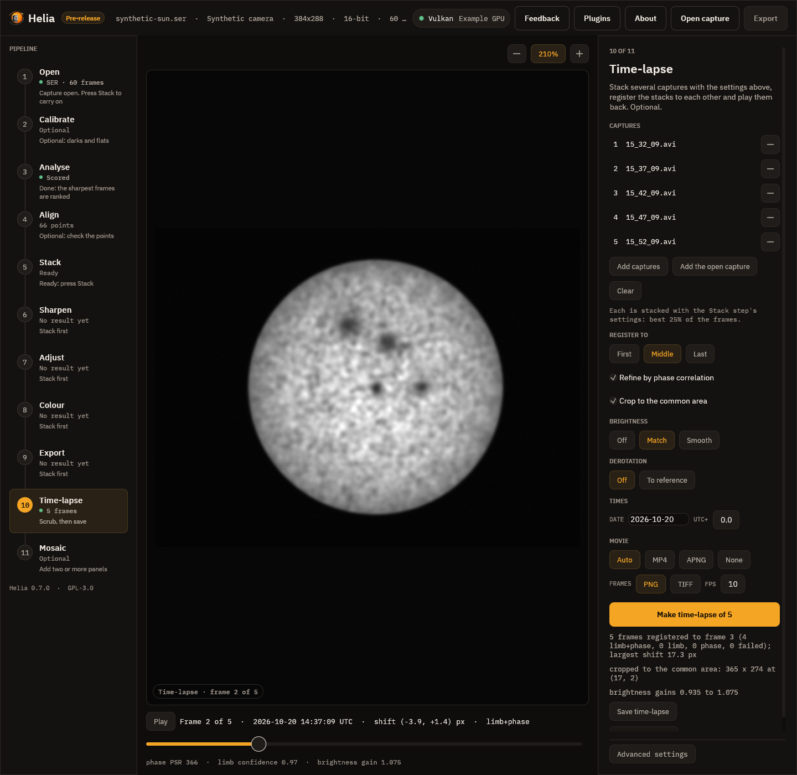

# Time-lapse

Helia can turn a series of captures of the Sun into a time-lapse
(#26). Each capture is stacked
with the same settings, the stacks are registered to each other so the disc and its
features stay still while the Sun's surface evolves, the brightness can be made even,
and the result is written as a numbered PNG or TIFF sequence and a movie. A worked
example is in [Tutorial: a time-lapse of two H-alpha captures](../tutorials/timelapse.md).



## What it does

1. **Stacks** every capture with the settings you give (on the command line, the ones
   after `--`; in the app, those of the Stack step). Nothing differs between frames
   except the capture.
2. **Puts the frames in time order** when every capture has a time (see
   [Where the times come from](#where-the-times-come-from)); otherwise it keeps the
   order you gave.
3. **Registers** each stack to a reference stack, by the limb fit and then a phase
   correlation of the disc centre (see [How the registration works](#how-the-registration-works)).
4. Optionally **derotates** the frames to one time by the Sun's differential rotation
   (see [Solar derotation](derotation.md)), **evens out the brightness** and **crops** to
   the area every frame covers.
5. **Writes** `frame-0001.png`, `frame-0002.png` and so on, a registration table
   `timelapse.csv`, and a movie: an MP4 when `ffmpeg` is installed, otherwise an animated
   PNG that Helia writes itself.

It is for full-disc captures of one camera and one telescope: every stack must be the
same size, so use the same crop (or none) for all of them.

## How the registration works

Between two captures a few minutes apart the whole picture has moved by a few to a few
tens of pixels (polar alignment, tracking and flexure), and the disc has not changed
shape. Two measurements say how far, and Helia uses both.

**The limb fit.** The edge of the disc is located along 720 rays and a circle is fitted
by iteratively reweighted least squares, so prominences, flares and spot edges do not
pull it (the method is described in [How stacking works](how-stacking-works.md)). The
difference of the two discs' centres is the shift. It does not care what is on the
disc, and it is good to about a tenth of a pixel on a clean limb. Its fit also says how
far to trust it (a confidence from 0 to 1).

**The phase correlation of the disc centre.** After the limb shift, the middle of the
disc (a square of 1.4 times the radius on a side) is correlated against the same patch
of the reference by FFT phase correlation with sub-pixel refinement. It follows the
granulation and the filaments themselves, so it removes what the limb cannot tell: an
edge pushed about by seeing, a limb pulled by a large prominence. It is added to the
limb shift only when its peak is sharp (peak-to-sidelobe ratio at least 6) and the
correction it asks for is no more than `--max-refine` pixels (3 by default); otherwise
the limb shift stands and the table says so. Switch it off with `--no-refine`.

A frame with no usable limb (the disc cut by the frame, or too faint) is registered by
phase correlation of the whole frame, which is trusted at a peak-to-sidelobe ratio of 4.
A frame for which neither works is left where it is and named in a warning and in the
table (`failed`).

The frames are moved with a Lanczos-3 kernel. A frame's edge that has nothing behind
it takes the nearest edge value, so use `--crop` for a clean frame.

Registration moves the picture; it does not turn it or change its scale. With
`--derotate` the surface of the Sun is moved too, to one time (see below); the
correlation then runs on the derotated frame, so that it follows the pointing and not the
rotation of the surface.

### Derotation

Over minutes the Sun's surface turns by a fraction of a pixel and nothing needs doing.
Over hours it is tens of pixels, differently at different latitudes. `--derotate` brings
every frame to the time of the reference frame (or `--derotate-to`) by the Sun's
differential rotation, after the limb shift and before the correlation of the disc centre,
so that features hold still as the series plays. It needs the time of every capture and a
clear limb in the reference. The method, the laws, the orientation options and the
measured effect are in [Solar derotation](derotation.md).

### Brightness

The mean over the inner disc (0.8 of the radius of the reference) is measured in every
registered frame.

* **Match** brings every frame to the median of those means. Thin cloud and
  exposure or gain changes between captures are taken out.
* **Smooth** brings every frame to the median of the means of the frames around it
  (`--deflicker-window` frames, odd, at least 3, 5 by default). Flicker goes and a slow
  change, such as the Sun climbing out of the haze, stays.

Only a gain is applied (the sky is dark in the filters Helia is for). The gains are in
the table and in the file notes. The brightness of the inner disc is the measure, so
a capture whose limb darkening differs is not made worse by it.

## Where the times come from

Times matter for the order of the frames and for the table. Each capture's time is read
from the first of these that exists:

1. a SER file's frame timestamps (the mean);
2. a FITS file's `DATE-AVG`, `DATE-OBS` or `DATE-BEG`;
3. the file name. SharpCap and others name a file after its start time: `15_32_09.avi`
   (a time of day only) or `2025-09-17-161400-Solar.mp4` (a date and a time). A name
   that holds only a time needs `--date YYYY-MM-DD`. A name's time is taken to be UTC;
   if the clock that named the files was local, give `--utc-offset HOURS` (`1` for
   British Summer Time).

An AVI has no timestamps in it. When a capture has no time, a note says so, and if any
capture in the series has none the order you gave is kept. The time of a capture named
from its start is the start, a little earlier than its middle; the error is half the
capture, and does not matter for a time-lapse.

## The command line

```sh
helia timelapse CAPTURES... -o DIR [options] [-- STACK OPTIONS]
```

```sh
helia timelapse 15_32_09.avi 15_37_19.avi -o tl --date 2026-10-20 --utc-offset 1 \
    --crop --deflicker match -- --preset ha
```

The captures can also be images that are already stacked (`.tif`, `.tiff`, `.png`,
`.fits`): they are used as they are, and nothing after `--` applies. Mix them freely.
The stacks Helia makes are kept in `DIR/stacks/` (16-bit TIFF, numbered in time
order), so a second run with `--reuse-stacks` registers again without stacking.

| Option | Meaning | Default |
|---|---|---|
| `CAPTURES...` | The captures (`.ser`, `.avi`, a video) or stacked images, one per frame; at least two | required |
| `-o`, `--output DIR` | Directory for the frames, movie, table and stacks; created when missing | required |
| `--format png\|tiff` | The numbered frames: 8-bit PNG for sharing, or 16-bit TIFF | `png` |
| `--movie auto\|mp4\|apng\|none` | `auto` is an MP4 when ffmpeg is installed, else an animated PNG; `mp4` is an error without ffmpeg; `apng` needs nothing; `none` writes the frames only | `auto` |
| `--fps FPS` | Frames a second of the movie, above 0 and up to 120 | 10 |
| `--reference first\|middle\|N` | The frame the others are registered to; `N` counts from 1 | `middle` |
| `--no-refine` | Register by the limb fit alone | refine on |
| `--max-refine PX` | Largest correction the phase correlation may make to the limb shift | 3 |
| `--deflicker off\|match\|smooth` | How the brightness is evened out | `off` |
| `--deflicker-window N` | Frames in the running median of `smooth`; odd, at least 3 | 5 |
| `--crop` | Cut every frame to the area all of them cover | off |
| `--derotate` | Bring every frame to the reference frame's time by the Sun's differential rotation; needs the time of every capture | off |
| `--derotate-to TIME` | Bring them to a UTC time instead, such as `2026-10-20T14:30:00` (implies `--derotate`) | the reference's |
| `--rotation-law LAW`, `--north-angle DEG`, `--celestial-north-up`, `--mirror`, `--raw-brightness` | The rotation law and the orientation of the images, as for `helia solar-derotate` | `howard`, 0, off, off, off |
| `--date YYYY-MM-DD` | The UTC date of the captures, for names that hold only a time of day | none |
| `--utc-offset HOURS` | Hours east of UTC of the clock that named the files; may be negative | 0 |
| `--no-sort` | Keep the captures in the order given instead of sorting them by time | sort |
| `--reuse-stacks` | Use a stack already in `DIR/stacks` instead of stacking its capture again | off |
| `-- STACK OPTIONS` | Everything `helia stack` takes except the input, the output and `--quiet`; every capture is stacked with the same ones | the defaults of `helia stack` |

The middle frame as the reference is the choice with the least total shift, so the
least cropping. Choose `first` when you want the first frame's position to stay.

It prints one line for each frame: its time, the shift that was applied, the method
and the peak-to-sidelobe ratio of the correlation.

```text
2 frames registered to frame 2 (1 limb+phase, 0 limb, 0 phase, 0 failed); largest shift 18.2 px
cropped to the common area: 698 x 530 at (2, 8)
brightness gains 0.937 to 1.073
    1 14:32:09  shift ( 17.17,  -5.94) px  limb+phase  phase PSR 180
    2 14:37:19  shift (  0.00,   0.00) px  reference
wrote 2 frames to tl (tl/timelapse.csv)
wrote tl/timelapse.mp4 (mp4)
```

### What is written

| File | Contents |
|---|---|
| `frame-0001.png`, `frame-0002.png`, ... | The registered frames, in time order. Each records its time, method, shift and gain in its description (a PNG text chunk or the TIFF `ImageDescription`) |
| `timelapse.mp4` | H.264 (or MPEG-4 part 2 when the ffmpeg build has no H.264 encoder), `yuv420p`, even sides (an odd last row or column is dropped) |
| `timelapse.png` | The animated PNG, when there is no MP4. It plays in a browser and in most viewers; one that does not shows the first frame |
| `timelapse.csv` | One row per frame: file, source stack, time, shift, method, the limb fit's centre, radius and confidence, the correlation's correction and peak-to-sidelobe ratio, the level, the gain and the most the derotation moved the surface (`derotated_px`) |
| `stacks/` | The stacks made from the captures |

A single frame has nothing to animate, so no movie is made for it.

### ffmpeg

The MP4 needs the optional `ffmpeg` program, the same one that reads MP4 and other
compressed captures (see [Installation](installation.md)). Helia finds it as it does
for reading, from `HELIA_FFMPEG` (and `HELIA_FFPROBE`) or the `PATH`. With `--movie
auto` and no ffmpeg, an animated PNG is written instead and a note says why.

## In the app

The Time-lapse step is the tenth in the rail. It works on its own list of captures, so
it does not need a capture open, but it stacks each with the settings you have chosen
in the other steps (the filter, the share of frames kept, the alignment points, the
colour plane, true colour, the crop, the edits and the colour look), so set those up on
one capture first. Choosing the filter in the Open step matters: it sets the colour
plane and the look.

| Control | What it does |
|---|---|
| **Add captures** | Choose one or more capture files, or stacked images (TIFF, PNG, FITS), which are used as they are |
| **Add the open capture** | Add the capture open in the other steps |
| **Clear**, the minus on a row | Empty the list, or remove one capture |
| **Register to** First, Middle, Last | The reference frame (`--reference`) |
| **Refine by phase correlation** | The phase correlation of the disc centre (off is `--no-refine`) |
| **Crop to the common area** | `--crop` |
| **Brightness** Off, Match, Smooth, and the Window | `--deflicker` and `--deflicker-window` (3 to 21, odd) |
| **Derotation** Off, To reference; **Law**; **Celestial north is up** | `--derotate`, `--rotation-law`, `--celestial-north-up`; see [Solar derotation](derotation.md) |
| **Date** and **UTC+** | `--date` and `--utc-offset`; the date box turns amber when it is not `YYYY-MM-DD` |
| **Movie** Auto, MP4, APNG, None | `--movie` |
| **Frames** PNG, TIFF and **FPS** | `--format` and `--fps` (1 to 60 here); the rate is also the playback rate |
| **Make time-lapse of N** | Stacks, registers and shows the series; the bar says which capture and stage. **Cancel** stops it |
| **Save time-lapse** | Choose a folder; writes the frames, the movie and `timelapse.csv` as the command line does |

When it has finished, the viewer shows the registered frames. The **frame scrubber**
under the picture moves through them (left and right arrow keys, Home and End, Shift for
ten at a time); **Play** steps through them at the chosen rate, and Space plays and
pauses. The line above the slider gives the frame's time, the shift applied and the
method; the line under it the correlation's peak-to-sidelobe ratio, the limb fit's
confidence and the brightness gain. Zoom and pan as in any other step: the registered
disc stays put as you scrub, so a frame that jumps is one that was badly registered.

The stacks made for the time-lapse use the Stack step's settings, so they move off a
clipped colour plane as `helia stack` does (the Stack step says so when a capture is
opened). A channel you chose yourself on the Channel chip under **Advanced settings** is
never changed: if a stack looks flat and white after you chose Red for an H-alpha
capture, choose Green.

## In the API

The captures are stacked by ordinary jobs, one per capture with the same `config`, and
`POST /api/v1/timelapse` registers the stacked images and writes the result; its `derotate`
object brings the frames to one time (see [Solar derotation](derotation.md)). See
[The API](api.md#post-timelapse) and the [API reference](../reference/api.md).

## Limits

* Every frame must be the same size: stack with the same crop and resize.
* The series is held in memory, with a copy while it is registered: a frame is four
  bytes a sample (three channels for colour), so a hundred 1920 by 1080 colour frames
  need about 6 GB. A mono series needs a third of that.
* At most 200 frames through the API and the app.
* No frame is dropped for being bad: a frame that cannot be registered is kept as it is
  and reported. Remove it from the list and run again if you do not want it.
* The registration is a translation. A change of scale (a different focal length or a
  big change of the Sun's distance) and a turning of the picture are not corrected. The
  Sun's own rotation is, with `--derotate`.

See also [Troubleshooting](troubleshooting.md) and the
[command line reference](../reference/cli.md).
