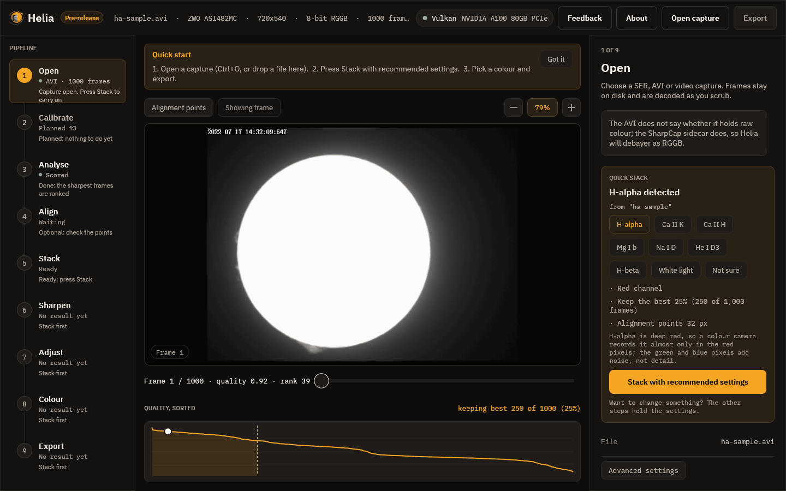
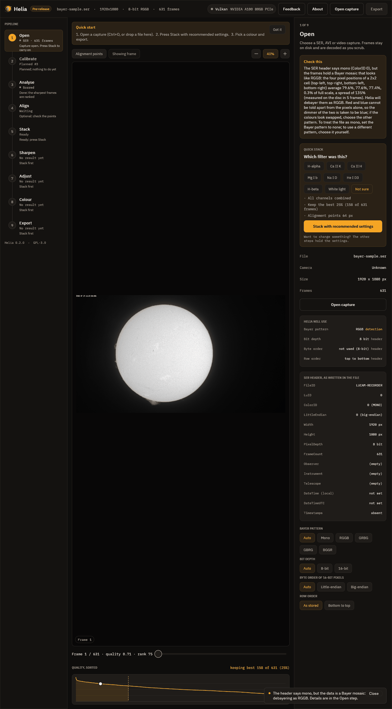

# 1. Open a capture

Press Ctrl+O, choose **Open capture** in the top bar, or drop a file on the
window. Helia reads SER and uncompressed AVI files, and with the optional ffmpeg
installed also MP4, MOV, MKV and WebM (see
[Installation](../user-guide/installation.md#optional-ffmpeg-for-mp4-and-other-video)).

While it opens, a notice above the picture says *Opening the file and indexing its
frames*. Nothing is loaded into memory: the frames stay on disk and are decoded as
you scrub.

## What you see

* **Top bar.** The Helia name with a **Pre-release** badge while the version is
  below 1.0, then the file name, the camera, the frame size, the bit depth with the
  Bayer pattern, and the number of frames (a long line is cut short with an
  ellipsis). On the right, the compute backend, then **Feedback**, **About**,
  **Open capture** and **Export**.
* **Pipeline rail** on the left: nine steps (and two optional ones, Time-lapse and Mosaic), each with its state and a one-line
  hint. Click a step to select it.
* **Viewer** in the middle: the first frame, a **frame scrubber** (drag it, or
  use the arrow keys) and the **quality curve**, every frame's sharpness sorted
  from best to worst. The dashed line marks where the frames you will keep end.
* **Inspector** on the right: the settings of the selected step. In Open it
  holds the notice about the file, the Quick stack card, the file facts and the
  overrides.

In the picture above, Helia noticed something about the file: *the header flag
says big-endian, but the pixel data only makes sense as little-endian; Helia reads
it that way.* That is a common quirk of SER files and it is handled for you. Every
such decision is written down in the notice, never made silently.

## A capture Helia recognises

Helia reads the filter from the file name, the folder, the SharpCap sidecar and
the SER header. This capture is called `ha-sample.avi`, so Helia knows it is
H-alpha and says where it got that from:

The card lists what it will use: the **red channel** (H-alpha is deep red, so a
colour camera records it almost only in the red pixels), **the best 25 per cent of
the frames** (250 of 1,000) and an alignment point size. The note above the card
says the AVI does not state its Bayer pattern but the SharpCap sidecar does, so
Helia debayers it as RGGB. If the filter's name is not in the file name, the card
asks *Which filter was this?* and you press the right one, or **Not sure** for
plain defaults, as in the first picture.

## When the header is wrong

Some recorders label a colour camera's raw frames as mono. If you stacked such a
file as it says, you would get a fine grid in the result. Helia checks the pixels
of a SER file that says mono, and when it finds a mosaic it tells you:

Read the picture from the top:

1. **Check this** explains, in words, what the file says and what the pixels say.
   Here the header says mono (ColorID 0), the pixels are an RGGB mosaic, and Helia
   will debayer as RGGB. A short message also appears at the bottom of the window.
2. **Helia will use** lists the Bayer pattern, bit depth, byte order and row order
   with where each came from: `header`, `sidecar`, `detection` or `override`.
   Anything that is not straight from the header is shown in the accent colour.
   Here the Bayer pattern is `RGGB`, from `detection`.
3. **SER header, as written in the file** shows every field exactly as stored:
   FileID, ColorID with its meaning, endianness, size, depth, frame count,
   observer, instrument, telescope, and whether times are set.
4. **The overrides**, the rows of buttons at the foot: Bayer pattern, bit depth,
   byte order and row order. Each reopens the capture with your choice, and the
   list above updates to show `override` as the source.

If Helia is right, do nothing. If you know better, press the pattern that is true
(or **Mono** if the file really is mono). If the colours come out swapped after
stacking, try the other pattern of the same family: RGGB or BGGR, GRBG or GBRG.
The recipe [Fixing a Bayer grid](../recipes/fixing-a-bayer-grid.md) covers it, and
`helia info` on the command line prints the same lists.

Overrides belong to the file: opening another capture starts again from Auto.

## Next

[Quick stack](02-quick-stack.md) is the one-button route. If you want to see each
step instead, go on to [Analyse](03-analyse.md).
