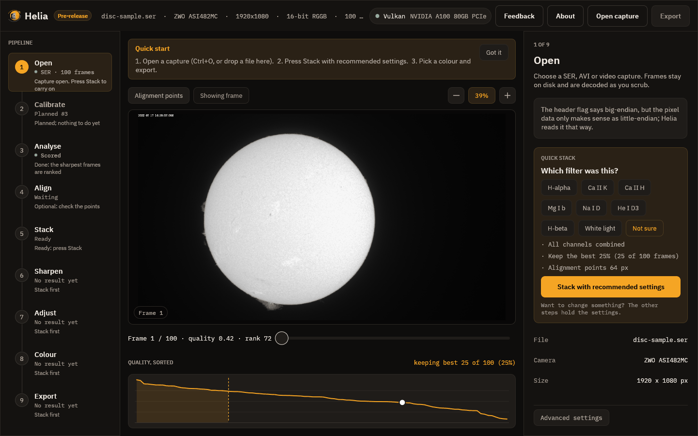

# 2. Quick stack

The **Stack with recommended settings** button on the Open step does the whole
middle of the job for you: it applies the settings on the card, scores and aligns
the frames, stacks the best of them, and moves on to Sharpen with the filter's
recommended wavelets already applied.

Use it when you want a good first picture. The rest of the steps then become a
place to adjust, not a place you must visit.

## What happens when you press it

1. A notice above the picture names the current stage, with a progress bar, the
   time left, and a **Cancel** button. The stages are *Scoring the frames*,
   *Building the reference image*, *Aligning the frames*, *Measuring the alignment
   points*, *Stacking the best frames* and *Finishing the image*.
2. When it ends, a message at the bottom right says how it went. For the full-disc
   capture: *Stacked 25 of 100 frames in 1.9 s*. For the 1,000-frame H-alpha
   capture: *Stacked 250 of 1,000 frames in 2.7 s*. (The times are those of one
   machine with a GPU, not a promise.)
3. The viewer switches to the stacked image and the **Export** button lights up.
4. Helia moves on to [Sharpen](06-sharpen.md).

If something looks wrong, the settings are in the other steps, and pressing the
button again puts the recommended settings back.

## Do I need the other steps?

Often not. The steps exist so that you can look closer when a result disappoints:

| If | Look at |
|---|---|
| Frames you expected to be best are ranked low | [Analyse](03-analyse.md) |
| The grid of alignment points sits on text or sky | [Align](04-align.md) |
| The stack is soft, or too noisy | [Stack](05-stack.md) and [Sharpen](06-sharpen.md) |
| The brightness or contrast is off | [Adjust](07-adjust.md) |
| You want colour, or want it differently | [Colour](08-colour.md) |
