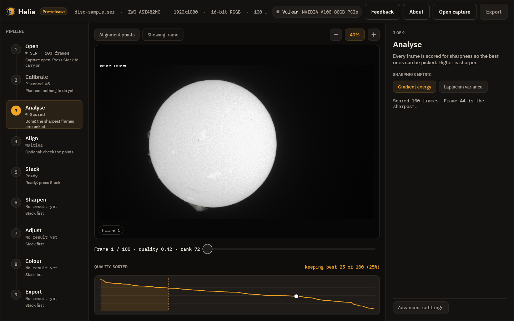

# 3. Analyse

As soon as a capture opens, Helia scores every frame for sharpness, in the
background. The rail shows **Scoring** and then **Scored**; while it works a
notice shows a count and the time left. You can look at the capture meanwhile.

## The quality curve

Under the viewer, **Quality, sorted** plots every frame's score from the best on
the left to the worst on the right. Read it like this:

* A curve that falls steeply at the left and then flattens means a few frames were
  much sharper than the rest, which is typical in poor seeing. Keeping fewer
  frames helps.
* A curve that is nearly flat means the seeing was steady, or the frames are all
  about as good, and keeping more frames costs little.
* The **dashed line** marks where the kept frames end, the shaded area is the kept
  set, and the white dot is the frame on screen. Hover to read a rank; click to
  jump to that frame.

The scrubber reads, for example, `Frame 1 / 100 · quality 0.42 · rank 72`. Quality
runs from 0 (the worst frame) to 1 (the best); rank 1 is the sharpest. So this
first frame is not one of the best, which is why Helia ranks the frames itself and
does not trust the order they were recorded in.

## The metric

The inspector offers two ways to score a frame:

* **Gradient energy**, the default, is the mean squared gradient of the frame.
* **Laplacian variance** is the variance of the Laplacian.

Both ignore overall brightness, so a brighter frame does not look sharper.
Changing the metric scores the capture again. Most users never change it; see
[How stacking works](../user-guide/how-stacking-works.md).

## Next

[Align](04-align.md).
